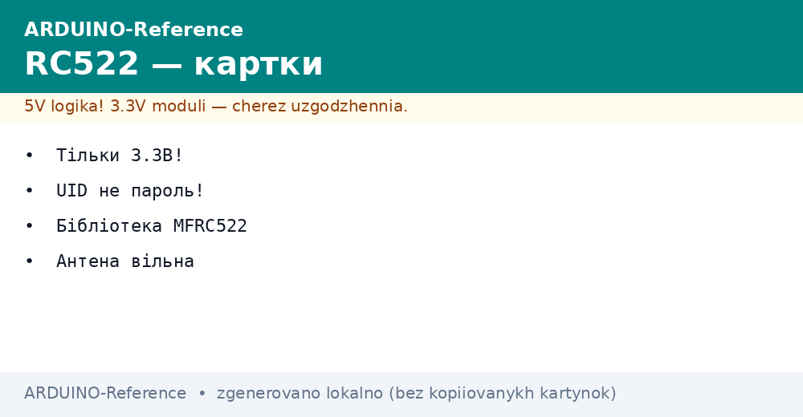
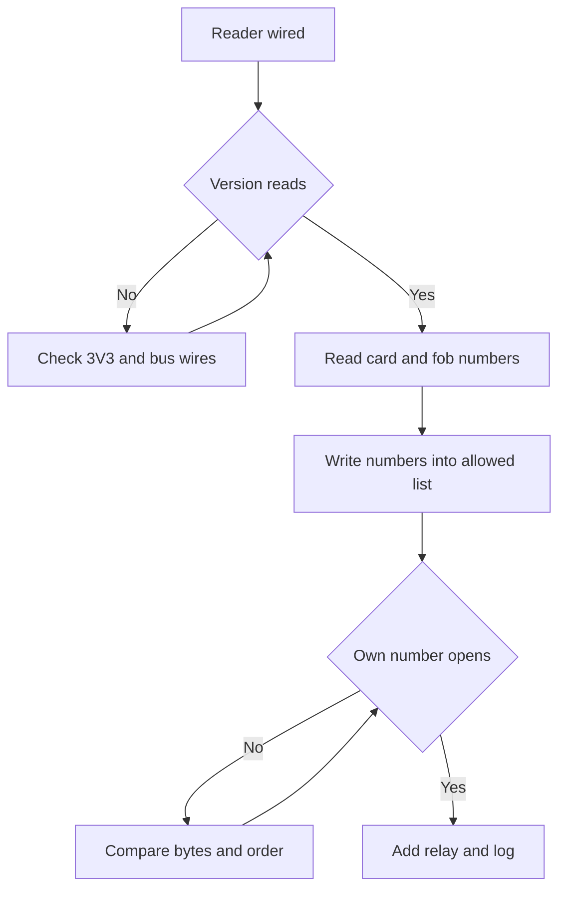

# RC522 RFID - Card Reader over SPI


*Fig. RC522 module with antenna, power through 3.3 V, card near coil, UID read by SPI.*

> [!tip] Purpose of this note
> Read RFID cards near the board: connect module on SPI, choose 3.3 V power, read UID with library.

## 1. Purpose

RC522 reads 13.56 MHz proximity cards; outputs UID over SPI.

Used for access control, identification, counters.

## 2. Module characteristics

| Parameter | Value | Note |
| --- | --- | --- |
| Frequency | 13.56 MHz | NFC/RFID |
| Interface | SPI | CS, MOSI, MISO, SCK |
| Power | 3.3 V | Never 5 V |
| Card type | MIFARE 1K/4K, UID 4 bytes | Most common |

## 3. Connection

| RC522 | Board |
| --- | --- |
| 3.3V | 3.3V |
| RST | Any digital |
| CS | Any digital |
| MOSI | MOSI |
| MISO | MISO |
| SCK | SCK |
| GND | GND |

Keep wires under ten centimeters; shared ground next to bus.
Never feed VCC from 5 V rail; chip overheats and goes silent.
Read firmware version register first; empty reply means wiring fault.

## 3.1 Only three volts

Board 5 V kills the reader die slowly: heat, then silence.
Check VCC marking near comb; measure before first start.
Logic lines tolerate board levels through module dividers on most carriers.
Bare chips need external dividers; ready modules usually include them.
Antenna coil stays clear of metal; plastic spacer keeps range.

## 4. Library MFRC522

Install by GitHub or library manager.

```cpp
#include <SPI.h>
#include <MFRC522.h>
MFRC522 mfrc522(10, 9); // CS, RST
void setup() { SPI.begin(); mfrc522.PCD_Init(); }
void loop() { if (mfrc522.PICC_IsNewCardPresent() && mfrc522.PICC_ReadCardSerial()) { Serial.print("UID:"); for (byte i=0; i<mfrc522.uid.size; i++) Serial.print(mfrc522.uid.uidByte[i], HEX); } }
```

Dump version with `PCD_DumpVersionToSerial`; expect v1 or v2 reply.
`PICC_IsNewCardPresent` polls field; `PICC_ReadCardSerial` latches UID bytes.
Halt card with `PICC_HaltA` after read to let next tag enter field.
Print UID in HEX with leading zeros; compare byte arrays, not strings.

## 5. UID and access

UID is unique; compare with allowed list; open only on match.

Read both tags from kit and store both numbers; single entry leaves second fob dead.
UID is an identifier, not a password: cloned tag opens the same lock.
For serious protection use crypto sectors or another system; UID suits attendance and bins.
Log every opening with timestamp; unknown UID blinks refusal without relay click.

## 5.1 UID reading sketch

Poll loop prints UID lines to monitor; hold card steady over coil center.
Debounce repeats: ignore same UID within two seconds to avoid log flood.
Store allowed UIDs in array in PROGMEM; compare length then bytes.
Drive relay through transistor with separate supply; never from pin directly.
Add buzzer beep on grant and double beep on deny for audible feedback.

## 5.2 Access control sketch

Allowed list check gates relay pulse of three seconds plus log line.
Unknown card increments counter; third miss locks reader for thirty seconds.
Keep relay wiring away from antenna; clicks induce false reads on long wires.
Test with card in clean plastic; metal cases and phones block the field.
Backup allowed list on paper; reflash wipes RAM copy on power loss.

## Mermaid: from read to lock



## 6. Common issues

| # | Issue | Fix |
| --- | --- | --- |
| 1 | No read | Check 3.3 V, antenna orientation |
| 2 | Wrong UID | Check card type |
| 3 | SPI error | Verify CS and RST pins |
| 4 | 5V feed heat | Only 3V3 on VCC, measure rail |
| 5 | Long wires noise | Short wires, ground nearby |
| 6 | Copy opens lock | UID is pass, not secret - use other system for vaults |
| 7 | Second fob dead | Read and store both kit numbers |
| 8 | Relay resets reader | Transistor switch with separate supply |

## 7. RC522 quick cheat sheet

| Task | Action |
| --- | --- |
| Version | Dump register, expect v1/v2 |
| Read UID | Present card, print HEX bytes |
| Allow list | Array compare, halt after read |
| Relay | Transistor, 3 s pulse, log line |
| Range | Clean plastic close to coil |
| Second fob | Store both kit numbers at setup |
| Deny path | Double beep, no relay click |

## 7.1 Antenna range and placement

Coil center gives best read; edges need closer approach.
Keep metal screws and shields five centimeters from coil face.
Phones in same hand detune the field; present card alone.
Test range with slow approach; record centimeters in build log.

## Official sources

- [MFRC522 library on docs.arduino.cc](https://docs.arduino.cc/libraries/mfrc522/) - install, UID read example, call reference.
- [SPI reference on arduino.cc](https://www.arduino.cc/en/Reference/SPI) - bus signals, speeds, sharing rules.

## See also

- [Home](../../../../ARDUINO-Reference/Home.md)
- [Fast bus](../../../../ARDUINO-Reference/UA/04-Shini/02-SPI.md)
