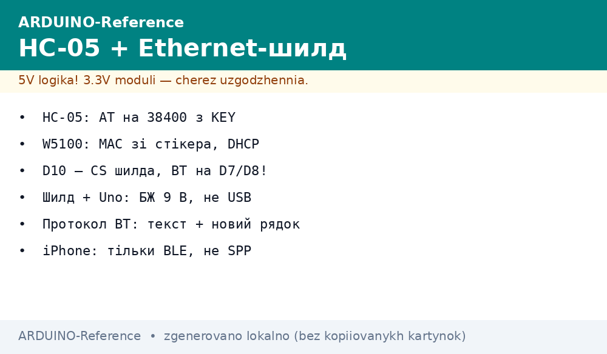
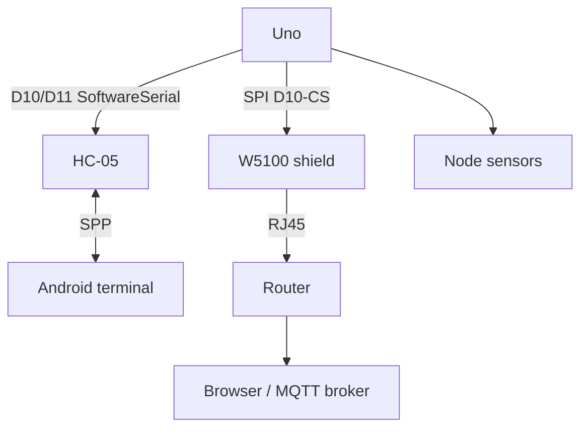

# BT Ethernet - Bluetooth and Wired Link

*Fig. Dual module: Bluetooth for wireless, Ethernet for wired, UART to board.*

> [!tip] Purpose of this note
> Connect to devices by wireless or wire: set module through UART, choose protocol.

## 1. Purpose

Module provides both interfaces; useful for flexible systems.

## 2. Characteristics

| Interface | Protocol | Use |
| --- | --- | --- |
| Bluetooth | Serial profile | Phone, PC link |
| Ethernet | TCP/IP | Network, server |

## 3. Connection

UART to module; module to network or phone.

| HC-05 | Board | Note |
| --- | --- | --- |
| VCC | 5 V | Module carrier with regulator |
| GND | GND | Common ground |
| TX | RX via divider | 3.3 V logic |
| RX | TX via divider | 3.3 V logic |
| KEY | D9 or button | HIGH before power for AT mode |

| W5100/W5500 shield | Board | Note |
| --- | --- | --- |
| MOSI/D11 | MOSI | Shared SPI |
| MISO/D12 | MISO | Shared SPI |
| SCK/D13 | SCK | Shared SPI |
| CS/D10 | D10 | Shield select, keep free |
| SD_CS/D4 | D4 | Card slot select |

Keep BT off shield pins D10-D13; move BT to D7/D8 software port.
Shield draws near USB limit; feed board from 9 V 1 A unit into VIN.
Check link LEDs on RJ45; dark means cable or switch port fault.

## 3.1 HC-05 minimum

Enter AT mode with KEY HIGH before applying power; port 38400 in AT mode.
Rename module and set PIN with AT commands; data mode runs at 9600.
Pair from phone settings, then press Connect in terminal app: pair alone is not link.
iPhones lack SPP profile; HC-05 suits Android and PC only.
Test loopback first: wire TX to RX on module and echo typed chars.

## 3.2 Ethernet shield minimum

DHCP gives address automatically; print it to monitor before browser test.
No DHCP gives `0.0.0.0`: set static `192.168.1.177` with gateway and mask.
SD slot shares SPI; Ethernet D10 and SD D4 are sacred, never swap.
Call `Ethernet.maintain()` in loop for DHCP lease; static IP skips it.
Serve tiny pages from RAM first; SD pages second after link works.

## 4. Common issues

| # | Issue | Fix |
| --- | --- | --- |
| 1 | No BT pair | Check pairing mode |
| 2 | No Ethernet | Check cables and IP |
| 3 | HC-05 silent in AT | KEY HIGH before power, port 38400 |
| 4 | Paired but no data | Press connect in terminal app, pair is not enough |
| 5 | Ethernet 0.0.0.0 | No DHCP or cable - static 192.168.1.177, check link LEDs |
| 6 | Shield hangs on USB | Feed 9V 1A into VIN, USB is at limit |
| 7 | D10 conflict | BT to D7/D8, leave D10-D13 to shield |
| 8 | iPhone sees nothing | iOS lacks SPP - BLE modules only |

## 5. Bluetooth pairing

Use default PIN 1234 or 0000; pair from phone settings.

Change PIN after first link; default codes invite strangers.
Unpair old phones before new tests; one active link at a time.
Keep antenna clear of metal enclosure; range drops to meters inside box.

## 6. Ethernet IP

Set static IP: 192.168.1.100; gateway 192.168.1.1.

Reserve static address outside DHCP pool to avoid collisions.
Print address, gateway, and mask to monitor on every boot.
Ping board from PC before opening browser; no ping means wire fault.

## 7. Protocol selection

Bluetooth serial for short range; Ethernet TCP for network.

Phone terminal over SPP for field tweaks; Ethernet MQTT for home hub.
One sensor can feed both: BT for phone display, Ethernet for logger.
Switch transports without changing payload format: same CSV both ways.

## 7.1 Working code

BT bridge forwards software-port bytes to monitor and back.
Ethernet web server answers `GET /` with sensor values page.
Close each Ethernet client with `stop()` after reply; leaks hang the shield.
Throttle page refresh to two seconds; faster polls flood sockets.

## 8. Security

Use passwords for Bluetooth; firewall rules for Ethernet.

Disable AT mode in product; KEY floating invites reconfiguration.
Filter Ethernet clients by subnet; no port forward without password page.
Log unknown BT addresses; repeated misses mean scanning neighbor.

## 8.1 Power and mounting

Star ground from supply to board, shield, and sensors.
Ventilate shield; warm regulator is normal, hot means overload.
Mount RJ45 toward enclosure wall cutout; strain relief on cable.
Keep BT antenna three centimeters from shield can for range.

## Mermaid: BT and Ethernet link

## Official sources

- [HC-05 Bluetooth Module (Components101)](https://components101.com/wireless/hc-05-bluetooth-module) - pins, AT, modes.
- [Ethernet Shield Rev2 (Arduino docs)](https://docs.arduino.cc/hardware/ethernet-shield-rev2/) - W5500, SD slot, library.
- [Language Reference (Arduino docs)](https://docs.arduino.cc/language-reference/) - SoftwareSerial, Ethernet, SPI.

## See also

- [Home](../../../../ARDUINO-Reference/Home.md)
- [UART bus](../../../../ARDUINO-Reference/UA/04-Shini/01-UART.md)
- [Fast bus](../../../../ARDUINO-Reference/UA/04-Shini/02-SPI.md)
