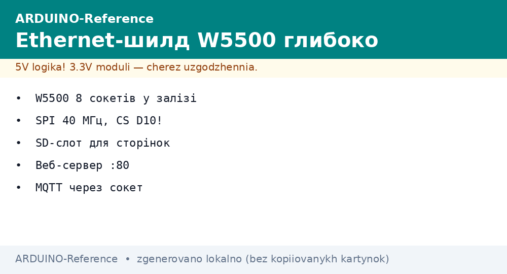
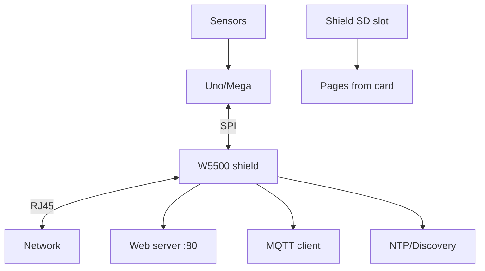

# Ethernet W5500 Deep - TCP/IP Stack over SPI


*Fig. W5500 module with SPI to board, RJ45 connector, IP setup, TCP sockets.*

> [!tip] Purpose of this note
> Add network to Arduino: connect W5500 on SPI, set IP, open socket, send data.

## 1. Purpose

W5500 is an Ethernet chip with TCP/IP stack; library handles sockets.

Used for servers, clients, remote control.

## 2. Module characteristics

| Parameter | Value | Note |
| --- | --- | --- |
| Chip | W5500 | Hardware TCP/IP |
| Interface | SPI | CS, MOSI, MISO, SCK |
| Power | 3.3 V | Module often has 3.3 V reg or needs it |
| Connector | RJ45 | Standard Ethernet |

## 3. Connection

| W5500 | Board |
| --- | --- |
| VCC | 3.3 V or 5 V if module accepts |
| GND | GND |
| MOSI | MOSI |
| MISO | MISO |
| SCK | SCK |
| CS | Any digital |
| INT | Any digital (optional) |

## 4. Library Ethernet3 or W5500

```cpp
#include <SPI.h>
#include <Ethernet3.h>
byte mac[] = { 0xDE, 0xAD, 0xBE, 0xEF, 0xFE, 0xED };
void setup() { Ethernet.begin(mac); }
void loop() {}
```

## 5. IP setup

Can use DHCP or static; static needs gateway and subnet.

Print assigned address to monitor on boot; `0.0.0.0` means no DHCP or cable.
Test with static `192.168.1.177`, mask `255.255.255.0`, gateway `192.168.1.1`.
Ping from PC before browser; no ping means wire or switch fault.
Call `Ethernet.maintain()` each loop for DHCP lease renewal.

## 6. Socket example

```cpp
EthernetServer server(80);
void setup() { server.begin(); }
void loop() { EthernetClient client = server.available(); if (client) { client.println("HTTP/1.1 200 OK"); client.println(); } }
```

Close every client with `client.stop()` after reply; open sockets exhaust fast.
Read request line before answering; ignore favicon noise with empty reply.
Serve from RAM first; SD file pages second after link proves stable.
Limit page to few kilobytes; large `index.htm` stalls on small RAM.

## 6.1 Ethernet library detail

Ethernet3 targets W5500; classic Ethernet targets W5100; pick per shield marking.
Init with MAC sticker value; duplicate MACs collide on one LAN.
Socket count is eight on W5500; serve one client at a time in loop.
`linkStatus()` reports cable state; check before blaming code.
Update library via manager; old versions miss W5500 reset sequence.

## 7. Common issues

| # | Issue | Fix |
| --- | --- | --- |
| 1 | No connection | Check cable, IP, gateway |
| 2 | SPI error | Verify CS |
| 3 | No data | Check library and pins |
| 4 | 0.0.0.0 address | No DHCP or cable - static for test, other cable |
| 5 | Torn page | Client left open - stop after reply |
| 6 | SD vs Ethernet clash | Ethernet D10, SD D4 - never swap |
| 7 | Hangs after a minute | Missing maintain on DHCP - call it or use static |
| 8 | Slow load | Shrink page, no images, stream by chunks |

## 8. TCP client mode

Connect to remote server; send HTTP requests.

Open client to host port 80; send `GET /path HTTP/1.0` with host header.
Read reply until timeout; print status line first for debug.
Close and pause thirty seconds; fast loops trigger server bans.
NTP and MQTT run as UDP and TCP clients over same stack.

## 8.1 MQTT over Ethernet

PubSubClient publishes sensor CSV to broker topic; subscribes relay commands.
Keepalive every fifteen seconds; missed pings drop the session.
Small payloads under 128 bytes fit RAM buffers safely.
Test against public broker first, then move to local hub address.

## 9. Performance

W5500 handles up to 4 sockets; divide connections.

Serve one client per loop pass; queue others in stack hardware.
Eight sockets share 32 KB buffer; large pages split into writes.
Measure page time with `millis()`; over 500 ms means page too big.
SPI at full speed feeds W5500; long bus wires throttle throughput.

## 10. Power

Use 3.3 V; module often includes regulator.

Shield draws up to 200 mA active; more means short on bus.
Feed board from VIN supply, not bare USB, for stable rail.
Warm shield is normal; burning hot means reversed or shorted pins.
Decouple with short ground; RJ45 magnetics need solid return.

## 11. Enclosure

Protect RJ45 from moisture; mount near router.

Cutout faces wall jack; strain relief prevents contact cracks.
Keep antenna-style WiFi away from Ethernet magnetics.
Label MAC and static IP inside lid for field service.

## Mermaid: W5500 network link



## 12. Ethernet quick cheat sheet

| Task | Action |
| --- | --- |
| Init | MAC, begin, print IP |
| Serve | Available, read, reply, stop |
| Static | IP, gateway, mask for test |
| Share SPI | W5500 D10, SD D4 |
| Keep alive | Maintain on DHCP |

## Official sources

- [Ethernet Shield Rev2 (Arduino docs)](https://docs.arduino.cc/hardware/ethernet-shield-rev2/) - W5500, SD slot, pins.
- [ArduinoHttpClient (GitHub)](https://github.com/arduino-libraries/ArduinoHttpClient) - HTTP over Ethernet.
- [Language Reference (Arduino docs)](https://docs.arduino.cc/language-reference/) - SPI, SD, Ethernet.

## See also

- [Home](../../../../ARDUINO-Reference/Home.md)
- [Fast bus](../../../../ARDUINO-Reference/UA/04-Shini/02-SPI.md)
