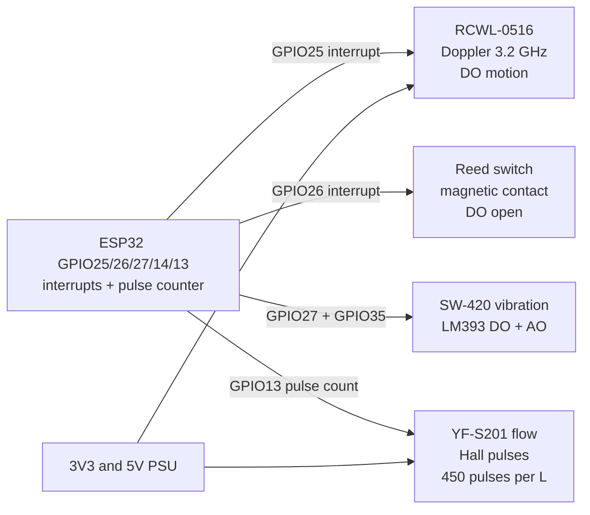

# RCWL-0516, Reed, Vibration, Tilt, Flow

## Purpose

Low-power presence and event sensors: RCWL-0516 (microwave Doppler 3.2 GHz, digital DO), reed switch (magnetic contact, digital), vibration SW-420 (digital + analog from LM393), tilt ball switch / digital, water flow YF-S201 (Hall pulse per rotation). All use digital outputs for interrupts and analog for level. Applications: room presence, door open/close, vibration alarm, tilt detection, water flow measurement.

> RCWL-0516 can trigger false positives near moving metal or moisture; set sensitivity via potentiometer and use software debounce.

## Characteristics

| Sensor | Type | Output | Range / Notes |
| --- | --- | --- | --- |
| RCWL-0516 | Microwave Doppler | DO LOW = motion | ~3-7 m, 120° cone, 3.2 GHz |
| Reed | Magnetic contact | DO LOW = open | 2-20 mm gap, 0.5 A max |
| Vibration SW-420 | Spring / piezo + LM393 | DO + AO | Sensitivity via pot |
| Tilt | Ball / mercury | DO LOW = tilt | Digital only |
| Flow YF-S201 | Hall pulse | Pulse / AO | 1-30 L/min, 450 pulses/L |

## Module pin legend

| Pin | Function | Note |
| --- | --- | --- |
| VCC | Power | 3.3-5 V; RCWL 5 V better |
| GND | Ground | Common |
| DO | Digital output | LOW = event; pull-up if open-drain |
| AO | Analog output | For vibration / flow level |

## Wiring diagram

| ESP32 | Sensor | Note |
| --- | --- | --- |
| 3V3 | VCC | 3.3 V for digital sensors |
| GND | GND | Star ground |
| GPIO25 | RCWL DO | Interrupt |
| GPIO26 | Reed DO | Interrupt |
| GPIO27 | Vibration DO | Interrupt + AO on GPIO35 |
| GPIO14 | Tilt DO | Interrupt |
| GPIO13 | Flow signal | Pulse input |

## Common issues

| No. | Error | Symptom | Solution |
| --- | --- | --- | --- |
| 1 | RCWL too sensitive / near metal | False motion | Reduce pot; add software filter 2-3 s |
| 2 | Reed without pull-up | Unreliable open | Internal pull-up or 10k to 3V3 |
| 3 | Vibration AO noisy | Random values | Average 10-20 samples; set threshold |
| 4 | Flow without pulse counter | No flow reading | Count pulses with interrupt; 450 pulses/L |

## Official sources

- RCWL-0516 Datasheet (manufacturer) - `check manually`.
- SW-420 Datasheet (van der?) - `check manually`.
- YF-S201 Datasheet - `check manually`.


*Fig. 1. RCWL-0516 presence chain: microwave, reed, vibration, tilt and flow pulse into ESP32 interrupts.*

### Signal chain



## ESP-IDF example

```c
#include "driver/gpio.h"
#include "esp_log.h"
#include "freertos/FreeRTOS.h"
#include "freertos/task.h"

#define EVT_PIN GPIO_NUM_25  // event sensors digital output, LOW = event
static const char *TAG = "gpio";
static volatile uint32_t evt_count = 0;

static void IRAM_ATTR isr_handler(void *arg) {
    evt_count++;  // keep ISR short: count only, debounce in task
}

void app_main(void) {
    gpio_config_t io = {
        .mode = GPIO_MODE_INPUT,
        .pull_up_en = GPIO_PULLUP_ENABLE,  // most modules are open-drain LOW
        .intr_type = GPIO_INTR_NEGEDGE,
        .pin_bit_mask = (1ULL << EVT_PIN),
    };
    gpio_config(&io);
    gpio_install_isr_service(0);
    gpio_isr_handler_add(EVT_PIN, isr_handler, NULL);
    // RCWL on 25, reed on 26, vibration on 27, tilt on 14, flow pulses on 13
    for (;;) {
        ESP_LOGI(TAG, "event sensors: events=%lu", (unsigned long)evt_count);
        vTaskDelay(pdMS_TO_TICKS(1000));
    }
}
```

## Arduino example

```cpp
#define EVT_PIN 25  // event sensors digital output

volatile uint32_t evt_count = 0;
void IRAM_ATTR onEvt() { evt_count++; }  // short ISR, filter in loop

void setup() {
  Serial.begin(115200);
  pinMode(EVT_PIN, INPUT_PULLUP);
  attachInterrupt(digitalPinToInterrupt(EVT_PIN), onEvt, FALLING);
  // RCWL on 25, reed on 26, vibration on 27, tilt on 14, flow pulses on 13
}

void loop() {
  static uint32_t last = 0;
  if (millis() - last > 1000) {  // 1 s software debounce window
    last = millis();
    Serial.printf("event sensors: events=%lu\n", (unsigned long)evt_count);
  }
}
```

## MicroPython example

```python
from machine import Pin
import time

evt_count = 0
last_ms = 0

def on_evt(p):
    global evt_count, last_ms
    now = time.ticks_ms()
    if time.ticks_diff(now, last_ms) > 200:  # 200 ms debounce
        last_ms = now
        evt_count += 1

pin = Pin(25, Pin.IN, Pin.PULL_UP)
pin.irq(trigger=Pin.IRQ_FALLING, handler=on_evt)
# RCWL on 25, reed on 26, vibration on 27, tilt on 14, flow pulses on 13
while True:
    print("event sensors: events=%d" % evt_count)
    time.sleep(1)
```

## Operating notes

- RCWL-0516 sees through thin walls: mount facing the room, away from metal ducts and WiFi antennas.
- Reed gap 2-20 mm: align magnet pole to sensor mark, test open and close ten times.
- SW-420 threshold pot sets LM393 trip point; AO pin shows raw vibration level for tuning.
- YF-S201 needs 450 pulses per liter: count rising edges, divide by 7.5 for L per min at 1 s gate.
- Tilt ball switches bounce for 50-200 ms: 200 ms software lockout after first edge.

## Power and wiring checklist

| Check | Rule |
| --- | --- |
| 1. Power every module from a rail it is rated for | 5 V heaters never from ESP32 3V3. |
| 2. Common ground first | star topology, ESP32 GND tied to sensor GND before signals. |
| 3. I2C always needs pull-ups | 4.7k to 3V3 when the module has none fitted. |
| 4. 5 V sensor outputs never touch GPIO directly | divider or level shifter first. |
| 5. Verify addresses and baud on the bench | I2C scan plus UART loopback before code. |
| 6. Average analog reads 10-64x | single ESP32 ADC samples are noisy by design. |

## First run and calibration

1. Wire power only, check module current against datasheet before connecting signals.
2. Run bus scan (I2C) or loopback (UART) to confirm the device answers.
3. Flash the minimal example above, confirm plausible raw values in logs.
4. Calibrate: zero/span, clean-air baseline or white reference per sensor type.
5. Stress test 30 min: heat, vibration and supply sag expose weak joints early.
6. Log raw plus converted values: raw data stays valid when formulas change.
## See also

- [EN/03-GPIO/01-GPIO-Overview.en]
- [01-DHT11-DHT22](../../../../ESP32-Reference/UA/10-Sensori/01-DHT11-DHT22.md)
