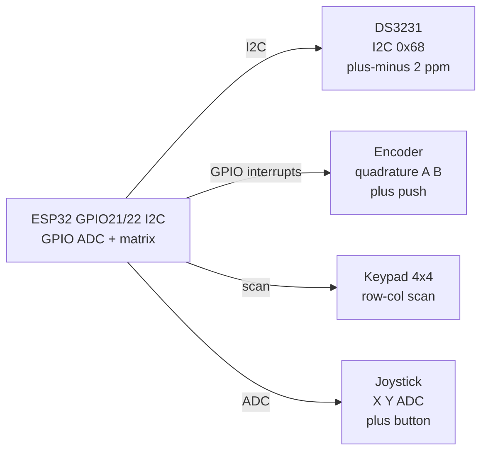

# DS3231, Encoder, Keypad, Joystick

## Purpose

Real-time clock DS3231 (I2C, temperature compensated, battery backup), rotary encoder (quadrature A/B, push), keypad matrix 4×4, analog joystick (X/Y/A + button). Applications: clocks, menu control, input devices.

## Characteristics

| Device | Interface | Features |
| --- | --- | --- |
| DS3231 | I2C 0x68 | ±2 ppm, temperature comp, alarm, 32kHz |
| Encoder | GPIO A/B + push | Quadrature, 360° or limited |
| Keypad 4×4 | GPIO row/col | Matrix scan |
| Joystick | ADC X/Y + button | Analog 0-3.3 V |

## Wiring diagram

| ESP32 | DS3231 / Encoder / Keypad / Joystick | Note |
| --- | --- | --- |
| 3V3 | VCC | 3.3 V |
| GND | GND | Common |
| GPIO21 | SDA / Encoder A / Joystick X | I2C / interrupt |
| GPIO22 | SCL / Encoder B / Joystick Y | I2C / ADC |
| GPIO4 | Encoder push / Keypad row | Pull-up |

## Common issues

| No. | Error | Symptom | Solution |
| --- | --- | --- | --- |
| 1 | DS3231 without battery | Time lost on power off | CR2032 backup, 3V battery |
| 2 | Encoder bounce | Count jumps | Software debounce 1-2 ms |
| 3 | Keypad ghosting | Wrong key | Diodes in matrix or software scan |

## Official sources

- DS3231 Datasheet (Maxim) - `check manually`.
- Encoder guide - see libraries.


*Fig. 1. DS3231 clock plus human inputs: encoder, keypad matrix and joystick into ESP32.*

### Signal chain



## ESP-IDF example

```c
#include "driver/i2c.h"
#include "esp_log.h"

#define I2C_PORT I2C_NUM_0
#define SDA_PIN  GPIO_NUM_21
#define SCL_PIN  GPIO_NUM_22
#define CHIP_ADDR 0x68   // DS3231 7-bit address, verify with i2c scan!

static const char *TAG = "ds3231";

void app_main(void) {
    i2c_config_t conf = {
        .mode = I2C_MODE_MASTER,
        .sda_io_num = SDA_PIN,
        .scl_io_num = SCL_PIN,
        .sda_pullup_en = GPIO_PULLUP_ENABLE,  // 4.7k to 3V3 if module lacks them
        .scl_pullup_en = GPIO_PULLUP_ENABLE,
        .master.clk_speed = 100000,           // start at 100 kHz, raise later
    };
    i2c_param_config(I2C_PORT, &conf);
    i2c_driver_install(I2C_PORT, conf.mode, 0, 0, 0);
    // read time registers, set alarms, enable 32 kHz output if needed
    uint8_t probe = 0;
    esp_err_t err = i2c_master_write_read_device(
        I2C_PORT, CHIP_ADDR, NULL, 0, &probe, 1, pdMS_TO_TICKS(100));
    ESP_LOGI(TAG, "%s probe: %s (0x%02X)", "DS3231",
             err == ESP_OK ? "ACK" : "NACK", probe);
}
```

## Arduino example

```cpp
#include <Wire.h>

#define CHIP_ADDR 0x68  // DS3231, verify with I2C scanner sketch

void setup() {
  Serial.begin(115200);
  Wire.begin(21, 22);  // SDA, SCL
  Wire.setClock(100000);
  // read time registers, set alarms, enable 32 kHz output if needed
  Wire.beginTransmission(CHIP_ADDR);
  uint8_t err = Wire.endTransmission();
  Serial.printf("DS3231: %s\n", err == 0 ? "found" : "NOT found, check wiring");
}

void loop() {
  // poll data register here; average 4-8 samples before use
  delay(500);
}
```

## MicroPython example

```python
from machine import I2C, Pin

i2c = I2C(0, scl=Pin(22), sda=Pin(21), freq=100000)
found = i2c.scan()
print("bus:", [hex(a) for a in found])
# read time registers, set alarms, enable 32 kHz output if needed
assert 0x68 in found, "DS3231 not on bus, check pull-ups and wiring"
print("DS3231 ready at", hex(0x68))
```

## Operating notes

- DS3231 keeps time on CR2032 for years: set once, read anytime, no NTP needed offline.
- Encoder quadrature gives direction plus steps: decode A/B edges, debounce push 2 ms.
- Keypad 4x4 needs 8 GPIO: drive rows low one by one, read columns with pull-ups.
- Joystick center sits near mid-scale: calibrate min, center, max per axis at first boot.
- DS3231 temperature register doubles as coarse room thermometer, plus-minus 3 C.

## Power and wiring checklist

| Check | Rule |
| --- | --- |
| 1. Power every module from a rail it is rated for | 5 V heaters never from ESP32 3V3. |
| 2. Common ground first | star topology, ESP32 GND tied to sensor GND before signals. |
| 3. I2C always needs pull-ups | 4.7k to 3V3 when the module has none fitted. |
| 4. 5 V sensor outputs never touch GPIO directly | divider or level shifter first. |
| 5. Verify addresses and baud on the bench | I2C scan plus UART loopback before code. |
| 6. Average analog reads 10-64x | single ESP32 ADC samples are noisy by design. |

## First run and calibration

1. Wire power only, check module current against datasheet before connecting signals.
2. Run bus scan (I2C) or loopback (UART) to confirm the device answers.
3. Flash the minimal example above, confirm plausible raw values in logs.
4. Calibrate: zero/span, clean-air baseline or white reference per sensor type.
5. Stress test 30 min: heat, vibration and supply sag expose weak joints early.
6. Log raw plus converted values: raw data stays valid when formulas change.
## See also

- [I2C](../../../../ESP32-Reference/UA/04-Shini/03-I2C.md)
- [01-DHT11-DHT22](../../../../ESP32-Reference/UA/10-Sensori/01-DHT11-DHT22.md)
