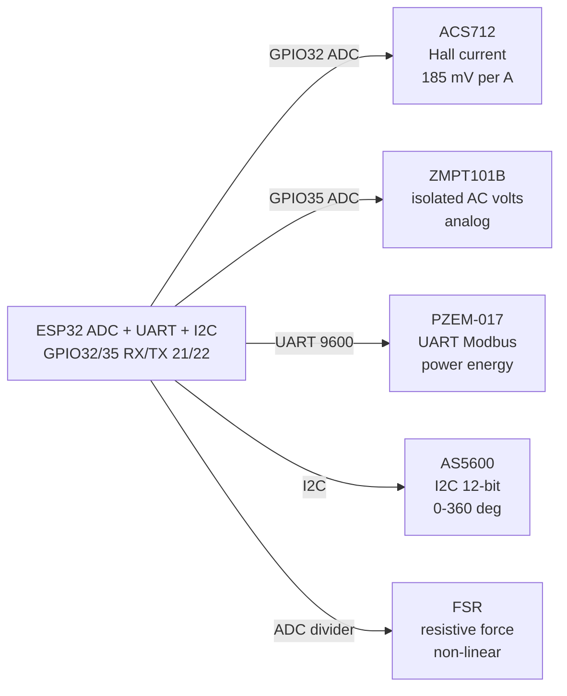

# ACS712, ZMPT101B, PZEM, AS5600, FSR

## Purpose

Current sensing ACS712 (Hall, analog 2.5V ±), voltage ZMPT101B (isolation, analog), power meter PZEM-017 (UART/Modbus), magnetic encoder AS5600 (I2C 12-bit), force sensor FSR (resistive analog). Applications: energy monitoring, position, force measurement.

## Characteristics

| Sensor | Range | Output | Note |
| --- | --- | --- | --- |
| ACS712 5A | ±5 A | Analog 2.5V ± | 185 mV/A |
| ACS712 20A | ±20 A | Analog | 100 mV/A |
| ZMPT101B | 100V AC | Analog | Isolation transformer |
| PZEM-017 | 0-100A / 0-400V | UART / Modbus | Power, energy |
| AS5600 | 0-360° | I2C 12-bit | Magnetic |
| FSR | 0-10 kg | Analog resistance | Non-linear |

## Wiring diagram

| ESP32 | Sensor | Note |
| --- | --- | --- |
| 3V3 | VCC / AS5600 SDA/SCL | 3.3 V |
| GND | GND | Star |
| GPIO32 | ACS712 AO | ADC1 |
| GPIO35 | ZMPT AO | ADC1 |
| UART RX/TX | PZEM | 9600 baud |

## Common issues

| No. | Error | Symptom | Solution |
| --- | --- | --- | --- |
| 1 | ACS712 near AC line without isolation | Noise, risk | Use isolated module; keep distance |
| 2 | ZMPT without calibration | Wrong voltage | Calibrate with known source |
| 3 | PZEM wrong baud | No data | 9600 default; check address |

## Official sources

- ACS712 Datasheet (Allegro) - `check manually`.
- PZEM manual - see manufacturer.


*Fig. 1. Mains and motion sensing: ACS712 current, ZMPT101B voltage, PZEM meter, AS5600 angle, FSR force.*

### Signal chain



## ESP-IDF example

```c
#include "driver/adc.h"
#include "esp_log.h"

#define SENSOR_CH ADC1_CHANNEL_32  // ACS712 analog output, GPIO32
static const char *TAG = "adc";

static int read_mv_avg(int n) {
    int sum = 0;
    for (int i = 0; i < n; i++) sum += adc1_get_raw(SENSOR_CH);
    // 12-bit, 11 dB attenuation: ~0-3.3 V full scale, see ADC docs
    return (sum / n) * 3300 / 4095;
}

void app_main(void) {
    adc1_config_width(ADC_WIDTH_BIT_12);
    adc1_config_channel_atten(SENSOR_CH, ADC_ATTEN_DB_11);
    int mv = read_mv_avg(16);  // average 16 samples against noise
    ESP_LOGI(TAG, "ACS712: %d mV", mv);
    // zero current sits at ~2.5 V supply-half; subtract offset, divide by 185 mV per A (5 A version)
}
```

## Arduino example

```cpp
#define SENSOR_PIN 32  // ACS712 analog output

void setup() {
  Serial.begin(115200);
  analogReadResolution(12);
  analogSetAttenuation(ADC_11db);  // ~0-3.3 V range
}

void loop() {
  long sum = 0;
  for (int i = 0; i < 16; i++) sum += analogRead(SENSOR_PIN);
  int mv = (sum / 16) * 3300 / 4095;
  Serial.printf("ACS712: %d mV\n", mv);
  // zero current sits at ~2.5 V supply-half; subtract offset, divide by 185 mV per A (5 A version)
  delay(500);
}
```

## MicroPython example

```python
from machine import ADC, Pin
import time

adc = ADC(Pin(32))
adc.atten(ADC.ATTN_11DB)      # ~0-3.3 V range
adc.width(ADC.WIDTH_12BIT)

while True:
    raw = sum(adc.read() for _ in range(16)) // 16
    mv = raw * 3300 // 4095
    print("ACS712: %d mV" % mv)
    # zero current sits at ~2.5 V supply-half; subtract offset, divide by 185 mV per A (5 A version)
    time.sleep(0.5)
```

## Operating notes

- ACS712 output centers at half supply: measure offset at zero current on every boot.
- ZMPT101B needs calibration against a known AC source; multiturn pot sets gain on module.
- PZEM-017 speaks Modbus at 9600 baud default: energy counter survives module power loss.
- AS5600 magnet gap 0.5-3 mm centered on chip: check AGC register for magnet range.
- FSR is strongly non-linear: use log lookup table, preload slightly to skip dead zone.

## Power and wiring checklist

| Check | Rule |
| --- | --- |
| 1. Power every module from a rail it is rated for | 5 V heaters never from ESP32 3V3. |
| 2. Common ground first | star topology, ESP32 GND tied to sensor GND before signals. |
| 3. I2C always needs pull-ups | 4.7k to 3V3 when the module has none fitted. |
| 4. 5 V sensor outputs never touch GPIO directly | divider or level shifter first. |
| 5. Verify addresses and baud on the bench | I2C scan plus UART loopback before code. |
| 6. Average analog reads 10-64x | single ESP32 ADC samples are noisy by design. |

## First run and calibration

1. Wire power only, check module current against datasheet before connecting signals.
2. Run bus scan (I2C) or loopback (UART) to confirm the device answers.
3. Flash the minimal example above, confirm plausible raw values in logs.
4. Calibrate: zero/span, clean-air baseline or white reference per sensor type.
5. Stress test 30 min: heat, vibration and supply sag expose weak joints early.
6. Log raw plus converted values: raw data stays valid when formulas change.
## See also

- [ADC](../../../../ESP32-Reference/UA/06-Analog/01-ADC.md)
- [UART](../../../../ESP32-Reference/UA/04-Shini/01-UART.md)
