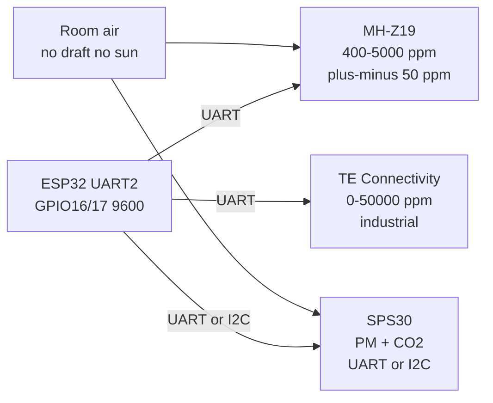

# Gas CO2 Precision

## Purpose

High-precision CO2 sensors using NDIR (non-dispersive infrared): MH-Z19 (UART, 400-5000 ppm, ±50 ppm), Sensirion SPS30 (UART/I2C, PM1/2.5/10 + CO2, ±10% or ±40 ppm), TE Connectivity (industrial). Applications: indoor air quality, demand-controlled ventilation.

## Characteristics

| Model | Range | Interface | Accuracy | Note |
| --- | --- | --- | --- |
| MH-Z19 | 400-5000 ppm | UART 9600 | ±50 ppm + 3% | 3.3-5 V, warm-up 3 min |
| SPS30 | 400-10000 ppm | UART/I2C | ±10% or ±40 ppm | Also PM |
| TE | 0-50000 ppm | UART/I2C | ±3% | Industrial |

## Common issues

| No. | Error | Symptom | Solution |
| --- | --- | --- | --- |
| 1 | No warm-up | Wrong initial reading | Wait 3-5 min after power-on |
| 2 | Direct sunlight / draft | Drift | Shield, avoid direct airflow |
| 3 | Incorrect UART baud | No data | Default 9600; check address |

## Official sources

- MH-Z19 Datasheet (Winsen) - `check manually`.
- SPS30 Datasheet (Sensirion) - `check manually`.


*Fig. 1. NDIR CO2 sensing: MH-Z19 UART, SPS30 particulate plus CO2, industrial TE probe.*

### Signal chain



## ESP-IDF example

```c
#include "driver/uart.h"
#include "esp_log.h"

#define UART_PORT UART_NUM_2
#define RX_PIN 16
#define TX_PIN 17
#define BAUD 9600   // MH-Z19 default rate, check datasheet
static const char *TAG = "uart";

void app_main(void) {
    uart_config_t cfg = {
        .baud_rate = BAUD,
        .data_bits = UART_DATA_8_BITS,
        .parity = UART_PARITY_DISABLE,
        .stop_bits = UART_STOP_BITS_1,
        .flow_ctrl = UART_HW_FLOWCTRL_DISABLE,
    };
    uart_param_config(UART_PORT, &cfg);
    // RX buffer 2x frame: MH-Z19 frames are short but bursty
    uart_driver_install(UART_PORT, 2048, 0, 0, NULL, 0);
    uart_set_pin(UART_PORT, TX_PIN, RX_PIN, UART_PIN_NO_CHANGE, UART_PIN_NO_CHANGE);
    // send 9-byte read command, parse bytes 2-3 as ppm high-low
    uint8_t frame[64];
    int n = uart_read_bytes(UART_PORT, frame, sizeof(frame), pdMS_TO_TICKS(2000));
    ESP_LOGI(TAG, "MH-Z19: got %d bytes", n);
}
```

## Arduino example

```cpp
#include <HardwareSerial.h>

HardwareSerial sens(2);  // UART2: RX 16, TX 17

void setup() {
  Serial.begin(115200);
  sens.begin(9600, SERIAL_8N1, 16, 17);
  // send 9-byte read command, parse bytes 2-3 as ppm high-low
}

void loop() {
  if (sens.available()) {
    String line = sens.readStringUntil('\n');
    Serial.printf("MH-Z19: %s\n", line.c_str());
  }
  delay(200);
}
```

## MicroPython example

```python
from machine import UART
import time

u = UART(2, baudrate=9600, rx=16, tx=17, timeout=2000)
# send 9-byte read command, parse bytes 2-3 as ppm high-low
while True:
    if u.any():
        print("MH-Z19:", u.readline())
    time.sleep(0.2)
```

## Operating notes

- MH-Z19 needs 3 min warm-up: ignore first readings, then zero-calibrate in fresh outdoor air.
- ABC auto-calibration assumes nightly fresh air: disable ABC in bedrooms kept closed.
- SPS30 fan needs clean airflow: vacuum inlet monthly, avoid condensing humidity.
- Mount at breathing height 1-1.5 m, away from windows, doors and direct heater draft.
- Ventilation control band 800-1200 ppm: start fan at 1000, stop at 800 hysteresis.

## Power and wiring checklist

| Check | Rule |
| --- | --- |
| 1. Power every module from a rail it is rated for | 5 V heaters never from ESP32 3V3. |
| 2. Common ground first | star topology, ESP32 GND tied to sensor GND before signals. |
| 3. I2C always needs pull-ups | 4.7k to 3V3 when the module has none fitted. |
| 4. 5 V sensor outputs never touch GPIO directly | divider or level shifter first. |
| 5. Verify addresses and baud on the bench | I2C scan plus UART loopback before code. |
| 6. Average analog reads 10-64x | single ESP32 ADC samples are noisy by design. |

## First run and calibration

1. Wire power only, check module current against datasheet before connecting signals.
2. Run bus scan (I2C) or loopback (UART) to confirm the device answers.
3. Flash the minimal example above, confirm plausible raw values in logs.
4. Calibrate: zero/span, clean-air baseline or white reference per sensor type.
5. Stress test 30 min: heat, vibration and supply sag expose weak joints early.
6. Log raw plus converted values: raw data stays valid when formulas change.
## See also

- [22-Gas-2-VOC-Industrial](../../../../ESP32-Reference/UA/10-Sensori/22-Gas-2-VOC-Industrial.md)
