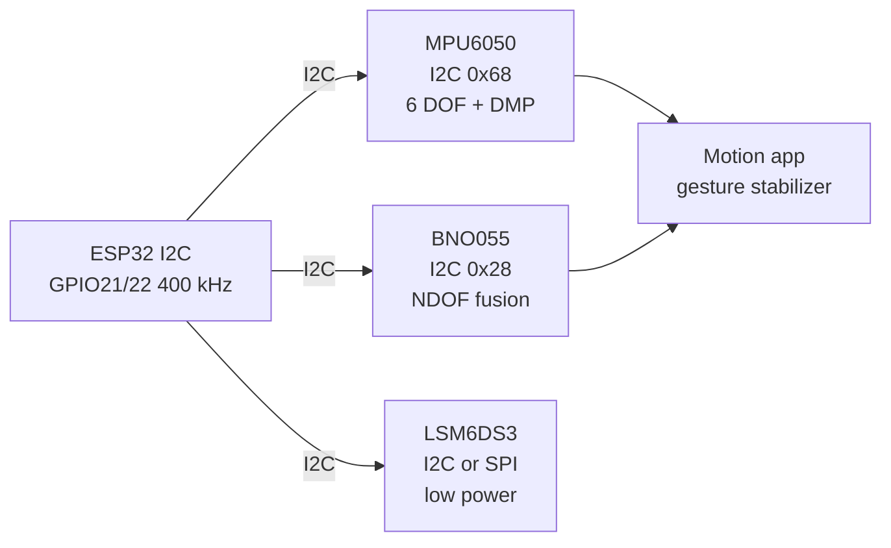

# IMU 6-9 DOF

## Purpose

Inertial measurement units for motion tracking: MPU6050 (I2C 6 DOF accel+gyro, DMP), BNO055 (I2C 9 DOF with fusion, absolute), LSM6DS3, ADXL345, MMA8452. Applications: motion detection, orientation, gesture, stabilization.

## Characteristics

| IMU | DOF | Interface | Features |
| --- | --- | --- | --- |
| MPU6050 | 6 | I2C 0x68 | DMP, 6-axis |
| BNO055 | 9 | I2C 0x28 | Fusion, absolute |
| LSM6DS3 | 6 | I2C/SPI | Low power |

## Common issues

| No. | Error | Symptom | Solution |
| --- | --- | --- | --- |
| 1 | MPU6050 no DMP | No quaternion | Use library with DMP support |
| 2 | BNO055 wrong mode | No orientation | Enable NDOF mode |

## Official sources

- MPU6050 Datasheet (InvenSense) - `check manually`.
- BNO055 Datasheet (Bosch) - `check manually`.


*Fig. 1. IMU motion chain: MPU6050 and LSM6DS3 raw axes, BNO055 fused orientation into ESP32.*

### Signal chain



## ESP-IDF example

```c
#include "driver/i2c.h"
#include "esp_log.h"

#define I2C_PORT I2C_NUM_0
#define SDA_PIN  GPIO_NUM_21
#define SCL_PIN  GPIO_NUM_22
#define CHIP_ADDR 0x68   // MPU6050 7-bit address, verify with i2c scan!

static const char *TAG = "mpu6050";

void app_main(void) {
    i2c_config_t conf = {
        .mode = I2C_MODE_MASTER,
        .sda_io_num = SDA_PIN,
        .scl_io_num = SCL_PIN,
        .sda_pullup_en = GPIO_PULLUP_ENABLE,  // 4.7k to 3V3 if module lacks them
        .scl_pullup_en = GPIO_PULLUP_ENABLE,
        .master.clk_speed = 100000,           // start at 100 kHz, raise later
    };
    i2c_param_config(I2C_PORT, &conf);
    i2c_driver_install(I2C_PORT, conf.mode, 0, 0, 0);
    // wake device, set gyro and accel full scale, read 14-byte burst
    uint8_t probe = 0;
    esp_err_t err = i2c_master_write_read_device(
        I2C_PORT, CHIP_ADDR, NULL, 0, &probe, 1, pdMS_TO_TICKS(100));
    ESP_LOGI(TAG, "%s probe: %s (0x%02X)", "MPU6050",
             err == ESP_OK ? "ACK" : "NACK", probe);
}
```

## Arduino example

```cpp
#include <Wire.h>

#define CHIP_ADDR 0x68  // MPU6050, verify with I2C scanner sketch

void setup() {
  Serial.begin(115200);
  Wire.begin(21, 22);  // SDA, SCL
  Wire.setClock(100000);
  // wake device, set gyro and accel full scale, read 14-byte burst
  Wire.beginTransmission(CHIP_ADDR);
  uint8_t err = Wire.endTransmission();
  Serial.printf("MPU6050: %s\n", err == 0 ? "found" : "NOT found, check wiring");
}

void loop() {
  // poll data register here; average 4-8 samples before use
  delay(500);
}
```

## MicroPython example

```python
from machine import I2C, Pin

i2c = I2C(0, scl=Pin(22), sda=Pin(21), freq=100000)
found = i2c.scan()
print("bus:", [hex(a) for a in found])
# wake device, set gyro and accel full scale, read 14-byte burst
assert 0x68 in found, "MPU6050 not on bus, check pull-ups and wiring"
print("MPU6050 ready at", hex(0x68))
```

## Operating notes

- MPU6050 sleeps at power-on: write PWR_MGMT_1 zero first or every read returns zeros.
- BNO055 NDOF needs magnetometer calibration: wave figure-eight until status reads 3.
- Mount IMU rigidly near rotation center: soft mounts add phase lag to stabilization loops.
- Gyro bias drifts with temperature: average 200 samples at rest on boot, subtract live.
- Run I2C at 400 kHz for 100 Hz+ sample rates; 100 kHz starves 6-axis bursts.

## Power and wiring checklist

| Check | Rule |
| --- | --- |
| 1. Power every module from a rail it is rated for | 5 V heaters never from ESP32 3V3. |
| 2. Common ground first | star topology, ESP32 GND tied to sensor GND before signals. |
| 3. I2C always needs pull-ups | 4.7k to 3V3 when the module has none fitted. |
| 4. 5 V sensor outputs never touch GPIO directly | divider or level shifter first. |
| 5. Verify addresses and baud on the bench | I2C scan plus UART loopback before code. |
| 6. Average analog reads 10-64x | single ESP32 ADC samples are noisy by design. |

## First run and calibration

1. Wire power only, check module current against datasheet before connecting signals.
2. Run bus scan (I2C) or loopback (UART) to confirm the device answers.
3. Flash the minimal example above, confirm plausible raw values in logs.
4. Calibrate: zero/span, clean-air baseline or white reference per sensor type.
5. Stress test 30 min: heat, vibration and supply sag expose weak joints early.
6. Log raw plus converted values: raw data stays valid when formulas change.
## See also

- [04-MPU6050](../../../../ESP32-Reference/UA/10-Sensori/04-MPU6050.md)
- [16-HMC5883-BNO055-RFID-RC522-Barcode](../../../../ESP32-Reference/UA/10-Sensori/16-HMC5883-BNO055-RFID-RC522-Barcode.md)
