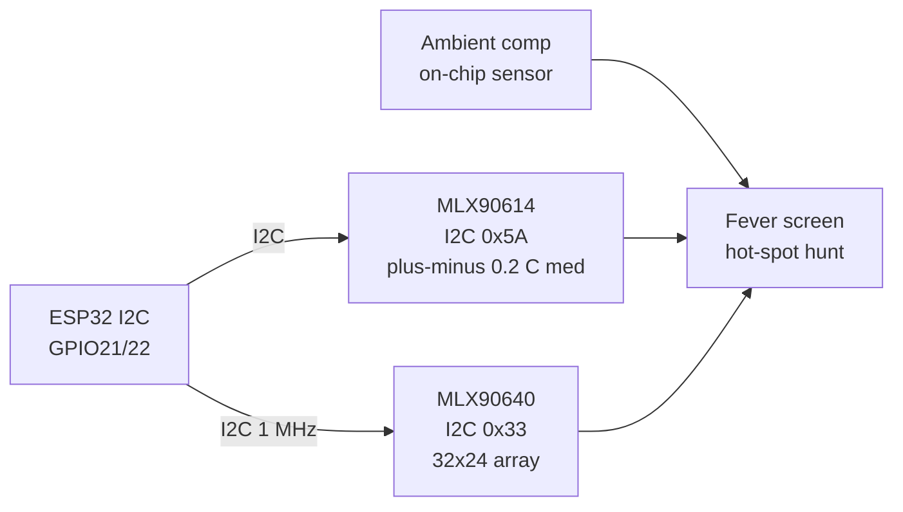

# Bio-IR Temperature

## Purpose

Non-contact infrared temperature sensors for body/industrial measurement: MLX90614 (I2C, 32x32 pixels or single point, medical version ±0.2 °C), MLX90640 (32x24 array, I2C, 32x32 possible with interpolation). Applications: fever screening, non-contact thermometry.

## Characteristics

| Sensor | Array | Range | Accuracy | Note |
| --- | --- | --- | --- |
| MLX90614 | 1-32x32 | −70…382 °C | ±0.2 °C (medical) | I2C 0x5A |
| MLX90640 | 32x24 | −40…300 °C | ±1.5 °C | I2C 0x33 |

## Common issues

| No. | Error | Symptom | Solution |
| --- | --- | --- | --- |
| 1 | No ambient compensation | Wrong reading | Use ambient sensor or library compensation |
| 2 | Emissivity wrong | Low/high value | Set emissivity 0.95 for skin |

## Official sources

- MLX90614 Datasheet (Melexis) - `check manually`.
- MLX90640 Datasheet (Melexis) - `check manually`.


*Fig. 1. Non-contact temperature: MLX90614 point sensor and MLX90640 array into ESP32.*

### Signal chain



## ESP-IDF example

```c
#include "driver/i2c.h"
#include "esp_log.h"

#define I2C_PORT I2C_NUM_0
#define SDA_PIN  GPIO_NUM_21
#define SCL_PIN  GPIO_NUM_22
#define CHIP_ADDR 0x5A   // MLX90614 7-bit address, verify with i2c scan!

static const char *TAG = "mlx90614";

void app_main(void) {
    i2c_config_t conf = {
        .mode = I2C_MODE_MASTER,
        .sda_io_num = SDA_PIN,
        .scl_io_num = SCL_PIN,
        .sda_pullup_en = GPIO_PULLUP_ENABLE,  // 4.7k to 3V3 if module lacks them
        .scl_pullup_en = GPIO_PULLUP_ENABLE,
        .master.clk_speed = 100000,           // start at 100 kHz, raise later
    };
    i2c_param_config(I2C_PORT, &conf);
    i2c_driver_install(I2C_PORT, conf.mode, 0, 0, 0);
    // read object register, apply emissivity 0.95 for skin, slow bus to 100 kHz
    uint8_t probe = 0;
    esp_err_t err = i2c_master_write_read_device(
        I2C_PORT, CHIP_ADDR, NULL, 0, &probe, 1, pdMS_TO_TICKS(100));
    ESP_LOGI(TAG, "%s probe: %s (0x%02X)", "MLX90614",
             err == ESP_OK ? "ACK" : "NACK", probe);
}
```

## Arduino example

```cpp
#include <Wire.h>

#define CHIP_ADDR 0x5A  // MLX90614, verify with I2C scanner sketch

void setup() {
  Serial.begin(115200);
  Wire.begin(21, 22);  // SDA, SCL
  Wire.setClock(100000);
  // read object register, apply emissivity 0.95 for skin, slow bus to 100 kHz
  Wire.beginTransmission(CHIP_ADDR);
  uint8_t err = Wire.endTransmission();
  Serial.printf("MLX90614: %s\n", err == 0 ? "found" : "NOT found, check wiring");
}

void loop() {
  // poll data register here; average 4-8 samples before use
  delay(500);
}
```

## MicroPython example

```python
from machine import I2C, Pin

i2c = I2C(0, scl=Pin(22), sda=Pin(21), freq=100000)
found = i2c.scan()
print("bus:", [hex(a) for a in found])
# read object register, apply emissivity 0.95 for skin, slow bus to 100 kHz
assert 0x5A in found, "MLX90614 not on bus, check pull-ups and wiring"
print("MLX90614 ready at", hex(0x5A))
```

## Operating notes

- Skin emissivity 0.95-0.98: wrong setting shifts fever readings by whole degrees.
- Measure forehead at 3-5 cm, no sweat or cosmetics: distance changes spot size fast.
- MLX90640 needs 1 MHz I2C for 16 Hz frames: 100 kHz gives slideshow, not video.
- Let sensor equalize to room for 10 min: cold sensor on warm face reads low.
- Black tape reference patch gives known emissivity anchor for calibration checks.

## Power and wiring checklist

| Check | Rule |
| --- | --- |
| 1. Power every module from a rail it is rated for | 5 V heaters never from ESP32 3V3. |
| 2. Common ground first | star topology, ESP32 GND tied to sensor GND before signals. |
| 3. I2C always needs pull-ups | 4.7k to 3V3 when the module has none fitted. |
| 4. 5 V sensor outputs never touch GPIO directly | divider or level shifter first. |
| 5. Verify addresses and baud on the bench | I2C scan plus UART loopback before code. |
| 6. Average analog reads 10-64x | single ESP32 ADC samples are noisy by design. |

## First run and calibration

1. Wire power only, check module current against datasheet before connecting signals.
2. Run bus scan (I2C) or loopback (UART) to confirm the device answers.
3. Flash the minimal example above, confirm plausible raw values in logs.
4. Calibrate: zero/span, clean-air baseline or white reference per sensor type.
5. Stress test 30 min: heat, vibration and supply sag expose weak joints early.
6. Log raw plus converted values: raw data stays valid when formulas change.
## See also

- [30-Temp-Precision](../../../../ESP32-Reference/UA/10-Sensori/30-Temp-Precision.md)
