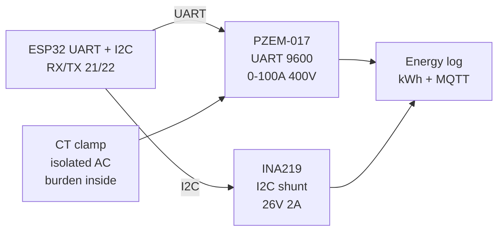

# Energy Meters

## Purpose

Energy and power measurement modules: PZEM-017 (UART, 0-100A/400V, energy), INA219 with shunt (I2C, 26V 2A), ACE712, CT clamp, wattmeter modules. Applications: home energy monitoring, solar tracking.

## Characteristics

| Module | Interface | Range | Accuracy |
| --- | --- | --- | --- |
| PZEM-017 | UART | 0-100A / 0-400V | ±1% |
| INA219 | I2C | 26V / 2A | ±0.5% |

## Common issues

| No. | Error | Symptom | Solution |
| --- | --- | --- | --- |
| 1 | Shunt wrong value | Wrong current | Use exact shunt resistance |
| 2 | PZEM wrong baud/address | No data | Default 9600 / address 1 |

## Official sources

- PZEM manual - see manufacturer.
- INA219 Datasheet (TI) - `check manually`.


*Fig. 1. Energy monitoring: PZEM-017 UART meter and INA219 shunt monitor into ESP32.*

### Signal chain



## ESP-IDF example

```c
#include "driver/uart.h"
#include "esp_log.h"

#define UART_PORT UART_NUM_2
#define RX_PIN 16
#define TX_PIN 17
#define BAUD 9600   // PZEM-017 default rate, check datasheet
static const char *TAG = "uart";

void app_main(void) {
    uart_config_t cfg = {
        .baud_rate = BAUD,
        .data_bits = UART_DATA_8_BITS,
        .parity = UART_PARITY_DISABLE,
        .stop_bits = UART_STOP_BITS_1,
        .flow_ctrl = UART_HW_FLOWCTRL_DISABLE,
    };
    uart_param_config(UART_PORT, &cfg);
    // RX buffer 2x frame: PZEM-017 frames are short but bursty
    uart_driver_install(UART_PORT, 2048, 0, 0, NULL, 0);
    uart_set_pin(UART_PORT, TX_PIN, RX_PIN, UART_PIN_NO_CHANGE, UART_PIN_NO_CHANGE);
    // poll holding registers for volts amps watts energy, address 1 default
    uint8_t frame[64];
    int n = uart_read_bytes(UART_PORT, frame, sizeof(frame), pdMS_TO_TICKS(2000));
    ESP_LOGI(TAG, "PZEM-017: got %d bytes", n);
}
```

## Arduino example

```cpp
#include <HardwareSerial.h>

HardwareSerial sens(2);  // UART2: RX 16, TX 17

void setup() {
  Serial.begin(115200);
  sens.begin(9600, SERIAL_8N1, 16, 17);
  // poll holding registers for volts amps watts energy, address 1 default
}

void loop() {
  if (sens.available()) {
    String line = sens.readStringUntil('\n');
    Serial.printf("PZEM-017: %s\n", line.c_str());
  }
  delay(200);
}
```

## MicroPython example

```python
from machine import UART
import time

u = UART(2, baudrate=9600, rx=16, tx=17, timeout=2000)
# poll holding registers for volts amps watts energy, address 1 default
while True:
    if u.any():
        print("PZEM-017:", u.readline())
    time.sleep(0.2)
```

## Operating notes

- PZEM address 1 default: change before paralleling two meters on one UART bus.
- INA219 shunt value must match code: 0.1 Ohm stock, recompute calibration register if swapped.
- CT clamps measure AC only and need burden: never open-circuit a CT secondary.
- Log energy hourly to NVS or SD: RAM counters die on every reboot and brownout.
- Mains side needs fuse plus isolation: keep low-voltage ESP32 ground off mains earth loops.

## Power and wiring checklist

| Check | Rule |
| --- | --- |
| 1. Power every module from a rail it is rated for | 5 V heaters never from ESP32 3V3. |
| 2. Common ground first | star topology, ESP32 GND tied to sensor GND before signals. |
| 3. I2C always needs pull-ups | 4.7k to 3V3 when the module has none fitted. |
| 4. 5 V sensor outputs never touch GPIO directly | divider or level shifter first. |
| 5. Verify addresses and baud on the bench | I2C scan plus UART loopback before code. |
| 6. Average analog reads 10-64x | single ESP32 ADC samples are noisy by design. |

## First run and calibration

1. Wire power only, check module current against datasheet before connecting signals.
2. Run bus scan (I2C) or loopback (UART) to confirm the device answers.
3. Flash the minimal example above, confirm plausible raw values in logs.
4. Calibrate: zero/span, clean-air baseline or white reference per sensor type.
5. Stress test 30 min: heat, vibration and supply sag expose weak joints early.
6. Log raw plus converted values: raw data stays valid when formulas change.
## See also

- [15-ACS712-ZMPT101B-PZEM-AS5600-FSR](../../../../ESP32-Reference/UA/10-Sensori/15-ACS712-ZMPT101B-PZEM-AS5600-FSR.md)
- [ADC](../../../../ESP32-Reference/UA/06-Analog/01-ADC.md)
