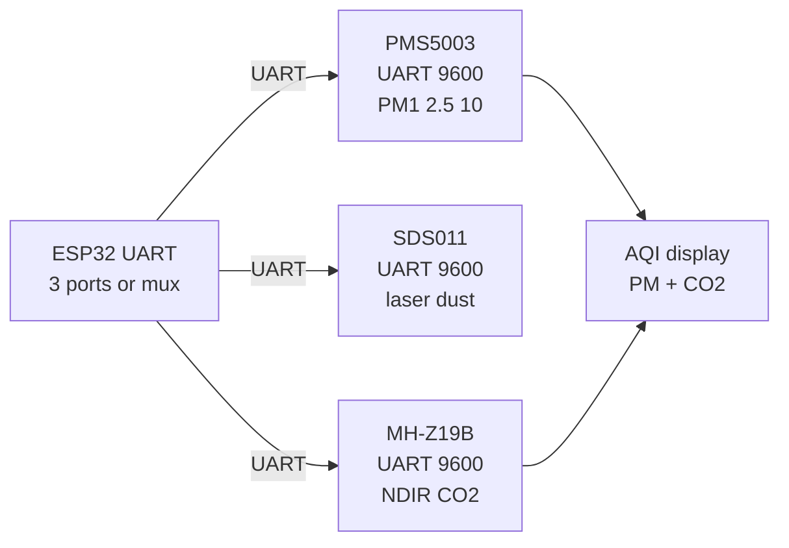

# Dust CO2 2

## Purpose

Dust and CO2 sensors for air quality: PMS5003/7003 (PM1/2.5/10 UART 9600). MH-Z19B (CO2 UART). SDS011 (dust laser). Applications: indoor monitors, weather stations.

## Characteristics

| Sensor | Range | Interface | Note |
| --- | --- | --- | --- |
| PMS5003 | 0-500 µg/m³ PM2.5 | UART 9600 | Passive / laser |
| SDS011 | 0-1000 µg/m³ | UART 9600 | Laser |
| MH-Z19B | 400-5000 ppm CO2 | UART 9600 | NDIR |

## Common issues

| No. | Error | Symptom | Solution |
| --- | --- | --- | --- |
| 1 | PMS no data | Wrong baud | 9600 default |
| 2 | CO2 drift | No warm-up | Warm 3 min |

## Official sources

- PMS5003 Datasheet (Plantower) - `check manually`.
- MH-Z19B Datasheet (Winsen) - `check manually`.


*Fig. 1. Air quality monitors: PMS5003 and SDS011 dust plus MH-Z19B CO2 over UART.*

### Signal chain



## ESP-IDF example

```c
#include "driver/uart.h"
#include "esp_log.h"

#define UART_PORT UART_NUM_2
#define RX_PIN 16
#define TX_PIN 17
#define BAUD 9600   // PMS5003 default rate, check datasheet
static const char *TAG = "uart";

void app_main(void) {
    uart_config_t cfg = {
        .baud_rate = BAUD,
        .data_bits = UART_DATA_8_BITS,
        .parity = UART_PARITY_DISABLE,
        .stop_bits = UART_STOP_BITS_1,
        .flow_ctrl = UART_HW_FLOWCTRL_DISABLE,
    };
    uart_param_config(UART_PORT, &cfg);
    // RX buffer 2x frame: PMS5003 frames are short but bursty
    uart_driver_install(UART_PORT, 2048, 0, 0, NULL, 0);
    uart_set_pin(UART_PORT, TX_PIN, RX_PIN, UART_PIN_NO_CHANGE, UART_PIN_NO_CHANGE);
    // read 32-byte passive frame, check start bytes and checksum before use
    uint8_t frame[64];
    int n = uart_read_bytes(UART_PORT, frame, sizeof(frame), pdMS_TO_TICKS(2000));
    ESP_LOGI(TAG, "PMS5003: got %d bytes", n);
}
```

## Arduino example

```cpp
#include <HardwareSerial.h>

HardwareSerial sens(2);  // UART2: RX 16, TX 17

void setup() {
  Serial.begin(115200);
  sens.begin(9600, SERIAL_8N1, 16, 17);
  // read 32-byte passive frame, check start bytes and checksum before use
}

void loop() {
  if (sens.available()) {
    String line = sens.readStringUntil('\n');
    Serial.printf("PMS5003: %s\n", line.c_str());
  }
  delay(200);
}
```

## MicroPython example

```python
from machine import UART
import time

u = UART(2, baudrate=9600, rx=16, tx=17, timeout=2000)
# read 32-byte passive frame, check start bytes and checksum before use
while True:
    if u.any():
        print("PMS5003:", u.readline())
    time.sleep(0.2)
```

## Operating notes

- Three UART sensors exceed ESP32 UART count: poll sequentially or add multiplexer.
- PMS fans clog: monthly vacuum of inlet, sleep fan between hourly samples to extend life.
- Dust readings spike in humidity over 80 percent: report RH alongside, flag suspect data.
- MH-Z19B ABC calibration needs weekly fresh air: disable ABC in sealed rooms.
- Verify checksum on every frame: UART noise crafts plausible but wrong numbers.

## Power and wiring checklist

| Check | Rule |
| --- | --- |
| 1. Power every module from a rail it is rated for | 5 V heaters never from ESP32 3V3. |
| 2. Common ground first | star topology, ESP32 GND tied to sensor GND before signals. |
| 3. I2C always needs pull-ups | 4.7k to 3V3 when the module has none fitted. |
| 4. 5 V sensor outputs never touch GPIO directly | divider or level shifter first. |
| 5. Verify addresses and baud on the bench | I2C scan plus UART loopback before code. |
| 6. Average analog reads 10-64x | single ESP32 ADC samples are noisy by design. |

## First run and calibration

1. Wire power only, check module current against datasheet before connecting signals.
2. Run bus scan (I2C) or loopback (UART) to confirm the device answers.
3. Flash the minimal example above, confirm plausible raw values in logs.
4. Calibrate: zero/span, clean-air baseline or white reference per sensor type.
5. Stress test 30 min: heat, vibration and supply sag expose weak joints early.
6. Log raw plus converted values: raw data stays valid when formulas change.
## See also

- [17-Gas-CO2-Precision](../../../../ESP32-Reference/UA/10-Sensori/17-Gas-CO2-Precision.md)
