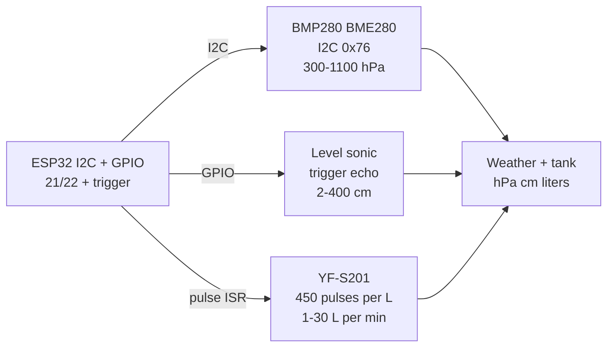

# Pressure Level Flow

## Purpose

Environmental sensors: BMP280/BME280 (I2C/SPI, pressure 300-1100 hPa, temperature, humidity with BME), liquid level ultrasonic / capacitive, flow YF-S201 (Hall pulse per rotation, 450 pulses/L). Applications: weather, tank level, water flow.

## Characteristics

| Sensor | Range | Interface | Note |
| --- | --- | --- | --- |
| BMP280 | 300-1100 hPa | I2C/SPI 0x76/77 | Pressure, temp |
| BME280 | 300-1100 hPa / 0-100% RH | I2C/SPI | + humidity |
| Level ultrasonic | 2-400 cm | GPIO trigger/echo | HC-SR04 style |
| Flow YF-S201 | 1-30 L/min | Pulse / ADC | 450 pulses/L |

## Common issues

| No. | Error | Symptom | Solution |
| --- | --- | --- | --- |
| 1 | Pressure wrong | No calibration | Calibrate at known pressure |
| 2 | Flow pulse missed | Wrong volume | Use interrupt; debounce |

## Official sources

- BMP280 Datasheet (Bosch) - `check manually`.


*Fig. 1. Weather and water: BMP280/BME280 pressure, ultrasonic level, YF-S201 flow pulses.*

### Signal chain



## ESP-IDF example

```c
#include "driver/i2c.h"
#include "esp_log.h"

#define I2C_PORT I2C_NUM_0
#define SDA_PIN  GPIO_NUM_21
#define SCL_PIN  GPIO_NUM_22
#define CHIP_ADDR 0x76   // BMP280 7-bit address, verify with i2c scan!

static const char *TAG = "bmp280";

void app_main(void) {
    i2c_config_t conf = {
        .mode = I2C_MODE_MASTER,
        .sda_io_num = SDA_PIN,
        .scl_io_num = SCL_PIN,
        .sda_pullup_en = GPIO_PULLUP_ENABLE,  // 4.7k to 3V3 if module lacks them
        .scl_pullup_en = GPIO_PULLUP_ENABLE,
        .master.clk_speed = 100000,           // start at 100 kHz, raise later
    };
    i2c_param_config(I2C_PORT, &conf);
    i2c_driver_install(I2C_PORT, conf.mode, 0, 0, 0);
    // read temp plus pressure, apply sea-level correction for altitude display
    uint8_t probe = 0;
    esp_err_t err = i2c_master_write_read_device(
        I2C_PORT, CHIP_ADDR, NULL, 0, &probe, 1, pdMS_TO_TICKS(100));
    ESP_LOGI(TAG, "%s probe: %s (0x%02X)", "BMP280",
             err == ESP_OK ? "ACK" : "NACK", probe);
}
```

## Arduino example

```cpp
#include <Wire.h>

#define CHIP_ADDR 0x76  // BMP280, verify with I2C scanner sketch

void setup() {
  Serial.begin(115200);
  Wire.begin(21, 22);  // SDA, SCL
  Wire.setClock(100000);
  // read temp plus pressure, apply sea-level correction for altitude display
  Wire.beginTransmission(CHIP_ADDR);
  uint8_t err = Wire.endTransmission();
  Serial.printf("BMP280: %s\n", err == 0 ? "found" : "NOT found, check wiring");
}

void loop() {
  // poll data register here; average 4-8 samples before use
  delay(500);
}
```

## MicroPython example

```python
from machine import I2C, Pin

i2c = I2C(0, scl=Pin(22), sda=Pin(21), freq=100000)
found = i2c.scan()
print("bus:", [hex(a) for a in found])
# read temp plus pressure, apply sea-level correction for altitude display
assert 0x76 in found, "BMP280 not on bus, check pull-ups and wiring"
print("BMP280 ready at", hex(0x76))
```

## Operating notes

- BMP280 address is 0x76 or 0x77 by SDO pin: scan bus before hardcoding the driver.
- Ultrasonic level needs stilling tube in tanks: waves and foam scatter echo timing.
- YF-S201 minimum 1 L per min: below that pulses stop, report zero not last value.
- Pressure weather trends need 3 h windows: single readings are noise, slopes are signal.
- Temperature-compensate level echo: sound speed shifts 0.17 percent per degree.

## Power and wiring checklist

| Check | Rule |
| --- | --- |
| 1. Power every module from a rail it is rated for | 5 V heaters never from ESP32 3V3. |
| 2. Common ground first | star topology, ESP32 GND tied to sensor GND before signals. |
| 3. I2C always needs pull-ups | 4.7k to 3V3 when the module has none fitted. |
| 4. 5 V sensor outputs never touch GPIO directly | divider or level shifter first. |
| 5. Verify addresses and baud on the bench | I2C scan plus UART loopback before code. |
| 6. Average analog reads 10-64x | single ESP32 ADC samples are noisy by design. |

## First run and calibration

1. Wire power only, check module current against datasheet before connecting signals.
2. Run bus scan (I2C) or loopback (UART) to confirm the device answers.
3. Flash the minimal example above, confirm plausible raw values in logs.
4. Calibrate: zero/span, clean-air baseline or white reference per sensor type.
5. Stress test 30 min: heat, vibration and supply sag expose weak joints early.
6. Log raw plus converted values: raw data stays valid when formulas change.
## See also

- [03-BME280-BMP280-SHT31](../../../../ESP32-Reference/UA/10-Sensori/03-BME280-BMP280-SHT31.md)
