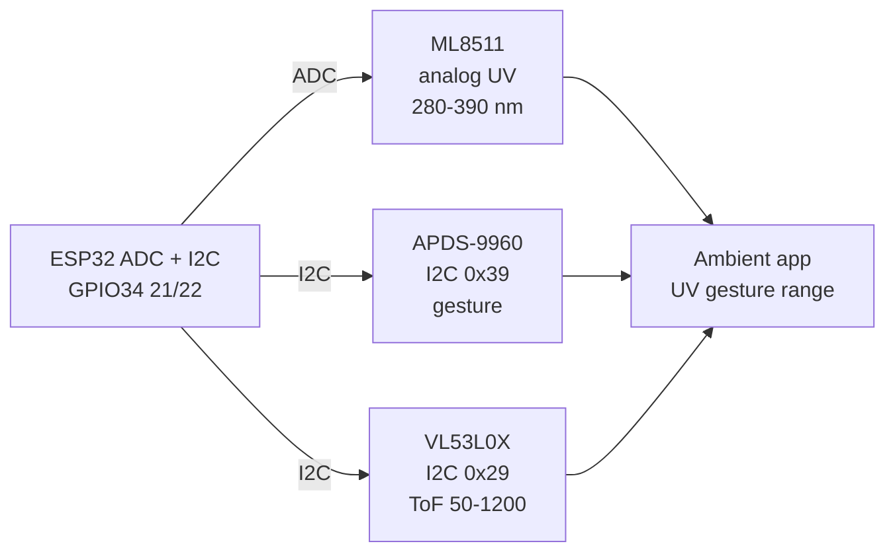

# Light UV IR Array ToF

## Purpose

Multi-spectrum light and distance sensors: ML8511 UV (I2C/analog), TCS3200 RGB, APDS-9960 gesture/proximity, VL53L0X ToF. Applications: ambient adaptation, gesture interface, distance.

## Characteristics

| Sensor | Feature | Interface | Note |
| --- | --- | --- | --- |
| ML8511 | UV index | Analog / I2C | 280-390 nm |
| APDS-9960 | Proximity + gesture | I2C 0x39 | 4-direction |
| VL53L0X | ToF 50-1200 mm | I2C 0x29 | ±1 mm |

## Common issues

| No. | Error | Symptom | Solution |
| --- | --- | --- | --- |
| 1 | UV sensor near window | High UV | Shield or use indoor |


*Fig. 1. Multi-spectrum sensing: ML8511 UV analog, APDS gesture, VL53L0X ToF distance.*

### Signal chain



## ESP-IDF example

```c
#include "driver/adc.h"
#include "esp_log.h"

#define SENSOR_CH ADC1_CHANNEL_34  // ML8511 analog output, GPIO34
static const char *TAG = "adc";

static int read_mv_avg(int n) {
    int sum = 0;
    for (int i = 0; i < n; i++) sum += adc1_get_raw(SENSOR_CH);
    // 12-bit, 11 dB attenuation: ~0-3.3 V full scale, see ADC docs
    return (sum / n) * 3300 / 4095;
}

void app_main(void) {
    adc1_config_width(ADC_WIDTH_BIT_12);
    adc1_config_channel_atten(SENSOR_CH, ADC_ATTEN_DB_11);
    int mv = read_mv_avg(16);  // average 16 samples against noise
    ESP_LOGI(TAG, "ML8511: %d mV", mv);
    // output ~1 V at UV index 0 rising ~0.1 V per index: convert mV to index linearly
}
```

## Arduino example

```cpp
#define SENSOR_PIN 34  // ML8511 analog output

void setup() {
  Serial.begin(115200);
  analogReadResolution(12);
  analogSetAttenuation(ADC_11db);  // ~0-3.3 V range
}

void loop() {
  long sum = 0;
  for (int i = 0; i < 16; i++) sum += analogRead(SENSOR_PIN);
  int mv = (sum / 16) * 3300 / 4095;
  Serial.printf("ML8511: %d mV\n", mv);
  // output ~1 V at UV index 0 rising ~0.1 V per index: convert mV to index linearly
  delay(500);
}
```

## MicroPython example

```python
from machine import ADC, Pin
import time

adc = ADC(Pin(34))
adc.atten(ADC.ATTN_11DB)      # ~0-3.3 V range
adc.width(ADC.WIDTH_12BIT)

while True:
    raw = sum(adc.read() for _ in range(16)) // 16
    mv = raw * 3300 // 4095
    print("ML8511: %d mV" % mv)
    # output ~1 V at UV index 0 rising ~0.1 V per index: convert mV to index linearly
    time.sleep(0.5)
```

## Operating notes

- ML8511 behind glass reads near zero: glass blocks UV, mount sensor outside or open window.
- UV index formula is linear from 1 V base: calibrate offset at night when index is zero.
- ToF cover glass needs 940 nm IR-transparent window: plain plastic blinds the sensor.
- Gesture plus ToF combine well: wake on proximity, confirm presence with distance.
- Average UV over 60 s: clouds make instant readings jumpy and useless for exposure.

## Power and wiring checklist

| Check | Rule |
| --- | --- |
| 1. Power every module from a rail it is rated for | 5 V heaters never from ESP32 3V3. |
| 2. Common ground first | star topology, ESP32 GND tied to sensor GND before signals. |
| 3. I2C always needs pull-ups | 4.7k to 3V3 when the module has none fitted. |
| 4. 5 V sensor outputs never touch GPIO directly | divider or level shifter first. |
| 5. Verify addresses and baud on the bench | I2C scan plus UART loopback before code. |
| 6. Average analog reads 10-64x | single ESP32 ADC samples are noisy by design. |

## First run and calibration

1. Wire power only, check module current against datasheet before connecting signals.
2. Run bus scan (I2C) or loopback (UART) to confirm the device answers.
3. Flash the minimal example above, confirm plausible raw values in logs.
4. Calibrate: zero/span, clean-air baseline or white reference per sensor type.
5. Stress test 30 min: heat, vibration and supply sag expose weak joints early.
6. Log raw plus converted values: raw data stays valid when formulas change.

## Official sources

- [ESP32 ADC (Espressif)](https://docs.espressif.com/projects/esp-idf/en/latest/esp32/api-reference/peripherals/adc.html) - API used by the examples above.
- ML8511 Datasheet (Lapis) - `check manually`.
- APDS-9960 Datasheet (Broadcom/Avago) - `check manually`.
- VL53L0X Datasheet (ST) - `check manually`.
## See also

- [18-Light-Spectral-Gesture](../../../../ESP32-Reference/UA/10-Sensori/18-Light-Spectral-Gesture.md)
- [10-VL53L0X-TCS34725-TSL2561](../../../../ESP32-Reference/UA/10-Sensori/10-VL53L0X-TCS34725-TSL2561.md)
