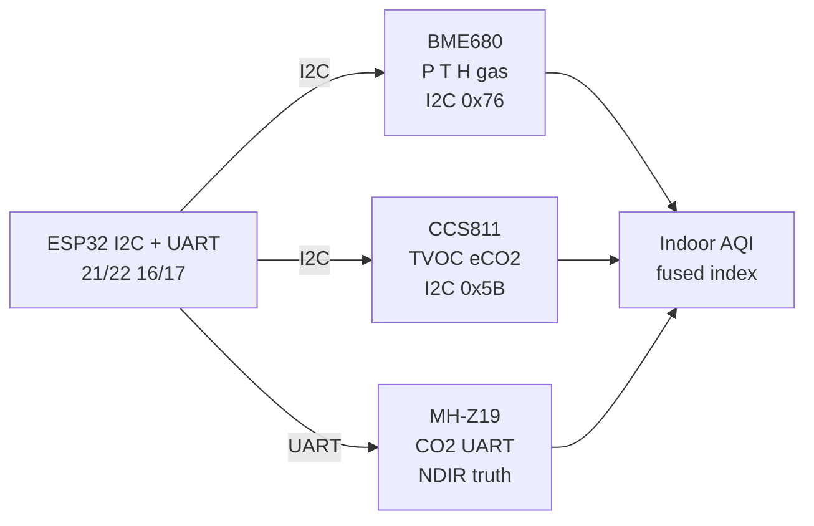

# Env NewGen

## Purpose

Next-gen combined environmental sensors: BME680 (pressure, temp, humidity, gas resistance, I2C/SPI), CCS811 (TVOC/eCO2 I2C 0x5B), MH-Z19 CO2 UART, PMS5003 dust UART. Applications: smart home, indoor air quality.

## Characteristics

| Sensor | Measures | Interface | Note |
| --- | --- | --- | --- |
| BME680 | P,T,H,gas | I2C/SPI 0x76 | Gas resistance |
| CCS811 | TVOC, eCO2 | I2C 0x5B | Requires burn-in |
| MH-Z19 | CO2 | UART 9600 | NDIR |

## Common issues

| No. | Error | Symptom | Solution |
| --- | --- | --- | --- |
| 1 | CCS811 no data | Not initialized | Run startup sequence |
| 2 | BME680 gas not calibrated | Wrong gas | Calibrate with clean air |


*Fig. 1. New-gen environment: BME680 gas plus CCS811 TVOC plus MH-Z19 CO2.*

### Signal chain



## ESP-IDF example

```c
#include "driver/i2c.h"
#include "esp_log.h"

#define I2C_PORT I2C_NUM_0
#define SDA_PIN  GPIO_NUM_21
#define SCL_PIN  GPIO_NUM_22
#define CHIP_ADDR 0x76   // BME680 7-bit address, verify with i2c scan!

static const char *TAG = "bme680";

void app_main(void) {
    i2c_config_t conf = {
        .mode = I2C_MODE_MASTER,
        .sda_io_num = SDA_PIN,
        .scl_io_num = SCL_PIN,
        .sda_pullup_en = GPIO_PULLUP_ENABLE,  // 4.7k to 3V3 if module lacks them
        .scl_pullup_en = GPIO_PULLUP_ENABLE,
        .master.clk_speed = 100000,           // start at 100 kHz, raise later
    };
    i2c_param_config(I2C_PORT, &conf);
    i2c_driver_install(I2C_PORT, conf.mode, 0, 0, 0);
    // forced mode per read, heater profile per datasheet, gas resistance is relative
    uint8_t probe = 0;
    esp_err_t err = i2c_master_write_read_device(
        I2C_PORT, CHIP_ADDR, NULL, 0, &probe, 1, pdMS_TO_TICKS(100));
    ESP_LOGI(TAG, "%s probe: %s (0x%02X)", "BME680",
             err == ESP_OK ? "ACK" : "NACK", probe);
}
```

## Arduino example

```cpp
#include <Wire.h>

#define CHIP_ADDR 0x76  // BME680, verify with I2C scanner sketch

void setup() {
  Serial.begin(115200);
  Wire.begin(21, 22);  // SDA, SCL
  Wire.setClock(100000);
  // forced mode per read, heater profile per datasheet, gas resistance is relative
  Wire.beginTransmission(CHIP_ADDR);
  uint8_t err = Wire.endTransmission();
  Serial.printf("BME680: %s\n", err == 0 ? "found" : "NOT found, check wiring");
}

void loop() {
  // poll data register here; average 4-8 samples before use
  delay(500);
}
```

## MicroPython example

```python
from machine import I2C, Pin

i2c = I2C(0, scl=Pin(22), sda=Pin(21), freq=100000)
found = i2c.scan()
print("bus:", [hex(a) for a in found])
# forced mode per read, heater profile per datasheet, gas resistance is relative
assert 0x76 in found, "BME680 not on bus, check pull-ups and wiring"
print("BME680 ready at", hex(0x76))
```

## Operating notes

- BME680 gas is relative resistance, not ppm: baseline in clean air, track ratios.
- CCS811 needs 48 h burn-in plus 20 min warm-up per power cycle: first-day data is junk.
- Cross-check eCO2 against MH-Z19 NDIR monthly: CCS baseline drifts with background VOC.
- Heater profiles differ per use: low-power mode for battery, continuous for air quality.
- Place sensor away from ESP32 heat: 2 C board warmth skews humidity and gas badly.

## Power and wiring checklist

| Check | Rule |
| --- | --- |
| 1. Power every module from a rail it is rated for | 5 V heaters never from ESP32 3V3. |
| 2. Common ground first | star topology, ESP32 GND tied to sensor GND before signals. |
| 3. I2C always needs pull-ups | 4.7k to 3V3 when the module has none fitted. |
| 4. 5 V sensor outputs never touch GPIO directly | divider or level shifter first. |
| 5. Verify addresses and baud on the bench | I2C scan plus UART loopback before code. |
| 6. Average analog reads 10-64x | single ESP32 ADC samples are noisy by design. |

## First run and calibration

1. Wire power only, check module current against datasheet before connecting signals.
2. Run bus scan (I2C) or loopback (UART) to confirm the device answers.
3. Flash the minimal example above, confirm plausible raw values in logs.
4. Calibrate: zero/span, clean-air baseline or white reference per sensor type.
5. Stress test 30 min: heat, vibration and supply sag expose weak joints early.
6. Log raw plus converted values: raw data stays valid when formulas change.

## Official sources

- [ESP32 I2C (Espressif)](https://docs.espressif.com/projects/esp-idf/en/latest/esp32/api-reference/peripherals/i2c.html) - API used by the examples above.
- BME680 Datasheet (Bosch Sensortec) - `check manually`.
- CCS811 Datasheet (ScioSense/ams) - `check manually`.
- MH-Z19 Datasheet (Winsen) - `check manually`.
## See also

- [03-BME280-BMP280-SHT31](../../../../ESP32-Reference/UA/10-Sensori/03-BME280-BMP280-SHT31.md)
- [08-BME680-CCS811-MHZ19-PMS5003](../../../../ESP32-Reference/UA/10-Sensori/08-BME680-CCS811-MHZ19-PMS5003.md)
