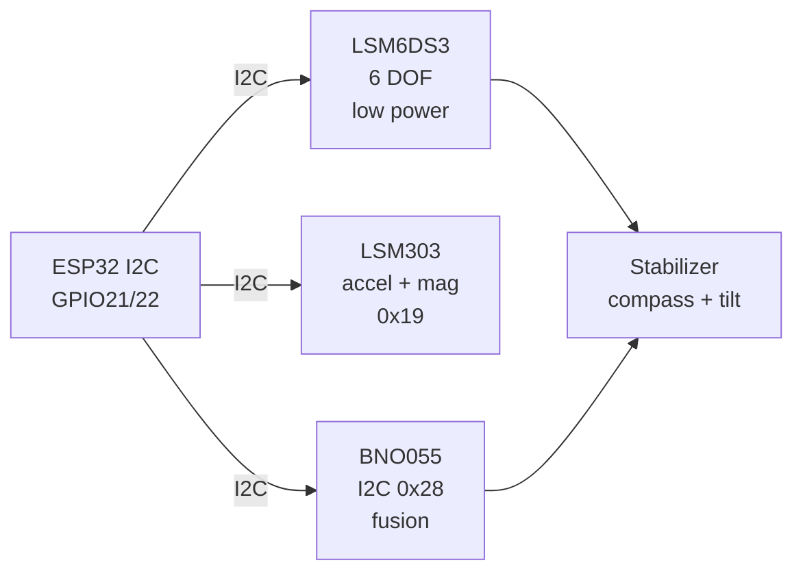

# IMU Mag 3

## Purpose

IMU and magnetometer combinations: LSM6DS3 (6 DOF, low power), LSM303 (accel+mag), HMC5883, BNO055 (9 DOF). Applications: motion tracking, compass, stabilization.

## Characteristics

| IMU | DOF / Type | Interface | Note |
| --- | --- | --- | --- |
| LSM6DS3 | 6 DOF accel+gyro | I2C/SPI | Low power |
| LSM303 | Accel + Mag | I2C 0x19 | Low power |
| BNO055 | 9 DOF | I2C 0x28 | Fusion |


*Fig. 1. IMU plus magnetometer: LSM6DS3 motion, LSM303 combo, BNO055 absolute heading.*

### Signal chain



## ESP-IDF example

```c
#include "driver/i2c.h"
#include "esp_log.h"

#define I2C_PORT I2C_NUM_0
#define SDA_PIN  GPIO_NUM_21
#define SCL_PIN  GPIO_NUM_22
#define CHIP_ADDR 0x6A   // LSM6DS3 7-bit address, verify with i2c scan!

static const char *TAG = "lsm6ds3";

void app_main(void) {
    i2c_config_t conf = {
        .mode = I2C_MODE_MASTER,
        .sda_io_num = SDA_PIN,
        .scl_io_num = SCL_PIN,
        .sda_pullup_en = GPIO_PULLUP_ENABLE,  // 4.7k to 3V3 if module lacks them
        .scl_pullup_en = GPIO_PULLUP_ENABLE,
        .master.clk_speed = 100000,           // start at 100 kHz, raise later
    };
    i2c_param_config(I2C_PORT, &conf);
    i2c_driver_install(I2C_PORT, conf.mode, 0, 0, 0);
    // enable accel plus gyro, set ODR 104 Hz, read 12-byte burst
    uint8_t probe = 0;
    esp_err_t err = i2c_master_write_read_device(
        I2C_PORT, CHIP_ADDR, NULL, 0, &probe, 1, pdMS_TO_TICKS(100));
    ESP_LOGI(TAG, "%s probe: %s (0x%02X)", "LSM6DS3",
             err == ESP_OK ? "ACK" : "NACK", probe);
}
```

## Arduino example

```cpp
#include <Wire.h>

#define CHIP_ADDR 0x6A  // LSM6DS3, verify with I2C scanner sketch

void setup() {
  Serial.begin(115200);
  Wire.begin(21, 22);  // SDA, SCL
  Wire.setClock(100000);
  // enable accel plus gyro, set ODR 104 Hz, read 12-byte burst
  Wire.beginTransmission(CHIP_ADDR);
  uint8_t err = Wire.endTransmission();
  Serial.printf("LSM6DS3: %s\n", err == 0 ? "found" : "NOT found, check wiring");
}

void loop() {
  // poll data register here; average 4-8 samples before use
  delay(500);
}
```

## MicroPython example

```python
from machine import I2C, Pin

i2c = I2C(0, scl=Pin(22), sda=Pin(21), freq=100000)
found = i2c.scan()
print("bus:", [hex(a) for a in found])
# enable accel plus gyro, set ODR 104 Hz, read 12-byte burst
assert 0x6A in found, "LSM6DS3 not on bus, check pull-ups and wiring"
print("LSM6DS3 ready at", hex(0x6A))
```

## Operating notes

- LSM6DS3 address is 0x6A or 0x6B by SDO pin: scan before assuming driver default.
- Pedometer and tap interrupts run on-chip: use them to keep ESP32 in light sleep.
- Magnetometer calibration per install: steel chassis bends field, calibrate in place.
- Complementary filter beats raw angles: trust gyro short-term, accel-mag long-term.
- Vibration aliases into accel data: mount on damper for rotors, sample above 200 Hz.

## Power and wiring checklist

| Check | Rule |
| --- | --- |
| 1. Power every module from a rail it is rated for | 5 V heaters never from ESP32 3V3. |
| 2. Common ground first | star topology, ESP32 GND tied to sensor GND before signals. |
| 3. I2C always needs pull-ups | 4.7k to 3V3 when the module has none fitted. |
| 4. 5 V sensor outputs never touch GPIO directly | divider or level shifter first. |
| 5. Verify addresses and baud on the bench | I2C scan plus UART loopback before code. |
| 6. Average analog reads 10-64x | single ESP32 ADC samples are noisy by design. |

## First run and calibration

1. Wire power only, check module current against datasheet before connecting signals.
2. Run bus scan (I2C) or loopback (UART) to confirm the device answers.
3. Flash the minimal example above, confirm plausible raw values in logs.
4. Calibrate: zero/span, clean-air baseline or white reference per sensor type.
5. Stress test 30 min: heat, vibration and supply sag expose weak joints early.
6. Log raw plus converted values: raw data stays valid when formulas change.

## Common issues

| Symptom | Cause | Fix |
| --- | --- | --- |
| Wrong I2C address | LSM6DS3 SDO pin selects 0x6A or 0x6B | Scan bus, match driver define to hardware |
| Yaw drifts in minutes | No magnetometer fusion or uncalibrated compass | Enable NDOF mode, run magnetic calibration |
| Noisy tilt angles | Vibration aliasing at low sample rate | Raise ODR over 100 Hz, add damping mount |
| Zeros from every axis | Sensor still in power-down reset state | Write power-management register to wake first |


## Official sources

- [ESP32 I2C (Espressif)](https://docs.espressif.com/projects/esp-idf/en/latest/esp32/api-reference/peripherals/i2c.html) - API used by the examples above.
- LSM6DS3 Datasheet (ST) - `check manually`.
- BNO055 Datasheet (Bosch Sensortec) - `check manually`.
## See also

- [19-IMU-6-9DOF](../../../../ESP32-Reference/UA/10-Sensori/19-IMU-6-9DOF.md)
- [25-Mag-IMU-2](../../../../ESP32-Reference/UA/10-Sensori/25-Mag-IMU-2.md)
