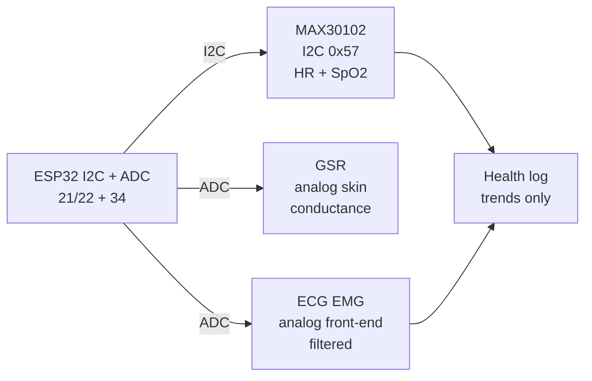

# Bio-2

## Purpose

Biometric sensors: MAX30102 (I2C pulse oximeter + heart rate), galvanic skin response, EMG/ECG modules, respiration. Applications: health monitoring, wearables.

## Characteristics

| Sensor | Feature | Interface | Note |
| --- | --- | --- | --- |
| MAX30102 | HR + SpO2 | I2C 0x57 | LED + ADC |
| GSR | Resistance | Analog | Skin conductance |

## Common issues

| No. | Error | Symptom | Solution |
| --- | --- | --- | --- |
| 1 | MAX30102 motion artifact | Wrong HR | Hold finger still; use algorithm filter |


*Fig. 1. Wearable biosignals: MAX30102 pulse oximeter, GSR skin response, EMG/ECG modules.*

### Signal chain



## ESP-IDF example

```c
#include "driver/i2c.h"
#include "esp_log.h"

#define I2C_PORT I2C_NUM_0
#define SDA_PIN  GPIO_NUM_21
#define SCL_PIN  GPIO_NUM_22
#define CHIP_ADDR 0x57   // MAX30102 7-bit address, verify with i2c scan!

static const char *TAG = "max30102";

void app_main(void) {
    i2c_config_t conf = {
        .mode = I2C_MODE_MASTER,
        .sda_io_num = SDA_PIN,
        .scl_io_num = SCL_PIN,
        .sda_pullup_en = GPIO_PULLUP_ENABLE,  // 4.7k to 3V3 if module lacks them
        .scl_pullup_en = GPIO_PULLUP_ENABLE,
        .master.clk_speed = 100000,           // start at 100 kHz, raise later
    };
    i2c_param_config(I2C_PORT, &conf);
    i2c_driver_install(I2C_PORT, conf.mode, 0, 0, 0);
    // set LED currents low first, FIFO almost-full interrupt, 100 Hz sample
    uint8_t probe = 0;
    esp_err_t err = i2c_master_write_read_device(
        I2C_PORT, CHIP_ADDR, NULL, 0, &probe, 1, pdMS_TO_TICKS(100));
    ESP_LOGI(TAG, "%s probe: %s (0x%02X)", "MAX30102",
             err == ESP_OK ? "ACK" : "NACK", probe);
}
```

## Arduino example

```cpp
#include <Wire.h>

#define CHIP_ADDR 0x57  // MAX30102, verify with I2C scanner sketch

void setup() {
  Serial.begin(115200);
  Wire.begin(21, 22);  // SDA, SCL
  Wire.setClock(100000);
  // set LED currents low first, FIFO almost-full interrupt, 100 Hz sample
  Wire.beginTransmission(CHIP_ADDR);
  uint8_t err = Wire.endTransmission();
  Serial.printf("MAX30102: %s\n", err == 0 ? "found" : "NOT found, check wiring");
}

void loop() {
  // poll data register here; average 4-8 samples before use
  delay(500);
}
```

## MicroPython example

```python
from machine import I2C, Pin

i2c = I2C(0, scl=Pin(22), sda=Pin(21), freq=100000)
found = i2c.scan()
print("bus:", [hex(a) for a in found])
# set LED currents low first, FIFO almost-full interrupt, 100 Hz sample
assert 0x57 in found, "MAX30102 not on bus, check pull-ups and wiring"
print("MAX30102 ready at", hex(0x57))
```

## Operating notes

- Finger must stay still with gentle pressure: motion artifact dwarfs the pulse signal.
- Start LED current low: too bright saturates photodiode, too dim buries signal in noise.
- SpO2 needs red plus IR ratio: single LED gives heart rate only, never oxygen.
- ECG needs driven-right-leg plus shielded leads: mains hum otherwise wins every time.
- Trends matter, absolutes deceive: compare against personal baseline, not tables.

## Power and wiring checklist

| Check | Rule |
| --- | --- |
| 1. Power every module from a rail it is rated for | 5 V heaters never from ESP32 3V3. |
| 2. Common ground first | star topology, ESP32 GND tied to sensor GND before signals. |
| 3. I2C always needs pull-ups | 4.7k to 3V3 when the module has none fitted. |
| 4. 5 V sensor outputs never touch GPIO directly | divider or level shifter first. |
| 5. Verify addresses and baud on the bench | I2C scan plus UART loopback before code. |
| 6. Average analog reads 10-64x | single ESP32 ADC samples are noisy by design. |

## First run and calibration

1. Wire power only, check module current against datasheet before connecting signals.
2. Run bus scan (I2C) or loopback (UART) to confirm the device answers.
3. Flash the minimal example above, confirm plausible raw values in logs.
4. Calibrate: zero/span, clean-air baseline or white reference per sensor type.
5. Stress test 30 min: heat, vibration and supply sag expose weak joints early.
6. Log raw plus converted values: raw data stays valid when formulas change.

## Official sources

- [ESP32 I2C (Espressif)](https://docs.espressif.com/projects/esp-idf/en/latest/esp32/api-reference/peripherals/i2c.html) - API used by the examples above.
- MAX30102 Datasheet (Analog Devices/Maxim) - `check manually`.
- ECG/EMG front-end module notes (manufacturer) - `check manually`.
## See also

- [20-Bio-IR-Temp](../../../../ESP32-Reference/UA/10-Sensori/20-Bio-IR-Temp.md)
