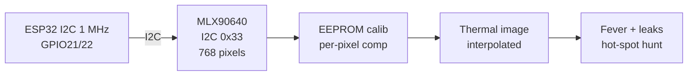

# Thermal MLX90640

## Purpose

Thermal imaging sensor MLX90640 (32x24 IR array, 768 pixels, I2C 0x33, 16 Hz, 0-300 °C). Applications: thermal imaging, fever screening, industrial monitoring.

## Characteristics

| Parameter | Value |
| --- | --- |
| Array | 32 x 24 (768 pixels) |
| Frame rate | 16 Hz |
| Temperature range | −40…300 °C |
| Interface | I2C 0x33 |
| Accuracy | ±1.5 °C (typical) |

## Common issues

| No. | Error | Symptom | Solution |
| --- | --- | --- | --- |
| 1 | No image | Wrong I2C address | Check 0x33; check wiring |
| 2 | Hot spots | Calibration needed | Use library calibration; check emissivity |

## Official sources

- MLX90640 Datasheet (Melexis) - `check manually`.


*Fig. 1. Thermal imaging: MLX90640 32x24 IR array at 16 Hz into ESP32.*

### Signal chain



## ESP-IDF example

```c
#include "driver/i2c.h"
#include "esp_log.h"

#define I2C_PORT I2C_NUM_0
#define SDA_PIN  GPIO_NUM_21
#define SCL_PIN  GPIO_NUM_22
#define CHIP_ADDR 0x33   // MLX90640 7-bit address, verify with i2c scan!

static const char *TAG = "mlx90640";

void app_main(void) {
    i2c_config_t conf = {
        .mode = I2C_MODE_MASTER,
        .sda_io_num = SDA_PIN,
        .scl_io_num = SCL_PIN,
        .sda_pullup_en = GPIO_PULLUP_ENABLE,  // 4.7k to 3V3 if module lacks them
        .scl_pullup_en = GPIO_PULLUP_ENABLE,
        .master.clk_speed = 100000,           // start at 100 kHz, raise later
    };
    i2c_param_config(I2C_PORT, &conf);
    i2c_driver_install(I2C_PORT, conf.mode, 0, 0, 0);
    // 1 MHz bus for 16 Hz frames, read EEPROM constants once, two subpages per frame
    uint8_t probe = 0;
    esp_err_t err = i2c_master_write_read_device(
        I2C_PORT, CHIP_ADDR, NULL, 0, &probe, 1, pdMS_TO_TICKS(100));
    ESP_LOGI(TAG, "%s probe: %s (0x%02X)", "MLX90640",
             err == ESP_OK ? "ACK" : "NACK", probe);
}
```

## Arduino example

```cpp
#include <Wire.h>

#define CHIP_ADDR 0x33  // MLX90640, verify with I2C scanner sketch

void setup() {
  Serial.begin(115200);
  Wire.begin(21, 22);  // SDA, SCL
  Wire.setClock(100000);
  // 1 MHz bus for 16 Hz frames, read EEPROM constants once, two subpages per frame
  Wire.beginTransmission(CHIP_ADDR);
  uint8_t err = Wire.endTransmission();
  Serial.printf("MLX90640: %s\n", err == 0 ? "found" : "NOT found, check wiring");
}

void loop() {
  // poll data register here; average 4-8 samples before use
  delay(500);
}
```

## MicroPython example

```python
from machine import I2C, Pin

i2c = I2C(0, scl=Pin(22), sda=Pin(21), freq=100000)
found = i2c.scan()
print("bus:", [hex(a) for a in found])
# 1 MHz bus for 16 Hz frames, read EEPROM constants once, two subpages per frame
assert 0x33 in found, "MLX90640 not on bus, check pull-ups and wiring"
print("MLX90640 ready at", hex(0x33))
```

## Operating notes

- 1 MHz I2C is required for full rate: 400 kHz halves frame rate, 100 kHz crawls.
- Emissivity default 1.0 suits black tape: set 0.95 for skin, 0.9 for painted metal.
- Refresh rate trades noise: 16 Hz noisy, 1 Hz clean; pick per use case.
- Interpolate 32x24 to display size: bilinear is enough, fancy filters add lag.
- Gradient plus absolute alarms: hot spot relative to background catches faults early.

## Power and wiring checklist

| Check | Rule |
| --- | --- |
| 1. Power every module from a rail it is rated for | 5 V heaters never from ESP32 3V3. |
| 2. Common ground first | star topology, ESP32 GND tied to sensor GND before signals. |
| 3. I2C always needs pull-ups | 4.7k to 3V3 when the module has none fitted. |
| 4. 5 V sensor outputs never touch GPIO directly | divider or level shifter first. |
| 5. Verify addresses and baud on the bench | I2C scan plus UART loopback before code. |
| 6. Average analog reads 10-64x | single ESP32 ADC samples are noisy by design. |

## First run and calibration

1. Wire power only, check module current against datasheet before connecting signals.
2. Run bus scan (I2C) or loopback (UART) to confirm the device answers.
3. Flash the minimal example above, confirm plausible raw values in logs.
4. Calibrate: zero/span, clean-air baseline or white reference per sensor type.
5. Stress test 30 min: heat, vibration and supply sag expose weak joints early.
6. Log raw plus converted values: raw data stays valid when formulas change.
## See also

- [20-Bio-IR-Temp](../../../../ESP32-Reference/UA/10-Sensori/20-Bio-IR-Temp.md)
