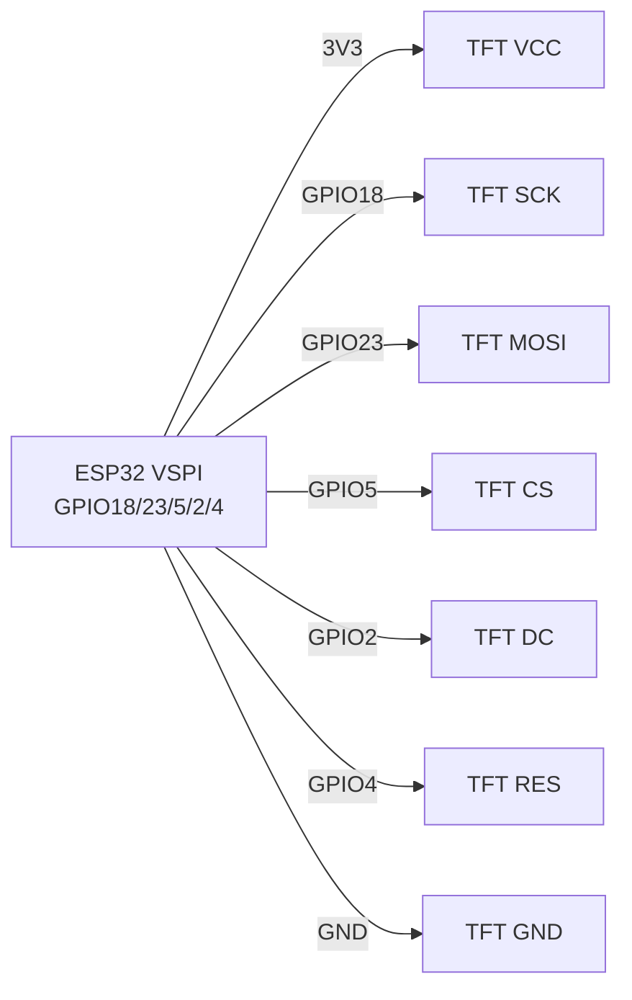
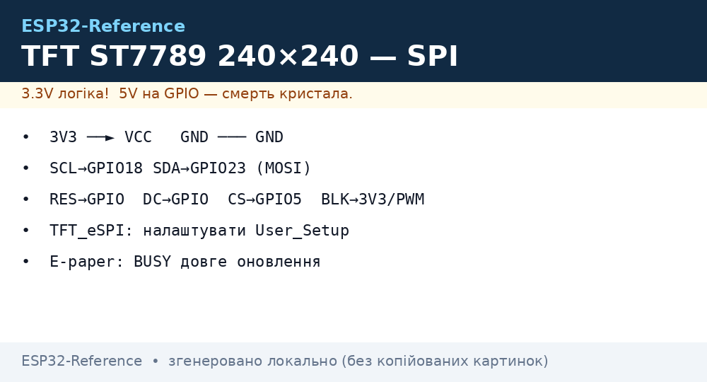

# TFT ST7789 / ILI9341, LCD1602+I2C, E-paper - Displays

## Purpose

Overview of large displays for ESP32: ST7789 (IPS 240x240 / 240x320, fast SPI) - clocks, dashboards, cameras; ILI9341 240x320 + XPT2046 touch - control panel; LCD1602 + PCF8574 - cheap 2-line text; E-paper (GDEY/DEPG from Good Display, GxEPD driver) - price tags, street boards with static image and battery power.

## Characteristics

| Display | resolution | Interface | power supply | Feature |
| --- | --- | --- | --- | --- |
| ST7789 1.3-1.54″ | 240x240 | SPI 40-80 MHz | 3.3 V | IPS, bright; needs TFT_eSPI/LovyanGFX |
| ST7789 2.0″ | 240×320 | SPI | 3.3 in | Той же driver, different offset |
| ILI9341 2.4-2.8″ | 240x320 | SPI + XPT2046 touch (SPI) | 3.3 V (module with LDO → 5 V) | Touch on separate CS |
| LCD1602 + PCF8574 | 16x2 text | I2C 0x27 (typically) / 0x3F | 5 V (backlight!) | Contrast with potentiometer |
| E-paper 2.13-4.2″ | 250x122 … 400x300 | SPI (GxEPD/GxEPD2) | 3.3 V | Update 2-30 s, partial refresh; do not update more often than ~3 min |

> E-paper dislikes frequent full updates: every 5-10 min do a full refresh against ghosting, avoid updating below 0 C without heating.

## Pinout

| ST7789 (module) | Purpose |
| --- | --- |
| VCC / GND | 3.3 in / ground |
| SCL (SCK) | SPI clock → GPIO18 |
| SDA (MOSI) | SPI MOSI → GPIO23 |
| RES (RST) | Reset → GPIO4 (або EN) |
| DC | Data/Command → GPIO2 |
| CS | Chip-select → GPIO5 |
| BLK | Backlight → 3V3 or PWM-GPIO (brightness) |

| ILI9341 + touch | Additionally |
| --- | --- |
| T_CLK/T_DOUT/T_DIN/T_CS/T_IRQ | second SPI device: common SCK/MISO/MOSI, separate T_CS (GPIO14), IRQ optional |

| LCD1602+I2C | I2C 0x27/0x3F, power supply 5 in (контраст!) |

## Wiring diagram

| ESP32 | ST7789 / ILI9341 | Note |
| --- | --- | --- |
| 3V3 | VCC | Only 3.3 V (ILI9341 module with LDO can take 5 V) |
| GND | GND | common ground |
| GPIO18 | SCL/SCK | VSPI SCK |
| GPIO23 | SDA/MOSI | VSPI MOSI |
| GPIO19 | MISO | Only ILI9341-touch (XPT2046 reads); ST7789 usually without MISO |
| GPIO5 | CS | TFT CS |
| GPIO2 | DC | Data/Command (no strapping issue after boot) |
| GPIO4 | RES | Reset |
| GPIO15 | BLK (ST7789) | through PWM - brightness control |
| GPIO14 | T_CS (ILI9341) | Touch CS, окремий on TFT CS |

| ESP32 | LCD1602+I2C | Note |
| --- | --- | --- |
| 5V | VCC | Backlight needs 5 V |
| GND | GND | ground |
| GPIO22 | SCL | I2C |
| GPIO21 | SDA | I2C, address 0x27 або 0x3F |

| ESP32 | E-paper (SPI) | Note |
| --- | --- | --- |
| 3V3/GND | VCC/GND | 3.3 in |
| GPIO18/23/5 | SCK/MOSI/CS | SPI |
| GPIO2/4/15 | DC/RST/BUSY | BUSY - wait input |

### ASCII-schem

```text
ESP32 DevKit (VSPI)     ST7789 / ILI9341 (SPI)
-------------------     ----------------------
3V3 ──────────────────► VCC (тільки 3.3 В!)
GND ──────────────────► GND
GPIO18 ───────────────► SCL / SCK
GPIO23 ───────────────► SDA / MOSI
GPIO19 ───────────────► MISO (тільки ILI9341-touch XPT2046)
GPIO5 ────────────────► CS (TFT)
GPIO2 ────────────────► DC (Data/Command)
GPIO4 ────────────────► RES / RST
GPIO15 ──[PWM]────────► BLK (яскравість підсвітки)
GPIO14 ───────────────► T_CS (touch, окремий від TFT CS)
VCC ◄──[100 нФ]──► GND біля дисплея; SPI 20-40 МГц на довгих дротах
```

### Mermaid




*Fig. TFT ST7789 - hardware VSPI, DC/RES separate, backlight via PWM. Space below photo - see .*

## Code ESP-IDF+Arduino+TFT_eSPI

`TFT_eSPI` (Arduino/PlatformIO): in `User_Setup.h` або `platformio.ini` build_flags:

```ini
-DILI9341_DRIVER=1      ; або -DST7789_DRIVER=1
-DTFT_MOSI=23 -DTFT_SCLK=18 -DTFT_CS=5 -DTFT_DC=2 -DTFT_RST=4
-DTOUCH_CS=14           ; для ILI9341 touch
-DSPI_FREQUENCY=40000000
```

```cpp
#include <TFT_eSPI.h>
TFT_eSPI tft;
void setup() {
  tft.init();
  tft.setRotation(1);
  tft.fillScreen(TFT_BLACK);
  tft.setTextColor(TFT_WHITE, TFT_BLACK);
  tft.drawString("ESP32 TFT OK", 10, 10, 2);
  tft.drawRect(10, 40, 100, 30, TFT_GREEN);
}
void loop() {}
```

LovyanGFX (recommended for ST7789 + ESP-IDF/Arduino): autodetect, DMA, sprite buffer.

## Code MicroPython

```python
# ST7789 (драйвер st7789.py, RusHuang)
from machine import SPI, Pin
import st7789
spi = SPI(2, baudrate=40000000, sck=Pin(18), mosi=Pin(23))
tft = st7789.ST7789(spi, 240, 240, reset=Pin(4, Pin.OUT),
                    dc=Pin(2, Pin.OUT), cs=Pin(5, Pin.OUT),
                    backlight=Pin(15, Pin.OUT), rotation=1)
tft.fill(st7789.BLACK)
tft.text("ESP32 TFT OK", 10, 10, st7789.WHITE)

# LCD1602 I2C:
# from lcd1602 import LCD; lcd = LCD(I2C(0, scl=Pin(22), sda=Pin(21)), 0x27)
# lcd.print("Hello ESP32")
```

## E-paper GxEPD (Arduino)

```cpp
#include <GxEPD2_BW.h>
GxEPD2_BW<GxEPD2_213_BN, GxEPD2_213_BN::HEIGHT> display(
  GxEPD2_213_BN(5, 2, 4, 15)); // CS, DC, RST, BUSY
void setup() {
  display.init(115200);
  display.setRotation(1);
  display.fillScreen(GxEPD_WHITE);
  display.setTextColor(GxEPD_BLACK);
  display.setCursor(10, 20);
  display.print("E-paper OK");
  display.display(); // повне оновлення ~2-3 с
}
void loop() { delay(60000); } // НЕ частіше раз на кілька хвилин!
```

## Common issues

1. **White ST7789 screen** → wrong offset/rotation or swapped DC/RES. Pick `User_Setup` for exact diagonal (135x240 vs 240x240 vs 240x320).
2. **TFT powered from weak board 3V3 LDO** → sag, flicker. Power display separately at bright backlight.
3. **ILI9341 touch not working** → T_CS conflicts with TFT CS (must be different GPIO), or MISO not connected.
4. **LCD1602 shows blocks/blank** → wrong address (0x27 vs 0x3F) or contrast at zero. Scan I2C, turn potentiometer.
5. **LCD1602 on 3.3 V** → dim backlight/invisible symbols. Power 5 V (3.3 V is enough for SDA/SCL).
6. **E-paper ghosts** → partial updates without full refresh. Full `display()` every N partials; do not update more often than ~180 s.
7. **SPI 80 MHz on long wires** → artifacts. Lower to 20-40 MHz, short wires, 100 nF across power.

## Official sources

- [TFT ST7789 - live photo (Adafruit)](https://www.adafruit.com/product/3787) - product page with photo; Sitronix datasheet - `check manually`.
- [I2C LCD + ESP32 tutorial with code (RNT)](https://randomnerdtutorials.com/esp32-esp8266-I2C-lcd-arduino-ide/) - LCD1602/2004 via PCF8574.
- [E-paper HAT - photo and wiki (Waveshare)](https://www.waveshare.com/wiki/2.13inch_e-Paper_HAT) - schematics, code examples.
- ILI9341 Datasheet (Ilitek) - `check manually`.

## See also

- [SPI](../../../../ESP32-Reference/UA/04-Shini/02-SPI.md)
- [I2C](../../../../ESP32-Reference/UA/04-Shini/03-I2C.md)
- [ GPIO Overview]
- [OLED SSD1306](../../../../ESP32-Reference/UA/11-Vivid/01-OLED-SSD1306.md)
- [ Interrupts / PWM]
- [NeoPixel Servo Relay MOSFET](../../../../ESP32-Reference/UA/11-Vivid/03-NeoPixel-Servo-Rele-MOSFET.md)
