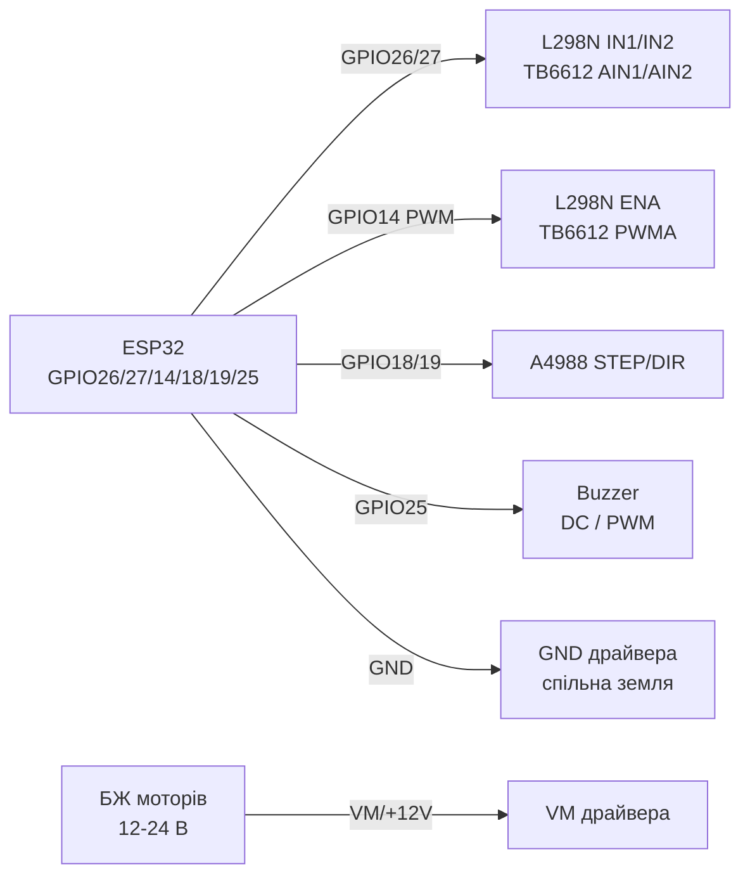
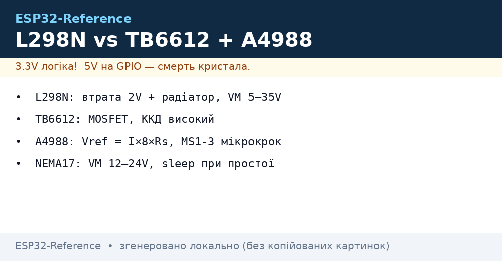

# L298N, TB6612FNG, A4988, Buzzer - Motor Drivers and Sound

## Purpose

Brushed DC and stepper motor drivers + sound emitter: L298N - classic bipolar H-bridge (cheap, but with ~2 V drop and heating); TB6612FNG - modern MOSFET bridge (high efficiency, no heatsink); A4988 - bipolar stepper driver for NEMA17 (microstep up to 1/16, current set via Vref); active buzzer (beeps alone on DC) vs passive (needs PWM melody).

## Characteristics

| Parameter | L298N (module) | TB6612FNG | A4988 |
| --- | --- | --- | --- |
| Type | Bipolar H-bridge x2 | MOSFET H-bridge x2 | Stepper chopper driver |
| Motor voltage | 5-35 V (5 V logic) | 2.5-13.5 V (2.7-5.5 V logic) | 8-35 V (3-5.5 V logic) |
| Current | 2 A/channel (3 A peak), really 1-1.5 A with heatsink | 1.2 A continuous / 3.2 A peak per channel | up to 1 A without heatsink / 2 A with airflow |
| Drop | ~2-3 V (transistor saturation!) | ~0.1-0.3 V (Rds(on) MOSFET) | Chopper - high efficiency |
| Microstep | None | None (direction+PWM only) | Full/1-2/1-4/1-8/1-16 (MS1-MS3) |
| Protection | Diodes on module, weak thermal guard | Thermal shutdown, UVLO | Thermal + overcurrent |
| ESP32 levels | OK (threshold ~2 V) | OK directly at 3.3 V | STEP/DIR 3.3 V OK |

Buzzer:

| Type | Control | Sound |
| --- | --- | --- |
| Active (with generator) | DC HIGH/LOW - beeps alone (~2-4 kHz) | One tone, loud; for alarms |
| Passive (no generator) | PWM/melody (`tone()`, LEDC, RMT) | Any melody; for UI sounds |

## Pinout

| L298N module | Purpose |
| --- | --- |
| +12V / GND | Motor supply (5-35 V) + common ground with ESP32 |
| +5V | 5 V output (5V-EN jumper on, Vin <=12 V) or 5 V logic input (jumper off, Vin >12 V) |
| IN1/IN2 | Напрям мотора A (GPIO) |
| IN3/IN4 | Напрям мотора B (GPIO) |
| ENA/ENB | speed (PWM) - remove jumper for PWM, on = always ON |
| OUT1/OUT2, OUT3/OUT4 | to motors A/B |

| TB6612FNG | Purpose |
| --- | --- |
| VM / VCC / GND | VM = motors, VCC = 3.3-5 V logic, common GND |
| AIN1/AIN2, BIN1/BIN2 | Напрям (GPIO) |
| PWMA/PWMB | speed (ШІМ) |
| STBY | HIGH = run (pull up to VCC/GPIO) |
| AO1/AO2, BO1/BO2 | to motors |

| A4988 (StepStick) | Purpose |
| --- | --- |
| VMOT/GND | 8-35 V motors + 100 uF electrolytic near board! |
| VDD/GND | 3.3-5 V logic |
| STEP/DIR | Step (edge) / direction (GPIO) |
| ENABLE | LOW = enabled (can tie to GND) |
| MS1-MS3 | Microstep (see table) |
| RESET/SLEEP | join together (else sleeps) |
| 1A/1B, 2A/2B | Stepper windings (pair rings with multimeter!) |
| Vref (potentiometer) | current: Itrip = Vref / (8 x Rs); Rs=0.1 Ohm → I = Vref/0.8 |

## Wiring diagram

| ESP32 | L298N | Note |
| --- | --- | --- |
| GPIO26 | IN1 | Напрям A |
| GPIO27 | IN2 | Напрям A |
| GPIO14 | ENA | PWM speed (ENA jumper removed) |
| GPIO32/33 | IN3/IN4 | Напрям B |
| GPIO15 | ENB | PWM speed |
| GND | GND | common ground mandatory |
| - | +12V | Motor PSU (not from ESP32!) |

| ESP32 | TB6612FNG | Note |
| --- | --- | --- |
| GPIO26/27 | AIN1/AIN2 | Напрям |
| GPIO14 | PWMA | PWM 20 kHz (above audible) |
| 3V3 | VCC + STBY | Logic + enable |
| Motor PSU | VM | 2.5-13.5 V |
| GND | GND | common ground |

| ESP32 | A4988 | Note |
| --- | --- | --- |
| GPIO18 | STEP | Step, pulse >=1 us |
| GPIO19 | DIR | Напрям |
| GPIO21 | ENABLE | Optional (LOW = on) |
| 3V3 | VDD | Logic |
| 12-24 V PSU | VMOT | 100 uF electrolytic! |
| GND | GND (both) | common ground |

| ESP32 | Buzzer | Note |
| --- | --- | --- |
| GPIO25 | + active (DC) | through 100 Ohm; loud - 100-220 Ohm resistor |
| GPIO25 | + passive | PWM/LEDC/RMT melody; NPN transistor as 5 V buffer |

### ASCII-schem

```text
ESP32 DevKit            L298N / TB6612 / A4988 / Buzzer
------------            --------------------------------
GPIO26 ───────────────► IN1 / AIN1 (напрям A)
GPIO27 ───────────────► IN2 / AIN2 (напрям A)
GPIO14 ──[PWM 20 кГц]─► ENA / PWMA (швидкість, джампер знято!)
GPIO32/33 ────────────► IN3/IN4 (мотор B, L298N)
3V3 ──────────────────► VCC логіки + STBY (TB6612 HIGH = робота)
БЖ моторів ───────────► +12V (L298N) / VM (TB6612) / VMOT (A4988)
GND ──────────────────► GND драйвера (= GND ESP32 обов'язково!)
A4988: GPIO18 ──► STEP, GPIO19 ──► DIR, [100 мкФ] на VMOT!
Buzzer: GPIO25 ──[100 Ом]──► + (активний DC / пасивний PWM)
Мотори - ніколи від 5V/3V3 плати, тільки окремий БЖ!
```

### Mermaid




*Fig. L298N/TB6612 - separate power ground with common GND, PWM on ENA/PWMA, A4988 STEP/DIR. Space below photo - see .*

## Code ESP-IDF

```c
#include "driver/ledc.h"
#include "driver/gpio.h"
#include "freertos/FreeRTOS.h"
#include "freertos/task.h"

#define IN1 GPIO_NUM_26
#define IN2 GPIO_NUM_27
#define ENA_PWM_CH LEDC_CHANNEL_0
#define STEP_PIN GPIO_NUM_18
#define DIR_PIN  GPIO_NUM_19

static void motor_dc(int8_t speed) // -100..100
{
    gpio_set_level(IN1, speed >= 0);
    gpio_set_level(IN2, speed < 0);
    uint32_t duty = abs(speed) * 8191 / 100; // 13 біт
    ledc_set_duty(LEDC_LOW_SPEED_MODE, ENA_PWM_CH, duty);
    ledc_update_duty(LEDC_LOW_SPEED_MODE, ENA_PWM_CH);
}

static void stepper_steps(int n, int us_delay)
{
    for (int i = 0; i < n; i++) {
        gpio_set_level(STEP_PIN, 1);
        esp_rom_delay_us(5);
        gpio_set_level(STEP_PIN, 0);
        esp_rom_delay_us(us_delay);
    }
}

void app_main(void)
{
    gpio_set_direction(IN1, GPIO_MODE_OUTPUT);
    gpio_set_direction(IN2, GPIO_MODE_OUTPUT);
    gpio_set_direction(STEP_PIN, GPIO_MODE_OUTPUT);
    gpio_set_direction(DIR_PIN, GPIO_MODE_OUTPUT);
    // LEDC 20 кГц для ENA + 2 кГц для пасивного buzzera - за потребою
    motor_dc(70);
    gpio_set_level(DIR_PIN, 1);
    stepper_steps(400, 1000); // 2 оберти при 1/1, 200 кроків/об
}
```

## Code Arduino

```cpp
#define IN1 26
#define IN2 27
#define ENA 14
#define STEP_PIN 18
#define DIR_PIN 19
#define BUZZ_PIN 25

void dcSpeed(int8_t s) { // -255..255
  digitalWrite(IN1, s >= 0);
  digitalWrite(IN2, s < 0);
  analogWrite(ENA, abs(s)); // ESP32 core: LEDC
}

void setup() {
  pinMode(IN1, OUTPUT); pinMode(IN2, OUTPUT);
  pinMode(STEP_PIN, OUTPUT); pinMode(DIR_PIN, OUTPUT);
  pinMode(BUZZ_PIN, OUTPUT);
  // A4988 мікрокрок MS1..MS3: LOW LOW LOW = full step
  digitalWrite(DIR_PIN, HIGH);
}

void loop() {
  dcSpeed(180); delay(1500);
  dcSpeed(-180); delay(1500);
  // Кроковик: 200 імпульсів = 1 оберт (full step, NEMA17 1.8°)
  for (int i = 0; i < 200; i++) {
    digitalWrite(STEP_PIN, HIGH); delayMicroseconds(5);
    digitalWrite(STEP_PIN, LOW); delayMicroseconds(1000);
  }
  tone(BUZZ_PIN, 2000, 150); // пасивний buzzer; активному - digitalWrite HIGH
  delay(1000);
}
```

## Code MicroPython

```python
from machine import Pin, PWM
import time

in1, in2 = Pin(26, Pin.OUT), Pin(27, Pin.OUT)
ena = PWM(Pin(14), freq=20000)
step_pin, dir_pin = Pin(18, Pin.OUT), Pin(19, Pin.OUT, value=1)
buzz = PWM(Pin(25, freq=2000, duty=0))

def dc(speed):  # -100..100
    in1.value(speed >= 0); in2.value(speed < 0)
    ena.duty(int(abs(speed) * 1023 / 100))

dc(70); time.sleep(1.5)
dc(-70); time.sleep(1.5); dc(0)

for _ in range(200):  # 1 оберт NEMA17 full-step
    step_pin.value(1); time.sleep_us(5)
    step_pin.value(0); time.sleep_us(1000)

buzz.duty(512); time.sleep_ms(150); buzz.duty(0)  # пасивний beep
```

## A4988 current configuration (Vref)

1. Вимкити мотор, подати VMOT + VDD.
2. Multimeter: black to GND, red to potentiometer wiper.
3. Turn to `Vref = Itrip x 0.8` (at Rs 0.1 Ohm): NEMA17 1.2 A → Vref ≈ 0.96 V; without airflow limit to 1 A → 0.8 V.
4. Check heating after 5 min: finger holds ~10 s - normal; else lower Vref / add heatsink+fan.
5. NEVER switch motor with VMOT applied - spike kills bridge.

## Common issues

1. **L298N + 6 V motors on 6 V PSU** → ~4 V at motor (2 V drop), slow/weak. Raise PSU by 2-3 V or move to TB6612.
2. **ENA jumper on + PWM applied** → conflict, PWM dead. Remove ENA/ENB jumper for speed control.
3. **No common ESP32-driver ground** → motors jerk/driver ignores. Join all GNDs.
4. **A4988 without 100 uF electrolytic on VMOT** → spikes kill driver. Capacitor near board mandatory.
5. **Stepper winding pairs swapped** → vibration instead of rotation. Pairs ring with multimeter (low resistance ~single Ohms).
6. **TB6612 STBY floating / A4988 RESET-SLEEP not joined** → driver silent. STBY → HIGH; RESET ↔ SLEEP with jumper.
7. **Active buzzer on PWM melody** → rasps/silent. Active needs DC HIGH/LOW only; melodies only for passive.

## Official sources

- [L298N + ESP32 tutorial with code (RNT)](https://randomnerdtutorials.com/esp32-dc-motor-l298n-motor-driver-control-speed-direction/) - DC motor speed and direction.
- [TB6612 - live photo (Adafruit)](https://www.adafruit.com/product/2448) - product page with photo.
- [TB6612 guide with code (Adafruit Learn)](https://learn.adafruit.com/adafruit-tb6612-h-bridge-dc-stepper-motor-driver-breakout) - DC and stepper motors.
- A4988 Datasheet (Allegro) - `check manually`.

## See also

- [ Interrupts / PWM]
- [ GPIO Overview]
- [ADC](../../../../ESP32-Reference/UA/06-Analog/01-ADC.md)
- [I2C](../../../../ESP32-Reference/UA/04-Shini/03-I2C.md)
- [SPI](../../../../ESP32-Reference/UA/04-Shini/02-SPI.md)
- [NeoPixel Servo Relay MOSFET](../../../../ESP32-Reference/UA/11-Vivid/03-NeoPixel-Servo-Rele-MOSFET.md)
- [05 HC SR04 PIR](../../../../ESP32-Reference/UA/10-Sensori/05-HC-SR04-PIR.md)
