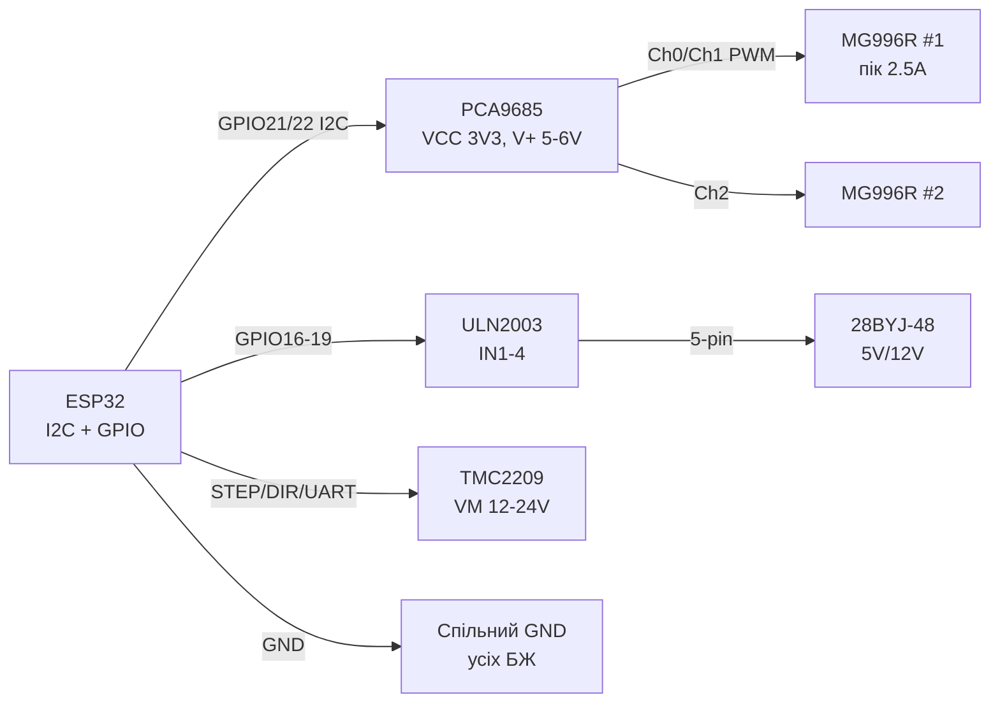
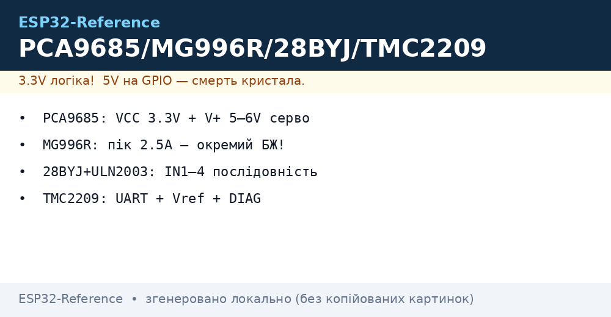
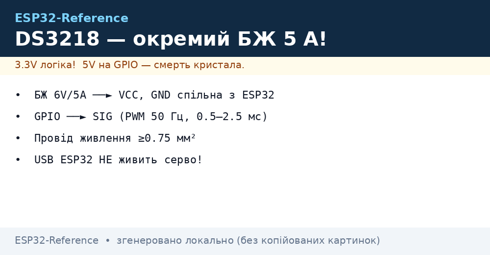

# PCA9685, MG996R, 28BYJ-48, TMC2209 - Servos, Stepper, Drivers

## Purpose

Powerful motion for ESP32 without timer fights: 16-channel PWM driver PCA9685 over I2C drives up to 16 servos with 12-bit precision; MG996R servo gives ~10 kg-cm for arms, chassis, grippers; 28BYJ-48 stepper with ULN2003 driver - cheap precise positioning (clocks, dials, actuators); TMC2209 driver - silent (StealthChop) control of bipolar NEMA17/14 via STEP/DIR or UART. All with separate power and common GND.

## Characteristics

| Module | Control | power supply | Key rule |
| --- | --- | --- | --- |
| PCA9685 16ch 12-bit PWM | I2C, address 0x40 + A0-A5 (up to 62 boards) | VCC 3.3 V (logic) + V+ 5-6 V (servo) | OE to GND (or PWM dimming); servo frequency 50-60 Hz |
| MG996R servo | PWM 50 Hz, 1-2 ms (0-180 deg) | 4.8-6 V, run ~500 mA, stall peak ~2.5 A! | Separate PSU 5-6 V / 3 A+; NEVER from ESP32 3.3 V |
| 28BYJ-48 + ULN2003 | IN1-IN4, half/full step sequence | 5 V (12 V version exists - check marking!) | Gear 1:64 → 4096 half-steps/rev |
| TMC2209 | STEP/DIR + UART (address, current, StealthChop) | VM 4.75-28 V, VIO 3.3 V | Vref / UART current limit; MS1/MS2 - UART address |
| libraries Arduino | Adafruit_PWMServoDriver | ESP32Servo | AccelStepper, CheepStepper |
| ESP-IDF | I2C + prescale calculation | LEDC 50 Hz | RMT/PCNT or MCPWM STEP |

> Power ground and logic ground - common, but power supply - SEPARATE. Servos/motors on ESP32 3V3 pin = guaranteed reboots and regulator death.

## Легенда pinandin модуля

| pin | Тип | Куди | Note |
| --- | --- | --- | --- |
| PCA9685 VCC | logic supply | 3.3 V ESP32 | Logic only! |
| PCA9685 V+ (green terminal) | Power | 5-6 V PSU (servo) | current = sum of all servos; 20%+ margin |
| PCA9685 GND | ground | GND ESP32 + power PSU GND | common point mandatory |
| PCA9685 SDA / SCL | I2C | GPIO21 / GPIO22 | Pull-ups on board present; address A0-A5 via jumpers |
| PCA9685 OE | input, active LOW | GND (or GPIO/PWM) | HIGH disables all outputs - emergency stop |
| PCA9685 Ch0-Ch15 (PWM/Servo) | Outputs | Servo signal | GND+V+ from nearby terminal |
| MG996R brown/black | GND | Power PSU GND | Thick wire! |
| MG996R red | 5-6 V | V+ PSU | 2.5 A peak - 470-1000 uF capacitor |
| MG996R orange | Signal | PCA9685 Ch / GPIO | PWM 50 Hz |
| ULN2003 IN1-IN4 | Inputs | 4x GPIO | Half-step sequence: 8 states |
| ULN2003 VCC / GND | power supply | 5 V / GND | Power jumper on board |
| 28BYJ-48 connector | 5-pin | ULN2003 board | do not mix 5 V and 12 V versions! |
| TMC2209 VM / GND | Power | 12-24 V (motors) | 100 uF electrolytic near VM! |
| TMC2209 VIO | Logic | 3.3 V | Common GND with ESP32 |
| TMC2209 STEP / DIR | Inputs | GPIO | Step on edge; DIR - direction |
| TMC2209 TX / RX (PDN_UART) | UART 1-wire | GPIO (115200) | Current, microstep, StealthChop setup |
| TMC2209 MS1 / MS2 | UART address | GND/VIO combos | 4 addresses on one UART line |
| TMC2209 DIAG | output | GPIO (interrupt) | StallGuard - endstop/homing without limit switches |
| TMC2209 EN | input | GPIO or GND | LOW = driver active |

## Wiring diagram

| ESP32 | module | Note |
| --- | --- | --- |
| GPIO21 | PCA9685 SDA | I2C; up to 62 boards on bus |
| GPIO22 | PCA9685 SCL | 400 кГц ок |
| 3V3 | PCA9685 VCC | Logic |
| GND | PCA9685 GND | + power PSU GND here too |
| PSU 5-6 in | PCA9685 V+ (клемник) | 3 but+ for 2× MG996R |
| Ch0.. | MG996R Signal | one wire per servo |
| GPIO16,17,18,19 | ULN2003 IN1-IN4 | Pin order matters for free run |
| 5V PSU | ULN2003 VCC | version мотора 5 in! |
| GPIO25 | TMC2209 STEP | Імпульси кроку |
| GPIO26 | TMC2209 DIR | Напрям |
| GPIO27 | TMC2209 RX/TX (1-wire) | via 1 k resistor; UART 115200 |
| GPIO14 | TMC2209 DIAG | Optional, StallGuard |
| 3V3 | TMC2209 VIO + EN logic | EN to GND = always active (simpler than GPIO) |

### ASCII-schem

```text
ESP32 DevKit              PCA9685 + MG996R + ULN2003 + TMC2209
------------              ------------------------------------
GPIO21 ──────────────────► SDA PCA9685 (VCC=3V3, V+=5-6V БЖ!)
GPIO22 ──────────────────► SCL PCA9685 (A0-A5 = адреса)
GND ─────────────────────► GND PCA9685 (= GND силового БЖ!)
Ch0/Ch1 ─────────────────► Signal MG996R ×2 (VCC ──► V+ БЖ)
БЖ 5-6V/3A+ ─────────────► V+ PCA9685 + [470мкФ] на клемник
GPIO16-19 ───────────────► IN1-IN4 ULN2003 (VCC=5V мотора!)
GPIO25 ──────────────────► STEP TMC2209 (VM=12-24V +[100мкФ])
GPIO26 ──────────────────► DIR  TMC2209 (VIO=3V3)
GPIO27 ──[1к]────────────► PDN_UART TMC2209 (115200, адреса)
GPIO14 ◄───────────────── DIAG TMC2209 (StallGuard)
```

### Mermaid




*Fig. PCA9685 with split logic/servo power, ULN2003 for 28BYJ-48, TMC2209 with VM 12-24 V. All GNDs common, power rails separate. Space below photo - see .*

## Code ESP-IDF

```c
// PCA9685 по I2C: prescale для 50 Гц + кут серво; STEP для TMC2209 по RMT/GPIO
#include "driver/i2c.h"
#include "driver/gpio.h"

#define PCA_ADDR 0x40
#define SERVO_CH 0

static void pca_write(uint8_t reg, uint8_t val) {
    i2c_cmd_handle_t c = i2c_cmd_link_create();
    i2c_master_start(c);
    i2c_master_write_byte(c, (PCA_ADDR << 1) | I2C_MASTER_WRITE, true);
    i2c_master_write_byte(c, reg, true);
    i2c_master_write_byte(c, val, true);
    i2c_master_stop(c);
    i2c_master_cmd_begin(I2C_NUM_0, c, pdMS_TO_TICKS(50));
    i2c_cmd_link_delete(c);
}

static void servo_angle(uint8_t ch, float deg) {
    // 50 Гц, 12 біт: 1мс=205, 2мс=410
    uint16_t off = 205 + (uint16_t)(deg * (205.0f / 180.0f));
    uint8_t base = 0x06 + ch * 4;
    pca_write(base, 0); pca_write(base + 1, 0);
    pca_write(base + 2, off & 0xFF); pca_write(base + 3, off >> 8);
}

void app_main(void) {
    i2c_config_t cfg = {.mode = I2C_MODE_MASTER,
        .sda_io_num = 21, .scl_io_num = 22,
        .sda_pullup_en = true, .scl_pullup_en = true,
        .master.clk_speed = 400000};
    i2c_param_config(I2C_NUM_0, &cfg);
    i2c_driver_install(I2C_NUM_0, I2C_MODE_MASTER, 0, 0, 0);

    pca_write(0x00, 0x10);   // sleep для зміни prescale
    pca_write(0xFE, 121);    // prescale: 25МГц/(4096*50)-1 ≈ 121
    pca_write(0x00, 0x00);   // wake
    pca_write(0x01, 0x04);   // totem-pole (не open-drain)
    servo_angle(SERVO_CH, 90);
}
```

## Code Arduino

```cpp
#include <Wire.h>
#include <Adafruit_PWMServoDriver.h>
#include <AccelStepper.h>
#include <TMCStepper.h>

// --- PCA9685 + MG996R ---
Adafruit_PWMServoDriver pca = Adafruit_PWMServoDriver(0x40);
#define SERVO_MIN 205   // 1 мс @50Гц
#define SERVO_MAX 410   // 2 мс @50Гц
void servoDeg(uint8_t ch, float deg) {
  pca.setPWM(ch, 0, SERVO_MIN + deg * (SERVO_MAX - SERVO_MIN) / 180.0);
}

// --- 28BYJ-48 + ULN2003 (півкрок) ---
AccelStepper byj(AccelStepper::HALF4WIRE, 16, 18, 17, 19);

// --- TMC2209 по UART ---
#define RX_PIN 27  // PDN_UART 1-wire через 1к
#define TX_PIN 27
#define DRV_ADDR 0b00
TMC2209Stepper tmc(&Serial2, 0.11f, DRV_ADDR);

void setup() {
  Wire.begin(21, 22);
  pca.begin();
  pca.setPWMFreq(50);
  servoDeg(0, 90);

  byj.setMaxSpeed(500);
  byj.setAcceleration(200);
  byj.moveTo(2048);  // пів оберта

  Serial2.begin(115200, SERIAL_8N1, RX_PIN, TX_PIN);
  tmc.begin();
  tmc.rms_current(600);      // мА мотора!
  tmc.microsteps(16);
  tmc.en_spreadCycle(false); // StealthChop = тихо
  tmc.pwm_autoscale(true);

  pinMode(25, OUTPUT);  // STEP
  pinMode(26, OUTPUT);  // DIR
}

void loop() {
  byj.run();
  digitalWrite(26, HIGH);
  digitalWrite(25, HIGH); delayMicroseconds(5);
  digitalWrite(25, LOW); delayMicroseconds(500);
}
```

## Code MicroPython

```python
from machine import Pin, I2C
import time

# --- PCA9685 ---
i2c = I2C(0, sda=Pin(21), scl=Pin(22), freq=400_000)
PCA = 0x40
def w(reg, val):
    i2c.writeto_mem(PCA, reg, bytes([val]))

w(0x00, 0x10); w(0xFE, 121); w(0x00, 0x00); w(0x01, 0x04)
time.sleep_ms(10)

def servo(ch, deg):
    off = int(205 + deg * 205 / 180)
    base = 0x06 + ch * 4
    i2c.writeto_mem(PCA, base, bytes([0, 0, off & 0xFF, off >> 8]))

servo(0, 90)

# --- 28BYJ-48 півкрок ---
SEQ = [(1,0,0,0),(1,1,0,0),(0,1,0,0),(0,1,1,0),
       (0,0,1,0),(0,0,1,1),(0,0,0,1),(1,0,0,1)]
pins = [Pin(n, Pin.OUT) for n in (16, 17, 18, 19)]
def step_once(i, d=2):
    for p, v in zip(pins, SEQ[i % 8]):
        p.value(v)
    time.sleep_ms(d)

for i in range(512):  # ~1/8 оберта для тесту
    step_once(i)

# --- TMC2209 STEP/DIR (UART-конфіг - через module tmc2209 за наявності) ---
step, dir_ = Pin(25, Pin.OUT), Pin(26, Pin.OUT)
dir_.value(1)
for _ in range(200):
    step.value(1); time.sleep_us(5)
    step.value(0); time.sleep_us(500)
```

### DS3218 - large 20 kg-cm servo

| Parameter | DS3218 (180° / 270° / 360° versions) |
| --- | --- |
| Момент / speed | 20 кг/см at 6.8 in, 0.16 с/60° |
| Control | PWM 50 Hz, 0.5-2.5 ms (wider window than SG90!) |
| Power | 4.8-6.8 V, stall peak up to 3 A |
| Calibration | Pick 0.5/2.5 ms endpoints per unit - spread ±10% |

```text
БЖ 6 В / 5 А ──► VCC DS3218 ═══ GND спільна з ESP32 ═══
ESP32 GPIO ──► SIG DS3218 (рівень 3.3 В достатньо, вхід 5V-толерантний за паспортом)
```

> DS3218 vs MG996R: twice the torque and metal gears, but 3 A peak too - PSU with margin, supply wire no thinner than 0.75 mm2.


*Fig. DS3218: separate 6 V/5 A PSU, common ground, 50 Hz PWM with 0.5-2.5 ms window.*

## Common issues

| # | error | Symptom | Fix |
| --- | --- | --- | --- |
| 1 | Servo (esp. MG996R) on board 3V3/USB | Reboots, jitter, AMS1117 death | Separate 5-6 V / 3 A+ PSU, thick wires, 470-1000 uF on V+ |
| 2 | No common ESP32-PCA-PSU GND | Servo jerks randomly | Join all GNDs at one star point |
| 3 | Wrong PCA9685 prescale | Angle not 0-180 deg, servo hum | Prescale 121 for 50 Hz (internal 25 MHz ± spread - calibrate) |
| 4 | MG996R holds load constantly | Overheat, gear wear | Disable PWM (setPWM 0/4096) or OE in pauses |
| 5 | 28BYJ-48 at 12 V instead of 5 V (or vice versa) | Weak/hot, missed steps | Read motor marking; supply = rated |
| 6 | Wrong IN1-IN4 pin order | Vibrates in place, does not spin | Swap pin order (16,17,18,19) or invert sequence |
| 7 | TMC2209 without current limit | Boiling motor/driver | rms_current() = ~70% of motor rating; heatsink + fan |
| 8 | TMC2209 VM without electrolytic / on long wires | Resets, breakdown on back-EMF | 100 uF near VM, short thick wires, VM within 4.75-28 V |
| 9 | TMC2209 UART address (MS1/MS2) mismatch | Silent on UART, STEP/DIR only | MS1/MS2 both GND = 0b00; check address in code |
| 10 | DS3218 powered from ESP32 USB | Reboots on move + sag | Separate 5-6.8 V / 5 A PSU, common GND, signal wire away from power |

## Official sources

- PCA9685 Datasheet (NXP) - `check manually` (nxp.com site redesign).
- [PCA9685 - live photo (Adafruit)](https://www.adafruit.com/product/815) - product page with photo.
- [Servo + ESP32 tutorial with code (RNT)](https://randomnerdtutorials.com/esp32-servo-motor-web-server-arduino-ide/) - servo control, also valid for PCA9685.
- [How servo works with code (LME)](https://lastminuteengineers.com/servo-motor-arduino-tutorial/) - PWM, angles, power.
- TMC2209 Datasheet (Analog/Trinamic) - `check manually`.
- DS3218 Datasheet (PDF search): [DS3218 search](https://www.alldatasheet.com/view.jsp?Searchword=DS3218) - 20 kg-cm servo (generic model from several factories, verify with actual batch).

## See also

- [ Interrupts / PWM]
- [EN/07-Timers/01-Timers-MCPWM-PCNT-RMT.en]
- [I2C](../../../../ESP32-Reference/UA/04-Shini/03-I2C.md)
- [UART](../../../../ESP32-Reference/UA/04-Shini/01-UART.md)
- [ Power Supply Rails]
- [Home](../../../../ESP32-Reference/Home.md)
- [NeoPixel Servo Relay MOSFET](../../../../ESP32-Reference/UA/11-Vivid/03-NeoPixel-Servo-Rele-MOSFET.md)
