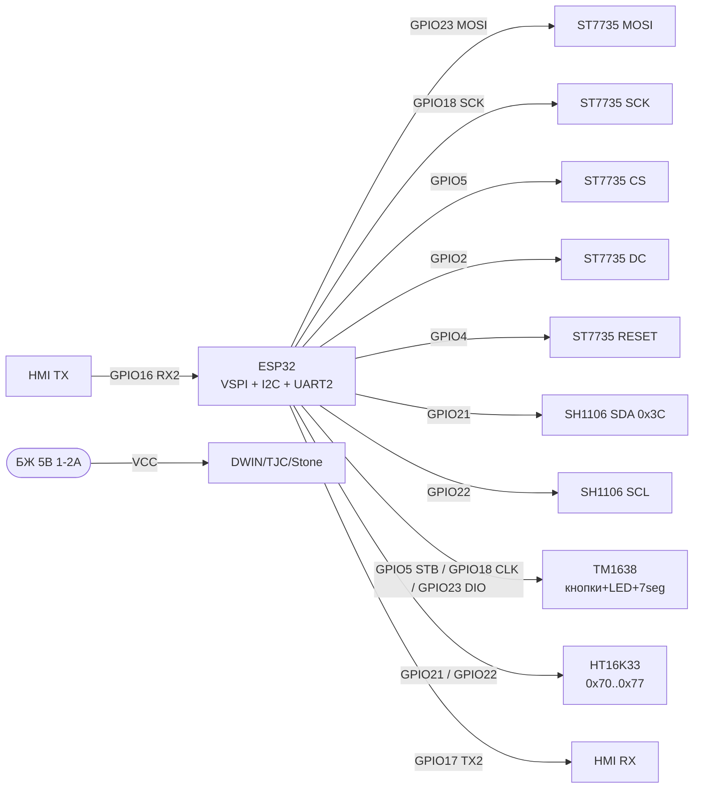
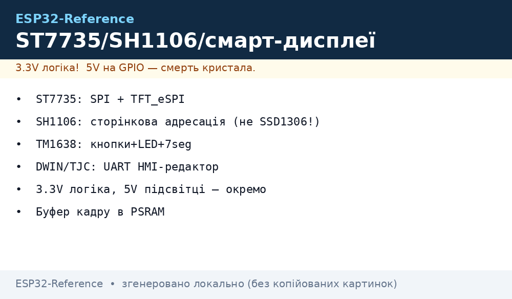

# Displays 2 - TFT SPI, SH1106/SSD1309, HX8357, TM1638, HT16K33, Smart HMI

## Purpose

Extended overview of display modules for ESP32: colour TFT over SPI (ST7735 1.8", HX8357 3.5"),
mono OLED controllers SH1106 and SSD1309 (how they differ from SSD1306),
LED controllers with TM1638 buttons and I2C matrix driver HT16K33,
but also smart UART displays DWIN / TJC (TJC - Nextion clone) / Stone with own HMI editor.
Basic OLED SSD1306 - see [OLED SSD1306](../../../../ESP32-Reference/UA/11-Vivid/01-OLED-SSD1306.md), TFT/EPaper - [TFT LCD Epaper](../../../../ESP32-Reference/UA/11-Vivid/02-TFT-LCD-Epaper.md),
7-segment MAX7219/TM1637 - [MAX7219 TM1637 74HC595](../../../../ESP32-Reference/UA/11-Vivid/05-MAX7219-TM1637-74HC595.md), Nextion/LCD2004 - [DFPlayer MAX98357 Nextion LCD2004](../../../../ESP32-Reference/UA/11-Vivid/08-DFPlayer-MAX98357-Nextion-LCD2004.md).

## Characteristics

| Module | Diagonal / resolution | Interface | power / logic | Feature |
| --- | --- | --- | --- | --- |
| ST7735 1.8" TFT | 1.8", 128x160, 18-bit (262144 colours) | SPI 4-wire + DC/RES/CS, microSD slot | 3.3 V (module with LDO), 3.3 V logic OK | TFT_eSPI library, fast framebuffer |
| SH1106 1.3" OLED | 1.3", 128x64 mono | I2C (address 0x3C/0x3D) | 3.3 V | 132x64 GDDRAM with 2 px shift - needs own driver! |
| SSD1309 2.42" OLED | 2.42", 128x64 mono | SPI / I2C (BS1/BS2 jumpers) | 3.3 V | Bigger screen, external charge-pump, driver separate from SSD1306 |
| HX8357 3.5" TFT | 3.5", 320x480, 16-bit | SPI or 8/16-bit parallel | 3.3 V, backlight ~100-150 mA | Large screen, needs PSRAM/sprite buffer |
| TM1638 | 8x7-seg + 8 LEDs + 8 buttons | 3-wire (STB/CLK/DIO) | 3.3-5 V | All in one chip: indication + keyboard |
| HT16K33 | LED matrix 8x8 / 16x8, 7-seg up to 8 digits | I2C (addresses 0x70-0x77) | 3.3-5 V | Hardware multiplexing + 1/16 dimming, INT interrupt |
| DWIN / TJC / Stone | 2.4"-7.0" TFT with touch | UART (TTL, typically 115200) | 5 V separate PSU | GUI drawn in HMI editor, ESP32 only sends commands |

> SH1106 is not SSD1306: SH1106 has page addressing 132x64, so SSD1306 driver shifts image by 2 px.
> SSD1309 is a separate controller for large 2.42" OLEDs, no SSD1306 compat at init level.

## Легенда pinandin модуля

### ST7735 1.8" TFT (SPI, typical module with microSD)

| Pin | Value | Type | To ESP32 | Note |
| --- | --- | --- | --- | --- |
| 1 | VCC | power supply input | 3V3 (або 5V if is LDO) | recommended 3.3 in |
| 2 | GND | ground | GND | common ground |
| 3 | CS (TFT_CS) | input CS, active low | GPIO5 | Chip Select дисплея |
| 4 | RESET (RST) | input reset | GPIO4 (будь-which GPIO) | hardware скид, active low |
| 5 | A0 / DC | digital input | GPIO2 (any GPIO) | Data/Command: HIGH = data, LOW = command |
| 6 | SDA / MOSI | input SPI | GPIO23 (VSPI MOSI) | ESP32 → display |
| 7 | SCK | SPI input | GPIO18 (VSPI SCK) | Clocking up to 40 MHz |
| 8 | LED (BL) | power input | 3V3 or GPIO via PWM | Backlight ~50 mA, can dim with PWM |
| 9 | SD_CS | card CS input | GPIO13 (any GPIO) | unused without card - pull HIGH |

### SH1106 1.3" OLED (I2C, 4-pin)

| Pin | Value | Type | To ESP32 | Note |
| --- | --- | --- | --- | --- |
| 1 | VCC | power supply input | 3V3 | 3.3 V only |
| 2 | GND | ground | GND | common ground |
| 3 | SCL | I2C input | GPIO22 | 400 kHz, pull-up on module |
| 4 | SDA | I2C input/output | GPIO21 | 400 kHz, pull-up on module |

> Difference from SSD1306 - page addressing: GDDRAM 132x64, visible 128x64 with 2-column shift.
> driver: `U8G2_SH1106_128X64_NONAME_F_HW_I2C`, `Adafruit_SH110X`. address та ж: 0x3C (SA0=0) / 0x3D (SA0=1).

### SSD1309 2.42" OLED (SPI/I2C, перемички BS1/BS2)

| Pin | Value | Type | To ESP32 | Note |
| --- | --- | --- | --- | --- |
| 1 | VCC | power supply input | 3V3 | Logic and panel 3.3 V |
| 2 | GND | ground | GND | common ground |
| 3 | SCL / SCK | input | GPIO22 (I2C) або GPIO18 (SPI) | depends on BS1/BS2 |
| 4 | SDA / MOSI | input/output | GPIO21 (I2C) або GPIO23 (SPI) | I2C-address 0x3C |
| 5 | RES | input reset | GPIO4 | Active low |
| 6 | DC | digital input | GPIO2 | Only in SPI mode |
| 7 | CS | CS input | GPIO5 | Only in SPI mode, in I2C - to GND |

### HX8357 3.5" TFT 320×480 (SPI-version)

| Pin | Value | Type | To ESP32 | Note |
| --- | --- | --- | --- | --- |
| 1 | VCC | power supply input | 3V3 | Consumption with backlight up to 150 mA |
| 2 | GND | ground | GND | Thick short wires |
| 3 | CS | input CS, active low | GPIO5 | Chip Select |
| 4 | RESET | input reset | GPIO4 | Active low |
| 5 | DC/RS | digital input | GPIO2 | Data/Command |
| 6 | MOSI | input SPI | GPIO23 | data ESP32 → display |
| 7 | SCK | input SPI | GPIO18 | SPI 20-40 МГц |
| 8 | LED/BL | input | 3V3 or PWM GPIO | Backlight, can do PWM dimming |
| 9 | MISO | SPI output | GPIO19 | GRAM read (optional) |
| 10 | T_CS | touch CS input | GPIO15 | XPT2046, optional |
| 11 | T_IRQ | interrupt output | GPIO27 or NC | Touch, optional |

### TM1638 (module with кнопками, LED and 7-сегментами)

| Pin | Value | Type | To ESP32 | Note |
| --- | --- | --- | --- | --- |
| 1 | VCC | power supply input | 3V3 or 5V | Logic tolerant to 3.3 V |
| 2 | GND | ground | GND | common ground |
| 3 | STB | strobe input, active low | GPIO5 | Analog of CS |
| 4 | CLK | clock input | GPIO18 | Driven by ESP32 |
| 5 | DIO | Bidirectional | GPIO23 | data + button read |

### HT16K33 (I2C LED driver, backpack module)

| Pin | Value | Type | To ESP32 | Note |
| --- | --- | --- | --- | --- |
| 1 | VCC | power supply input | 3V3 or 5V | depends on LED matrix |
| 2 | GND | ground | GND | common ground |
| 3 | SCL | input I2C | GPIO22 | 400 кГц |
| 4 | SDA | input/output I2C | GPIO21 | Адреси 0x70-0x77 (перемички A0-A2) |
| 5 | INT | output, active low | GPIO26 or NC | keyscan interrupt (only versions with keyboard) |

### Smart display DWIN / TJC / Stone (UART HMI)

| Pin | Value | Type | To ESP32 | Note |
| --- | --- | --- | --- | --- |
| 1 | VCC | power supply input | 5V separate 1-2 A PSU | not from DevKit 5V pin for 5"+! |
| 2 | GND | ground | GND | common with ESP32 mandatory |
| 3 | TX (дисплея) | output UART | GPIO16 (RX2 ESP32) | Перехресно: TX→RX |
| 4 | RX (дисплея) | input UART | GPIO17 (TX2 ESP32) | Перехресно: RX→TX, level 3.3 in OK |

> TJC is a compatible Nextion clone (same editor and protocol). Stone/DWIN have own editors,
> protocol differs. ESP32 does not draw GUI - only sends/receives commands over UART 115200.

## Wiring diagram

| ESP32 | ST7735 (main ex.) | SH1106 | TM1638 | HT16K33 | HMI-UART |
| --- | --- | --- | --- | --- | --- |
| 3V3 | VCC | VCC | VCC | VCC | - (display on 5 in PSU) |
| GND | GND | GND | GND | GND | GND (common!) |
| GPIO18 | SCK | - | CLK | - | - |
| GPIO23 | SDA/MOSI | - | DIO | - | - |
| GPIO5 | CS | - | STB | - | - |
| GPIO2 | DC (A0) | - | - | - | - |
| GPIO4 | RESET | - | - | - | - |
| GPIO22 | - | SCL | - | SCL | - |
| GPIO21 | - | SDA | - | SDA | - |
| GPIO16 | - | - | - | - | TX дисплея |
| GPIO17 | - | - | - | - | RX дисплея |

Power: ST7735 backlight ~50 mA, HX8357 ~100-150 mA - DevKit 3V3 is enough;
smart 5"+ HMI (up to 1-2 A) - separate 5 V PSU only, see [ Power Supply Rails].
bus SPI - [SPI](../../../../ESP32-Reference/UA/04-Shini/02-SPI.md), I2C - [I2C](../../../../ESP32-Reference/UA/04-Shini/03-I2C.md), UART - [UART](../../../../ESP32-Reference/UA/04-Shini/01-UART.md).

### ASCII-schem

```text
ESP32 DevKit              ST7735 1.8" TFT (SPI)
------------              ---------------------
3V3 ────────────────────► VCC
GND ────────────────────► GND
GPIO5 ──────────────────► CS (TFT_CS)
GPIO4 ──────────────────► RESET
GPIO2 ──────────────────► DC/A0 (HIGH=дані, LOW=команда)
GPIO23 ─────────────────► SDA/MOSI
GPIO18 ─────────────────► SCK (до 40 МГц)
3V3 ────────────────────► LED/BL (або GPIO+PWM для димінгу)
GPIO13 ─────────────────► SD_CS (HIGH якщо карти немає)

ESP32 DevKit              SH1106 1.3" / SSD1309-I2C
------------              ------------------------
3V3 ────────────────────► VCC
GND ────────────────────► GND
GPIO22 ─────────────────► SCL (400 кГц)
GPIO21 ─────────────────► SDA (адреса 0x3C; зсув 2 px - драйвер SH1106!)

ESP32 DevKit              TM1638 (кнопки+LED+7seg)
------------              -----------------------
3V3/5V ─────────────────► VCC
GND ────────────────────► GND
GPIO5 ──────────────────► STB
GPIO18 ─────────────────► CLK
GPIO23 ────────────────►► DIO (двонапрямлена!)

ESP32 DevKit              HT16K33 backpack (I2C матриця)
------------              -----------------------------
3V3/5V ─────────────────► VCC
GND ────────────────────► GND
GPIO22 ─────────────────► SCL
GPIO21 ─────────────────► SDA (0x70..0x77 перемичками A0-A2)
GPIO26 ◄───────────────── INT (опційно)

ESP32 DevKit              DWIN/TJC/Stone HMI (UART)
------------              ------------------------
GND ═════════════════════ GND (спільна обов'язково!)
GPIO16 (RX2) ◄──────────── TX дисплея
GPIO17 (TX2) ────────────► RX дисплея
[5V БЖ 1-2А] ────────────► VCC дисплея (НЕ від DevKit!)
Baud: 115200 8N1, перехресно TX-RX
```

### Mermaid




*Fig. wiring ST7735 over SPI, SH1106 over I2C, TM1638/HT16K33 and UART HMI display. Space below schematic - see .*

## Code ESP-IDF

```c
#include <stdio.h>
#include "driver/spi_master.h"
#include "driver/i2c.h"
#include "driver/uart.h"

// --- ST7735 через SPI (спрощено: ініціалізація + заливка) ---
#define TFT_HOST SPI2_HOST
#define PIN_MOSI 23
#define PIN_SCLK 18
#define PIN_CS   5
#define PIN_DC   2
#define PIN_RST  4

static spi_device_handle_t tft;

static void tft_cmd(uint8_t c)
{
    gpio_set_level(PIN_DC, 0);
    spi_transaction_t t = { .length = 8, .tx_buffer = &c, .flags = SPI_TRANS_USE_TXDATA };
    // спрощено: реальний код тримає CS через spi_device_transmit
    spi_device_transmit(tft, &t);
}

void app_main(void)
{
    // SPI-шина для ST7735
    spi_bus_config_t bus = {
        .mosi_io_num = PIN_MOSI, .sclk_io_num = PIN_SCLK,
        .miso_io_num = -1, .quadwp_io_num = -1, .quadhd_io_num = -1,
    };
    spi_bus_initialize(TFT_HOST, &bus, SPI_DMA_CH_AUTO);
    spi_device_interface_config_t dev = {
        .clock_speed_hz = 40 * 1000 * 1000, .mode = 0,
        .spics_io_num = PIN_CS, .queue_size = 4,
    };
    spi_bus_add_device(TFT_HOST, &dev, &tft);
    // Далі: MADCTL/COLMOD/CASET/RASET/RAMWR за даташитом ST7735,
    // зручніше - компонент esp_lcd (esp_lcd_new_panel_st7735).

    // I2C для SH1106 (адреса 0x3C) / HT16K33 (0x70): шина одна
    i2c_config_t icfg = {
        .mode = I2C_MODE_MASTER,
        .sda_io_num = 21, .scl_io_num = 22,
        .sda_pullup_en = GPIO_PULLUP_ENABLE,
        .scl_pullup_en = GPIO_PULLUP_ENABLE,
        .master.clk_speed = 400000,
    };
    i2c_param_config(I2C_NUM_0, &icfg);
    i2c_driver_install(I2C_NUM_0, icfg.mode, 0, 0, 0);
    // SH1106: слати команди 0x00-префіксом, дані 0x40-префіксом,
    // пам'ятати про зсув колонок +2 (column addr 2..133)!

    // UART2 для HMI (TJC-протокол приклад):
    uart_config_t ucfg = {
        .baud_rate = 115200, .data_bits = UART_DATA_8_BITS,
        .parity = UART_PARITY_DISABLE, .stop_bits = UART_STOP_BITS_1,
        .flow_ctrl = UART_HW_FLOWCTRL_DISABLE,
    };
    uart_param_config(UART_NUM_2, &ucfg);
    uart_set_pin(UART_NUM_2, 17, 16, UART_PIN_NO_CHANGE, UART_PIN_NO_CHANGE);
    uart_driver_install(UART_NUM_2, 1024, 1024, 0, NULL, 0);
    const char *cmd = "t0.txt=\"T=24.5C\"";
    uart_write_bytes(UART_NUM_2, cmd, 12);
    uint8_t end[3] = {0xFF, 0xFF, 0xFF};  // термінатор TJC/Nextion-команди
    uart_write_bytes(UART_NUM_2, (char *)end, 3);
}
```

## Code Arduino

```cpp
// ST7735 1.8" через TFT_eSPI (налаштування - у User_Setup.h!)
#include <TFT_eSPI.h>
TFT_eSPI tft = TFT_eSPI();
void setup_st7735() {
  tft.init();
  tft.setRotation(1);
  tft.fillScreen(TFT_BLACK);
  tft.setTextColor(TFT_WHITE, TFT_BLACK);
  tft.drawString("ESP32 ST7735 OK", 10, 10, 2);
  tft.drawString("T=24.5C", 10, 30, 2);
}

// SH1106 1.3" через U8g2 (зсув 2px враховано драйвером!)
#include <U8g2lib.h>
U8G2_SH1106_128X64_NONAME_F_HW_I2C u8g2(U8G2_R0, U8X8_PIN_NONE);
void setup_sh1106() {
  Wire.begin(21, 22);
  u8g2.begin();
  u8g2.clearBuffer();
  u8g2.setFont(u8g2_font_ncenB08_tr);
  u8g2.drawStr(0, 12, "SH1106 OK");
  u8g2.sendBuffer();
}

// TM1638: кнопки + LED + 7-сегментів (бібліотека TM1638 - rjbatista)
#include <TM1638.h>
TM1638 tm(23 /*DIO*/, 18 /*CLK*/, 5 /*STB*/);
void loop_tm1638() {
  uint8_t keys = tm.getButtons();       // бітова маска 8 кнопок
  tm.setLED(1, keys & 0x01);            // LED0 за кнопкою S1
  tm.displayText("24.5 55");            // 8 символів на 7-сегментів
  delay(100);
}

// HT16K33 матриця 8x8 (бібліотека Adafruit_LEDBackpack)
#include <Adafruit_LEDBackpack.h>
Adafruit_8x8matrix m8x8 = Adafruit_8x8matrix();
void setup_ht16k33() {
  m8x8.begin(0x70);
  m8x8.setBrightness(8);                // 0..15
  m8x8.setRotation(1);
  m8x8.drawPixel(3, 3, LED_ON);
  m8x8.writeDisplay();
}

// HMI (TJC/Nextion-протокол): текст + термінатор FF FF FF
void hmi_set_text(const char *obj, const char *txt) {
  Serial2.printf("%s.txt=\"%s\"", obj, txt);
  Serial2.write(0xFF); Serial2.write(0xFF); Serial2.write(0xFF);
}
void setup() {
  Serial.begin(115200);
  Serial2.begin(115200, SERIAL_8N1, 16, 17);  // RX=16, TX=17
  setup_st7735();
  setup_sh1106();
  m8x8.begin(0x70);
  hmi_set_text("t0", "ESP32 OK");
}
void loop() {
  loop_tm1638();
}
```

## Code MicroPython

```python
from machine import SPI, I2C, Pin, UART
import time

# --- ST7735 1.8" (драйвер st7735.py з репозиторію) ---
spi = SPI(2, baudrate=40000000, sck=Pin(18), mosi=Pin(23))
from st7735 import ST7735
tft = ST7735(spi, cs=Pin(5), dc=Pin(2), rst=Pin(4), width=160, height=128)
tft.fill(0x0000)
tft.text("ESP32 ST7735 OK", 5, 5, 0xFFFF)

# --- SH1106 1.3": драйвер sh1106.py, НЕ ssd1306! ---
i2c = I2C(0, scl=Pin(22), sda=Pin(21), freq=400000)
print("I2C:", [hex(a) for a in i2c.scan()])  # чекаємо 0x3c
import sh1106
oled = sh1106.SH1106_I2C(128, 64, i2c, addr=0x3C)
oled.fill(0)
oled.text("SH1106 OK +2px", 0, 0)  # драйвер сам компенсує зсув колонок
oled.show()

# --- HT16K33 матриця (мінімальний I2C без бібліотеки) ---
HT = 0x70
i2c.writeto(HT, bytes([0x21]))   # oscillator on
i2c.writeto(HT, bytes([0x81]))   # display on, no blink
i2c.writeto(HT, bytes([0xE8]))   # brightness 8/16
i2c.writeto_mem(HT, 0x00, bytes([0xFF, 0x00] * 8))  # тестовий візерунок

# --- TM1638 біт-бенг (STB/CLK/DIO) ---
stb, clk, dio = Pin(5, Pin.OUT), Pin(18, Pin.OUT), Pin(23, Pin.OUT)
def tm_send(b):
    for i in range(8):
        dio.value((b >> i) & 1); clk.value(1); clk.value(0)
stb.value(0); tm_send(0x8F); stb.value(1)  # display on, max brightness

# --- HMI UART (TJC/Nextion-протокол) ---
hmi = UART(2, baudrate=115200, tx=17, rx=16)
hmi.write(b't0.txt="ESP32 OK"')
hmi.write(bytes([0xFF, 0xFF, 0xFF]))
time.sleep_ms(50)
if hmi.any():
    print("HMI reply:", hmi.read())
```

## Common issues

1. **SH1106 with SSD1306 driver** → image shifted by 2 px / garbage. Use `U8G2_SH1106_...` or `Adafruit_SH110X`.
2. **SSD1309 inited as SSD1306** → black screen. SSD1309 has own init sequence (charge-pump, COM config) and BS mode jumpers.
3. **TFT_eSPI without User_Setup** → white/black screen. CS/DC/RST pins and driver are set in `User_Setup.h`, not in sketch.
4. **HX8357 without buffer** → flicker/slowness. Use sprite in PSRAM or DMA, update only changed zones.
5. **TM1638 read as SPI** → buttons dead. DIO is bidirectional: switch pin to INPUT before read.
6. **HT16K33 does not start** → forgot `0x21` (oscillator on). Without it display silent at correct address.
7. **HMI without `FF FF FF` terminator** → command ignored. Every TJC/Nextion command ends with three 0xFF.
8. **HMI powered from DevKit** → reboot on backlight. 5"+ screens eat 1-2 A - separate 5 V PSU + common GND.
9. **TX-TX / RX-RX in HMI** → тиша. UART перехресно: TX дисплея → RX ESP32 (GPIO16), RX дисплея ← TX ESP32 (GPIO17).
10. **TFT flex cables near WiFi antenna** → stripes on screen. Move flex away from ESP32 antenna, add 100 nF on power.

## Official sources

- [ST7735 1.8" TFT - product page with photo (Adafruit)](https://www.adafruit.com/product/358) - 128x160, 18-bit, microSD, EYESPI.
- [ST7735 1.8" TFT - guide with code (Adafruit Learn)](https://learn.adafruit.com/1-8-tft-display) - Pinout, library, ex.
- [TFT_eSPI - library with code (GitHub Bodmer)](https://github.com/Bodmer/TFT_eSPI) - User_Setup, ST7735/HX8357, ex.
- [HT16K33 LED Backpack - overview with code (Adafruit Learn)](https://learn.adafruit.com/adafruit-led-backpack/overview) - matrix, addresses 0x70-0x77, library.
- [Smart HMI displays - editor and protocol (Nextion)](https://nextion.tech/editor_guide/) - UART HMI, Instruction Set, Editor.

## See also

- [Home](../../../../ESP32-Reference/Home.md)
- [OLED SSD1306](../../../../ESP32-Reference/UA/11-Vivid/01-OLED-SSD1306.md)
- [TFT LCD Epaper](../../../../ESP32-Reference/UA/11-Vivid/02-TFT-LCD-Epaper.md)
- [MAX7219 TM1637 74HC595](../../../../ESP32-Reference/UA/11-Vivid/05-MAX7219-TM1637-74HC595.md)
- [DFPlayer MAX98357 Nextion LCD2004](../../../../ESP32-Reference/UA/11-Vivid/08-DFPlayer-MAX98357-Nextion-LCD2004.md)
- [ GPIO Overview]
- [ Interrupts / PWM]
- [UART](../../../../ESP32-Reference/UA/04-Shini/01-UART.md)
- [SPI](../../../../ESP32-Reference/UA/04-Shini/02-SPI.md)
- [I2C](../../../../ESP32-Reference/UA/04-Shini/03-I2C.md)
- [ Power Supply Rails]
- [Troubleshooting FAQ](../../../../ESP32-Reference/UA/99-Dodatki/02-Troubleshooting-FAQ.md)
