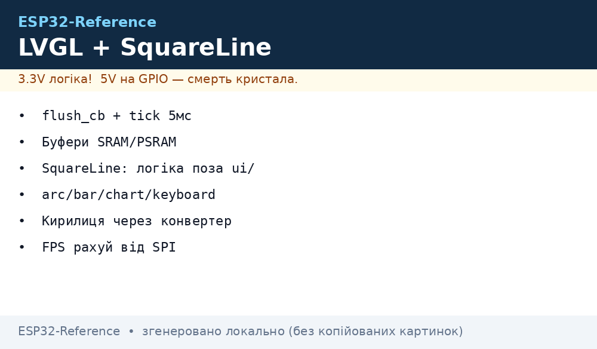
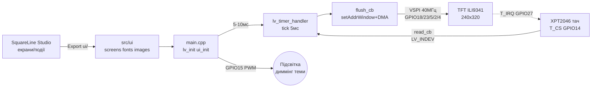

# LVGL v8/v9 + SquareLine Studio - GUI Dashboards

## Purpose

LVGL is a graphics library for microcontrollers: widgets, themes, fonts, animations
without a separate GPU. SquareLine Studio is a visual editor: draw screens with mouse,
export C files (`ui/`) into a PlatformIO project. EEZ Flow is a brief alternative
with a Blockly-like approach. This note covers LVGL + flush driver + XPT2046 touch wiring,
SquareLine workflow, key widgets, fonts/themes, performance and dashboard code.

## Characteristics

| Component | version / role | Requirements | Note |
| --- | --- | --- | --- |
| LVGL v8.3 | stable classic | C99, ~16 kB RAM minimum | API `lv_obj_create(parent)`, styles via `lv_style_t` |
| LVGL v9.x | current branch | C99, more flash for new renderer | different API (`lv_screen_active()`, `lv_draw_buf`), v8 examples need porting! |
| SquareLine Studio | WYSIWYG editor | PC Win/Linux/Mac, C export | generates `ui.c/ui.h/screens/*.c`, events as callbacks |
| EEZ Flow | low-code alternative | EEZ Studio, LVGL 8/9 | block scenarios + C code, free |
| LovyanGFX / TFT_eSPI | low-level driver | SPI 20-80 MHz | `flush_cb` draws via them; see [TFT LCD Epaper](../../../../ESP32-Reference/UA/11-Vivid/02-TFT-LCD-Epaper.md) |
| XPT2046 | resistive touch | SPI, common bus with TFT | separate CS + IRQ; calibration mandatory |

> LVGL v8 and v9 are not API compatible: `lv_scr_act()` → `lv_screen_active()`,
> `lv_disp_draw_buf_t` → `lv_draw_buf_t`, different theme init. SquareLine
> asks target version at project creation - set it ONCE and do not change
> mid-development, else export must be regenerated.

## LVGL v8/v9 - display driver, tick, buffers

Three things without which LVGL will not run:

1. **`flush_cb`:** LVGL draws to RAM buffer, then calls your callback
   "send rectangle (x1,y1,x2,y2) to display". Inside - `tft.startWrite()`,
   `setAddrWindow()`, `pushColors(px_map, len)`, `tft.endWrite()`, then
   MANDATORY `lv_disp_flush_ready(&disp_drv)`. Without it - hang on
   first frame (LVGL waits for ready forever).
2. **`tick`:** millisecond counter for animations and timers: `lv_tick_inc(5)`
   with `esp_timer` every 5 ms or with loop timer. Without tick buttons are dead,
   animations stop.
3. **Буфери:** `lv_disp_draw_buf_init(&buf, buf1, buf2, size)`:
   - Single buffer - minimum RAM, drawing waits for flush.
   - Two buffers (double/full-double) - LVGL draws to one, DMA sends second:
     max FPS at RAM cost.
   - Size: minimum 1/10 screen (`240*320/10` px), comfortable 1/4-1/2.
   - Placement: SRAM (fast, small) for tiny buffers; PSRAM for
     full-screen double (320x240x2 bytes x2 = 300 kB - PSRAM only!).

Main loop: `lv_timer_handler()` (v8: `lv_task_handler()`) every 5-10 ms
from loop or separate FreeRTOS task on second core (S3) - then GUI stays smooth
under WiFi. Partial refresh: LVGL repaints only dirty rectangles -
do not call `lv_obj_invalidate(full_screen)` needlessly.

### Легенда pinandin TFT-модуля with тачем (ILI9341 2.4″ + XPT2046)

| Pin | Value | Type | To ESP32 | Note |
| --- | --- | --- | --- | --- |
| 1 | VCC | power supply | 3V3 (module with LDO - 5V) | Check J1 jumper on module: 3V3 vs 5V! |
| 2 | GND | ground | GND | Short ground + 100 nF on power near module |
| 3 | CS (TFT) | input CS | GPIO5 | Chip-select дисплея |
| 4 | RESET | input reset | GPIO4 | Скидання controller's |
| 5 | DC/RS | input D/C | GPIO2 | data vs команда |
| 6 | MOSI/SDI | SPI input | GPIO23 (VSPI MOSI) | Pixel stream |
| 7 | SCK | SPI input | GPIO18 (VSPI SCK) | 40 MHz typically, 80 on short wires |
| 8 | LED/BLK | Backlight | 3V3 or GPIO15 (PWM) | via PWM - brightness/dimming of GUI theme |
| 9 | MISO/SDO | output SPI | GPIO19 (VSPI MISO) | common with тачем! |
| 10 | T_CS | input CS тача | GPIO14 | ОКРЕМИЙ on TFT-CS! |
| 11 | T_IRQ | interrupt output | GPIO27 (optional) | Wake on touch; without it - polling |
| 12 | T_CLK/T_DIN | touch SPI | GPIO18/23 (shared!) | Touch is second device on same bus |

Explanation:

- **common bus:** TFT and XPT2046 hang on one VSPI (SCK/MOSI/MISO shared),
  selected by separate CS. In `flush_cb` and `touch_read` do not forget to raise foreign CS.
- **MISO mandatory:** without MISO touch cannot be read (TFT would live without MISO, touch would not).
- **T_IRQ optional:** with IRQ touch event wakes (`lv_indev`), without - read touch
  every 20-30 ms by timer.
- **Calibration:** raw XPT2046 ADC (0-4095) → pixels via 2-3 points;
  SquareLine does no calibration - code in firmware (see ex. below).

## SquareLine Studio workflow - ui-файли → export → PlatformIO

1. **New project:** Board = `Arduino + TFT_eSPI` (or Custom for LovyanGFX),
   resolution of your panel (240x320), 16-bit colour depth, LVGL version =
   the one in `platformio.ini` (8.3.x or 9.x - do not mix!).
2. **Drawing:** Screens (Screen1: dashboard, Screen2: setup) → widgets
   (arc/bar/chart/keyboard) → Styles (colours/fonts) → Events (click → switch
   screen via `lv_scr_load_anim`, call own function via `call function`).
3. **Export UI Files:** button Export → папка `ui/` (`ui.c`, `ui.h`,
   `screens/ui_Screen1.c`, `components/`, `images/`, `fonts/`).
4. **PlatformIO:** copy `ui/` into `src/` (or `lib/`), add to `platformio.ini`:
   `lib_deps = lvgl/lvgl@^8.3.11` (або `^9.1.0`), `build_flags` under driver TFT.
   in `main.cpp`: `lv_init()` → `tft.begin()` → `ui_init()` → цикл `lv_timer_handler()`.
5. **Iteration:** changes in SquareLine → Export → rewrites `ui/` (keep own handlers
   SEPARATE in `ui_events.c`, else export wipes them - classic loss!.

> Own callbacks in `src/app_events.cpp`, never inside `ui/`.
> SquareLine rewrites export fully. `ui_events.c` holds only thin calls
> `app_on_btn(...)`, implementation lives nearby in project.

## EEZ Flow overview

EEZ Studio (Envox) + EEZ Flow: free open-source GUI builder over
same LVGL (8.x/9.x support) plus Flow scenarios for automation
(measurement tech, SCPI). Differences from SquareLine:

- Project is one `.eez-project`, C++ code generation for Arduino/STM32.
- Widgets drag to canvas the same, but logic is Flow blocks, not C callbacks.
- LVGL page/widgets compatible with IDE, export with own generator
  (not SquareLine `ui/` - do not mix!).
- When to use: free + need Flow scenarios/enterprise automation;
  SquareLine when: beginner, ready themes/examples for ESP32.

## Widgets: arc / bar / chart / keyboard

- **`lv_arc`:** round gauge (speed, temp): range via `lv_arc_set_range`,
  value via `lv_arc_set_value`, remove clickability via `lv_obj_clear_flag(...CLICKABLE)`
  for indicators. Base arc with `LV_PART_MAIN` style, active with `LV_PART_INDICATOR`.
- **`lv_bar`:** linear bar (battery, RSSI): `lv_bar_set_range/value`,
  animated value via `lv_bar_set_value(..., LV_ANIM_ON)`.
- **`lv_chart`:** history graph (temp/current): `LV_CHART_TYPE_LINE` type,
  `lv_chart_set_point_count` (e.g. 60), series via `lv_chart_add_series`,
  updates via `lv_chart_set_next_value` on 1 s timer. Large point_count in PSRAM!
- **`lv_keyboard`:** on-screen keyboard: bind via `lv_keyboard_set_textarea(ta)`,
  modes like `LV_KEYBOARD_MODE_NUMBER` for PIN. Toggle visibility on focus event.
- Events everywhere: `lv_obj_add_event_cb(obj, handler, LV_EVENT_VALUE_CHANGED, NULL)` -
  in SquareLine this is the Events button without manual code.

## Шрифти and теми

- **Built-in:** `lv_font_montserrat_14/20/28...` - enable needed ones in `lv_conf.h`
  (`LV_FONT_MONTSERRAT_20 1`), drop unused - flash saving.
- **Cyrillic:** stock montserrat has no Cyrillic! Converter
  (LVGL Font Converter, online): TTF → `my_ukr_font.c` with range
  `0x0400-0x04FF` + латиниця; connect `LV_FONT_CUSTOM_DECLARE`.
- **Themes:** `lv_theme_default_init()` + `lv_disp_set_theme()`; dark/light -
  two styles and a switch on Settings screen. Brand colours via
  `lv_color_hex(0x...)` in one `theme.h`, no magic numbers scattered.
- **Icons:** `lv_img_dsc_t` via PNG→C converter (SquareLine Images do this
  automatically); large backgrounds in PSRAM/flash with `LV_IMG_CF_TRUE_COLOR`.

## Тактиль through XPT2046

LVGL input driver (`lv_indev_drv_t`, `LV_INDEV_TYPE_POINTER` type): callback
`read_cb` reads XPT2046 over SPI (command + 12-bit ADC), maps to pixels,
sets `data->state = LV_INDEV_STATE_PRESSED/RELEASED`. Calibration:
minimum 2 points (left-top, right-bottom), formula `x = (adc - x0) * W / (x1 - x0)`.
Jitter filter: 3 reads in a row + median, 30 ms debounce. IRQ pin for
wake from light-sleep; in active mode 30 Hz polling is enough.

## Performance - FPS vs SPI speed, partial refresh

- **Математика SPI:** кадр 320×240×2 байти = 153 600 байт; at 40 МГц (~4 МБ/с
  in practice) - ~26 FPS bus limit; at 80 MHz - ~50 FPS, but only short wires
  and quality module. No more from bus - next only parallel 8/16-bit
  or RGB panel.
- **Partial refresh:** LVGL sends only dirty rectangles - static dashboard
  with one arrow updates ~5% screen = 20x FPS margin. Rule: do not invalidate
  whole screen by timer, update widget values.
- **Buffer vs FPS:** single 1/10 - minimum RAM, every flush waits; double 1/4 -
  golden mean; full-double in PSRAM - max, but PSRAM slower than SRAM
  (~2x), so full-single in SRAM sometimes faster than double in PSRAM.
- **Animations:** `LV_ANIM` with 200-400 ms duration; long animations across full
  width drop FPS - shrink area or disable on weak SPI.
- **Measure:** `LV_USE_PERF_MONITOR 1` in `lv_conf.h` - FPS counter over GUI.

## Diagram


*Fig. LVGL stack: SquareLine export → flush_cb → TFT, XPT2046 touch back into LVGL.
Space below schematic - see .*

### ASCII-schem

```text
ПК (SquareLine Studio)              ESP32 DevKit
──────────────────────              ────────────
Екрани/віджети/події ──Export──►  src/ui/ (ui.c, screens/, fonts/, images/)
                                          │
main.cpp: lv_init() → tft.begin() → ui_init()
                                          │
                    ┌─────────────────────┼─────────────────────┐
                    ▼                     ▼                     ▼
              lv_timer_handler()    flush_cb (TFT)        touch read (XPT2046)
              кожні 5-10 мс         setAddrWindow+DMA     SPI read → LV_INDEV
                    │                     │                     │
                    └──────── LVGL v8/v9 ядро (tick 5мс) ───────┘
                                          │
TFT ILI9341 (VSPI):                       ▼
3V3/GND, GPIO18 SCK / GPIO23 MOSI / GPIO19 MISO / GPIO5 CS / GPIO2 DC / GPIO4 RST
Тач XPT2046: GPIO14 T_CS (окремий!), GPIO27 T_IRQ (опц.), SPI спільна
Підсвітка: GPIO15 PWM (диммінг теми)
```

### Mermaid



## Code ESP-IDF - LVGL v9: flush + tick + дашборд

```c
#include "lvgl.h"
// Низький драйвер (LovyanGFX/TFT_eSPI обгортка) - спрощено:
extern void tft_push(uint16_t x1, uint16_t y1, uint16_t x2, uint16_t y2,
                     const uint8_t *px, int len);

#define W 240
#define H 320
static lv_draw_buf_t db1, db2;
static uint8_t *b1, *b2;

static void flush_cb(lv_display_t *d, const lv_area_t *a, uint8_t *px) {
    int32_t w = a->x2 - a->x1 + 1, h = a->y2 - a->y1 + 1;
    tft_push(a->x1, a->y1, a->x2, a->y2, px, w * h * 2);
    lv_display_flush_ready(d); // БЕЗ ЦЬОГО - ЗАВИСАННЯ!
}

static void tick_cb(void *arg) { lv_tick_inc(5); } // esp_timer кожні 5 мс

static lv_obj_t *arc_speed, *bar_batt, *chart_temp;
static lv_chart_series_t *ser;

void ui_dash(void) {
    lv_obj_t *s = lv_screen_active();
    lv_obj_t *t = lv_label_create(s);
    lv_label_set_text(t, "ESP32 Dash");
    lv_obj_align(t, LV_ALIGN_TOP_MID, 0, 6);

    arc_speed = lv_arc_create(s);
    lv_arc_set_range(arc_speed, 0, 120);
    lv_obj_set_size(arc_speed, 150, 150);
    lv_obj_align(arc_speed, LV_ALIGN_TOP_MID, 0, 34);
    lv_obj_clear_flag(arc_speed, LV_OBJ_FLAG_CLICKABLE);

    bar_batt = lv_bar_create(s);
    lv_bar_set_range(bar_batt, 0, 100);
    lv_obj_set_size(bar_batt, 200, 16);
    lv_obj_align(bar_batt, LV_ALIGN_BOTTOM_MID, 0, -46);

    lv_obj_t *ch = lv_chart_create(s);
    lv_chart_set_type(ch, LV_CHART_TYPE_LINE);
    lv_chart_set_point_count(ch, 60);
    ser = lv_chart_add_series(ch, lv_palette_main(LV_PALETTE_RED), LV_CHART_AXIS_PRIMARY_Y);
    lv_obj_set_size(ch, 200, 70);
    lv_obj_align(ch, LV_ALIGN_BOTTOM_MID, 0, -4);
}

void app_main(void) {
    lv_init();
    size_t px = W * H / 4; // 1/4 екрана на буфер
    b1 = heap_caps_malloc(px * 2, MALLOC_CAP_SPIRAM);
    b2 = heap_caps_malloc(px * 2, MALLOC_CAP_SPIRAM);
    lv_display_t *d = lv_display_create(W, H);
    lv_draw_buf_init(&db1, W, H / 4, LV_COLOR_FORMAT_RGB565, 0, b1, px * 2);
    lv_display_set_draw_buffers(d, &db1, NULL); // другий - за потреби
    lv_display_set_flush_cb(d, flush_cb);
    const esp_timer_create_args_t ta = {.callback = tick_cb};
    esp_timer_handle_t th; esp_timer_create(&ta, &th);
    esp_timer_start_periodic(th, 5000);
    ui_dash();
    while (1) { lv_timer_handler(); vTaskDelay(pdMS_TO_TICKS(8)); }
}
```

## Code Arduino - LVGL v8 + SquareLine-експорт + XPT2046

```cpp
#include <lvgl.h>
#include <TFT_eSPI.h>
#include <XPT2046_Touchscreen.h>
#include "ui/ui.h" // Export із SquareLine Studio!

TFT_eSPI tft;
XPT2046_Touchscreen ts(14, 27); // T_CS=GPIO14, T_IRQ=GPIO27
static lv_disp_draw_buf_t db;
static lv_color_t *b1, *b2;

void flush_cb(lv_disp_drv_t *d, const lv_area_t *a, lv_color_t *px) {
  uint32_t w = a->x2 - a->x1 + 1, h = a->y2 - a->y1 + 1;
  tft.startWrite();
  tft.setAddrWindow(a->x1, a->y1, w, h);
  tft.pushColors((uint16_t*)&px->full, w * h, true);
  tft.endWrite();
  lv_disp_flush_ready(d);
}

void touch_cb(lv_indev_drv_t *d, lv_indev_data_t *dt) {
  static int16_t lx, ly;
  if (ts.touched()) {
    TS_Point p = ts.getPoint();
    // Калібрування під СВІЙ module (2 точки, виміряти!):
    lx = map(p.x, 300, 3800, 0, 240);
    ly = map(p.y, 300, 3800, 0, 320);
    dt->state = LV_INDEV_STATE_PRESSED;
    dt->point.x = lx; dt->point.y = ly;
  } else dt->state = LV_INDEV_STATE_RELEASED;
}

void setup() {
  tft.begin(); tft.setRotation(1);
  ts.begin(); ts.setRotation(1);
  lv_init();
  b1 = (lv_color_t*)heap_caps_malloc(240*320/4*sizeof(lv_color_t), MALLOC_CAP_SPIRAM);
  b2 = (lv_color_t*)heap_caps_malloc(240*320/4*sizeof(lv_color_t), MALLOC_CAP_SPIRAM);
  lv_disp_draw_buf_init(&db, b1, b2, 240*320/4);
  static lv_disp_drv_t dd; lv_disp_drv_init(&dd);
  dd.hor_res = 240; dd.ver_res = 320;
  dd.flush_cb = flush_cb; dd.draw_buf = &db;
  lv_disp_drv_register(&dd);
  static lv_indev_drv_t id; lv_indev_drv_init(&id);
  id.type = LV_INDEV_TYPE_POINTER; id.read_cb = touch_cb;
  lv_indev_drv_register(&id);
  ui_init(); // ← згенеровано SquareLine, свої хендлери - в app_events.cpp!
}
void loop() { lv_timer_handler(); delay(5); }
```

## Code MicroPython - mini GUI without LVGL (framebuf)

```python
# MicroPython + повний LVGL важкий; для простих дашбордів - framebuf + ST7789.
# Повний порт LVGL (lv_micropython) існує, але тут - легкий варіант.
from machine import SPI, Pin, PWM
import st7789, framebuf, time

spi = SPI(2, baudrate=40000000, sck=Pin(18), mosi=Pin(23), miso=Pin(19))
tft = st7789.ST7789(spi, 240, 320, reset=Pin(4, Pin.OUT),
                    dc=Pin(2, Pin.OUT), cs=Pin(5, Pin.OUT),
                    backlight=Pin(15, Pin.OUT), rotation=1)
tft.init()

buf = bytearray(240 * 40 * 2)  # смуга 40 px - partial refresh вручну!
fb = framebuf.FrameBuffer(buf, 240, 40, framebuf.RGB565)

def bar(y, frac, label):
    fb.fill(0x0000)
    fb.text(label, 4, 4, 0xFFFF)
    w = int(232 * max(0, min(1, frac)))
    fb.fill_rect(4, 18, 232, 14, 0x39E7)   # фон смуги
    fb.fill_rect(4, 18, w, 14, 0x07E0)     # активна частина
    tft.blit_buffer(buf, 0, y, 240, 40)    # ллємо тільки смугу!

bl = Pin(15, Pin.OUT)
pwm = PWM(bl, freq=5000, duty=1023)  # диммінг теми

t = 0
while True:
    bar(40, (t % 100) / 100, "BATT %d%%" % (t % 100))   # смуга-батарея
    bar(120, abs((t % 200) - 100) / 100, "TEMP")        # смуга-температура
    t += 5
    time.sleep_ms(500)
```

## Common issues

1. **Hang after first frame** → forgotten `lv_disp_flush_ready()` /
   `lv_display_flush_ready()`. Check first.
2. **Dead buttons, stuck animations** → missing `lv_tick_inc()` / `lv_tick_inc(5)`.
   Tick via separate esp_timer, not in same loop as handler.
3. **Mixed v8/v9 API** → SquareLine project for v8, lib_deps for v9 (or vice versa).
   Align versions, regenerate export.
4. **White screen, LVGL seems running** → wrong TFT driver offset/rotation or
   swapped DC/RES. First bare TFT test without LVGL, see [TFT LCD Epaper](../../../../ESP32-Reference/UA/11-Vivid/02-TFT-LCD-Epaper.md).
5. **Touch mirrors/shifts** → no calibration, axes swapped at rotation.
   Calibrate 2-3 points AFTER final `setRotation`.
6. **TFT CS vs T_CS conflict** → one GPIO for both CS: touch and display mute
   each other. Split (5 and 14).
7. **SquareLine export wiped handlers** → code was inside `ui/`. Keep logic
   in `src/app_events.cpp`, in `ui/` only `ui_init()` and generated code.
8. **WDT reboots on flush at 80 MHz** → long wires, backlight supply sag.
   Lower to 40 MHz, separate backlight wire, 100 nF.
9. **Cyrillic shows squares** → stock montserrat has no Cyrillic. Font converter
   with 0x0400-0x04FF range, `LV_FONT_CUSTOM_DECLARE`.
10. **FPS 3-5 on full-screen animations** → SPI limit + full-screen invalidate.
    Partial refresh, smaller animation areas, double 1/4 buffer in PSRAM.

## Official sources

- [LVGL - documentation (v9)](https://docs.lvgl.io/master/) - flush_cb, tick, buffers, arc/bar/chart/keyboard widgets.
- [SquareLine docs](https://docs.squareline.io/docs/squareline) - editor, UI file export, target boards.
- [EEZ Studio - GUI + Flow (Envox)](https://github.com/eez-open/studio) - open-source alternative, LVGL 8/9 support.
- [LovyanGFX - fast display driver](https://github.com/lovyan03/LovyanGFX) - DMA, sprite buffers for flush_cb.

## See also

- [Home](../../../../ESP32-Reference/Home.md)
- [TFT LCD Epaper](../../../../ESP32-Reference/UA/11-Vivid/02-TFT-LCD-Epaper.md)
- [Displays 2](../../../../ESP32-Reference/UA/11-Vivid/10-Displays-2.md)
- [RC Protocols](../../../../ESP32-Reference/UA/12-Moduli-zvyazku/12-RC-Protocols.md)
- [Camera Streaming](../../../../ESP32-Reference/UA/12-Moduli-zvyazku/13-Camera-Streaming.md)
- [RS485 / CAN / Ethernet / Camera](../../../../ESP32-Reference/UA/12-Moduli-zvyazku/04-RS485-CAN-Ethernet-Kamera.md)
- [SPI](../../../../ESP32-Reference/UA/04-Shini/02-SPI.md)
- [EN/07-Timers/01-Timers-MCPWM-PCNT-RMT.en]
- [Pinout Tables](../../../../ESP32-Reference/UA/99-Dodatki/01-Pinout-tablici.md)
- [Troubleshooting FAQ](../../../../ESP32-Reference/UA/99-Dodatki/02-Troubleshooting-FAQ.md)
