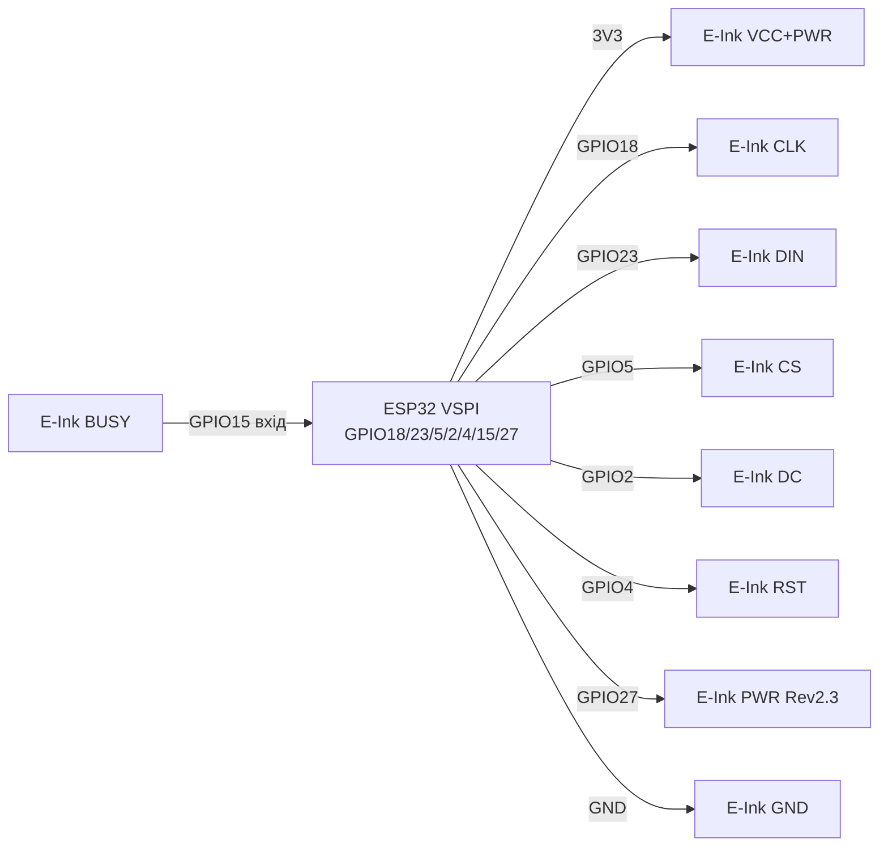
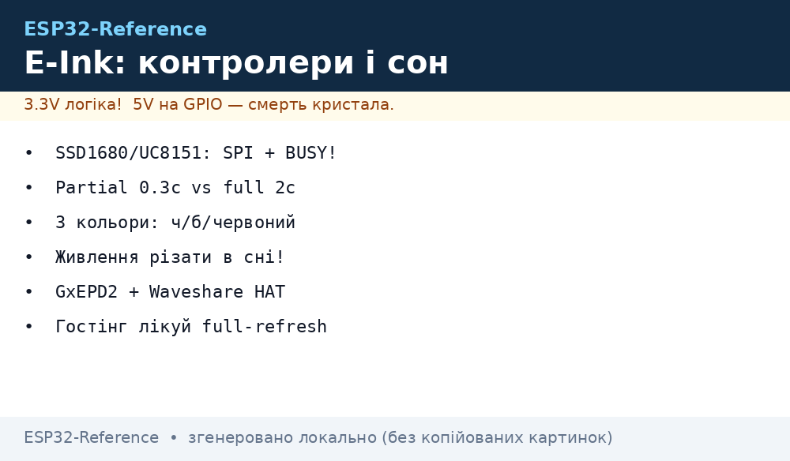

# E-Ink / E-Paper - Controllers, Sizes, Refresh, Power

## Purpose

E-Ink (electrophoretic E-Paper panels) - displays for static info:
price tags, street boards, weather sensors, badges, clocks, counters.
Image holds without power (bistability): update once per hour -
and sleep in deep-sleep with microamps.

This note covers what people always mix: SSD1680 / SSD1675 controllers,
IL0373 / IL3897, UC8151 / UC8176; sizes 1.54 / 2.13 / 2.9 / 4.2 / 7.5 inch;
mono (B/W) vs 3-colour (B/W/red or B/W/yellow); partial
(partial, ~0.3 s) vs full (~2 s) update and ghosting;
BUSY pin on Waveshare / DESPI modules; GxEPD2 library with examples;
temperature limits; proper deep-sleep with panel power switching.

> Golden E-Ink rule: full update rarely (once per minutes/hours),
> partial for digits/clock, every 5-10 partials one full against ghosting,
> when idle - sleep or full panel power-off.

## Characteristics

| Parameter | value / options |
| --- | --- |
| Mono controllers | SSD1680 (2.13/2.9 new), SSD1675A/B (2.13), UC8151 / IL0373 (1.54/2.13/2.9), UC8176 / IL0398 (4.2), EK79655 / UC8179 (7.5) |
| 3-colour controllers | SSD1681 (1.54 BWR), SSD1680 (2.13/2.66 BWR), UC8151D (2.9 BWR), UC8176 (4.2 BWR), EK79655 (7.5 BWR) |
| Popular sizes | 1.54″ 200x200; 2.13″ 122x250 (or 104x212); 2.9″ 128x296; 4.2″ 400x300; 7.5″ 640x384 or 800x480 |
| Colours | Mono B/W (faster, cheaper) vs B/W/R or B/W/Y (3-colour: full update 8-25 s!) |
| Interface | SPI 4-wire: SCK / MOSI / CS / DC + RST + BUSY (+ PWR on new HAT Rev 2.3) |
| Panel power | 3.3 V logic and supply (never 5 V on data without level shifter!); peak current 20-100 mA during refresh |
| Full refresh | ~2 s (small mono), ~3-5 s (4.2), ~4-6 s (7.5 mono), 8-27 s (3-colour) |
| Partial refresh | ~0.3-0.8 s (mono only and only where OTP/waveform supports!) |
| Lifetime | ~1,000,000 updates ideally; in practice - keep from sun and frost |
| Operating temp | 0…+40 C (mono), +15…+35 C (colour/7-colour); storage up to +30 C |
| library | GxEPD2 (Arduino) + Adafruit_GFX; ESP-IDF - порт/ex. Waveshare або calepd |
| Image hold | Years without power (theory), recommended to refresh 3-colour once per 24 hours |

### Controllers - what goes with what

| Marking | Family | Where found | Note |
| --- | --- | --- | --- |
| SSD1680 | Solomon SSD | 2.13″ / 2.66″ / 2.9″ new (GDEM0213B74, GDEY0213B74) | Fast full, has fast partial in GxEPD2 |
| SSD1675A/B | Solomon SSD | 2.13″ GDEH0213B72/B73 (aka IL3895) | check B73 vs B72 revision - different GxEPD2 classes! |
| IL0373 | Solomon-compatible | UC8151-compatible 1.54/2.13/2.9 (GDEW0154T8, GDEW0213T5D) | Old classic, differential partial |
| IL3897 | Solomon-compatible | Old 2.13″ GDE0213B1 (removed) | in new batches - SSD1675, code differs! |
| UC8151 / UC8151D | UltraChip | 1.54/2.13/2.6/2.9 mono and BWR (Z10/Z13/Z19) | D revision - different waveform, check GxEPD2 class |
| UC8176 / IL0398 | UltraChip | 4.2″ GDEW042T2 (mono) / GDEW042Z15 (BWR) | 4.2″ wants strong power, long wires are bad |
| UC8159c / EK79655 | Large | 7.5″ GDEW075T8/Z09, GDEW075T7/Z08 | do not power from Arduino 3V3 pin - separate regulator only! |

### Sizes - resolution and GxEPD2 classes

| Diagonal | resolution | example panel | GxEPD2 class (guide) |
| --- | --- | --- | --- |
| 1.54″ | 200×200 | GDEY0154D67 (SSD1681), GDEW0154Z04 (BWR) | `GxEPD2_154_D67`, `GxEPD2_154_Z90c` |
| 2.13″ | 122×250 | GDEH0213B73 (SSD1675B), DEPG0213BN (SSD1680) | `GxEPD2_213_B73`, `GxEPD2_213_BN` |
| 2.13″ | 104×212 | GDEW0213T5D (UC8151) | `GxEPD2_213_T5D` |
| 2.9″ | 128×296 | GDEM029T94 / GDEY029T94 (SSD1680) | `GxEPD2_290_T94` (+ `_V2` for Waveshare V2!) |
| 4.2″ | 400×300 | GDEW042T2 (UC8176) | `GxEPD2_420` |
| 7.5″ | 640×384 / 800×480 | GDEW075T8 / GDEW075T7 | `GxEPD2_750_T7`, `GxEPD2_750c_Z08` |

> Waveshare V2 2.9″ boards (GDEM029T94 without partial waveform in OTP) need
> `GxEPD2_290_T94_V2` class with waveform in registers - with ordinary class
> partial not працює або бруднить!

### Mono vs 3-colour

- **Mono (B/W):** 1 bit/pixel, full ~2 s, partial ~0.3 s possible,
  clock/sensor - ideal. Buffer: 2.13″ = 122x250/8 ≈ 3.8 kB.
- **3-colour (B/W/R, B/W/Y):** 2 passes (black + red),
  full 8-27 s, partial either missing or fast B/W mode only
  (`drawFastBlackWhite` for GDEW0213Z19/Z13 - up to 100 cycles, then full!).
- **4-colour / 7-colour (Spectra/ACEP):** beautiful, but 12-30 s
  and full only; for ESP32 - via paging (little RAM).

### Partial vs full refresh - time and ghosting

| Mode | Time | How it looks | When to use |
| --- | --- | --- | --- |
| Full | ~2 s (mono), up to 27 s (B/W/Y) | Black-white flashes several times (cleans ghosts) | Start, every Nth frame, scene change |
| Partial (differential) | ~0.3-0.8 s | No flash, updates window | Clock digits, temp, counter |
| Fast B/W on 3-colour | ~1-2 s | B/W without red layer | Temporary data on BWR panel |

Rules against ghosting:

1. Every 5-10 partials one full (`display(false)` / `displayWindow` → `display`).
2. Interval between updates - no more often than ~180 s for full (Waveshare advice).
3. Do not keep 3-colour for a month on one image - refresh once per 24 hours.
4. After deep-sleep wakeup - first `init` + clear, then draw.

### Temperature and updates

- Below 0 C electrophoresis slows: pale print, ghosts, possible damage.
- DES panels (Wide-Temp, e.g. GDEW0213M21) hold wider range -
  for street take DES.
- Fast partial in cold - disable (`hasFastPartialUpdate = false` in GxEPD2).
- in heat - do not leave in direct sun: ink dries irreversibly;
  white tape/UV filter + shade mandatory for street boards.

## Легенда pinandin модуля

Typical Waveshare HAT / DESPI-C02 (8-9 pins, SPI):

| Module pin | Value | Type | To ESP32 | Note |
| --- | --- | --- | --- | --- |
| 1 | VCC | power supply | 3V3 (stable!) | 2.3-3.6 V; 7.5″ separate PSU, not board pin! |
| 2 | GND | ground | GND | common ground + 100 nF near module |
| 3 | DIN (MOSI) | SPI input | GPIO23 (VSPI MOSI) | data to panel |
| 4 | CLK (SCK) | SPI input | GPIO18 (VSPI SCK) | 2-10 MHz (not 40 MHz like TFT!) |
| 5 | CS | CS input | GPIO5 | Panel chip-select |
| 6 | DC | input D/C | GPIO2 | data vs команда |
| 7 | RST | reset input | GPIO4 | Reset; on clever-reset boards - short 2-10 ms pulse! |
| 8 | BUSY | busy output | GPIO15 (input!) | HIGH = busy (some invert, check board wiki!) |
| 9 | PWR | power key | GPIO27 or VCC (Rev 2.3!) | on Driver HAT Rev 2.3 without HIGH on PWR panel is silent! |

Explanation:

- **BUSY is the most important E-Ink pin.** Without it library either hangs
  in `waitWhileBusy` or tears frame mid-transfer. Always connect!
  Logic: on Waveshare HIGH during refresh; code waits `while(digitalRead(BUSY))`.
- **PWR (Rev 2.3):** new panel power control pin. Options:
  tie to VCC (always on) or drive from GPIO for deep-sleep.
  Old examples without PWR on new board - black screen!
- **Clever-reset:** on new Waveshare - RC circuit, long LOW kills
  driver power. Cured by `init(115200, true, 2, false)` (2 ms reset)
  або pull-up 1 кОм at RST.
- **Good Display DESPI modules:** same pinout, but 24-pin FPC connector;
  flex longer than 20 cm loses data, lower SPI to 2 MHz.

## Wiring diagram

| ESP32 | E-Ink HAT / DESPI | Note |
| --- | --- | --- |
| 3V3 | VCC (+ PWR → 3V3, if uncontrolled) | 3.3 V only! |
| GND | GND | common ground |
| GPIO18 | CLK | VSPI SCK, 4 МГц старт |
| GPIO23 | DIN | VSPI MOSI |
| GPIO5 | CS | Panel CS |
| GPIO2 | DC | Data/Command |
| GPIO4 | RST | Reset, short pulse on clever boards |
| GPIO15 | BUSY | input, wait for refresh end |
| GPIO27 | PWR (Rev 2.3) | HIGH = panel power on |
| 5V (optional) | - | do not feed to panel! Only via board level shifter |

### ASCII-schem

```text
ESP32 DevKit (VSPI)          Waveshare / DESPI E-Paper (SPI)
-------------------          --------------------------------
3V3 ───────────────────────► VCC (тільки 3.3 В!)
GND ───────────────────────► GND
GPIO18 ────────────────────► CLK / SCK (4 МГц, не 40!)
GPIO23 ────────────────────► DIN / MOSI
GPIO5 ─────────────────────► CS
GPIO2 ─────────────────────► DC (Data/Command)
GPIO4 ─────────────────────► RST (2-10 мс на clever-reset платах!)
GPIO15 (ВХІД!) ◄──────────── BUSY (HIGH = зайнята, чекати!)
GPIO27 ────────────────────► PWR (Rev 2.3: HIGH або до VCC)
VCC ◄──[100 нФ]──► GND біля модуля; шлейф FPC < 20 см
PWR через MOSFET/аналоговий key - для deep-sleep (див. код нижче)
```

### Mermaid




*Fig. E-Ink HAT: VSPI + DC/RST/BUSY/PWR, 3V3 power, SPI 2-4 MHz. Space below schematic - see .*

## Code ESP-IDF

ESP-IDF without Arduino: via `calepd` component or Waveshare ex.
Minimum - SPI + BUSY wait + deep-sleep:

```c
#include "driver/spi_master.h"
#include "driver/gpio.h"
#include "esp_sleep.h"
#include "esp_timer.h"

#define PIN_CS 5
#define PIN_DC 2
#define PIN_RST 4
#define PIN_BUSY 15
#define PIN_PWR 27

static spi_device_handle_t epd;

static void epd_wait_busy(void) {
    // Waveshare: HIGH = зайнята
    while (gpio_get_level(PIN_BUSY) == 1) {
        vTaskDelay(pdMS_TO_TICKS(50));
    }
}

static void epd_cmd(uint8_t c) {
    gpio_set_level(PIN_DC, 0);
    spi_transaction_t t = { .length = 8, .tx_data = {c}, .flags = SPI_TRANS_USE_TXDATA };
    spi_device_transmit(epd, &t);
}

static void epd_data(uint8_t d) {
    gpio_set_level(PIN_DC, 1);
    spi_transaction_t t = { .length = 8, .tx_data = {d}, .flags = SPI_TRANS_USE_TXDATA };
    spi_device_transmit(epd, &t);
}

void app_main(void) {
    gpio_set_direction(PIN_PWR, GPIO_MODE_OUTPUT);
    gpio_set_level(PIN_PWR, 1); // увімкнути живлення панелі (Rev 2.3)
    gpio_set_direction(PIN_DC, GPIO_MODE_OUTPUT);
    gpio_set_direction(PIN_RST, GPIO_MODE_OUTPUT);
    gpio_set_direction(PIN_BUSY, GPIO_MODE_INPUT);

    // RST: короткий імпульс для clever-reset плат
    gpio_set_level(PIN_RST, 0); vTaskDelay(pdMS_TO_TICKS(2));
    gpio_set_level(PIN_RST, 1); vTaskDelay(pdMS_TO_TICKS(10));

    spi_bus_config_t bus = {
        .mosi_io_num = 23, .miso_io_num = -1, .sclk_io_num = 18,
        .max_transfer_sz = 4096,
    };
    spi_bus_initialize(SPI2_HOST, &bus, SPI_DMA_CH_AUTO);
    spi_device_interface_config_t dev = {
        .clock_speed_hz = 4 * 1000 * 1000, // НЕ гнати 40 МГц!
        .mode = 0, .spics_io_num = PIN_CS, .queue_size = 4,
    };
    spi_device_add_to_bus(SPI2_HOST, &dev, &epd);

    // ... init панелі за даташитом контролера (SSD1680/UC8151) ...
    // ... передати буфер, потім:
    // epd_cmd(0x22); epd_data(0xF7); epd_cmd(0x20); epd_wait_busy();

    // Спати: панель у deep-sleep (команда 0x10 + 0x01), потім PWR LOW
    // epd_cmd(0x10); epd_data(0x01); vTaskDelay(pdMS_TO_TICKS(100));
    gpio_set_level(PIN_PWR, 0); // ВІДРІЗАТИ живлення панелі!
    esp_sleep_enable_timer_wakeup(3600ULL * 1000000ULL); // раз на годину
    esp_deep_sleep_start();
}
```

## Code Arduino - GxEPD2

```cpp
#include <GxEPD2_BW.h>
// 2.13″ моно SSD1680: CS=5, DC=2, RST=4, BUSY=15
GxEPD2_BW<GxEPD2_213_BN, GxEPD2_213_BN::HEIGHT> display(
  GxEPD2_213_BN(/*CS=*/5, /*DC=*/2, /*RST=*/4, /*BUSY=*/15));

void setup() {
  // Для плат з clever-reset: init(115200, true, 2, false) - reset 2 мс!
  display.init(115200, true, 2, false);
  display.setRotation(1);
  display.setTextColor(GxEPD_BLACK);

  // --- Повне оновлення (рідко!) ---
  display.setFullWindow();
  display.firstPage();
  do {
    display.fillScreen(GxEPD_WHITE);
    display.setCursor(10, 20);
    display.print("E-Ink full OK");
    display.setCursor(10, 40);
    display.print("T=24.5C H=55%");
  } while (display.nextPage());
  delay(2000);
}

void loop() {
  static int n = 0;
  // --- Часткове вікно для годинника (швидко, без блимання) ---
  char buf[16];
  snprintf(buf, sizeof(buf), "%02d:%02d", 12, n++);
  display.setPartialWindow(10, 60, 120, 24);
  display.firstPage();
  do {
    display.fillScreen(GxEPD_WHITE);
    display.setCursor(10, 70);
    display.print(buf);
  } while (display.nextPage());

  if (n % 10 == 0) {
    // Кожен 10-й partial - повний refresh проти гостінгу!
    display.setFullWindow();
    display.firstPage();
    do {
      display.fillScreen(GxEPD_WHITE);
      display.setCursor(10, 20);
      display.print("Full clean");
    } while (display.nextPage());
  }
  // 3-кольорова панель: delay мінімум 180000 тут!
  delay(30000);
  // Deep-sleep з відрізанням живлення:
  // display.hibernate(); // сон контролера
  // digitalWrite(27, LOW); // PWR OFF (Rev 2.3)
  // esp_sleep_enable_timer_wakeup(600ULL*1000000ULL); esp_deep_sleep_start();
}
```

3-colour ex. (B/W/R - long!):

```cpp
// #include <GxEPD2_3C.h>
// GxEPD2_3C<GxEPD2_213_Z98c, GxEPD2_213_Z98c::HEIGHT> display(
//   GxEPD2_213_Z98c(5, 2, 4, 15));
// display.firstPage(); do {
//   display.fillScreen(GxEPD_WHITE);
//   display.setTextColor(GxEPD_BLACK); display.print("Black layer");
//   display.setTextColor(GxEPD_RED);   display.print(" RED layer");
// } while (display.nextPage()); // ~15-20 с, НЕ частіше раз на 3 хв!
```

## Code MicroPython

```python
# MicroPython: E-Paper через framebuf + SPI (моно 2.13", SSD1680 спрощено).
# Повний GxEPD2-порт відсутній - мінімальний драйвер full-refresh.
from machine import SPI, Pin
import framebuf, time

SCK, MOSI, CS, DC, RST, BUSY, PWR = 18, 23, 5, 2, 4, 15, 27
pwr = Pin(PWR, Pin.OUT, value=1)   # Rev 2.3: живлення панелі!
cs = Pin(CS, Pin.OUT, value=1)
dc = Pin(DC, Pin.OUT)
rst = Pin(RST, Pin.OUT)
busy = Pin(BUSY, Pin.IN)
spi = SPI(2, baudrate=4000000, sck=Pin(SCK), mosi=Pin(MOSI))

W, H = 122, 250
buf = bytearray(W * H // 8)
fb = framebuf.FrameBuffer(buf, W, H, framebuf.MONO_HLSB)

def cmd(c):
    dc(0); cs(0); spi.write(bytes([c])); cs(1)

def data(d):
    dc(1); cs(0); spi.write(bytes([d])); cs(1)

def wait_busy():
    while busy.value() == 1:  # HIGH = зайнята
        time.sleep_ms(50)

rst(0); time.sleep_ms(2); rst(1); time.sleep_ms(10)  # короткий reset!

fb.fill(1)
fb.text("E-Ink uPy", 4, 4, 0)
fb.text("T=24.5C", 4, 16, 0)
# Далі - init за даташитом SSD1680 + вивантаження buf + 0x20 + wait_busy().
# Після refresh:
# cmd(0x10); data(0x01); time.sleep_ms(100)  # deep-sleep контролера
# pwr(0)  # ВІДРІЗАТИ живлення!
# import esp32; ... deepsleep(3600000)
print("buf ready:", len(buf), "bytes; допишіть init під свій контролер")
```

### GDEY075T7 - large 7.5″ new-gen panel

| Parameter | GDEY075T7 |
| --- | --- |
| resolution | 800×480 (GDEW075T7 - 640×384, not переплутати!) |
| Controller | Compatible with UC8179 chain (pick GxEPD2 class by exact marking!) |
| Update | Full ~4-6 s; partial mono mode only |
| Power | 3.3 V, current peak at refresh up to 100 mA |
| When to use | Price tags, boards, street informers - where 4.2″ is small |

> GDEY075T7 vs GDEW075T7: different panels, different GxEPD2 classes! Read marking on flex, not on box.

## Common issues

| Error (symptom) | cause | Fix |
| --- | --- | --- |
| Black screen on Driver HAT Rev 2.3 | PWR not wired / LOW | PWR → 3V3 or GPIO27 HIGH; check board revision |
| Stuck in `waitWhileBusy` forever | BUSY not wired or no GND/SPI | connect BUSY to input, check SCK/MOSI/CS, lower SPI to 2 MHz |
| White screen, draws nothing | wrong GxEPD2 class (B72 vs B73, T94 vs T94_V2) | Drop panel marking with GxEPD2 README, pick exact class |
| Partial update dirties / ghosts | 10+ partials without full; cold; wrong waveform | Every 5-10 partials one full; in cold `hasFastPartialUpdate=false` |
| 3-colour updates 20 s and fades | Normal for BWR + frequent updates | Full no more often than ~180 s; refresh static image once per 24 hours |
| Panel heats / swells in a week | supply never switches off (high-voltage state) | After refresh - `hibernate()` + PWR LOW / sleep ESP32 |
| Artifacts, image shift | Long FPC flex, weak 7.5″ supply from pin | Flex < 20 cm, SPI 2 MHz, 7.5″ separate 3.3 V / 1 A reg |
| Reset dead on new Waveshare | Clever-reset: long LOW kills driver | `init(115200, true, 2, false)` (2 ms) + 1 k pull-up on RST |
| 5 V on bare panel data pins | Panel is 3.3 V only | via board level shifter or divider; bare panel only 3.3 V logic |
| GDEY075T7 instead of GDEW075T7 in code | White screen (wrong waveform) | Marking on flex → exact GxEPD2 class |

## Official sources

- [GxEPD2 - E-Paper library for Arduino (ZinggJM)](https://github.com/ZinggJM/GxEPD2) - panel classes, `ConnectingHardware.md`, waveform notes, DESPI-PICO.
- [Waveshare 2.13″ e-Paper HAT - wiki](https://www.waveshare.com/wiki/2.13inch_e-Paper_HAT) - схеми, демо ESP32/Arduino, table pinandin.
- [Waveshare E-Paper Driver HAT - wiki (Rev 2.3, PWR pin)](https://www.waveshare.com/wiki/E-Paper_Driver_HAT) - board revisions, Display Config, BUSY/sleep/180 s FAQ.
- [Adafruit E-Ink Breakouts - tricolour panel overview](https://learn.adafruit.com/adafruit-eink-display-breakouts) - SRAM buffer, power, tricolour principle.

## See also

- [Home](../../../../ESP32-Reference/Home.md)
- [TFT LCD Epaper](../../../../ESP32-Reference/UA/11-Vivid/02-TFT-LCD-Epaper.md)
- [LVGL SquareLine](../../../../ESP32-Reference/UA/11-Vivid/12-LVGL-SquareLine.md)
- [E-Ink](../../../../ESP32-Reference/UA/11-Vivid/15-EInk.md)
- [LCD Char](../../../../ESP32-Reference/UA/11-Vivid/16-LCD-Char.md)
- [Touchscreens](../../../../ESP32-Reference/UA/11-Vivid/17-Touchscreens.md)
- [I2C](../../../../ESP32-Reference/UA/04-Shini/03-I2C.md)
- [SPI](../../../../ESP32-Reference/UA/04-Shini/02-SPI.md)
- [03-Sleep-ULP](../../../../ESP32-Reference/UA/07-Timeri-Son/03-Sleep-ULP.md)
