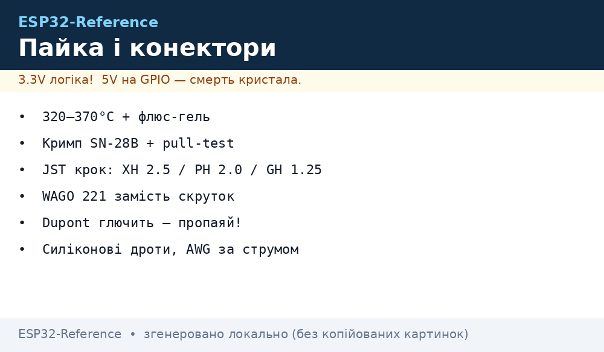
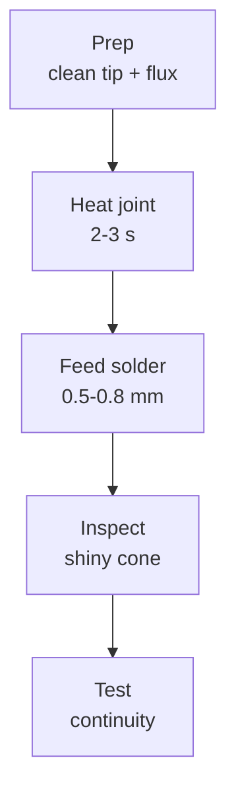

# Lab 2 - Soldering and Connectors

*Fig. Soldering stages: header, wire, connector, inspection.*

## 1. Tools and Settings

| Tool | Setting | Note |
| --- | --- | --- |
| Iron | 300-320 C | Lead-free solder needs higher temp |
| Tip | Conical 1 mm | Fine work on module pins |
| Flux | No-clean | Easier cleanup |
| Solder | 0.5-0.8 mm | Not too thick |

## 2. Header Soldering

- Insert header into breadboard or PCB; solder one pin, check alignment; solder rest.
- Use solder wick to remove excess; avoid bridging adjacent pins.
- Check with multimeter for shorts between neighboring pins.

## 3. Wire Connections

- Strip 2-3 mm; twist if needed; solder to pin; cover with heat shrink.
- Use different colors: red VCC, black GND, yellow/green signal.
- Keep I2C under 30 cm; SPI under 20 cm; UART under 100 cm.

## 4. Common Mistakes

| Mistake | Cause | Fix |
| --- | --- | --- |
| Cold joint | Not enough heat | Reheat with flux |
| Bridge | Too much solder | Wick or desolder pump |
| Lifted pad | Overheating / force | Repair with wire bridge |

### Soldering flow

## Temperature guide

| Joint | Iron temp | Time | Note |
| --- | --- | --- | --- |
| Header pin to PCB | 300-320 C lead-free | 2-3 s | Heat pin and pad together |
| Wire to pin | 300 C | 2 s | Pre-tin wire first |
| Module shield ground | 350 C, wide tip | 3-5 s | Needs thermal mass |
| Rework with wick | 320 C + flux | 3 s | Lift wick with joint, not after |

## Joint inspection checklist

- [ ] Cone shape, shiny surface, no ball sitting on pad.
- [ ] No bridges between neighbours (loupe + multimeter beep test).
- [ ] No lifted pads after rework (pad edges flat on PCB).
- [ ] Flux residue cleaned with IPA where high impedance matters (ADC inputs).
- [ ] Strain relief on every wire: heat shrink + tie, never solder alone.

## Wire length limits

| Bus | Max length | Why |
| --- | --- | --- |
| I2C | 30 cm | Capacitance kills edges, needs lower pull-up |
| SPI | 20 cm | Clock ringing at MHz rates |
| UART | 100 cm | Slow edges tolerate more, twist RX with GND |
| Power 5V | As short as possible | Every 10 cm thin wire drops volts at TX peaks |

## Common issues

| Symptom | Cause | Fix |
| --- | --- | --- |
| Cold joint, dull grainy surface | Joint moved during cooling or too little heat | Reheat with fresh flux until solder flows, hold still 2 s |
| Solder bridge between pins | Too much solder or dragging tip across pins | Wick with flux, verify with continuity test |
| Lifted copper pad | Overheating or pulling component while hot | Bridge with thin wire to next point, glue wire down |
| Wire breaks at joint | No strain relief, vibration flexes copper | Heat shrink over joint plus tie to board |
| ESP32 reboots after soldering | Solder ball short under module or flux short | Loupe inspection, IPA wash, resistance check 3V3 to GND |

## Official sources

- [ESP32 Hardware Design Guidelines (Espressif)](https://docs.espressif.com/projects/esp-hardware-design-guidelines/en/latest/esp32/index.html) - assembly and handling notes.
- [ESP32 Datasheet (Espressif)](https://www.espressif.com/sites/default/files/esp32-datasheet-en.pdf) - pin and power limits to respect while soldering.
- [Soldering guide (SparkFun)](https://learn.sparkfun.com/tutorials/how-to-solder) - joint shape and temperature basics. - `check manually if moved`.

## Connector pinout reference

| Connector | Pins | Note |
| --- | --- | --- |
| 2.54 mm header | Signal + GND | Standard DevKit pitch, breadboard friendly |
| JST-XH 2.50 | VCC + signal | Battery and sensor leads, locking |
| JST-PH 2.00 | Compact power | Small LiPo packs, check polarity twice |
| USB-C 16p | VBUS D+ D- CC | Flashing and power, needs breakout care |
| SMA / IPEX | RF only | Antenna path, no solder blobs near center pin |
| Terminal block 3.5 | Mains-side only | Never for logic, torque screws yearly |

## Solder alloy comparison

| Alloy | Melt point | Use | Note |
| --- | --- | --- | --- |
| Sn63/Pb37 | 183 C | Repair and prototyping | Easiest flow, RoHS restricted for sale |
| SAC305 lead-free | 217 C | Shipping products | Needs hotter iron, duller joints normal |
| Sn42/Bi57Ag1 low-temp | 138 C | Heat-sensitive parts | Weak joints, never for connectors |

## Hot-air rework procedure

1. Shield neighbours with kapton tape and aluminium foil tent.
2. Preheat board to 120 C, then 350 C airflow on target part.
3. Lift with tweezers only when solder shines liquid on all pads.
4. Clean pads with wick, fresh flux, place new part, reflow again.
5. Continuity plus power-off resistance check before first power-on.

## ESD protection notes

- Mat plus wrist strap grounded to a common point, tested monthly.
- Boards travel in shielded bags, never in plastic pockets or foam.
- Winter dry air spikes ESD risk: humidifier or ionizer near bench.

## Flux and cleaning quick table

| Flux | Use | Clean |
| --- | --- | --- |
| No-clean gel | Daily joints | Leave residue, safe |
| Rosin RMA | Old oxidized pads | IPA wash for ADC boards |
| Water-soluble | Never for field boards | Must wash fully, corrosive |
## See Also

- [Home](../../../../ESP32-Reference/Home.md)
- [01-Instruments](../../../../ESP32-Reference/UA/17-Lab/01-Instruments.md)
- [03-Cheklisti-montazhu](../../../../ESP32-Reference/UA/99-Dodatki/03-Cheklisti-montazhu.md)

> UA original twin: [UA](../../../../ESP32-Reference/UA/17-Lab/02-Soldering-Connectors.md)
