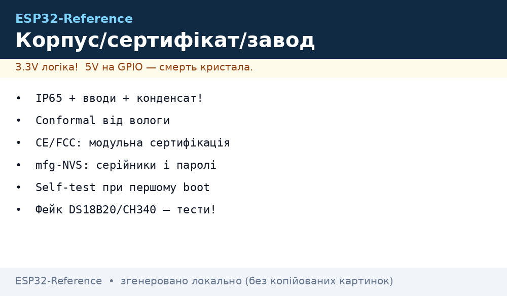

# Lab 3 - Enclosure, Certification and Factory Notes

*Fig. From design to factory: ventilation, antenna, sealing, labeling.*

## 1. Enclosure Design

- Use ABS or polycarbonate; wall thickness 2-3 mm.
- Ventilation holes near LDO; otherwise overheating.
- Antenna outside or in window; metal case kills WiFi.
- IP65 only if needed; otherwise IP54 sufficient.

## 2. Certification Notes

- CE: EMC and safety; test with certified lab.
- FCC: only for US; antenna must be certified if external.
- RoHS: lead-free solder and components.

## 3. Factory Assembly

- Use ESD mats; anti-static bags for boards.
- Flash and test before sealing; log serial numbers.
- Label with model, version, date; QR to docs.

## See Also

- [Home](../../../../ESP32-Reference/Home.md)
- [03-Cheklisti-montazhu](../../../../ESP32-Reference/UA/99-Dodatki/03-Cheklisti-montazhu.md)
- [05-Official-Sources-Sensors](../../../../ESP32-Reference/UA/99-Dodatki/05-Official-Sources-Sensors.md)

> UA original twin: [UA](../../../../ESP32-Reference/UA/17-Lab/03-Enclosure-Cert-Factory.md)
