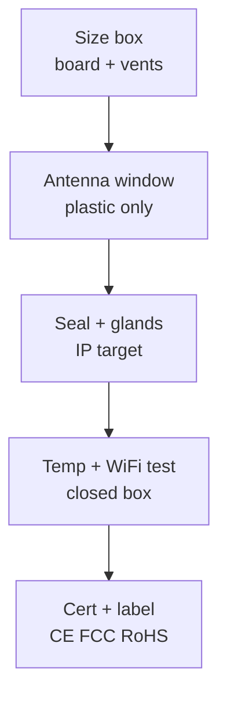

# Lab 3 - Enclosure, Certification and Factory Notes

*Fig. From design to factory: ventilation, antenna, sealing, labeling.*

## 1. Enclosure Design

- Use ABS or polycarbonate; wall thickness 2-3 mm.
- Ventilation holes near LDO; otherwise overheating.
- Antenna outside or in window; metal case kills WiFi.
- IP65 only if needed; otherwise IP54 sufficient.

## 2. Certification Notes

- CE: EMC and safety; test with certified lab.
- FCC: only for US; antenna must be certified if external.
- RoHS: lead-free solder and components.

## 3. Factory Assembly

- Use ESD mats; anti-static bags for boards.
- Flash and test before sealing; log serial numbers.
- Label with model, version, date; QR to docs.

### Enclosure flow

## IP rating quick table

| Rating | Dust | Water | ESP32 use |
| --- | --- | --- | --- |
| IP20 | None | None | Indoor desk only |
| IP54 | Splash-safe | Rainproof-ish | Balcony, vents with mesh |
| IP65 | Dust-tight | Water jets | Outdoor, sealed glands |
| IP67 | Dust-tight | 1 m immersion | Only with sealed connectors |

## Thermal and antenna checklist

- [ ] Vent near LDO and module; closed box adds 10-20 C at full WiFi load.
- [ ] Antenna faces plastic window or outside; metal case kills WiFi completely.
- [ ] No metal screws within 15 mm of PCB antenna keep-out zone.
- [ ] Cable glands tightened; USB opening has drip loop outside.
- [ ] Closed-box test: 30 min full load, log chip temp and RSSI before shipping.

## Common issues

| Symptom | Cause | Fix |
| --- | --- | --- |
| WiFi dead after boxing | Metal enclosure or antenna against wall | Plastic window or external antenna, retest RSSI closed |
| Chip overheat in sun | No vents, dark box, full TX duty | Vents with mesh, white box, reduce TX duty cycle |
| Water inside after rain | Glands loose, USB hole wicks water | Tighten glands, drip loop, conformal coat on HV parts |
| CE test fails radiated | Long unshielded cables act as antennas | Ferrites on cables, shorter leads, metal shield on noisy part |
| Condensation on board | Sealed box breathes with temperature cycles | Vent membrane or silica gel pack, service schedule |

## Official sources

- [ESP32 Hardware Design Guidelines (Espressif)](https://docs.espressif.com/projects/esp-hardware-design-guidelines/en/latest/esp32/index.html) - antenna keep-out and enclosure notes.
- [IEC 60529 IP ratings (IEC)](https://www.iec.ch) - what each IP digit means; look up IEC 60529. - `check manually`.
- [ESP32 Datasheet (Espressif)](https://www.espressif.com/sites/default/files/esp32-datasheet-en.pdf) - operating temperature and RF limits.

## Ventilation sizing guide

| Box volume | Vent area | Placement | Note |
| --- | --- | --- | --- |
| Under 0.5 L | 4 sq cm | Top plus bottom | Chimney flow past LDO |
| 0.5-2 L | 10 sq cm | Sides plus top | Mesh against dust and insects |
| Over 2 L | 20 sq cm or fan | Cross-flow path | Fan only if duty over 50 percent |
| Outdoor sun | Double shaded | North face plus hat | White reflective outer shell |

## Factory test jig plan

| Station | Test | Fail action |
| --- | --- | --- |
| 1. Power | 3V3 rail, sleep current | Reject shorts before flash |
| 2. Flash | Firmware plus NVS defaults | Retry once, then quarantine |
| 3. Radio | RSSI at 3 m reference AP | Antenna rework or reject |
| 4. Sensors | Known stimuli per input | Calibrate or replace module |
| 5. Burn-in | 2 h full load in closed box | Thermal rejects go to analysis |
| 6. Pack | Label, MAC log, seal photo | Missing log blocks shipment |

## Labeling and packaging

- Label shows model, hardware revision, serial, date and QR to docs.
- Serial logged with flashed firmware hash and test jig results.
- Box includes quick-start card: power, first boot LED pattern, support link.
- Desiccant plus humidity card for sea freight; replace yearly in stock.

## Mounting hardware table

| Mount | Use | Keep-out |
| --- | --- | --- |
| M3 brass standoff 10 mm | Board to box base | 15 mm from antenna |
| DIN clip | Cabinet rail installs | Vent slots stay open |
| Cable gland M12 | Power plus sensor entry | Drip loop outside box |
| VESA 75 plate | Wall pole installs | Antenna faces open sky |

## Outdoor install checklist

- [ ] North-face mount or sun hat fitted, white shell only.
- [ ] Glands torqued with cable seated, drip loops on every entry.
- [ ] Lightning path considered: shield grounded at one end, surge unit on long runs.
- [ ] Service loop inside box for sensor swap without rewiring.
- [ ] install photo plus GPS logged for maintenance visits.

## Desiccant service table

| Climate | Pack size | Swap |
| --- | --- | --- |
| Dry indoor | 5 g silica | Yearly |
| Humid indoor | 10 g silica | 6 months |
| Outdoor sealed | 20 g plus card | 3 months |
| Coastal | 20 g plus vent membrane | Monthly check |

## Cable entry table

| Entry | Seal | Note |
| --- | --- | --- |
| Power cable | M12 gland | Ferrite inside box |
| Sensor cable | M12 gland | Shield bonded at entry |
| USB service | Rubber plug | Open only for service |
| Antenna pigtail | Bulkhead SMA | Gasket plus nut torque |
## See Also

- [Home](../../../../ESP32-Reference/Home.md)
- [03-Cheklisti-montazhu](../../../../ESP32-Reference/UA/99-Dodatki/03-Cheklisti-montazhu.md)
- [05-Official-Sources-Sensors](../../../../ESP32-Reference/UA/99-Dodatki/05-Official-Sources-Sensors.md)

> UA original twin: [UA](../../../../ESP32-Reference/UA/17-Lab/03-Enclosure-Cert-Factory.md)
