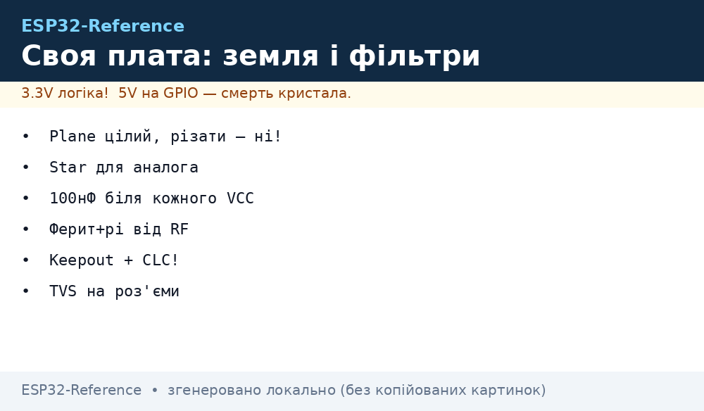
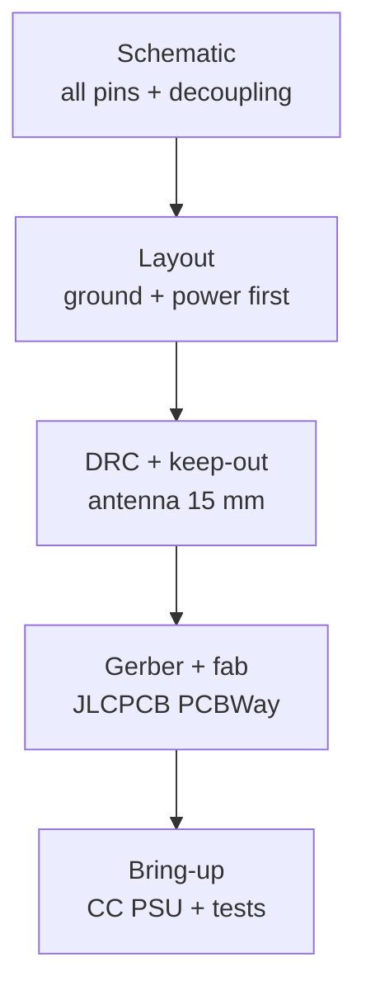

# Lab 4 - PCB Design

*Fig. Ground and power routing for ESP32 PCB.*

## 1. Schematic Basics

- Use ESP32 symbol with all pins labeled.
- Add pull-ups (10k), decoupling caps (100 nF per pin, 10 µF bulk).
- Include USB-UART bridge (CH340/CP2102) or native USB if S3.

## 2. Layout Rules

| Rule | Value | Reason |
| --- | --- | --- |
| Trace width power | 0.3 mm / 1 mm for 5V | Current capacity |
| Ground plane | Continuous | Low impedance |
| Antenna keep-out | 15 mm from metal | RF performance |
| Crystal near chip | <5 mm | Clock stability |

## 3. Ground Planes

- Use single-point ground near LDO; avoid ground loops.
- Star ground for analog and digital sections.

## 4. Power Routing

- Route 5V and 3.3V separately; use wide traces.
- Place bulk cap 47 µF near module; 100 nF near each pin.
- LDO thermal: add copper pour for heat sinking.

## 5. Manufacturing Notes

- Use 2-layer for simple boards; 4-layer for complex RF.
- Order from JLCPCB / PCBWay; check DRU for 5/5 rules.
- Include test points for power and UART.

### PCB flow

## Stackup and rules

| Choice | Value | Reason |
| --- | --- | --- |
| Layers, simple node | 2 | Cheap, enough without RF front-end |
| Layers, RF/complex | 4 | Solid ground plane under module |
| Power trace 3V3 | 0.5 mm+ | TX peaks 500 mA |
| Power trace 5V in | 1.0 mm+ | Adapter current plus margin |
| Antenna keep-out | 15 mm from copper/metal | RF detune otherwise |
| Crystal to chip | Under 5 mm | Clock stability |

## DRC and bring-up checklist

- [ ] 100 nF at every power pin plus 10-47 uF bulk at module entry.
- [ ] Single-point ground near LDO; no slots under high-current path.
- [ ] Test points: 3V3, GND, TX, RX, BOOT, EN (pogo-ready).
- [ ] First power via lab PSU with CC 100 mA before USB.
- [ ] Gerber checked in viewer: board outline, drills, mask openings on pads.

## Common issues

| Symptom | Cause | Fix |
| --- | --- | --- |
| WiFi weak on custom PCB | Copper under antenna or ground flood in keep-out | Cut keep-out 15 mm, no traces under antenna area |
| Reboots on TX peaks | Thin power traces plus small bulk cap | Widen 3V3/5V traces, 47 uF at module, shorter feed |
| I2C fails on long PCB runs | Capacitance plus missing pull-ups | 4.7k pull-ups near master, keep bus under 30 cm |
| USB-UART will not flash | DTR/RTS auto-reset circuit missing or wrong | Copy reference auto-reset with 100 nF EN cap |
| Noise on ADC readings | Analog routed with digital/SPI crosstalk | Guard analog trace with ground, average samples, RC filter |

## Official sources

- [ESP32 Hardware Design Guidelines (Espressif)](https://docs.espressif.com/projects/esp-hardware-design-guidelines/en/latest/esp32/index.html) - schematic, layout and RF rules.
- [ESP32 Datasheet (Espressif)](https://www.espressif.com/sites/default/files/esp32-datasheet-en.pdf) - strapping pins and power figures.

## Layer stackup options

| Design | Stackup | When |
| --- | --- | --- |
| Simple sensor node | 2-layer, ground pour both | No RF matching, slow buses only |
| WiFi gateway | 4-layer, solid GND plane | Controlled 50 Ohm antenna feed |
| Motor control | 4-layer, thick outer copper | High current plus logic separation |
| PoE or mains | 4-layer, isolation slots | Creepage per standard, fuse onboard |

## Gerber export checklist

- [ ] Board outline on mechanical layer, no overlapping copper edges.
- [ ] Drill file matches pads: plated versus non-plated clearly marked.
- [ ] Solder mask openings on all SMD pads, none on test vias to probe.
- [ ] Silkscreen shows pin 1, polarity, connector names and revision.
- [ ] Fab notes: material FR-4, thickness 1.6 mm, copper 1 oz, finish lead-free.
- [ ] Viewer check of every layer pair before sending to fab.

## Test point plan

| Net | Access | Why |
| --- | --- | --- |
| 3V3 and 5V | 2 mm pad each | Rail check under load |
| GND | Three pads spread out | Probe ground anywhere |
| TX RX | Pads near bridge | Flash and log without headers |
| BOOT EN | Pads with pull states | Force modes during debug |
| ADC input | Pad before RC filter | Inject test voltage |

## Crystal and RF layout notes

- 40 MHz crystal within 5 mm of chip, guard ring grounded, no bus under it.
- Antenna feed 50 Ohm microstrip over solid ground, no stubs or vias in path.
- Matching pi-network placed at antenna base, default 0 Ohm plus DNI pads.
- Keep switching regulators 20 mm from RF section with shielded inductor.

## Copper and via rules

| Feature | Rule | Why |
| --- | --- | --- |
| Outer copper | 1 oz standard, 2 oz for motors | Current without heat |
| Via power | Two 0.5 mm vias per amp | Single via overheats |
| Via tenting | Tent vias under module | Solder wicking prevention |
| Thermal relief | Spokes on plane pads | Hand solderability |

## Soldermask and courtyard notes

- Soldermask expansion 0.05 mm per side keeps mask off pads on 0.5 mm pitch.
- Courtyard overlap check in footprint editor prevents assembly collisions.
## See Also

- [Home](../../../../ESP32-Reference/Home.md)
- [EN/01-Hardware/05-WROOM-WROVER-MINI-Modules.en]
- [03-Cheklisti-montazhu](../../../../ESP32-Reference/UA/99-Dodatki/03-Cheklisti-montazhu.md)

> UA original twin: [UA](../../../../ESP32-Reference/UA/17-Lab/04-PCB-Design.md)
