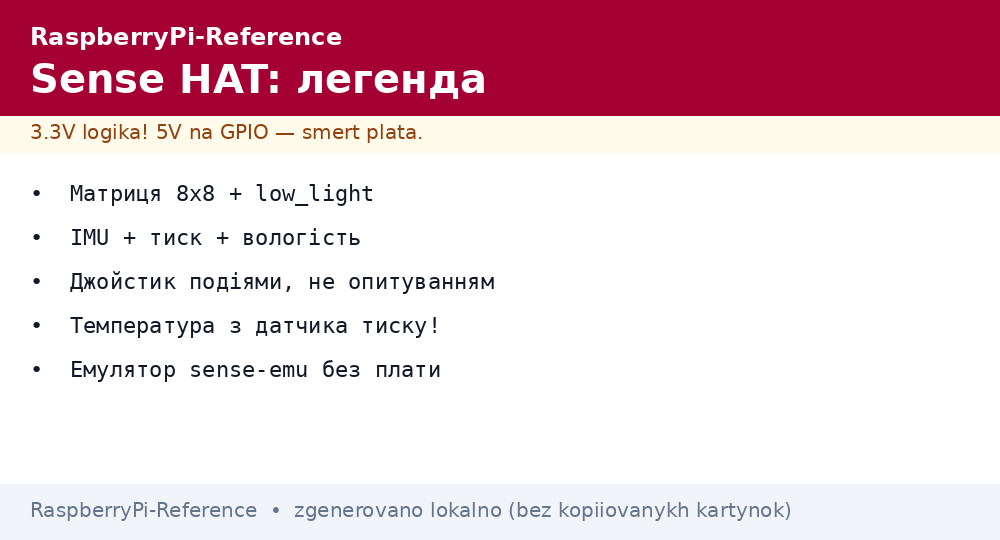
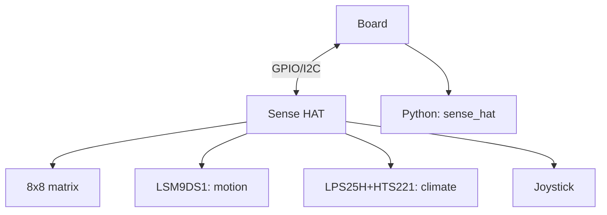

# Sense HAT on Raspberry Pi - LED Matrix, Sensors and Joystick


*Fig. Sense HAT on top of the pin header: 8x8 matrix, gyroscope/accelerometer/magnetometer, barometer, humidity, mini-joystick.*

> [!tip] What this note is
> A legend of the ecosystem (it flew on the ISS!): one board gives output, sensors and input at once. Perfect for learning and weather stations. HAT standard: [HAT and EEPROM](../../../../RaspberryPi-Reference/UA/03-GPIO/03-HAT-EEPROM.md), power supply: [USB-C power supply](../../../../RaspberryPi-Reference/UA/02-Zhivlennya/01-USB-C-PD.md).

## 1. Goal

Squeeze everything out of the Sense HAT:

- 8x8 RGB matrix: text, icons, charts;
- IMU (gyroscope+accelerometer+magnetometer): tilt and compass;
- pressure, humidity, temperature: a mini weather station;
- joystick: 5 directions as buttons;
- the `sense_hat` library - everything in three lines.

| Block | Chip | Features |
| --- | --- | --- |
| Matrix | LED 8x8 (ATtiny) | text, RGB 0-255 |
| IMU | LSM9DS1 (gyro+accel+magnet) | tilt, heading |
| Pressure/humidity | LPS25H + HTS221 | 260-1260 hPa,%RH |
| Joystick | 5 directions | events as buttons |

## 2. Board architecture



The only board that covers output+input+sensors together. Consumption is milliamperes, power from the pin header is enough.

## 3. Installation and first run

- sits on the 40-pin header through an extender (SoC ventilation!);
- library: `pip install sense-hat` (system one - through apt);
- emulator on a PC: `sense-emu` - code without the board;
- test: the `rainbow.py` example from the library;
- Astro Pi: the same boards flew on the ISS - missions for schools.

## 4. Matrix: text and graphics

- `show_message("Hi", scroll_speed=0.1)` - scrolling line;
- `set_pixel(x, y, r, g, b)` - dot drawing;
- `set_pixels(64-item list)` - a whole frame;
- brightness: `low_light=True` for the night;
- orientation: `set_rotation(0/90/180/270)`.

## 5. Working code: weather station with compass

```python
from sense_hat import SenseHat
import time

sense = SenseHat()
sense.low_light = True
sense.set_rotation(180)

def show_temp():
    t = sense.get_temperature_from_pressure()
    h = sense.get_humidity()
    p = sense.get_pressure()
    msg = f"{t:.0f}C {h:.0f}% {p:.0f}"
    sense.show_message(msg, scroll_speed=0.08, text_colour=[0, 255, 0])
    return t, h, p

def show_compass():
    o = sense.get_orientation()
    yaw = o['yaw']
    dirs = ['N', 'NE', 'E', 'SE', 'S', 'SW', 'W', 'NW']
    d = dirs[int((yaw + 22.5) / 45) % 8]
    sense.show_letter(d, text_colour=[255, 255, 0])
    return yaw

while True:
    t, h, p = show_temp()
    time.sleep(2)
    yaw = show_compass()
    print(f"T={t:.1f} H={h:.0f} P={p:.0f} yaw={yaw:.0f}")
    time.sleep(2)
```

We take temperature from the pressure sensor (more accurate - farther from the CPU). Calibration: subtract the board self-heating of 3-5 °C.

## 6. Joystick as buttons

- events: `pressed`, `held`, `released` + directions;
- menu on the matrix: up/down - items, press - select;
- the 8x8 "snake" game - a club classic;
- debounce built into the library.

## 7. Accuracy and limits

- the thermometer lies because of board heat - move it out or compensate;
- calibrate the magnetometer with a figure-eight;
- pressure - as a barometer, compute altitude from QNH;
- 8x8 - 3x5 symbols, Cyrillic alphabets are drawn by hand;
- for serious weather - external BME280/DS18B20 sensors.

## 8. Common issues

| Symptom | Cause | Fix |
| --- | --- | --- |
| Dark matrix | brightness/rotation? - code without `show` | call show after drawing |
| Temperature +5 °C | board heat | compensation or an external sensor |
| Joystick does not respond | reading state instead of events | pressed/held/released callbacks |
| IMU drifts | no calibration | figure-eight for the magnetometer |
| Emulator differs from hardware | timings on a PC differ | final test on the board |
| HAT heats the board | no ventilation | header extender + airflow |

## 9. Sense HAT quick cheat sheet

- `sense-emu` emulator - code without the board;
- temperature - from the pressure sensor;
- matrix: text, pixels, low_light;
- joystick - events, not polling;
- magnetometer calibration with a figure-eight.

## 10. Related notes

- [HAT and EEPROM](../../../../RaspberryPi-Reference/UA/03-GPIO/03-HAT-EEPROM.md) - board standard.
- [BME280 climate] - more accurate climate.
- [MPU6050 motion] - separate IMU.
- [NeoPixel and servo] - large output.
- [main map](../../../../RaspberryPi-Reference/Home.md) - full navigation.

## 9.1 Sense HAT flights: what was on the ISS

- Astro Pi: two boards on the station since 2015;
- Zero Robotics and Mission Zero missions for schools;
- student code really ran in orbit;
- the sensors are the same as in the shop;
- the next mission - a reason to build your own program.

## Official sources

- [Sense HAT (Raspberry Pi)](https://www.raspberrypi.com/products/sense-hat/) - features and sensors.
- [Getting Started (Raspberry Pi docs)](https://www.raspberrypi.com/documentation/computers/getting-started.html) - HAT and setup.
- [gpiozero docs (Read the Docs)](https://gpiozero.readthedocs.io/en/stable/) - pins and scripts.
