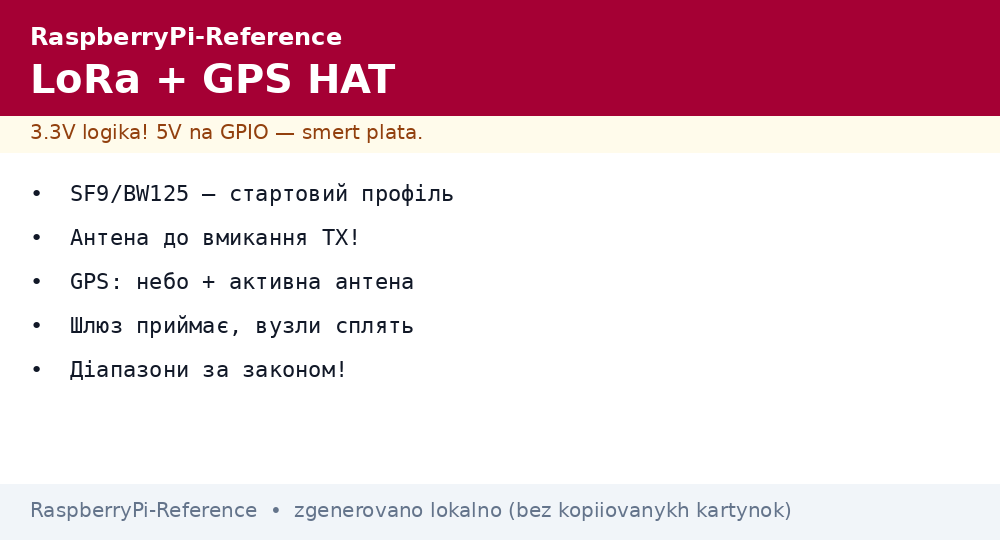
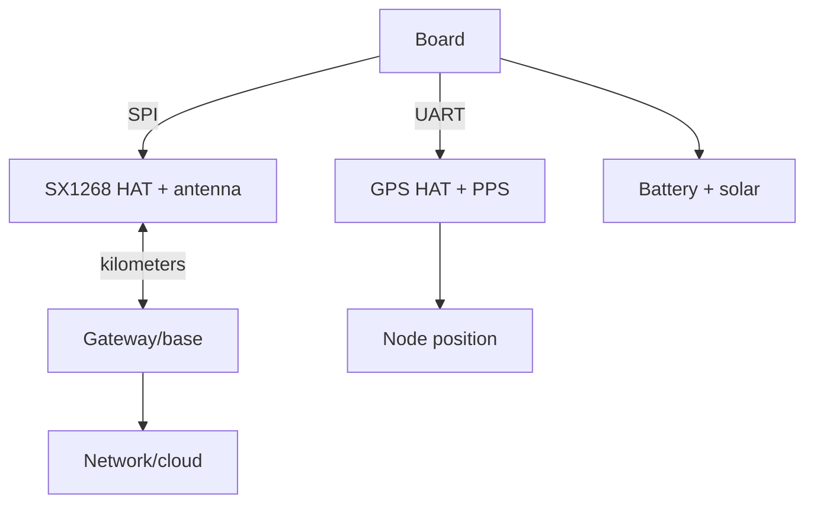

# LoRa and GPS HAT for Raspberry Pi - Long-Range Link and Position


*Fig. Long-range node: the LoRa hat talks for kilometers, the GPS HAT board knows where, the board controls both.*

> [!tip] What this note is
> When WiFi cannot reach: kilometers in the field (LoRa) plus position (GPS). A gateway, a tracker, country-house sensors. Onboard radio: [onboard radio], GPS separately: [GPS modules](../../../../RaspberryPi-Reference/UA/10-Sensori/05-GPS-NEO.md).

## 1. Goal

Build a long-range node:

- LoRa HAT (SX1268/SX1276): point-to-point and a LoRaWAN gateway;
- GPS HAT: position + PPS + clock;
- together: a tracker that sends position over radio;
- antennas, power supply, band legality.

| Module | Band | Range | Speed |
| --- | --- | --- | --- |
| SX1268 HAT | 433 MHz | up to 5 km line of sight | 0.3-62 kbit/s |
| SX1262 HAT | 868 MHz (EU) | up to 5 km | LoRaWAN-ready |
| GPS HAT (NEO) | L1 | worldwide | 9600 baud NMEA |

Band and power - per local law: 433 MHz/10 mW and 868 MHz/25 mW for the EU are reference points, check the regulations.

## 2. Node architecture



The gateway is the same pair on a Pi 4 with internet: it receives node packets and passes them to MQTT.

## 3. LoRa HAT in detail

- SX1268 (433) or SX1262 (868) chip: SPI + DIO1/BUSY/RST;
- parameters: SF7-SF12 (speed versus range), BW 125-500 kHz, CR 4/5-4/8;
- power up to +22 dBm, for battery use the lowest sufficient;
- antenna mandatory before enabling TX (see matching);
- libraries: `pySX127x`/`RadioLib` (a port), or manual SPI.

## 4. GPS HAT in detail

- NEO-6M/8M on the board + antenna connector (active!);
- UART 9600, PPS on GPIO;
- RTC battery on the HAT - warm start in seconds;
- external magnet-mount antenna - on the roof/hood;
- NMEA parsing is the same as in the GPS module note.

## 5. Working code: P2P tracker

```python
import time
import serial
from SX126x import SX126x

lora = SX126x(spi_bus=0, cs_pin=8, reset_pin=22, busy_pin=23, irq_pin=24)
lora.begin(freq=433000000, bw=125000, sf=9, cr=5, power=14)
gps = serial.Serial('/dev/serial0', 9600, timeout=1)

def gps_pos():
    for _ in range(20):
        line = gps.readline().decode('ascii', errors='ignore')
        if line.startswith('$GPGGA'):
            p = line.split(',')
            if p[6] not in ('', '0'):
                return p[2] + p[3] + ',' + p[4] + p[5]
    return None

while True:
    pos = gps_pos()
    msg = pos if pos else "NOFIX"
    lora.send(msg.encode())
    print("TX:", msg)
    time.sleep(60)
```

SF9 is the golden middle: kilometers covered, airwaves not jammed. 14 dBm power is enough for the city, 22 for the field.

## 6. LoRaWAN gateway (simplified)

- a single-channel gateway on the HAT - for your own nodes (not TTN);
- a full gateway - an SX1302 concentrator (a separate board);
- packet: node ID + data + CRC, acknowledgement from the base;
- payload encryption - AES with a firmware key;
- airwave ethics: duty-cycle and minimum power.

## 7. Antennas and range

- 433 MHz whip about 17 cm, 868 MHz about 8 cm - quarter-wave;
- height matters more than power: a roof beats watts;
- check VSWR with a meter, not by eye;
- NEVER transmit without an antenna - the output burns;
- lightning protection on fixed masts.

## 8. Common issues

| Symptom | Cause | Fix |
| --- | --- | --- |
| Silence on air | different SF/BW/frequency on nodes | one profile on all |
| GPS without fix | antenna indoors | window/roof, active antenna |
| Short range | antenna inside the case | move out, height decides |
| Burned TX | transmission without antenna | antenna first, then power |
| SPI conflict | display on the same bus | separate CS, interleave |
| No PPS | pin not connected | PPS to GPIO + overlay |

## 9. LoRa/GPS quick cheat sheet

- SF9/BW125 - starter profile;
- antenna before enabling TX always;
- GPS: sky + active antenna;
- the gateway receives, nodes sleep;
- share the air honestly (duty-cycle).

## 10. Related notes

- [onboard radio] - short-range link.
- [GPS modules](../../../../RaspberryPi-Reference/UA/10-Sensori/05-GPS-NEO.md) - NMEA in detail.
- [HAT and EEPROM](../../../../RaspberryPi-Reference/UA/03-GPIO/03-HAT-EEPROM.md) - HAT board mechanics.
- [I2C/SPI/UART buses](../../../../RaspberryPi-Reference/UA/04-Shini/01-I2C-SPI-UART.md) - SPI and UART.
- [main map](../../../../RaspberryPi-Reference/Home.md) - full navigation.

## 9.1 Airwave ethics for LoRa nodes

- minimum power that closes the distance;
- duty-cycle: silent 99% of the time;
- do not jam other gateways with your packets;
- frequency and SF - per the local band plan;
- node callsign/ID in every packet.

## Official sources

- [SX1268 433M LoRa HAT (Waveshare)](https://www.waveshare.com/wiki/SX1268_433M_LoRa_HAT) - connection, parameters.
- [NEO-6 series (u-blox)](https://www.u-blox.com/en/product/neo-6-series) - NMEA and PPS.
- [Getting Started (Raspberry Pi docs)](https://www.raspberrypi.com/documentation/computers/getting-started.html) - HAT and buses.
