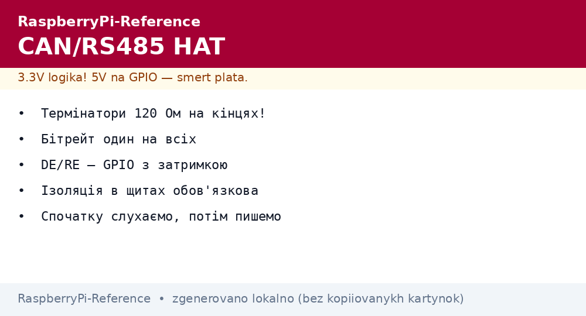
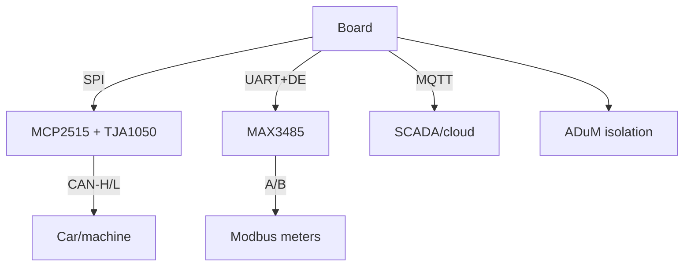

# CAN and RS485 HAT for Raspberry Pi - Industrial Buses


*Fig. Industrial bridge: a CAN transceiver into the vehicle bus, RS485 into a Modbus line, the board as a gateway to MQTT.*

> [!tip] What this note is
> The language of factories and cars: CAN (machines, tools) and RS485/Modbus (meters, PLCs). HATs with transceivers + terminators + isolation. Buses: [I2C/SPI/UART buses](../../../../RaspberryPi-Reference/UA/04-Shini/01-I2C-SPI-UART.md), protocols - queue 4 notes (Modbus).

## 1. Goal

Talk to industry:

- CAN HAT (MCP2515 + TJA1050): read the vehicle bus, control nodes;
- RS485 HAT (MAX3485/isolated): Modbus RTU to meters;
- 120 Ohm terminators: where to fit, where to remove;
- CAN/Modbus to MQTT gateway.

| Bus | Topology | Speed | Range |
| --- | --- | --- | --- |
| CAN 2.0 | line, 120 Ohm on both ends | up to 1 Mbit/s | 40 m - 1 km |
| CAN-FD | as CAN, faster data | up to 8 Mbit/s | shorter |
| RS485 | line, terminator on ends | up to 10 Mbit/s | up to 1200 m |

## 2. Gateway architecture



Isolated HATs are for cabinets with interference: board ground and field ground are separated. Non-isolated ones are for the desk.

## 3. CAN HAT in detail

- MCP2515 over SPI 10 MHz + INT interrupt;
- `mcp2515-can0` overlay, speed in parameters;
- `can0` interface in the system - `ip`, `candump`, `cansend`;
- MCP2515 filters/masks - in hardware, no CPU load;
- 11-bit and 29-bit identifiers at the same time.

## 4. RS485 HAT in detail

- MAX3485 or an isolated equivalent;
- DE/RE on GPIO: transmit - HIGH, receive - LOW;
- 120 Ohm terminator with a jumper (only on line ends!);
- bias resistors hold the line in pause;
- Modbus speeds: 9600/19200/115200, parity per device.

## 5. Working code

```bash
# CAN: підняти і слухати
sudo ip link set can0 type can bitrate 500000
sudo ip link set can0 up
candump can0
cansend can0 123#DEADBEEF
```

```python
import serial
import struct
import time

ser = serial.Serial('/dev/serial0', 9600, timeout=1)

def modbus_read(slave, reg, n=1):
    req = struct.pack('>BBHH', slave, 0x04, reg, n)
    crc = 0xFFFF
    for b in req:
        crc ^= b
        for _ in range(8):
            crc = (crc >> 1) ^ 0xA001 if crc & 1 else crc >> 1
    ser.write(req + struct.pack('<H', crc))
    time.sleep(0.05)
    return ser.read(5 + 2 * n)

if __name__ == '__main__':
    raw = modbus_read(1, 0x0000, 2)
    print('reply:', raw.hex())
```

We compute Modbus CRC-16 ourselves - 6 lines, no libraries. A full client is `pymodbus` from pip.

## 6. Terminators and topology

- CAN: 120 Ohm on two ends, middle - without;
- RS485: the same, plus 560 Ohm bias on one end;
- a star instead of a line - reflections and errors;
- stub length - centimeters, not meters;
- cable shield - grounded on one side.

## 7. Industrial safety

- reading car CAN is fine, writing - only knowing the consequences;
- galvanic isolation in cabinets is mandatory;
- fuses in the HAT power supply;
- logging all traffic before intervening;
- a test bench, not a live cabinet.

## 8. Common issues

| Symptom | Cause | Fix |
| --- | --- | --- |
| No `can0` | overlay not enabled | dtoverlay + reboot, `dmesg` |
| Silence on the bus | no terminator | 120 Ohm on the ends |
| Garbage in candump | wrong bitrate | match the network (125/250/500K) |
| Modbus timeout | DE/RE does not switch | GPIO control, 5 ms delay |
| CRC mismatch | byte order | little-endian CRC, big-endian data |
| Works, then stops | interference without isolation | isolated HAT, shield |

## 9. Bus quick cheat sheet

- 120 Ohm terminators only on the ends;
- bitrate identical on all nodes;
- DE/RE - GPIO with a delay;
- always compute CRC, no trust;
- listen first, then write.

## 10. Related notes

- [I2C/SPI/UART buses](../../../../RaspberryPi-Reference/UA/04-Shini/01-I2C-SPI-UART.md) - transport level.
- [HAT and EEPROM](../../../../RaspberryPi-Reference/UA/03-GPIO/03-HAT-EEPROM.md) - HAT board mechanics.
- [peaceful Sense hat](../../../../RaspberryPi-Reference/UA/12-Moduli-zvyazku/01-Sense-HAT.md) - sensors without industry.
- [OS setup] - can-utils installation.
- [main map](../../../../RaspberryPi-Reference/Home.md) - full navigation.

## 9.1 Industrial traffic logging

- `candump -l` writes everything to a file with stamps;
- ring buffer: a day in a circle, old data overwritten;
- time stamps from GPS-PPS for crash analysis;
- `can0,123:7FF` filter - only needed IDs;
- crash archive - separate from routine.

## Official sources

- [2-CH CAN HAT (Waveshare)](https://www.waveshare.com/wiki/2-CH_CAN_HAT) - connection, overlays.
- [MCP2515 (Microchip)](https://www.microchip.com/en-us/product/mcp2515) - controller, filters, SPI.
- [NEO-M9N module (u-blox)](https://www.u-blox.com/en/product/neo-m9n-module) - accurate time for bus stamps.
