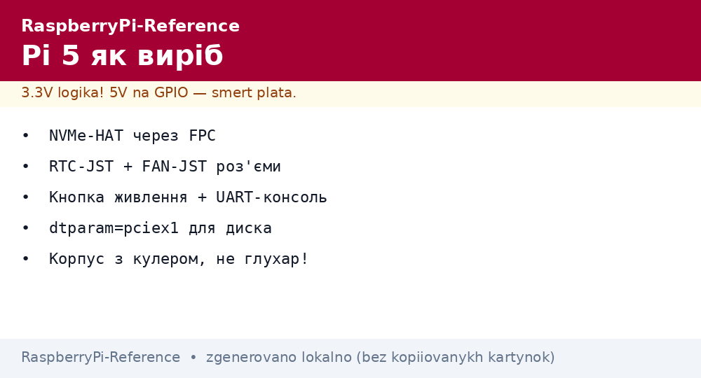
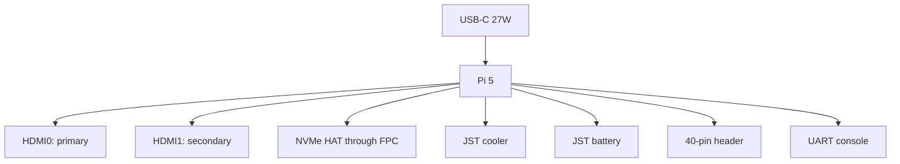

# Raspberry Pi 5 as a Product - Revisions, Connectors, NVMe and Cases


*Fig. Pi 5 anatomy: USB-C PD, 2xHDMI, PCIe-FPC, RTC-JST, FAN-JST, 40-pin header - everything in place.*

> [!tip] What this note is
> The board through an owner eye: what plugs where, which HAT boards to take, how not to overheat. The chip: [BCM2712 and Pi 5](../../../../RaspberryPi-Reference/UA/01-Hardware/02-BCM2712-Pi5.md), buying: [boards and accessories].

## 1. Goal

Master the board as a product in one evening:

- connector map: what goes where and why;
- NVMe HAT boards: which to take for system and data;
- cases and coolers: silence versus performance;
- power button and UART console: hidden features.

| Connector | Purpose | Note |
| --- | --- | --- |
| USB-C | PD 5V 5A power + data | only a quality cable |
| 2xmicro-HDMI | 4Kp60 monitors | HDMI0 is primary |
| PCIe FPC | NVMe HAT, 1 lane | enable in config.txt |
| RTC JST-SH | time battery | 2 pins, polarity! |
| FAN JST-SH | 5V cooler with PWM | 4 pins |
| UART debug | 3-pin console | 115200 8N1 |
| Header | 40 pins, 3.3V | HATs sit on top |

## 2. Board architecture



Assembly order: NVMe HAT board to cooler to case to SD (if needed) to cables. M2.5 screws, do not overtighten.

## 3. NVMe HAT boards in detail

- official M.2 HAT+: 2230/2242, PCIe 2.0 x1;
- third-party for 2280 - check power compatibility;
- DRAM-less SSD: runs cooler, cheaper, fine for the system;
- system straight on NVMe: Imager to select the disk;
- `dtparam=pciex1`, fresh EEPROM - otherwise no disk.

## 4. Cases and coolers

- official case + cooler: a balance of noise and temperature;
- Flirc passive: silence, but throttles under stress;
- open stand + large heatsink: maximum air;
- thermal pad on SoC/RAM/PMIC - all three get hot;
- cooler curve: `dtparam=fan_temp0=50000` and hysteresis.

## 5. Working code: button and fan

```python
from gpiozero import Button, PWMLED, CPUTemperature
import os
import time

# Штатний 4-піновий кулер Pi 5 керується прошивкою (dtoverlay=pwm-fan,
# див. розділ 4), а НЕ кодом: GPIO14 - це UART TXD!
# Зовнішній вентилятор - тільки через N-MOSFET:
fan = PWMLED(pin=14)  # GPIO14 -> затвор MOSFET, живлення 5V окремо
btn = Button(pin=3, hold_time=2)

def fan_curve(temp):
    if temp < 50:
        return 0.0
    if temp < 65:
        return 0.4
    return 1.0

def on_temp():
    fan.value = fan_curve(CPUTemperature().temperature)

btn.when_held = lambda: os.system('sudo poweroff')

while True:
    on_temp()
    time.sleep(5)
```

A button on GPIO3 is a hardware wakeup from sleep. A long hold is a clean shutdown, not pulling power.

## 6. Revisions and clones

- revision printed near the header: newer means fewer errata;
- no Pi 5 clones (complex board), but PSU and cooler clones exist;
- take shielded micro-HDMI adapters, otherwise 4K sparks;
- check on purchase: boot from a test SD before warranty ends.

## 7. Peripheral power

- USB ports: 1.6A total with a 5A PSU, 600 mA with a 3A PSU;
- 2.5 inch SSD over USB - through a powered hub;
- PoE+ HAT - power and network over one cable;
- measure current with a USB tester, not by eye.

## 7.1 USB peripherals: what the port pulls

- keyboard/mouse - any, current is tiny;
- 2.5 inch SSD - through a powered hub, otherwise dropouts;
- webcam + microphone - together within the port limit;
- SDR dongle - separate power on a long cable;
- limits: 1.2A with a 5A PSU, 600 mA with a 3A PSU;
- measure with a USB tester inline, do not guess.

## 8. Common issues

| Symptom | Cause | Fix |
| --- | --- | --- |
| NVMe not visible | no dtparam | `dtparam=pciex1` + reboot |
| Cooler does not spin | wrong JST or no overlay | 4-pin JST, `dtoverlay=pwm-fan` |
| RTC does not hold | battery missing/discharged | JST battery, `hwclock -w` |
| USB disk drops | weak PSU | 27W PD, powered hub |
| Throttling in a sealed case | no ventilation | case with cooler or open |
| Does not start from old SD | image before Bookworm | fresh image for Pi 5 |

## 9. Related notes

- [BCM2712 and Pi 5](../../../../RaspberryPi-Reference/UA/01-Hardware/02-BCM2712-Pi5.md) - chip in detail.
- [USB-C power supply](../../../../RaspberryPi-Reference/UA/02-Zhivlennya/01-USB-C-PD.md) - PSU in detail.
- [storage media](../../../../RaspberryPi-Reference/UA/08-Pamyat/01-SD-eMMC-NVMe.md) - NVMe in detail.
- [Pi 4 workhorse] - younger sister.
- [EEPROM boot](../../../../RaspberryPi-Reference/UA/09-Proshivka/02-EEPROM-Boot.md) - boot order.

## 10. Pi 5 product quick cheat sheet

- NVMe: HAT board + `dtparam=pciex1`;
- cooler: 4-pin JST + overlay;
- RTC: JST battery + `hwclock -w`;
- USB limits: 1.2A with PD, 600 mA with 3A;
- console: 3-pin UART 115200.

## Official sources

- [Raspberry Pi 5 (Raspberry Pi)](https://www.raspberrypi.com/products/raspberry-pi-5/) - connectors, power, PCIe.
- [Getting Started (Raspberry Pi docs)](https://www.raspberrypi.com/documentation/computers/getting-started.html) - first run.
- [gpiozero docs (Read the Docs)](https://gpiozero.readthedocs.io/en/stable/) - button, cooler, temperature.
