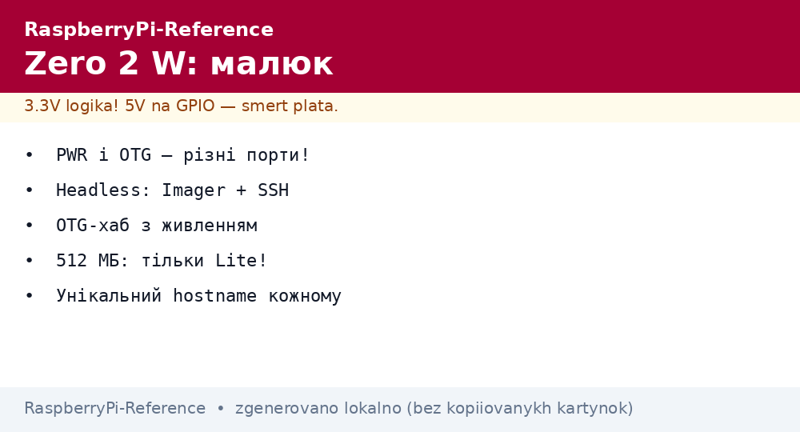

# Raspberry Pi Zero 2 W - Tiny Linux for IoT Nodes


*Fig. Zero 2 W: micro-USB power+OTG, mini-HDMI, CSI - a full Linux on a stamp.*

> [!tip] What this note is
> Pocket Linux for the price of a pizza: 4 cores, WiFi, camera - for sensors, camera traps and USB gadgets. Choice: [model comparison], buying: [boards and accessories].

## 1. Goal

Squeeze the maximum from 65x30 mm:

- power and OTG modes without surprises;
- headless setup from first boot;
- camera and sensors on a small board;
- honest limits: what the Zero cannot pull.

| Parameter | Value |
| --- | --- |
| SoC | RP3A0: 4xA53 1 GHz (SiP with RAM) |
| RAM | 512 MB LPDDR2 |
| Radio | WiFi + BT 4.2 |
| USB | 1xmicro-USB OTG (data+power separate!) |
| Video | mini-HDMI, CSI camera |
| Power supply | micro-USB 5V 2.5A |

Two micro-USB ports: PWR (power only) and USB (OTG data). Port confusion is a first-run classic.

## 2. Board architecture

```mermaid
flowchart TB
  PWR[micro-USB PWR] --> Z[Zero 2 W]
  OTG[micro-USB OTG] --> Z
  Z --> HDMI[mini-HDMI]
  Z --> CSI[CSI camera]
  Z --> GPIO[40-pin header (WH version)]
  OTG --> HUB[OTG hub: keyboard+mouse]
  Z -->|WiFi| NET[Network]
```

The WH version has a soldered header (+a couple of dollars, saves soldering). Without H, solder yourself or take a hammer-header with no iron.

## 3. Headless start

- Imager: Lite 64-bit OS, SSH, WiFi, user - all in the wizard;
- first boot 1-2 minutes (expansion);
- `ssh user@raspberrypi.local` or the IP from the router;
- change the hostname at once (`raspi-config`) - the network will hold several Zeros;
- clock is NTP only, no RTC.

## 4. OTG modes

- host: hub to keyboard/mouse/FM dongle;
- gadget: the Zero as Ethernet/USB-serial for a PC (`dtoverlay=dwc2`);
- Pi-KVM-like scenarios: keyboard/mouse for another PC;
- power does not go through the OTG cable - PWR is separate!

## 5. Working code: IoT node

```python
import time
import board
import busio
import adafruit_bme280
from gpiozero import LED
import paho.mqtt.client as mqtt

i2c = busio.I2C(board.SCL, board.SDA)
bme = adafruit_bme280.Adafruit_BME280_I2C(i2c, address=0x76)
led = LED(17)
cl = mqtt.Client()
cl.connect("broker.local", 1883, 60)
cl.loop_start()

while True:
    t = bme.temperature
    h = bme.humidity
    cl.publish("zero2w/climate", f"{t:.1f},{h:.0f}")
    led.toggle()
    time.sleep(60)
```

Blinka libraries (`board`, `busio`) are a CircuitPython bridge on Pi. They work identically on all Linux boards.

## 6. Camera on the Zero

- CSI connector: Camera Module 3 or AI Camera;
- libcamera + Picamera2 - the same code as on Pi 4/5 (details in the camera note);
- a frame trap once a minute + MQTT - a classic;
- 1080p video decodes, pulls a stream, but with effort.

## 7. Application limits

- desktop - no: 512 MB and one USB kill the idea;
- big compilation - no: swap on SD is slow, build on Pi 4/5;
- USB audio/disks - through a powered hub;
- 24/7 - yes, consumption about 1W, heats little;
- a Zero cluster is for learning, not combat.

## 7.1 Zero USB gadgets: modes

- Ethernet gadget: the Zero as a network card for a PC;
- Serial gadget: console over USB with no network;
- Mass-storage: a slice of SD as a flash drive for a PC;
- MIDI gadget: buttons into music software;
- combo: Ethernet + Serial at once;
- enable with `dtoverlay=dwc2` + `g_ether`/`g_serial` modules.

## 8. Common issues

| Symptom | Cause | Fix |
| --- | --- | --- |
| Does not start | cable in OTG instead of PWR | power into the PWR port |
| WiFi does not see 5 GHz | there is none (2.4 only) | 2.4 GHz access point |
| Keyboard does not work | OTG without hub/power | powered hub |
| Desktop lags | 512 MB + swap | Lite only |
| Black camera | ribbon/incompatible module | check ribbon, libcamera stack |
| Lost on the network | identical hostname | a unique name per Zero |

## 9. Related notes

- [model comparison] - the Zero place in the line.
- [Imager firmware](../../../../RaspberryPi-Reference/UA/09-Proshivka/01-Imager-Headless.md) - headless install.
- Climate BME280 as the first sensor - queue 3 note (sensors section).
- CSI camera in detail - queue 3 note (sensors section).
- [MQTT protocol](../../../../RaspberryPi-Reference/UA/15-Protokoli/01-MQTT.md) - node telemetry.

## 9.1 Zero 2 W quick cheat sheet

- power into PWR, data into OTG;
- Lite only, 2.4 GHz only;
- powered hub for peripherals;
- a unique hostname per unit;
- gadget modes through `dwc2`.

## Official sources

- [Raspberry Pi Zero 2 W (Raspberry Pi)](https://www.raspberrypi.com/products/raspberry-pi-zero-2-w/) - features and power.
- [Getting Started (Raspberry Pi docs)](https://www.raspberrypi.com/documentation/computers/getting-started.html) - OTG and headless.
- [gpiozero docs (Read the Docs)](https://gpiozero.readthedocs.io/en/stable/) - pins and LED.
