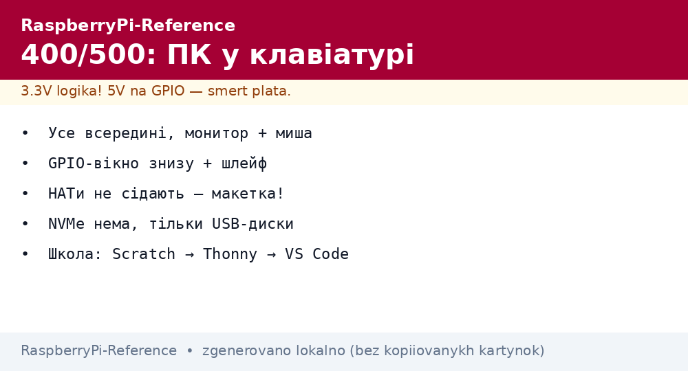
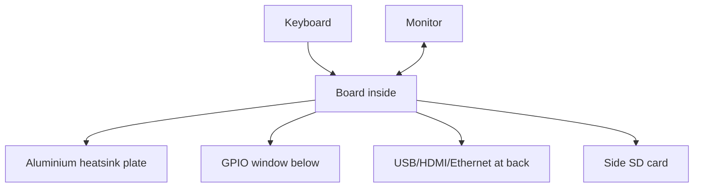

# Raspberry Pi 400 and 500 - Keyboard Computer for School and Home


*Fig. Everything in the keyboard: the board, a full-area heatsink, a GPIO window below - plug in a monitor and work.*

> [!tip] What this note is
> A ready PC without a kit: unpack and work. Perfect for a school, a club and a grandmother. Inside - Pi 4 (400) or Pi 5 class (500). Comparison: [model comparison].

## 1. Goal

Show the "computer without pain" niche:

- what is inside and how 400 differs from 500;
- GPIO for the club: how to reach the pins;
- software out of the box: what is already installed;
- when 400/500 fits and when a separate board does.

| Parameter | Pi 400 | Pi 500 / 500+ |
| --- | --- | --- |
| Base | Pi 4 (1.8 GHz) | Pi 5 class |
| RAM | 4 GB | 8/16 GB |
| Keyboard | 78 keys, 3 layouts | 78 keys, improved |
| GPIO | 40 pins under the lid | 40 pins under the lid |
| Ports | 2xUSB3, USB2, 2xHDMI, GbE | as Pi 5 + USB-C power |

## 2. Product architecture



A large aluminium plate is passive cooling across the keyboard: quiet and no throttling in office tasks.

## 3. Kit and first run

- Personal Kit: keyboard board + mouse + PSU + OS SD + HDMI cable + book;
- power on - a setup wizard: language, WiFi, updates;
- kid accounts and parental control - out of the box;
- Scratch, Thonny, LibreOffice - installed at once.

## 4. GPIO for the club

- a window below opens the 40-pin header;
- a ribbon adapter brings pins to a nearby breadboard;
- 3.3V logic - the same rules as on regular Pi boards;
- HATs do not fit (mechanics), only wires and breadboards;
- first lesson: LED + button in 10 minutes.

## 5. Working code: a 10-minute lesson

```python
from gpiozero import LED, Button
from signal import pause

led = LED(17)
btn = Button(27)

btn.when_pressed = led.on
btn.when_released = led.off

print("Натисни кнопку на макетці!")
pause()
```

Circuit: LED through 330 Ohm to GPIO17, button between GPIO27 and ground (gpiozero enables the internal pull-up itself).

## 6. Home and school

- media center: Kodi + HDMI + USB disk;
- programming: Scratch to Thonny to VS Code by age;
- office: browser + LibreOffice pulls calmly;
- server: Pi-hole or a file dump, but no NVMe;
- retro games: RetroPie on a separate card.

## 7. Limits

- no NVMe - USB disks only;
- GPIO without HATs - breadboard only;
- RAM upgrade impossible - choose at once;
- taking apart is fun, putting back together takes skill too;
- for serious making - a separate Pi 4/5 nearby.

## 7.1 Semester study program

| Week | Topic | Result |
| --- | --- | --- |
| 1-2 | Scratch and mouse | first game |
| 3-4 | Thonny + LED | blinker |
| 5-6 | Buttons and buzzer | reaction game |
| 7-8 | Temperature sensor | room chart |
| 9-10 | Camera + photo | stop-motion |
| 11-12 | Network and Scratch exchange | multiplayer |
| 13-14 | Own project | work defense |
| 15-16 | Backup and revision | exhibition |

Each lesson: 10 min theory, 30 min practice, a result photo in the portfolio. Homework is to finish, not to redo.

Grading without stress:

- works - already good;
- explained how - excellent;
- helped a neighbor - bonus;
- broke and fixed - experience, not failure.

## 8. Common issues

| Symptom | Cause | Fix |
| --- | --- | --- |
| Does not see 5 GHz WiFi | region not set | `raspi-config` to WiFi-country |
| GPIO does not respond | ribbon flipped | first pin marked with a triangle |
| Browser lags | too many tabs on 4 GB | fewer tabs or a Pi 500 |
| SD dies fast | swap + logs | zram, logs to RAM |
| Wrong keyboard layout | wrong locale | rerun the setup wizard |
| Want a HAT | mechanics forbids | HAT on a separate board |

## 9. Related notes

- [model comparison] - the 400/500 place.
- [Pi 4 workhorse] - the 400 internals.
- [Pi 5 flagship] - the 500 internals.
- [pin header and gpiozero](../../../../RaspberryPi-Reference/UA/03-GPIO/01-Header-Gpiozero.md) - first pins.
- [Imager firmware](../../../../RaspberryPi-Reference/UA/09-Proshivka/01-Imager-Headless.md) - OS reinstall.

## 9.1 400/500 quick cheat sheet

- Personal Kit equals everything to start;
- GPIO through the window + ribbon;
- HATs do not fit - breadboard only;
- no NVMe, USB disks;
- club: Scratch to Thonny to project.

## Official sources

- [Raspberry Pi 400 (Raspberry Pi)](https://www.raspberrypi.com/products/raspberry-pi-400/) - kit and features.
- [Raspberry Pi 500 (Raspberry Pi)](https://www.raspberrypi.com/products/raspberry-pi-500/) - new generation.
- [gpiozero docs (Read the Docs)](https://gpiozero.readthedocs.io/en/stable/) - first club code.
