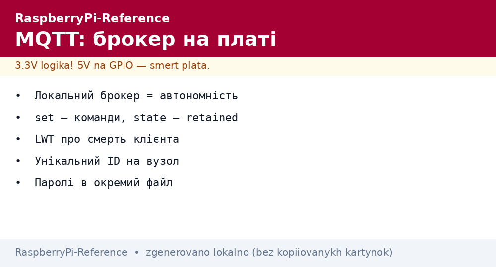
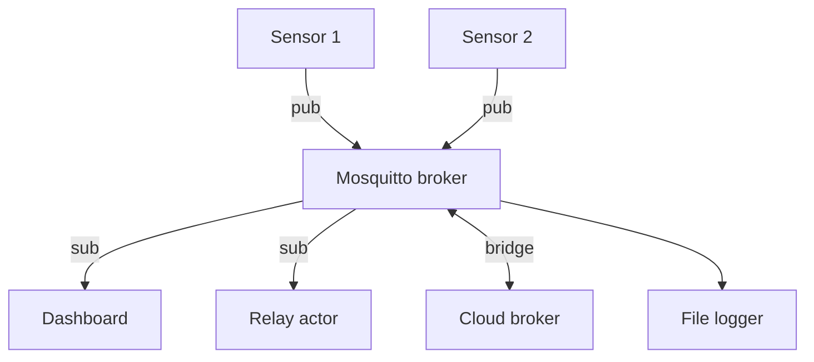

# MQTT on Raspberry Pi - Mosquitto Broker, Topics and Telemetry


*Fig. MQTT star: nodes publish, the broker distributes, subscribers take - the board is both broker and client.*

> [!tip] What this note is
> The IoT nervous system: light messages, hierarchical topics, work through dropouts. A broker on the board itself means autonomy without internet. Network: [OS setup], sensors: [BME280 climate].

## 1. Goal

Raise a full MQTT cycle:

- a Mosquitto broker on the board in 10 minutes;
- topics: naming that does not hurt in a year;
- QoS and retained: what to use when;
- paho Python client: publish and subscribe;
- a bridge to a cloud broker.

| Element | Role | Example |
| --- | --- | --- |
| Broker | star center | Mosquitto on Pi 4 |
| Publisher | gives data | temperature sensor |
| Subscriber | takes data | dashboard, relay |
| Topic | address | `home/kitchen/temp` |
| QoS | guarantee | 0 - fast, 1 - accurate |

## 2. Network architecture



A local broker works without internet - home automation does not depend on the provider. The bridge mirrors selected topics to the cloud.

## 3. Broker in 10 minutes

- `apt install mosquitto mosquitto-clients`;
- config: listener 1883, anonymous locally or passwords;
- passwords: `mosquitto_passwd`, a separate file;
- systemd autostart enabled by default;
- test: `mosquitto_sub` in one terminal, `mosquitto_pub` in another.

## 4. Topics that do not hurt

- hierarchy: `home/room/device/metric`;
- lowercase, no spaces and no Cyrillic;
- `.../set` - commands, `.../state` - state (retained!);
- `.../availability` - online/offline (LWT);
- schema version in the topic on format change (`v2/`).

## 5. Working code: client and bridge

```python
import json
import time
import paho.mqtt.client as mqtt

STATE = {'temp': 0.0, 'relay': False}

def on_connect(cl, ud, flags, rc, props=None):
    cl.subscribe('home/+/relay/set')
    cl.publish('home/node1/availability', 'online', retain=True)

def on_message(cl, ud, msg):
    topic = msg.topic
    if topic.endswith('/relay/set'):
        room = topic.split('/')[1]
        STATE['relay'] = msg.payload.decode() == 'ON'
        cl.publish(f'home/{room}/relay/state',
                   'ON' if STATE['relay'] else 'OFF', retain=True)

cl = mqtt.Client(mqtt.CallbackAPIVersion.VERSION2)
cl.on_connect = on_connect
cl.on_message = on_message
cl.will_set('home/node1/availability', 'offline', retain=True)
cl.username_pw_set('node1', 'secret')
cl.connect('localhost', 1883, 60)
cl.loop_start()

while True:
    STATE['temp'] = 23.5
    cl.publish('home/node1/temp',
               json.dumps({'t': STATE['temp'], 'ts': int(time.time())}))
    time.sleep(60)
```

The `offline` LWT message is spread by the broker itself if the client falls. Retained state survives a subscriber restart.

## 6. QoS and retained on fingers

- QoS 0: fire and forget (telemetry);
- QoS 1: at least once (commands);
- QoS 2: exactly once (rarely needed, expensive);
- retained: last value for new subscribers;
- clean session false: offline message queue.

## 7. Bridge to the cloud

- `connection` in `mosquitto.conf`: address, login, topics both ways;
- up - telemetry, down - commands;
- TLS for the bridge (Let's Encrypt certificates);
- on dropout, local work continues, the bridge catches up;
- bridge monitoring: `$SYS/broker/connection/+/state`.

## 8. Common issues

| Symptom | Cause | Fix |
| --- | --- | --- |
| `Connection refused` | broker not listening/firewall | `listener 1883`, ufw rule |
| Messages get lost | QoS 0 on dropouts | commands with QoS 1, queue |
| Command duplicates | retained + resubscribe | retained on state only, not on set |
| Client kicks out | identical client-id on two | a unique ID per node |
| Cyrillic in topics | encoding drifts | Latin only in topics |
| Password in code on GitHub | leak | a separate secrets file outside the repo |

## 9. MQTT quick cheat sheet

- local broker means autonomy;
- topics: home/room/device/metric;
- set - commands, state - retained state;
- LWT message about client death;
- passwords in a separate file.

## 10. Related notes

- [HTTP and webhooks](../../../../RaspberryPi-Reference/UA/15-Protokoli/02-HTTP-Webhook.md) - alternative transport.
- [BME280 climate] - typical publisher.
- [OS setup] - broker autostart.
- [weather station] - first publisher.
- [main map](../../../../RaspberryPi-Reference/Home.md) - full navigation.

## Official sources

- [MQTT Specification (OASIS)](https://mqtt.org/mqtt-specification/) - packets, QoS, retained.
- [paho.mqtt.python (Eclipse, GitHub)](https://github.com/eclipse/paho.mqtt.python) - client and examples.
- [Mosquitto download (Eclipse)](https://mosquitto.org/download/) - broker and configuration.
