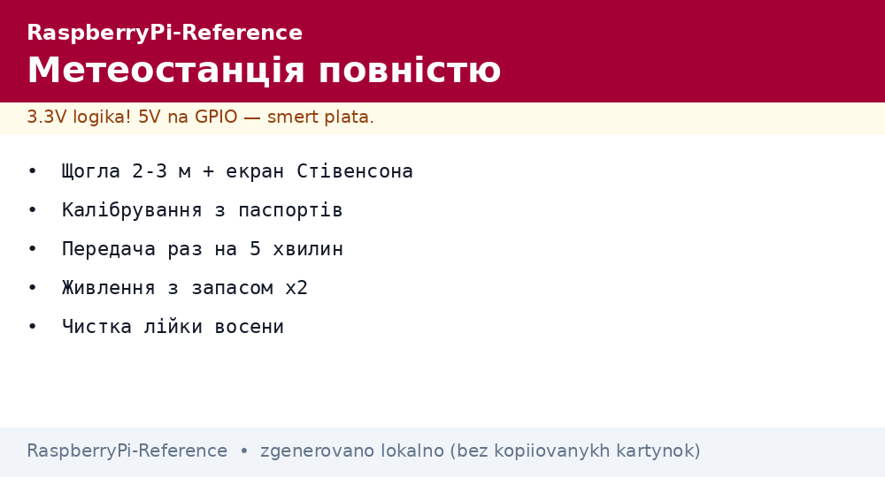
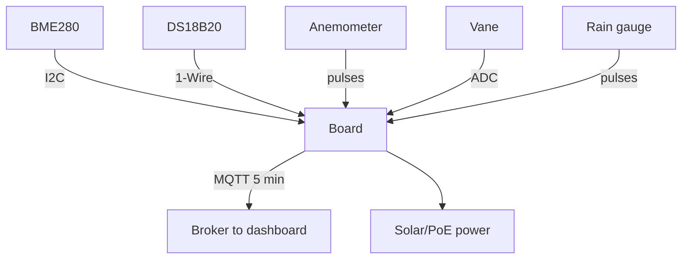

# Weather Station on Raspberry Pi - Sensors, Wind and Data Upload


*Fig. Weather node: BME280 + anemometer + rain gauge to board to MQTT to dashboard; power with margin.*

> [!tip] What this note is
> A genre classic from A to Z: sensors, mast, power, code, upload, dashboard. Built in a weekend, works for years. Sensors: [BME280 climate], [DS18B20 temperature], protocols: [MQTT protocol](../../../../RaspberryPi-Reference/UA/15-Protokoli/01-MQTT.md).

## 1. Goal

Build a station you trust:

- temperature/humidity/pressure - BME280 + DS18B20 for cross-check;
- wind: speed (anemometer) and direction (vane);
- precipitation: a tipping-bucket rain gauge;
- upload every 5 minutes + dashboard;
- autonomy: solar or PoE.

| Sensor | Measures | Connection |
| --- | --- | --- |
| BME280 | T/RH/P | I2C |
| DS18B20 | T for cross-check | 1-Wire |
| Anemometer | pulses/revolution | GPIO interrupt |
| Vane | resistive divider | ADC (ADS1115) |
| Rain gauge | closure per 0.2 mm | GPIO interrupt |

## 2. Station architecture



A 2-3 m mast above the roof: honest wind, temperature free of wall influence. Cable in trunking, IP65 box.

## 3. Wind: anemometer and vane

- anemometer: a reed switch gives 1 pulse/revolution, calibration 2.4 km/h per Hz (per datasheet);
- gusts: a 3-second window maximum, not the average;
- vane: 8 divider resistors give 8 directions by voltage;
- vane dead zone plus-minus 5 degrees is normal;
- anemometer bearings live 2-3 years, then replacement.

## 4. Precipitation: tipping bucket

- funnel 0.2 mm per tip (per datasheet);
- reed switch on the tip - a pulse into GPIO;
- ignore 100 ms anti-bounce;
- leaves in the funnel - weekly cleaning in autumn;
- snow does not count (melts in spring together).

## 5. Working code

```python
import time
import board
import busio
import adafruit_bme280
from gpiozero import Button

i2c = busio.I2C(board.SCL, board.SDA)
bme = adafruit_bme280.Adafruit_BME280_I2C(i2c, address=0x76)
bme.sea_level_pressure = 1013.25

wind_count = 0
rain_count = 0

def wind_tick():
    global wind_count
    wind_count += 1

def rain_tick():
    global rain_count
    rain_count += 1

anem = Button(5, pull_up=True)
anem.when_pressed = wind_tick
rain = Button(6, pull_up=True, bounce_time=0.1)
rain.when_pressed = rain_tick

import paho.mqtt.client as mqtt
cl = mqtt.Client()
cl.connect('broker.local', 1883, 60)
cl.loop_start()

while True:
    time.sleep(300)
    kmh = wind_count * 2.4 / 300 * 3.6
    mm = rain_count * 0.2
    wind_count = 0
    rain_count = 0
    t = bme.temperature
    h = bme.relative_humidity
    p = bme.pressure
    cl.publish('meteo/all', f"{t:.1f},{h:.0f},{p:.0f},{kmh:.1f},{mm:.1f}")
    print(f"T={t:.1f} H={h:.0f} P={p:.0f} W={kmh:.1f} R={mm:.1f}")
```

The anemometer calibration constant comes from the specific model datasheet. Check: a car at 60 km/h nearby (a joke with a share of truth - a fan with known speed is better).

## 6. Station power

- PoE is ideal if the cable reaches;
- 20W solar + 12V 7Ah battery + buck - a week of autonomy without sun;
- Zero 2 W instead of Pi 4 - watts saved many times over;
- winter mode: rarer polling, no backlight.

## 7. Dashboard and archive

- MQTT to Node-RED/Telegraf to InfluxDB to Grafana;
- daily min/max, monthly rain totals;
- CSV export for the agronomist neighbor;
- sky photo once an hour (camera!) - cloudiness with eyes.

## 8. Common issues

| Symptom | Cause | Fix |
| --- | --- | --- |
| Temperature +3 °C | sun on the case | Stevenson screen, shade |
| Wind always 0 | reed switch stuck | replace the reed, check the magnet |
| Doubled precipitation | bucket bounce | bounce_time 100 ms |
| Night data gap | battery sags | bigger battery, rarer cycles |
| Pressure "wrong" | QNH not updated | daily update from the weather service |
| Corrosion in a year | moisture in the box | silica gel, cable glands |

## 9. Station quick cheat sheet

- 2-3 m mast, sun screen;
- calibration constants from datasheets;
- upload once per 5 minutes;
- power with x2 margin;
- funnel cleaning in autumn.

## 10. Related notes

- [BME280 climate] - main sensor.
- [DS18B20 temperature] - cross-check.
- [MQTT protocol](../../../../RaspberryPi-Reference/UA/15-Protokoli/01-MQTT.md) - data upload.
- [PoE power](../../../../RaspberryPi-Reference/UA/02-Zhivlennya/02-PoE-HAT.md) - mast power.
- [main map](../../../../RaspberryPi-Reference/Home.md) - full navigation.

## Official sources

- [BME280 (Adafruit)](https://www.adafruit.com/product/2650) - station climate core.
- [Raspberry Pi OS (Raspberry Pi)](https://www.raspberrypi.com/software/) - node system.
- [gpiozero docs (Read the Docs)](https://gpiozero.readthedocs.io/en/stable/) - wind and rain pulses.
