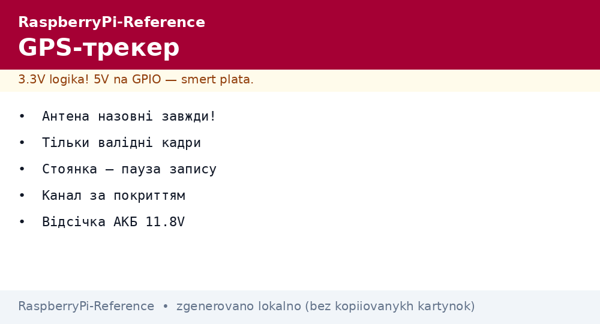
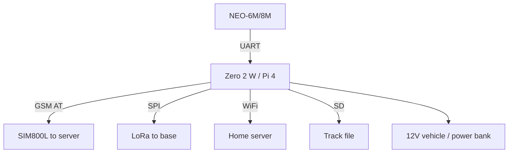

# GPS Tracker on Raspberry Pi - Position, Track and Geofences


*Fig. Tracker: GPS gives a point, the modem/LoRa delivers, the board writes the track and watches zones.*

> [!tip] What this note is
> Car, bicycle, beehive: where it is and where it goes. Three upload channels for budget and coverage. Sensor: [GPS modules](../../../../RaspberryPi-Reference/UA/10-Sensori/05-GPS-NEO.md), radio: [onboard radio], [LoRa and GPS HAT](../../../../RaspberryPi-Reference/UA/12-Moduli-zvyazku/02-GPS-LoRa-HAT.md).

## 1. Goal

Build a tracker for the task:

- a GPS fix every 10-60 seconds;
- channel: GSM (city), LoRa (field), WiFi (base);
- GPX track + geofences with alerts;
- vehicle/battery power with measurement.

| Channel | Where it works | Tariff/price |
| --- | --- | --- |
| GSM (SIM800L) | where cells exist | SIM with pennies |
| LoRa P2P | field, 5 km | free |
| WiFi | base/home | free |

## 2. Tracker architecture



A Zero 2 W is plenty: GPS + one channel. Pi 4 if the track needs a camera.

## 3. GPS part

- antenna with a sky view (windshield is the minimum);
- cold start 30 s, hot start in seconds (RTC battery on the module);
- filter: ignore jumps over 200 km/h;
- parking: do not write a point when standing (traffic saving);
- 2-5 m accuracy in the open.

## 4. Upload channels

- GSM: HTTP POST every minute, buffer on network loss;
- LoRa: a 20-byte packet (lat/lon/speed), once a minute;
- WiFi: dump of the backlog on return home;
- priority: WiFi to LoRa to GSM by availability;
- payload encryption - at least XOR with a key (AES is better).

## 5. Working code

```python
import serial
import time
import math

gps = serial.Serial('/dev/serial0', 9600, timeout=1)

def parse_rmc(line):
    p = line.strip().split(',')
    if len(p) < 10 or p[2] != 'A':
        return None
    def deg(raw, hemi):
        d = int(float(raw) / 100)
        m = float(raw) - d * 100
        v = d + m / 60.0
        return -v if hemi in 'SW' else v
    lat = deg(p[3], p[4])
    lon = deg(p[5], p[6])
    return lat, lon, float(p[7] or 0) * 1.852

HOME = (50.4501, 30.5234)
RADIUS_KM = 0.5

def dist(a, b):
    dlat = math.radians(b[0] - a[0])
    dlon = math.radians(b[1] - a[1])
    h = math.sin(dlat/2)**2 + math.cos(math.radians(a[0])) * math.cos(math.radians(b[0])) * math.sin(dlon/2)**2
    return 6371 * 2 * math.asin(math.sqrt(h))

inside = True
with open('/home/pi/track.gpx', 'a') as log:
    while True:
        line = gps.readline().decode('ascii', errors='ignore')
        if not line.startswith('$GPRMC'):
            continue
        r = parse_rmc(line)
        if not r:
            continue
        lat, lon, kmh = r
        now_in = dist((lat, lon), HOME) < RADIUS_KM
        if now_in != inside:
            inside = now_in
            print('ZONE:', 'HOME' if inside else 'AWAY')
        log.write(f"{time.strftime('%F %T')},{lat:.6f},{lon:.6f},{kmh:.0f}\n")
        log.flush()
        print(f"{lat:.6f},{lon:.6f} {kmh:.0f}kmh")
```

We add a GPX wrapper on upload (header + track points). Live view is a Traccar server or a custom dashboard.

## 6. Car power

- 12V to buck 5V 3A (lighter/constant plus);
- shutdown delay: work 10 min after ignition off, then sleep;
- car battery protection: cutoff at 11.8V;
- supercapacitor for a clean write finish;
- hidden install - the antenna still outside.

## 7. Geofences and alerts

- home/work/country house - circles in the config;
- enter/exit - an MQTT/Telegram event;
- speeding - a threshold by road type;
- parking in a foreign zone at night - a separate alert;
- zone history - in the database, not only in logs.

## 8. Common issues

| Symptom | Cause | Fix |
| --- | --- | --- |
| Spiderweb track while parked | position drift | do not write below 3 km/h |
| Track holes in the city | canyons/tunnels | interpolation + quality mark |
| Battery dead by morning | modem never sleeps | sleep between sends, PSM mode |
| SIM ate money | roaming/map traffic | IoT tariff, traffic limit |
| Antenna under metal | body shield | external roof antenna |
| Year 1970 in logs | no fix at start | wait for a valid RMC |

## 9. Tracker quick cheat sheet

- antenna outside always;
- write valid frames only;
- parking pauses recording;
- channel by coverage and budget;
- power with a battery cutoff.

## 10. Related notes

- [GPS modules](../../../../RaspberryPi-Reference/UA/10-Sensori/05-GPS-NEO.md) - NMEA in detail.
- [LoRa and GPS HAT](../../../../RaspberryPi-Reference/UA/12-Moduli-zvyazku/02-GPS-LoRa-HAT.md) - long-range channel.
- [onboard radio] - WiFi dump.
- [UPS backup](../../../../RaspberryPi-Reference/UA/02-Zhivlennya/03-UPS-18650.md) - node power.
- [main map](../../../../RaspberryPi-Reference/Home.md) - full navigation.

## Official sources

- [NEO-6 series (u-blox)](https://www.u-blox.com/en/product/neo-6-series) - NMEA and modes.
- [SX1268 433M LoRa HAT (Waveshare)](https://www.waveshare.com/wiki/SX1268_433M_LoRa_HAT) - long-range channel.
- [Getting Started (Raspberry Pi docs)](https://www.raspberrypi.com/documentation/computers/getting-started.html) - UART and power.
