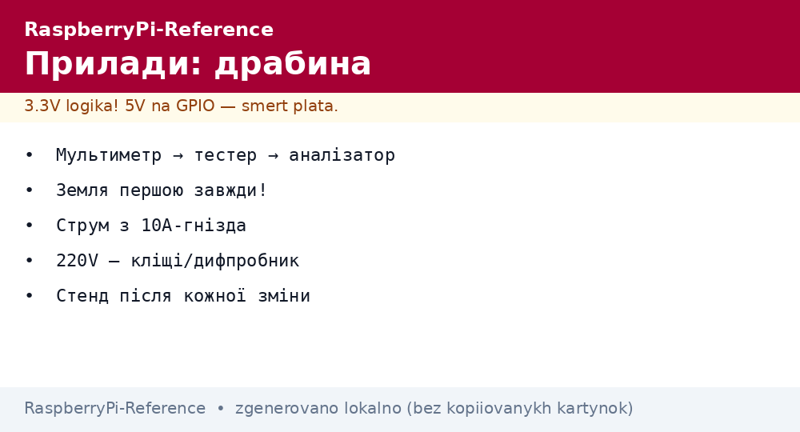
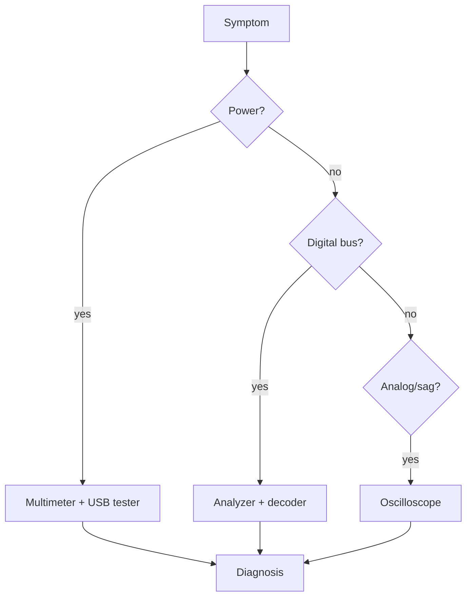

# Raspberry Pi Maker Instruments - Multimeter, Analyzer and Oscilloscope


*Fig. Instrument ladder: multimeter to USB tester to analyzer to oscilloscope - each covers its own issue class.*

> [!tip] What this note is
> What to measure with when something fails: from continuity to bus capture. Purchase order by return on investment. Bus debugging: [logic analyzer](../../../../RaspberryPi-Reference/UA/04-Shini/02-Logic-Analyzer.md), power supply: [USB-C power supply](../../../../RaspberryPi-Reference/UA/02-Zhivlennya/01-USB-C-PD.md).

## 1. Goal

Buy instruments in the right order:

- the starter minimum and its limits;
- what each next instrument covers;
- budget models without overpay;
- measurement safety (do not burn the input!).

| Instrument | Price order | Covers |
| --- | --- | --- |
| Digital multimeter | pennies | voltages, continuity, current |
| USB tester | little | supply volts/amps |
| 8ch logic analyzer | tens | live I2C/SPI/UART |
| 100 MHz oscilloscope | hundreds | sags, ringing, analog |
| IR thermometer | little | SoC and switch overheat |

## 2. Diagnostics architecture



The three-step rule: ground to power to signals. 90% of issues die on the first two.

## 3. Multimeter: the first friend

- DC voltage: 5V/3V3 on the header under load;
- continuity: shorts, breaks, assembly correctness;
- current: in the plus-wire break (start from the 10A jack!);
- resistance: resistors and ribbons without power;
- never measure mains current with a household meter - clamps only.

## 4. USB tester: the truth about power

- volts/amps/watts in real time;
- sag under load is the main number;
- mAh counter - honest power bank capacity;
- PD trigger cables - check the profile;
- a tester in the admin bag always.

## 5. Working code: self-test stand

```python
import subprocess

def psu_test():
    out = subprocess.check_output(['vcgencmd', 'get_throttled']).decode()
    code = int(out.strip().split('=')[1], 16)
    print(f"throttled flags: {code:#x}")
    return code == 0

def temp_test():
    out = subprocess.check_output(['vcgencmd', 'measure_temp']).decode()
    t = float(out.split('=')[1].replace("'C", ''))
    print(f"temp: {t}C")
    return t < 70

def disk_test():
    out = subprocess.check_output(['df', '/']).decode().splitlines()[1].split()
    pct = int(out[4].rstrip('%'))
    print(f"disk used: {pct}%")
    return pct < 85

if __name__ == '__main__':
    ok = psu_test() and temp_test() and disk_test()
    print('STAND: PASS' if ok else 'STAND: FAIL')
```

Run after every hardware change: a new HAT, a new PSU, a new case - the stand shows regressions at once.

## 6. Analyzer and oscilloscope

- analyzer: 8 channels, 24 MHz, decoders out of the box;
- oscilloscope: 2 channels, 100 MHz - the minimum for digital;
- x10 probes for high/fast signals;
- probe ground is short, otherwise ground ringing;
- oscilloscope calibration output - probe compensation.

## 7. Thermal control

- IR pyrometer: SoC, regulators, bridges - point by point;
- multimeter thermocouple - contact and accurate;
- phone thermal camera - the whole board picture;
- critical points: SoC, PMIC, USB hub, DC-DC;
- temperature log - a thermal paste degradation trend.

## 8. Common issues

| Symptom | Cause | Fix |
| --- | --- | --- |
| Silent multimeter | burned 200 mA fuse | measure current from the 10A jack |
| Analyzer sees noise | no common ground | GND clip to board ground |
| Oscilloscope lies | uncompensated probe | calibration on the output |
| USB tester gets hot | current over rating | 5A+ tester for Pi 5 |
| Pyrometer shows weather | emissivity/distance | matte tape on shiny parts |
| Burned scope input | 220V directly | only through a differential probe! |

## 9. Instrument quick cheat sheet

- order: multimeter to tester to analyzer to oscilloscope;
- ground first, then everything else;
- start current from the 10A jack;
- 220V with clamps/diff probe only;
- self-test stand after every change.

## 10. Related notes

- [logic analyzer](../../../../RaspberryPi-Reference/UA/04-Shini/02-Logic-Analyzer.md) - buses in detail.
- [USB-C power supply](../../../../RaspberryPi-Reference/UA/02-Zhivlennya/01-USB-C-PD.md) - what to measure.
- [PCB HAT board] - measurements on your own board.
- [backups and clones](../../../../RaspberryPi-Reference/UA/08-Pamyat/02-Backup-Clone.md) - backup before experiments.
- [main map](../../../../RaspberryPi-Reference/Home.md) - full navigation.

## 9.1 Home lab calibration

- multimeter: check against a reference source once a year;
- analyzer: test with a known UART pattern;
- oscilloscope: calibration output + compensation;
- thermometer: ice (0 °C) and boiling water (100 °C);
- calibration records - in the lab journal.

## Official sources

- [Getting Started (Raspberry Pi docs)](https://www.raspberrypi.com/documentation/computers/getting-started.html) - power and diagnostics.
- [Raspberry Pi OS (Raspberry Pi)](https://www.raspberrypi.com/software/) - vcgencmd utilities.
- [gpiozero docs (Read the Docs)](https://gpiozero.readthedocs.io/en/stable/) - test scripts.
