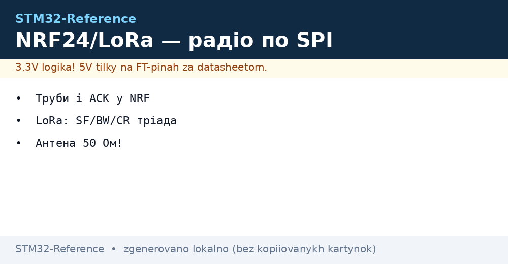
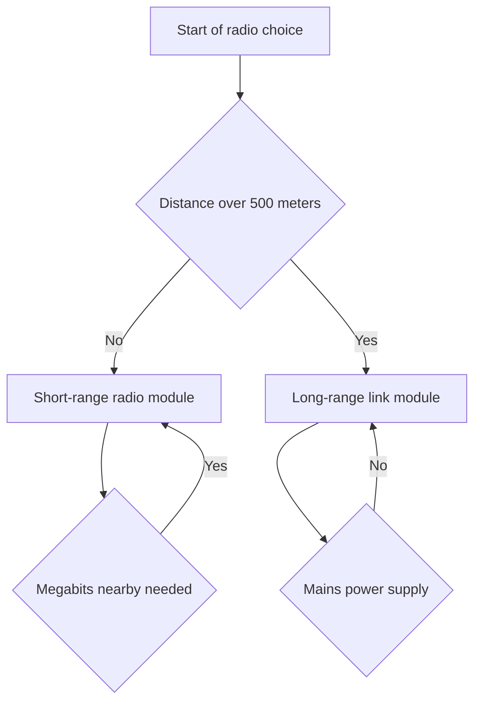

# NRF24 and LoRa - Radio over SPI


*Fig. Radio modules connected to the controller over a fast channel, power supply and antennas.*

> [!tip] Purpose of this note
> Give a practice of choosing between fast local radio and slow long-range radio with no air theory.

## 1. Purpose

The NRF24 module gives a cheap link inside a room and a house. The LoRa module gives kilometers at low speeds. Both are driven over a fast channel as peripherals. The controller builds packets and reads statuses. Radio power supply is sensitive to ripple. The antenna matters more than the power. A correct choice saves months of debugging. Fast radio fits remotes and nearby sensors. Long-range radio fits fields and streets.

## 2. NRF24 module and pipes

The module works in the 2.4 GHz band. Speeds are 250 kbit, 1 Mbit and 2 Mbit. A lower speed gives better sensitivity. Pipes are six receive addresses. The first pipe has a full address. The other pipes have one unique high byte. Auto-acknowledgement returns a receipt with no program involvement. Retries are set with delay and count. The channel is picked from a 1 MHz grid. Power ranges from minus 18 to zero dBm. The amplified version with a power amplifier gives hundreds of meters.

| Parameter | Value | Explanation |
| --- | --- | --- |
| Band | 2.4 GHz | Shared with home networks |
| Channels | 126 items | 1 MHz step |
| Speeds | 250 kbit, 1 and 2 Mbit | Slower goes further |
| Pipes | 6 addresses | One receiver, many transmitters |
| Packet | Up to 32 bytes | Short commands and statuses |
| Receipt | Automatic | No retry code |
| Retries | Up to 15 tries | Delay is adjustable |

## 3. NRF24 addresses, retries and speeds

The pipe address is five bytes. Transmitter and receiver must match. Low bytes of pipes one and two may differ in the high byte. The 250 kbit speed is the most stable in noise. The 2 Mbit speed is the fastest but sensitive. Retry delay depends on packet length. A long packet asks for a longer delay. A retry count of 5 is enough for a room. The loss counter shows channel quality. Queue overflow is cleared by hand. Transmit and receive interrupts are separate.

| Setting | Room | House | Street |
| --- | --- | --- | --- |
| Speed | 2 Mbit | 1 Mbit | 250 kbit |
| Power | Minimum | Medium | Maximum |
| Retries | 3 tries | 7 tries | 15 tries |
| Channel | Free of networks | Free of networks | Any free one |
| Antenna | Printed | External | External with amplifier |

```text
Карта труб приймача NRF24:
  Труба 0 : повна адреса 5 байтів, квитанції і передача
  Труба 1 : повна адреса 5 байтів, основний сенсор
  Труба 2 : старший байт свій, молодші спільні
  Труба 3 : старший байт свій, молодші спільні
  Труба 4 : старший байт свій, молодші спільні
  Труба 5 : старший байт свій, молодші спільні
  Канал ... 2 МГц, швидкість 250 кбіт для дальності
  Потужність 0 дБм, повтори 7, затримка 1 мс
```

## 4. LoRa and SF BW CR parameters

Spread spectrum technology gives sensitivity below noise. The spreading factor ranges from 7 to 12. A larger factor gives more range and less speed. The 125 kHz band is standard for range. A wider 500 kHz band gives more speed. The coding rate adds redundancy from 4 to 8. Power reaches 20 dBm in the amplified version. Sensitivity of minus 140 dBm is real in the field. Link budget is over 150 dB. Speed ranges from hundreds of bits to tens of kilobits.

| Parameter | Less range | More range | Price of choice |
| --- | --- | --- | --- |
| Factor SF | 7 | 12 | Air time grows |
| Band BW | 500 kHz | 125 kHz | Speed drops |
| Code CR | 4 over 5 | 4 over 8 | Redundancy grows |
| Power | 14 dBm | 20 dBm | Current grows |
| Packet | Up to 255 bytes | Up to 59 at SF12 | Air limits |

## 5. SX1276 chip versus built-in WL block

The external SX1276 chip is proven by years. Driven over a fast channel and interrupts. Libraries are mature and examples are many. Power supply is a stable 3.3 V. Receive consumption is about 10 mA. Transmit consumption reaches 120 mA. The built-in block of the WL series saves board space. Radio and controller sit in one package. Memory and peripherals are nearby. Board price is lower. But the package is harder to solder. The choice depends on the series and experience.

| Feature | SX1276 external | WL series built-in |
| --- | --- | --- |
| Interface | Fast channel plus pins | Internal bus |
| Libraries | Very many examples | Fewer examples |
| Board | Ready module | Custom high-frequency board |
| Receive current | About 10 mA | About 5 mA |
| Transmit current | Up to 120 mA | Up to 120 mA |
| Package | Simple module | Complex package with radio |

## 6. Amplifier power supply and dips

Transmission asks for peak current. A weak regulator dips. Voltage falls below the reset threshold. The controller restarts at the transmit moment. Symptoms look like a program issue. The fix is simple. A separate regulator with current margin. Capacitors of 10 and 100 uF near the module. Short and thick power supply wires. Ground in a star to the unit. Measurement with an oscilloscope at transmit peaks.

| Node | Value | Purpose |
| --- | --- | --- |
| Regulator | 500 mA margin | Transmit peak with no dip |
| Ceramic | 100 nF near power | High-frequency noise |
| Electrolyte | 100 uF near module | Transmit current peak |
| Wires | Short and thick | Less voltage drop |
| Ground | Star to the unit | No loops and noise |

## 7. 50 Ohm antenna and matching

The antenna must fit its band. Its own length for 2.4 GHz. Its own length for 868 MHz. Trace impedance is 50 Ohm. A long trace with no impedance control loses signal. A metal case shields the antenna. A printed antenna asks for a keep-out zone. An external antenna over a connector is better for range. A standing wave ratio below two is normal. A field range check is more reliable than theory.

## 8. Minimal HAL drivers

```c
#include "main.h"
#include "spi.h"

extern SPI_HandleTypeDef hspi1;

#define NRF_CE_GPIO  GPIOA
#define NRF_CE_PIN   GPIO_PIN_8
#define NRF_CS_GPIO  GPIOA
#define NRF_CS_PIN   GPIO_PIN_4
#define LORA_CS_GPIO GPIOB
#define LORA_CS_PIN  GPIO_PIN_6

static void nrf_cs(uint8_t v)
{
  HAL_GPIO_WritePin(NRF_CS_GPIO, NRF_CS_PIN,
    v ? GPIO_PIN_SET : GPIO_PIN_RESET);
}

static void nrf_ce(uint8_t v)
{
  HAL_GPIO_WritePin(NRF_CE_GPIO, NRF_CE_PIN,
    v ? GPIO_PIN_SET : GPIO_PIN_RESET);
}

static uint8_t nrf_rw(uint8_t d)
{
  uint8_t r = 0;
  nrf_cs(0);
  HAL_SPI_TransmitReceive(&hspi1, &d, &r, 1, 100);
  nrf_cs(1);
  return r;
}

void nrf_init(void)
{
  nrf_ce(0);
  HAL_Delay(20);
}

uint8_t nrf_send(uint8_t *p, uint8_t n)
{
  uint8_t cmd = 0xA0;
  nrf_cs(0);
  HAL_SPI_Transmit(&hspi1, &cmd, 1, 100);
  HAL_SPI_Transmit(&hspi1, p, n, 100);
  nrf_cs(1);
  nrf_ce(1);
  HAL_Delay(2);
  nrf_ce(0);
  return 1;
}

static void lora_cs(uint8_t v)
{
  HAL_GPIO_WritePin(LORA_CS_GPIO, LORA_CS_PIN,
    v ? GPIO_PIN_SET : GPIO_PIN_RESET);
}

void lora_write(uint8_t addr, uint8_t val)
{
  uint8_t b[2] = {(uint8_t)(addr | 0x80), val};
  lora_cs(0);
  HAL_SPI_Transmit(&hspi1, b, 2, 100);
  lora_cs(1);
}

uint8_t lora_read(uint8_t addr)
{
  uint8_t tx[2] = {(uint8_t)(addr & 0x7F), 0x00};
  uint8_t rx[2] = {0, 0};
  lora_cs(0);
  HAL_SPI_TransmitReceive(&hspi1, tx, rx, 2, 100);
  lora_cs(1);
  return rx[1];
}
```

## 9. Radio choice for the task



## Common issues

| # | Issue | Why it hurts | Fix |
| --- | --- | --- | --- |
| 1 | Module powered from a weak pin | Dip in transmit and reset | Separate regulator and capacitors |
| 2 | Same addresses on all pipes | Receiver confuses transmitters | Unique high bytes of pipes |
| 3 | 2 Mbit speed through walls | Losses and retries clog the air | 250 kbit for range and walls |
| 4 | Antenna tight against metal | Signal shielded by the case | Move antenna out, keep-out zone |
| 5 | SF12 for frequent packets | Air busy and batteries drain | SF7 for frequent and short ones |
| 6 | Long fast-channel wires | Clock breaks and broken statuses | Short wires and lower speed |

## Official sources

- [nRF24L01P datasheet (Nordic)](https://www.nordicsemi.com/Products/nRF24L01) - pipes, receipts, retries and channels.
- [SX1276 datasheet (Semtech)](https://www.semtech.com/products/wireless-rf/lora-connect/sx1276) - factors, bands, sensitivity and power.

## See also

- [Home](../../../../STM32-Reference/Home.md)
- [SPI bus](../../../../STM32-Reference/UA/04-Shini/02-SPI.md)
- [I2C bus](../../../../STM32-Reference/UA/04-Shini/03-I2C.md)
- [wired networks](../../../../STM32-Reference/UA/12-Moduli-zvyazku/02-RS485-CAN-Ethernet.md)
- [board power supply rails]
