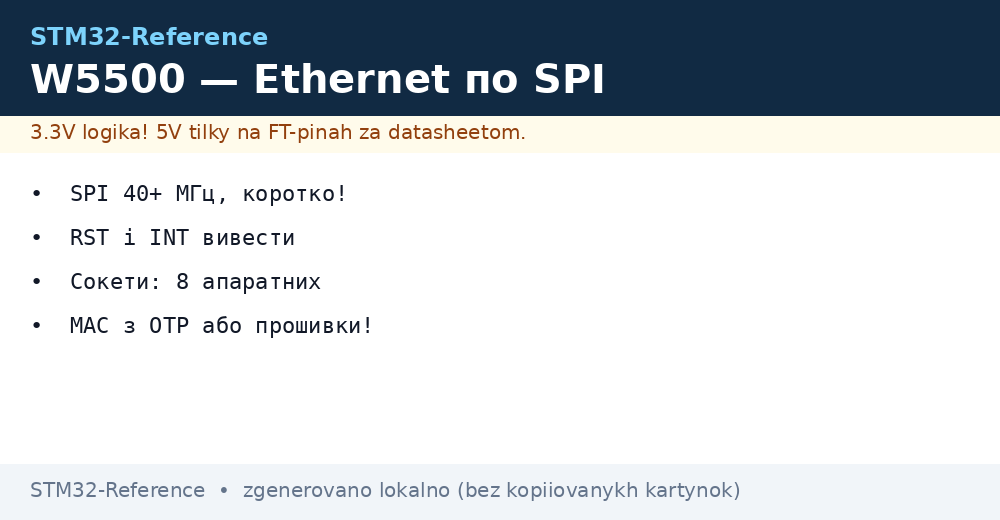
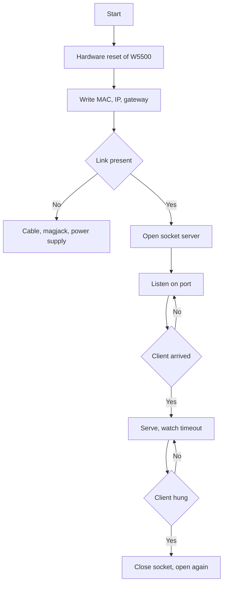

# W5500 - Ethernet over SPI for any STM32


*Fig. Network with no RMII: SPI carries all, sockets in hardware.*

> [!tip] Purpose of this note
> Bring Ethernet up on any STM32 with no RMII block: wiring, stack, sockets, server and common traps.

## 1. Purpose

W5500 is an Ethernet controller with hardware TCP/IP: MAC, IP, sockets and buffers inside the chip. STM32 talks to it over SPI knowing nothing about packets. It works even on F103, where no RMII block exists at all. For telemetry, Modbus-TCP and a web face it is an ideal bridge.

## 2. Why W5500 instead of RMII+LWIP

| Criterion | W5500 over SPI | RMII + LWIP (F407/H7) |
| --- | --- | --- |
| Chips | Any STM32 | Only with MAC block |
| Pins | 4 SPI + RST + INT | 9 RMII + MDIO |
| Chip RAM | Kilobytes | Tens of KB for buffers |
| Speed | Up to ~15 Mbit real | 100 Mbit |
| Code complexity | Sockets by calls | Stack, netconn, threads |

```text
Правило:
  телеметрія і керування ... W5500 вистачає;
  відео і важкі файли ..... тільки RMII.
```

## 3. SPI wiring in detail

| W5500 pin | Where | Note |
| --- | --- | --- |
| VCC | 3.3 V | 5 V kills the chip! |
| GND | GND | Common, thick |
| SCK, MOSI, MISO | Chip SPI | 40+ MHz, short wires! |
| SCS | Any GPIO | Chip select |
| RST | GPIO | Hardware reset at start |
| INT | EXTI if wanted | Socket events with no polling |

| Topic | Practice |
| --- | --- |
| SPI speed | Maximum stable: start at 10 MHz, grow |
| Mode | Mode 0 or 3 per datasheet, verify! |
| Bulk | 10 uF near module - transmit peaks |
| RJ45 connector | With transformer (magjack) mandatory! |

## 4. MAC address: where to take it

| Option | When |
| --- | --- |
| STM32 chip OTP | Unique ID → generate local MAC |
| Board EEPROM | Serial number and MAC from factory |
| Random while debugging | Bench only, never in series! |
| Buy OUI block | Series with a legality claim |

```c
// MAC з унікального ID чипа (локальний біт!):
uint8_t mac[6] = {0x02, 0x00, 0x00, 0x00, 0x00, 0x00};
uint32_t uid = HAL_GetUIDw0();
mac[3] = uid >> 16; mac[4] = uid >> 8; mac[5] = uid;
setSHAR(mac);   // перший байт 0x02 = локальна!
```

## 5. Sockets: 8 hardware channels

| Parameter | Value |
| --- | --- |
| Count | 8 independent sockets |
| Modes | TCP, UDP, MACRAW, PPPoE |
| Buffers | 32 KB shared between sockets |
| Split | Server more TX, client more RX |

## Mermaid: bringing the network up



## 6. TCP server: code skeleton

```c
// Відкриття сервера на порту 502 (Modbus-TCP):
socket(0, Sn_MR_TCP, 502, 0);
listen(0);
while (1) {
  if (getSn_SR(0) == SOCK_ESTABLISHED) {
    int n = recv(0, buf, sizeof(buf));
    if (n > 0) handle_request(buf, n);
  }
  if (sock_timeout(0)) { close(0); socket(0, Sn_MR_TCP, 502, 0); listen(0); }
}
```

| Rule | Explanation |
| --- | --- |
| Timeout for every socket | A hung client never holds a socket forever! |
| Reopen after close | A closed socket never listens by itself |
| Read receive buffer fully | Leftovers spoil the next frame |

## 7. DHCP or static

| Option | When |
| --- | --- |
| Static | Shop floor, known network, known gateway |
| DHCP | Office, frequent moves |
| Fallback | DHCP silent - own static! |
| DNS | Only if server by name |

## 8. Modbus-TCP over W5500

| Topic | Practice |
| --- | --- |
| Port | 502 standard |
| MBAP header | Transaction ties request and answer |
| Register map | Same as for RTU! |
| Several clients | Own socket for each |

## 9. Network diagnostics

| Symptom | Check |
| --- | --- |
| No link | Cable, magjack, 3.3 V power |
| Ping yes, sockets no | Port, firewall, listening? |
| Breaks under load | SPI speed down, more bulk |
| Works a minute then stops | Socket never reopened after close |
| Slow | Socket buffers small, batching |

## Common issues

| # | Issue | Why it hurts | Fix |
| --- | --- | --- | --- |
| 1 | 5 V power supply | Chip burns | Only 3.3 V! |
| 2 | No magjack | No isolation and matching | Connector with transformer |
| 3 | Random MAC in series | Collisions in network | Unique from OTP/EEPROM |
| 4 | Socket with no timeout | One hung client eats the channel | Timeout and reopen! |
| 5 | SPI at max at once | Broken bytes | Grow from 10 MHz up |
| 6 | RST never routed | No reset on hang | GPIO to reset always |
| 7 | No bulk | Reset at TX peaks | 10 uF near module |

## Official sources

- [W5500 datasheet (WIZnet)](https://docs.wiznet.io/Product/iEthernet/W5500/overview) - registers, sockets, timings.
- [ioLibrary examples (WIZnet)](https://github.com/Wiznet/ioLibrary_Driver) - ready HAL driver.

## See also

- [Home](../../../../STM32-Reference/Home.md)
- [wired networks](../../../../STM32-Reference/UA/12-Moduli-zvyazku/02-RS485-CAN-Ethernet.md)
- [industrial protocol](../../../../STM32-Reference/UA/15-Protokoli/01-Modbus.md)
- [data gateway](../../../../STM32-Reference/UA/16-Proekti/04-Modbus-Gateway.md)
- [exchange bus](../../../../STM32-Reference/UA/04-Shini/02-SPI.md)
- [power supply rails]
