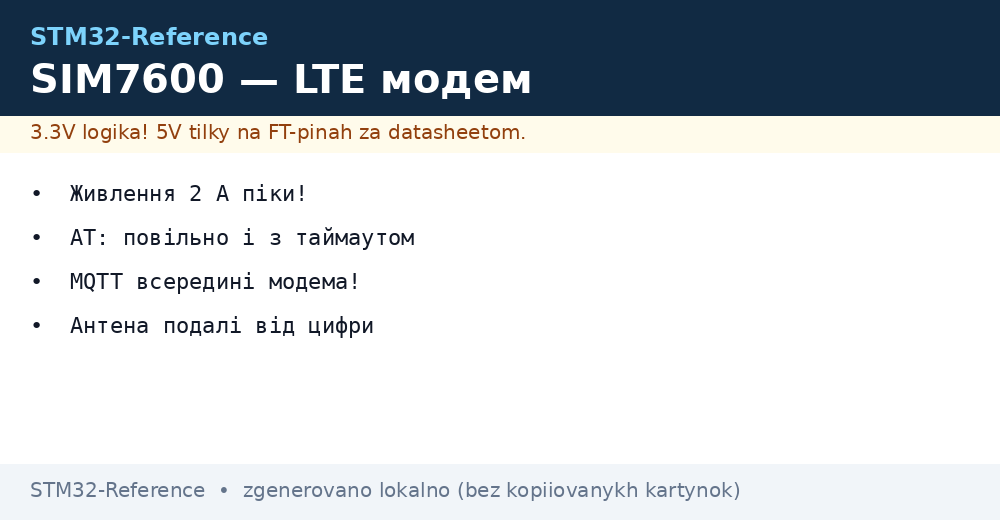
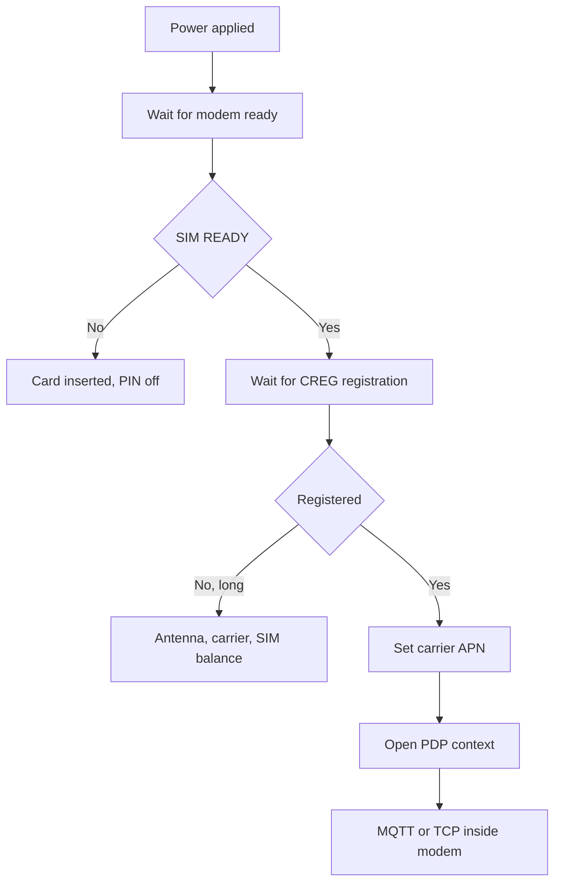

# SIM7600 - LTE Cat-1 Modem with AT Commands


*Fig. Node online: power supply, AT dialogue, data to the cloud.*

> [!tip] Purpose of this note
> Bring cellular link up: power supply with no dips, reliable AT dialogue, data to the cloud two ways.

## 1. Purpose

SIM7600 gives LTE Cat-1 where no WiFi and Ethernet exist: field, highway, roof. The modem understands AT commands over UART, and inside it can do TCP, MQTT and even GNSS. STM32 only leads the dialogue and feeds data. The price is power supply with 2 A peaks and patience in AT timeouts.

## 2. Power supply: peaks decide all

| Requirement | Value |
| --- | --- |
| Voltage | 3.4-4.2 V, typically 3.8-4.0 V! |
| TX peaks | Up to 2 A in pulse |
| Bulk | 100+ uF tantalum near module |
| Wires | Short thick, no Dupont noodles |

| Symptom | Cause | Fix |
| --- | --- | --- |
| Reboot at registration | Dip at peak | Bulk, PSU with margin |
| Works from USB, silent from battery | Internal resistance | Fresh cell, short wires |
| LDO heats | Drop and current | Separate buck to 4 V |

## 3. UART dialogue: parameters

| Parameter | Value |
| --- | --- |
| Speed | 115200 by default |
| Flow control | RTS/CTS desired on traffic! |
| Lines | CRLF both ways |
| Echo | Off after debug (ATE0) |

## 4. AT wrapper: code skeleton

```c
// Послати команду, дочекатись відповіді з таймаутом:
int at_cmd(const char *cmd, const char *expect, int timeout_ms)
{
  uart_flush();
  uart_send(cmd); uart_send("\r\n");
  return wait_for(expect, timeout_ms);  // 0 = OK
}

// Старт мережі покроково:
at_cmd("AT", "OK", 1000);
at_cmd("AT+CPIN?", "READY", 5000);     // SIM-карта!
at_cmd("AT+CREG?", "+CREG: 0,1", 60000); // реєстрація довга!
```

| Rule | Explanation |
| --- | --- |
| Every command with timeout | Modem sometimes thinks a minute! |
| Parse codes, not echo | Search the answer, ignore echo |
| Retries with pause | No spam - exponential pause |
| Log of all dialogue | Debugging blind with no log |

## Mermaid: going online



## 5. Two data paths to the cloud

| Path | How | When |
| --- | --- | --- |
| AT + external stack | PPP or raw over UART | Full control, complex |
| Built-in TCP/MQTT | Modem AT commands | Simple, chip RAM whole! |

| Command | Action |
| --- | --- |
| Context and APN | Carrier connection |
| TCP open | Socket inside modem |
| MQTT config | Broker, login, topics |
| Publish | Data goes with no stack on chip! |

## 6. GNSS in the same module

| Topic | Practice |
| --- | --- |
| Separate antenna | Active with power over module! |
| Cold start | Minutes under open sky |
| A-GPS | Ephemerides over network - seconds start |
| NMEA | Same sentences, shared parser |

## 7. Consumption and sleep

| Mode | Current |
| --- | --- |
| Active transmit | 2 A peaks |
| Idle registered | Tens of mA |
| Modem sleep | Units of mA |
| Pin power-off | Microamps, but registration again! |

```text
Стратегія батареї:
  прокинувся -> увімкнув модем -> дочекався -> відправив -> вимкнув;
  сесія рідше, пачка більша;
  eDRX/PSM якщо оператор дає.
```

## 8. SIM card and carrier: practice

| Topic | Practice |
| --- | --- |
| Format | Nano with adapter sits crooked - native better! |
| PIN | Off before install |
| APN | Exact carrier string, else no data |
| Balance and tariff | M2M tariff with no voice cheaper |
| Roaming | Clarify for border nodes |

## Common issues

| # | Issue | Why it hurts | Fix |
| --- | --- | --- | --- |
| 1 | Thin power wires | Reboot at registration | Short thick plus bulk! |
| 2 | No timeouts in AT | Hangs at first pause | Timeout for every command |
| 3 | Retry spam | Modem drowns | Exponential pause |
| 4 | PIN never off | CREG never comes | PIN off in advance |
| 5 | Random APN | Context never rises | Exact carrier APN |
| 6 | Antennas swapped | No network and GPS | LTE and GNSS separate! |
| 7 | Traffic with no limit | Bill | Rare, batched, compressed |

## Official sources

- [SIM7600 AT Manual (SIMCom)](https://www.simcom.com/product/SIM7600X.html) - commands, timings, codes.
- [SIM7600 Hardware Design (SIMCom)](https://www.simcom.com/product/SIM7600X.html) - power supply, antennas, SIM.

## See also

- [Home](../../../../STM32-Reference/Home.md)
- [satellites and cellular link](../../../../STM32-Reference/UA/12-Moduli-zvyazku/03-GPS-GSM.md)
- [telemetry protocol](../../../../STM32-Reference/UA/15-Protokoli/04-MQTT.md)
- [battery power]
- [serial port](../../../../STM32-Reference/UA/04-Shini/01-UART.md)
- [coordinate tracker]
