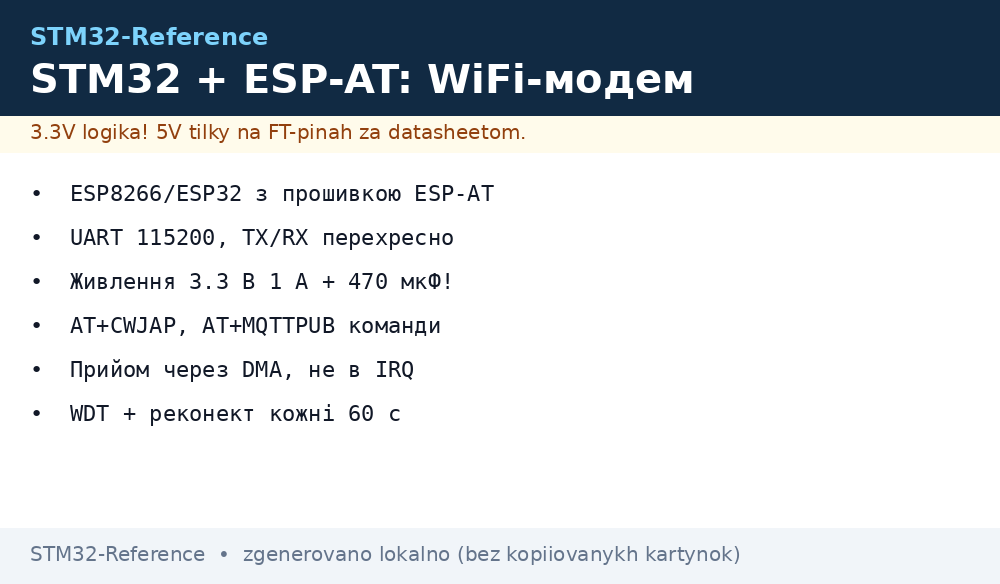
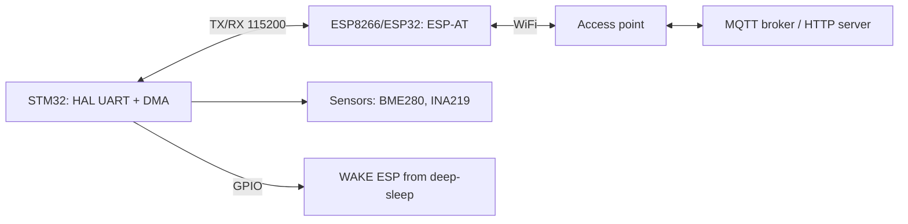

# STM32 + WiFi over ESP-AT - ESP8266/ESP32 as AT Modem over UART


*Fig. STM32 drives ESP-AT over UART: AT commands, sockets, MQTT with no WiFi stack on STM32.*

> [!tip] What this note is
> The most common IoT bundle for STM32 with no radio on chip: take a cheap ESP8266/ESP32, flash official ESP-AT and drive it from STM32 with text commands. Base: [STM32 UART bus](../../../../STM32-Reference/UA/04-Shini/01-UART.md), [GPS and GSM modems](../../../../STM32-Reference/UA/12-Moduli-zvyazku/03-GPS-GSM.md).

## 1. Goal

Give STM32 (Blue Pill, Nucleo, Discovery) internet access with no TCP/IP stack on the MCU itself:

- WiFi client with DHCP, reconnection and RSSI level signal;
- HTTP GET/POST and MQTT publishes over AT commands;
- all network code runs on ESP, STM32 only parses lines;
- power supply and ground follow power-part rules.

| Task | Fix |
| --- | --- |
| STM32F103 with no radio online | ESP-01S as modem, UART 115200 |
| Telemetry every 10 s | MQTT over AT+MQTTCONN |
| Field sensor on battery | ESP in deep sleep, STM32 wakes over GPIO |
| Debugging | AT dialogue log to a separate UART |

## 2. Architecture



STM32 never sees TCP: it sends `AT+CIPSEND` and reads `+IPD`. Answer parsing is a 5-state finite machine.

## 3. Hardware part

| STM32 pin (3.3V!) | ESP-01S / ESP32 pin | Note |
| --- | --- | --- |
| TX (PA9) | RX | crossed, no divider - both 3.3V |
| RX (PA10) | TX | crossed |
| 3V3 | VCC, CH_PD/EN | current up to 400 mA at TX peak! |
| GND | GND | common, thick wire |
| PB5 | RST | software modem reset |
| PA8 | GPIO0 | pull HIGH (work mode) |

> [!warning] Power supply - the top cause of "AT stays silent"
> ESP-01S takes 300-400 mA at transmit peak. A 150 mA LDO on Blue Pill is not enough: a separate AMS1117-3.3 or buck, 470 uF capacitor near VCC. Details: [STM32 power supply design](../../../../STM32-Reference/UA/02-Zhivlennya/03-Power-Design.md).

Speed: start at 115200, after `AT+UART_DEF` 921600 is possible for flashing. For field reliability keep 115200.

## 4. ESP-AT firmware

- ESP8266: ready ESP-AT binary (2 MB flash), flash over esptool or Flash Download Tool;
- ESP32: ESP-AT with BLE-bridge bonus, same command syntax;
- after flashing check in terminal: `AT` → `OK`, `AT+GMR` → version;
- fix parameters in flash: `AT+UART_DEF`, `AT+CWMODE_DEF=1`, `AT+CWJAP_DEF`.

## 5. Working HAL code

Reception runs over DMA with a ring buffer, parsing runs in the main loop, not in the interrupt:

```c
#define AT_BUF 512
static uint8_t at_rx[AT_BUF];
static volatile uint16_t at_head = 0;

void at_send(const char *cmd) {
  HAL_UART_Transmit(&huart1, (uint8_t*)cmd, strlen(cmd), 100);
  HAL_UART_Transmit(&huart1, (uint8_t*)"\r\n", 2, 100);
}

int at_wait(const char *token, uint32_t timeout_ms) {
  uint32_t t0 = HAL_GetTick();
  static char line[128];
  uint8_t li = 0;
  while (HAL_GetTick() - t0 < timeout_ms) {
    while (at_head) {
      char c = at_pull();
      if (c == '\n') { line[li] = 0; li = 0;
        if (strstr(line, token)) return 1;
        if (strstr(line, "ERROR")) return -1;
      } else if (li < sizeof(line)-1 && c != '\r') {
        line[li++] = c;
      }
    }
  }
  return 0;
}

int wifi_join(const char *ssid, const char *pass) {
  char cmd[96];
  snprintf(cmd, sizeof(cmd), "AT+CWJAP_DEF=\"%s\",\"%s\"", ssid, pass);
  at_send(cmd);
  if (at_wait("WIFI GOT IP", 15000) != 1) return -1;
  return 0;
}
```

DMA starts once: `HAL_UART_Receive_DMA(&huart1, dma_byte, 1)`, bytes go to `at_rx` in the callback. No blocking `HAL_Delay` inside reception.

## 6. MQTT over AT

| Step | Command | Expect |
| --- | --- | --- |
| Config | `AT+MQTTUSERCFG=0,1,"stm32-node","","",0,0,""` | OK |
| Connect | `AT+MQTTCONN=0,"broker.local",1883,1` | +MQTTCONNECTED |
| Publish | `AT+MQTTPUB=0,"sensors/temp","23.5",0,0` | OK |
| Subscribe | `AT+MQTTSUB=0,"cmd/led",0` | OK, then +MQTTSUBRECV |
| Ping alive | automatic, keepalive 120 | we do nothing |

Payloads up to 1 KB go to SRAM and leave in one `AT+MQTTPUB`. JSON is built by hand over `snprintf` - with no heavy libraries.

## 7. Field reliability

- every 60 s check `AT+CWJAP?`: no IP - `AT+RST` and join retry up to 5 times;
- independent STM32 watchdog: [timers and watchdog](../../../../STM32-Reference/UA/07-Timeri-Son/02-LPTIM-RTC-WDT.md);
- ESP in deep-sleep between sends: `AT+GSLP`, wake by edge on RST;
- restart counter goes to flash: [STM32 memory](../../../../STM32-Reference/UA/08-Pamyat/01-Flash-OTP-EEPROM.md);
- log RSSI (`AT+CWLAP`): level below -80 dBm is a reason to move the antenna.

## 8. Common issues

| Symptom | Cause | Fix |
| --- | --- | --- |
| Silence on `AT` | TX/RX swapped or no 3.3V power | cross the lines, give a separate 1 A LDO |
| `ERROR` on CWJAP | password/SSID with spaces and no quotes | escape strings, check by hand in terminal |
| Breaks every 2 minutes | power supply dip at TX peak | 470 uF capacitor, short power wires |
| Garbage instead of OK | wrong port speed | `AT+UART_DEF` to match `huart1.Init.BaudRate` |
| MQTT connect drops | client with same ID already online | unique ID per board, keepalive 120 |
| Hangs over weeks | no WDT and reconnect | watchdog plus flash counter |

## 9. Neighbour notes

- [STM32 UART bus](../../../../STM32-Reference/UA/04-Shini/01-UART.md) - USART setup, DMA.
- [GPS and GSM modems](../../../../STM32-Reference/UA/12-Moduli-zvyazku/03-GPS-GSM.md) - second external modem.
- [wired W5500 Ethernet](../../../../STM32-Reference/UA/12-Moduli-zvyazku/04-W5500.md) - radio-free alternative.
- [MQTT protocol in detail](../../../../STM32-Reference/UA/15-Protokoli/04-MQTT.md) - topics, QoS.
- [STM32 power supply design](../../../../STM32-Reference/UA/02-Zhivlennya/03-Power-Design.md) - peak currents.
- [Modbus gateway](../../../../STM32-Reference/UA/16-Proekti/04-Modbus-Gateway.md) - bridge between buses.

## Official sources

- [ESP-AT User Guide (Espressif)](https://docs.espressif.com/projects/esp-at/en/latest/esp32/) - AT syntax, MQTT commands.
- [ESP8266 Modules (Espressif)](https://www.espressif.com/en/products/modules/esp8266) - module models, power supply.
- [esp-at (Espressif, GitHub)](https://github.com/espressif/esp-at) - modem firmware sources.
- [MQTT Specification (OASIS)](https://mqtt.org/mqtt-specification/) - packet format, keepalive.
