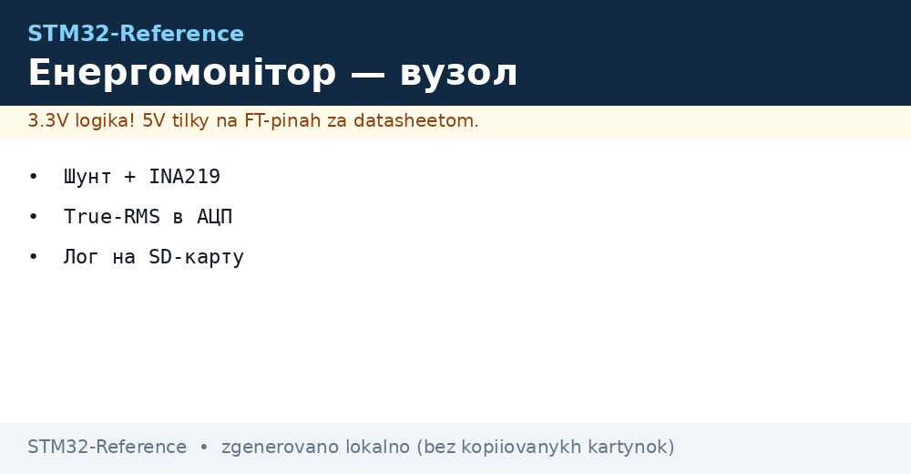
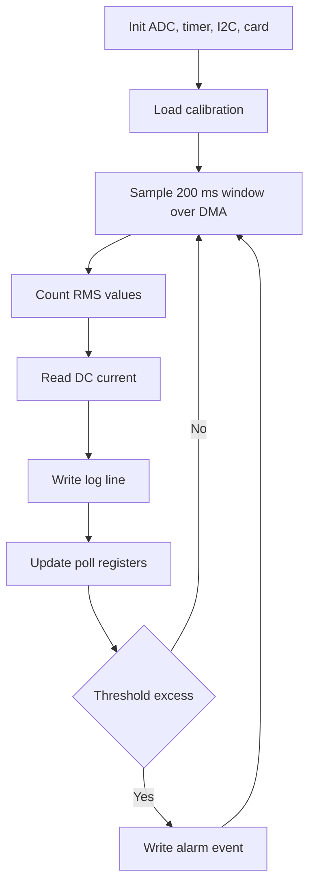

# Energy Monitor - Current, Voltage and Log


*Fig. Energy metering: current and voltage measurement, power math, log to card and data output.*

> [!tip] Purpose of this note
> Build an energy metering device: how to measure DC and AC current, how to count RMS values and how to write a log with no losses.

## 1. Purpose

The energy monitor shows what the load eats: current, voltage, power and energy per day. It goes into a panel, onto a solar plant or a test bench. Data goes to a memory card, and outside it leaves over an industrial protocol.

DC current is measured with a shunt or a dedicated sensor, AC current with a current transformer or an isolated shunt. Voltage is measured with a protected divider. Accuracy depends on calibration, not only on converter bits.

Sensor basics sit in the material on [current and weight](../../../../STM32-Reference/UA/10-Sensori/04-INA219-HX711.md), cards and external memory in the material on [cards and external flash](../../../../STM32-Reference/UA/04-Shini/06-SDMMC-QUADSPI.md).

## 2. Current sensors

| Option | Range | Pros | Cons |
| --- | --- | --- | --- |
| Shunt plus amplifier | Up to 30 A | Cheap, exact for DC | Heating, calibration needed |
| INA219 over I2C | Up to 3 A | Ready current, voltage, power | Small range with no external shunt |
| Current transformer | Up to 100 A | Galvanic isolation for mains | AC only, bias needed |
| Hall effect sensor | Up to 50 A | Isolation, measures DC and AC | Zero drift, nulling needed |

Mains 220 V needs isolation. The current transformer goes into the phase break, electronics feed over an isolated converter. A mains shunt with no isolation is lethal for life and instruments.

```text
Варіанти вимірювання:
  DC навантаження:
    батарея + --> шунт --> навантаження --> батарея -
                   | INA219 по I2C
                   +--> STM32
  AC мережа через трансформатор:
    фаза --> ТТ --> навантаження
               вторинна --> burden резистор --> зміщення 1.65V --> ADC
    нумерація: burden підібрати під повну шкалу ADC
```

## 3. RMS values in ADC

Instant samples say nothing about heating. For AC current count the RMS value over a window of one or several mains periods. The formula is simple, but the build needs uniform sampling.

| Step | Action |
| --- | --- |
| Zero shift | Subtract average or bias level |
| Square | Raise every sample to square |
| Average | Average over 200 ms, that is ten periods |
| Root | Take square root, that is the RMS value |
| Power | Multiply RMS current and voltage with phase shift |

Sampling runs at 4 kHz or 8 kHz to catch harmonics. ADC start comes from a timer, data leaves over DMA with no core. Driver layers are in the material on [HAL and LL layers](../../../../STM32-Reference/UA/09-Proshivka/02-HAL-LL.md).

```text
Ланцюг вибірки:
  таймер 8 kHz --> тригер ADC1 + ADC2
  ADC1: струм (PA0)  ADC2: напруга (PA1)
  DMA: два кільцеві буфери по 1600 точок
  ядро: раз на 200 ms рахує RMS і потужність
  калібрування: коефіцієнти у флеш + CRC
```

## 4. INA219 for DC current

| Register | Value | Explanation |
| --- | --- | --- |
| Config | 32 V, 12 bit, average 32 | Accuracy matters more than speed |
| Calibration | Formula for 0.1 Ohm shunt | Write after reset |
| Shunt | Shunt voltage | Proportional to current |
| Bus | Load voltage | For power and diagnostics |
| Power | Internal product | Can read ready |

The sensor connects over I2C with 4.7 kOhm pull-ups. The address goes by jumpers. The shunt sits in minus or plus by allowed common voltage. Traces to the shunt stay short and symmetric.

## 5. Logging to FATFS card

| Question | Fix |
| --- | --- |
| Filesystem | FATFS with 512-byte buffer |
| Format | CSV with time mark: time, current, voltage, power |
| Period | Every second for view, every minute for archive |
| Reliability | Buffer flush every minute or on alarm |
| Power | Capacitor to close the file on drop |

The card cannot leave during writes. A write LED signals activity. The file name comes from the real-time clock date. Card overflow is handled by deleting the oldest files.

Cards are in the note on [cards and external flash](../../../../STM32-Reference/UA/04-Shini/06-SDMMC-QUADSPI.md), industrial output in the note on [industrial Modbus protocol](../../../../STM32-Reference/UA/15-Protokoli/01-Modbus.md).

## 6. Measurement cycle HAL code

```c
#include "stm32f4xx_hal.h"
#include <math.h>
#include <stdio.h>

ADC_HandleTypeDef hadc1;
ADC_HandleTypeDef hadc2;
I2C_HandleTypeDef hi2c1;
TIM_HandleTypeDef htim3;

#define ADC_LEN 1600
uint16_t adc_i_buf[ADC_LEN];
uint16_t adc_v_buf[ADC_LEN];

float cal_i_gain = 0.0125f;
float cal_v_gain = 0.145f;
float cal_i_off = 2048.0f;
float cal_v_off = 2048.0f;

static float CalcRms(uint16_t *buf, int len, float off)
{
  double acc = 0.0;
  for (int k = 0; k < len; k++)
  {
    double d = (double)buf[k] - off;
    acc += d * d;
  }
  return (float)sqrt(acc / len);
}

static void MeasureAc(float *irms, float *vrms, float *pwr)
{
  float i_raw = CalcRms(adc_i_buf, ADC_LEN, cal_i_off);
  float v_raw = CalcRms(adc_v_buf, ADC_LEN, cal_v_off);
  *irms = i_raw * cal_i_gain;
  *vrms = v_raw * cal_v_gain;
  *pwr = (*irms) * (*vrms) * 0.95f;
}

#define INA219_ADDR 0x40

static float INA219_ReadCurrent(void)
{
  uint8_t reg = 0x04;
  uint8_t data[2] = {0};
  HAL_I2C_Master_Transmit(&hi2c1, INA219_ADDR << 1, &reg, 1, 100);
  HAL_I2C_Master_Receive(&hi2c1, INA219_ADDR << 1, data, 2, 100);
  int16_t raw = (int16_t)((data[0] << 8) | data[1]);
  return raw * 0.001f;
}

void Energy_Task(void)
{
  float irms = 0.0f;
  float vrms = 0.0f;
  float pwr = 0.0f;
  char line[96];

  HAL_TIM_Base_Start(&htim3);
  HAL_ADC_Start_DMA(&hadc1, (uint32_t *)adc_i_buf, ADC_LEN);
  HAL_Delay(250);
  HAL_ADC_Stop_DMA(&hadc1);

  MeasureAc(&irms, &vrms, &pwr);

  float idc = INA219_ReadCurrent();

  snprintf(line, sizeof(line), "%lu,%.3f,%.1f,%.1f,%.3f\r\n",
    (unsigned long)HAL_GetTick(), irms, vrms, pwr, idc);
  Log_Append(line);
  Modbus_SetRegs(irms, vrms, pwr, idc);
}
```

DMA buffers align in memory and declare DMA access attributes. Math runs in the main cycle, not in the interrupt, to keep sampling unbroken.

## 7. Work logic in scheme



## 8. Calibration and checks

| Step | Action |
| --- | --- |
| Current zero | Load off, write shift |
| Current etalon | Lab unit at 1 A, tune factor |
| Voltage etalon | Multimeter on terminals, tune divider |
| Power check | Known lamp, compare readings |
| Saving | Factors to flash with checksum |

With no calibration the issue reaches ten percent through resistor spread. Every unit calibrates separately. Calibration instruments sit in the note on [measuring instruments].

## Common issues

| # | Issue | Why it hurts | Fix |
| --- | --- | --- | --- |
| 1 | Shunt in mains phase with no isolation | Lethal danger and burnt oscilloscope | Current transformer and isolated power |
| 2 | Sampling with no time tie | Floating window and jumping readings | Timer trigger and DMA |
| 3 | Math in ADC interrupt | Missed samples, warped root | Count in main cycle over ready window |
| 4 | Card write every sample | Card wears, file tears | 512-byte buffer, write every second |
| 5 | No calibration | Resistor issue gives false kilowatts | Calibrate zero and factor of every node |
| 6 | Shunt ground with break | Pickup and wandering zero shift | Ground star, short symmetric feed |

## Official sources

- [INA219 datasheet Texas Instruments](https://www.ti.com/product/INA219) - calibration registers, shunt math.
- [AN2834 STM32 ADC accuracy ST](https://www.st.com/resource/en/application_note/an2834-how-to-get-the-best-adc-accuracy-in-stm32-microcontrollers--stmicroelectronics.pdf) - ADC accuracy, calibration, routing.

## See also

- [Home](../../../../STM32-Reference/Home.md)
- [current and weight](../../../../STM32-Reference/UA/10-Sensori/04-INA219-HX711.md)
- [cards and external flash](../../../../STM32-Reference/UA/04-Shini/06-SDMMC-QUADSPI.md)
- [industrial Modbus protocol](../../../../STM32-Reference/UA/15-Protokoli/01-Modbus.md)
- [HAL and LL layers](../../../../STM32-Reference/UA/09-Proshivka/02-HAL-LL.md)
- [weather node]
- [measuring instruments]
