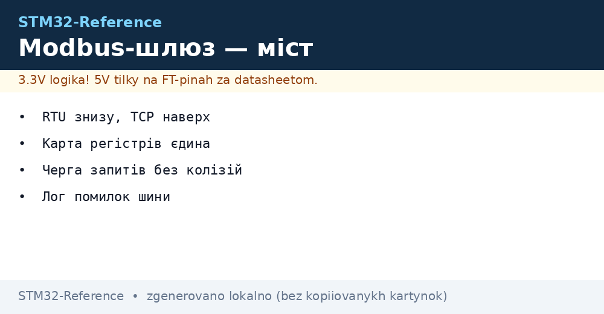
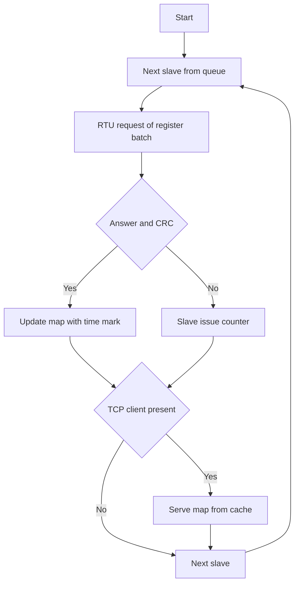

# Modbus Gateway - RTU to TCP Bridge


*Fig. Bridge between floors: RTU below, TCP above, map in the middle.*

> [!tip] Purpose of this note
> Teach joining shop devices to the network: RTU polling, register cache, TCP serving.

## 1. Purpose

The shop speaks RTU over RS485, the office speaks TCP over Ethernet. The gateway polls devices below, holds a fresh register map and serves it above. With no gateway every SCADA client pulls the slow bus itself and all wait.

## Gateway architecture

| Layer | Role |
| --- | --- |
| RTU master | Polls devices in turn |
| Register map | Fresh values with time marks |
| TCP server | Serves the map to clients |
| Diagnostics | Bus issue counters |

```text
Потік даних:
  пристрій -> RTU-читання -> карта -> TCP-відповідь.
  Клієнт ніколи не чекає повільну шину безпосередньо!
```

## Register map: single truth

| Topic | Practice |
| --- | --- |
| Addressing | Slave, function, register - flat table |
| Data age | Time mark of every read |
| Stale | Old value marked, never served as fresh! |
| Blocking | Read in batches, not one register |

## Poll queue

| Rule | Explanation |
| --- | --- |
| Round over devices | Every slave in turn |
| Issue never stops | Missed - go on, return in round |
| Priority to alarms | Important ones more often in round |
| Pause between frames | 3.5 silence chars per standard! |

## Mermaid: gateway cycle



## TCP server on LWIP

| Topic | Practice |
| --- | --- |
| MBAP header | Transaction, protocol, length |
| Several clients | Every one reads the map, bus untouched |
| Timeouts | A hung client gets cut |
| Load | Map in RAM - answers instant |

## Bus diagnostics

| Counter | Action on growth |
| --- | --- |
| CRC issues | Check termination and ground |
| Slave timeouts | Device power, address, speed |
| Request retries | Line noise, shielding |
| Round pauses | Too many devices - split the bus |

## Common issues

| # | Issue | Why it hurts | Fix |
| --- | --- | --- | --- |
| 1 | Client reads bus directly | All wait on the slow line | Only over cache map |
| 2 | Old served as fresh | SCADA lies | Time mark and stale flag |
| 3 | No pauses between frames | Bus collisions | 3.5 silence chars! |
| 4 | One slow node brakes round | All data ages | Short timeout, skip |
| 5 | No termination | Reflections and CRC issues | 120 Ohm at ends |
| 6 | TCP with no timeouts | Hung sockets | Close the silent |
| 7 | No diagnostics kept | Blind gateway | Counters and log from day one |

## Commissioning: order

| Number | Action |
| --- | --- |
| 1 | One slave on bench: manual read |
| 2 | Whole bus: poll round with no issues |
| 3 | TCP: map served to client |
| 4 | Slave break: round never stops |
| 5 | Day of work: counters clean |

## Official sources

- [Modbus TCP Specification (Modbus.org)](https://www.modbus.org/specs.php) - MBAP, functions, codes.
- [LWIP Documentation (Savannah)](https://www.nongnu.org/lwip/) - TCP server on microcontroller.

## Poll code: slave skeleton

```c
// Читання пачки регістрів одного слейва:
int poll_slave(uint8_t addr, uint16_t start, uint16_t n, uint16_t *out)
{
  build_request(addr, 0x03, start, n);   // функція читання
  uart_de_tx();                          // напрям передачі
  HAL_UART_Transmit(&huart1, req, len, 100);
  uart_de_rx();                          // напрям прийому
  if (HAL_UART_Receive(&huart1, resp, len, 200) != HAL_OK)
    return GW_ERR_TIMEOUT;
  if (!crc_ok(resp, len))
    return GW_ERR_CRC;
  unpack_regs(resp, out, n);
  return GW_OK;
}
```

## Backup: two gateways per shop

| Topic | Practice |
| --- | --- |
| Active and hot standby | Second listens to first |
| Heartbeat between them | Lost - standby takes the bus |
| One map | Cache sync at switch |
| Manual mode | Cabinet switch for emergency |

## See also

- [Home](../../../../STM32-Reference/Home.md)
- [industrial protocol](../../../../STM32-Reference/UA/15-Protokoli/01-Modbus.md)
- [wired networks](../../../../STM32-Reference/UA/12-Moduli-zvyazku/02-RS485-CAN-Ethernet.md)
- [energy metering]
- [serial port](../../../../STM32-Reference/UA/04-Shini/01-UART.md)
