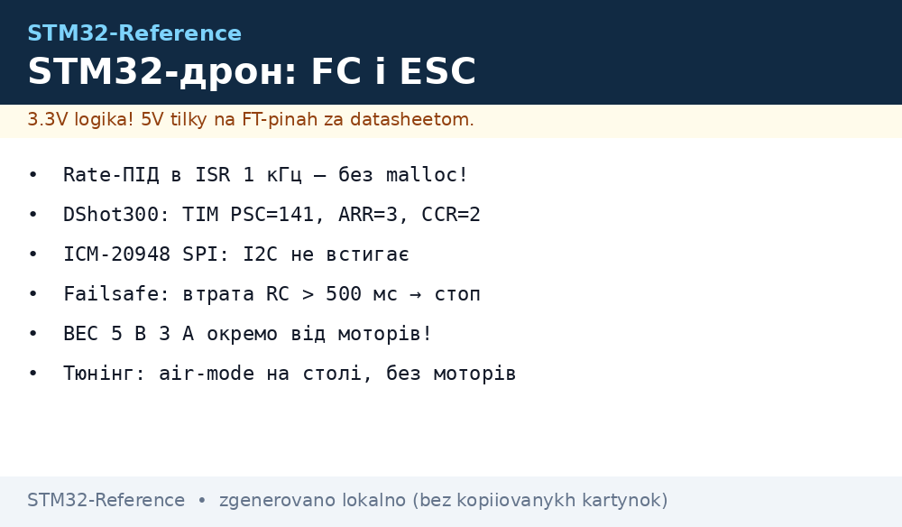
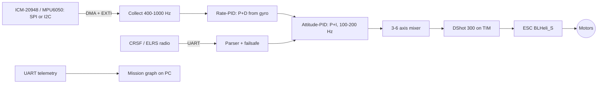

# Drone and ESC on STM32: PID from Gyro, DShot, FreeRTOS


*Fig. FC: gyro → 1 kHz PID → DShot PWM → ESC → motors; UART telemetry.*

> [!tip] What this note is
> Why FC is STM32, not ESP32: a deterministic 1 kHz cycle with no Wi-Fi breaks, no curses. Base: [F3/F4](../../../../STM32-Reference/UA/01-Hardware/02-F3-F4.md) or [H5/H7](../../../../STM32-Reference/UA/01-Hardware/04-H5-H7.md), [HAL/LL](../../../../STM32-Reference/UA/09-Proshivka/02-HAL-LL.md), [RTOS](../../../../STM32-Reference/UA/09-Proshivka/06-FreeRTOS.md). Base RC protocols - [Betaflight setup guide](https://betaflight.com/docs/wiki/getting-started/setup-guide).

## 1. Architecture



## 2. Timing demands

| Block | Frequency | Where it runs |
| --- | --- | --- |
| Gyro read | 400-1000 Hz | SPI ISR with DMA + EXTI |
| Rate loop | = gyro frequency | Timer ISR (TIM2), no FreeRTOS |
| Attitude loop | 100-200 Hz | same ISR, every N ticks |
| DShot | 300-600 Hz | TIM CH, never touch by hand |
| Telemetry | 10-50 Hz | FreeRTOS task, UART TX DMA |

Rate loop lives only in ISR, no malloc, no Serial, no blocking calls.

## 3. DShot: what it is and how to encode

- DShot300 frame: 16 bits (CRC5 + 11 throttle bits) over PWM ~300 kbit/s, pause ~2 ms;
- throttle 1000-2000 "digital", 0 means stop;
- TIM2 on F4 @168 MHz: PSC=141, ARR=3, CCR=2 → ~300 kbit/s (DShot300); DShot250 means PSC=167, ARR=3.

```c
// DShot300 на TIM2 CH1-CH3 (F4): скелет
static uint8_t crc5(uint16_t v) { /* таблиця 5 біт */ }

uint16_t dshot_frame(uint16_t thr) {
  uint16_t t = (thr >= 1000) ? (thr - 1000) : 0;
  t = (t << 5) | crc5(t & 0x3FF);
  return t;
}

void dshot_set(uint32_t ch, uint16_t thr) {
  // записуємо 10 МС1 + кадр: TIM PWM, 16 імпульсів по 3.33 мкс
  dshot_push(ch, dshot_frame(thr));
}
```

Ready libraries sit in [BLHeli_S](https://github.com/Betaflight/blheli_s) and [Betaflight](https://github.com/betaflight/betaflight) - for your own frame nobody usually writes "from the brew".

## 4. PID: structure and start values

- rate: P + D (D with EMA filter α=0.1 on gyro output);
- attitude: P + I (I with windup-clamp, else it "spins into itself");
- start values for a 100x100x100 mm frame with ICM-20948:

| Loop | P | I | D |
| --- | --- | --- | --- |
| rate roll/pitch | 0.04 | 0 | 0.00018 |
| rate yaw | 0.06 | 0 | 0.0004 |
| att P (roll/pitch) | 4.5 | | |
| att I | 0.5 | | |

Tuning: air-mode on bench only (motors off or on stands), no flight at start.

Tuning rules:

- start with air-mode: motors in air, on stands;
- raise P by 10% every 5 s of watching;
- add D when P starts "trembling";
- I attitude only with a constant drift.

## 5. FreeRTOS: task split

| Task | Priority | Details |
| --- | --- | --- |
| gyro_collect | ISR, outside RTOS | SPI DMA + EXTI, double buffer 16 |
| control (1 kHz) | configMAX-1 | TIM2 ISR, never blocks |
| telemetry | 2 | UART TX DMA, 20 Hz |
| cli/config | 1 | SPI-Flash JSON, under 512 KB |

Split rules:

- rate/attitude never wait on queues: ISR bypasses FreeRTOS;
- telemetry is the only blocking task (UART DMA + FIFO);
- config only over a service (separate flag), never straight from menu.

## 6. Calibration and failsafe

- gyro calibration: 5 s still, offset kept in Flash;
- failsafe: lost RC over 500 ms → throttle=1000 (stop) or safe landing - scenario picked in config;
- battery: telegram at VBAT below 10.2 V for 3S; a counter, not trust "as it goes".

## 7. FC power supply

- BEC 5 V 3 A separate from motors: LiPo dips must never reach STM32;
- digital: VDD 3.3 V, 4x100 nF near crystal, bulk 100 uF;
- connector: XT60 for batteries, XT30 for BEC (see [rails]).

## 8. Common issues

| Symptom | Cause | Fix |
| --- | --- | --- |
| ESC beeps 3-5 times and turns off | DShot300 unsupported by old ESC | DShot150/100 or rewrite protocol in ESC menu |
| Gyro "drifts" | offset never saved, board leads | calibrate at constant temperature |
| I2C timeout under PWM | common ground, noise on 5 V | I2C to SPI gyro, RC filter, ground |
| FC "flies away" at start | BEC weaker than motor peak | BEC 5 V 3 A, dip measures with oscilloscope |
| Motor spins backwards | direction in DShot/ESC | axis turn in mixer, direction=-1 |
| Drone "knocks out" on a normal run | gain too large / aliasing | smaller P rate, 100 Hz LPF on gyro |

## 9. Neighbour notes

- [RTOS](../../../../STM32-Reference/UA/09-Proshivka/06-FreeRTOS.md), [DMA](../../../../STM32-Reference/UA/04-Shini/07-DMA-DeepDive.md), [EXTI/NVIC](../../../../STM32-Reference/UA/03-GPIO/03-EXTI-NVIC.md)
- [MPU6050](../../../../STM32-Reference/UA/10-Sensori/03-MPU6050-IMU.md), [Timers](../../../../STM32-Reference/UA/07-Timeri-Son/01-GPTIM-ADTIM.md)
- [F411 board](../../../../STM32-Reference/UA/14-Devboards/01-Blue-Pill.md) - F411 as base board
- [power supply design](../../../../STM32-Reference/UA/02-Zhivlennya/03-Power-Design.md) - dips and LDO

## 9.1 BOM: starter for 3S

| Part | Count | Note |
| --- | --- | --- |
| STM32F411 (Blue Pill) | 1 | [F411 board](../../../../STM32-Reference/UA/14-Devboards/01-Blue-Pill.md) |
| ICM-20948 (SPI) | 1 | [MPU6050](../../../../STM32-Reference/UA/10-Sensori/03-MPU6050-IMU.md) - SPI option |
| BLHeli_S ESC 15 A (DShot) | 3 | [power supply](../../../../STM32-Reference/UA/02-Zhivlennya/03-Power-Design.md) |
| LiPo 3S 1300 mAh | 1 | XT60, 100A balance |
| CRSF / ELRS receiver | 1 | UART 57600, failsafe |
| BEC 5 V 3 A + XT30 | kit | separate from motors |

## Official sources

- [Betaflight - setup guide](https://betaflight.com/docs/wiki/getting-started/setup-guide) - loops, failsafe, config.
- [Betaflight (GitHub)](https://github.com/betaflight/betaflight) - FC code, compare with yours.
- [BLHeli_S (GitHub)](https://github.com/Betaflight/blheli_s) - ESC firmware, DShot.
- [STM32F4 (ST)](https://www.st.com/en/mcus-mpus/stm32f4.html) - F4 series, periphery, TIM.
- [ICM-20948 (TDK InvenSense)](https://www.tdk.com/en/products/sensor/inertial-measurement-units/) - IMU, SPI to 1 kHz.
