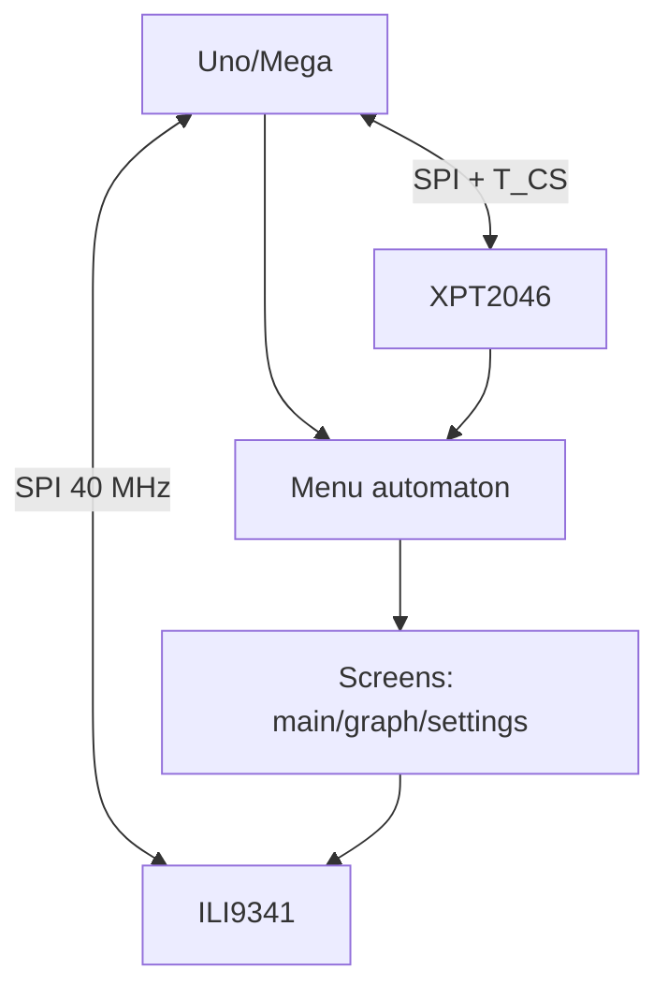

# Arduino TFT with Touch Deep - ILI9341, Calibration and Menu

![[assets/img/ard-tft-touch-deep-scheme.png|600]]
*Fig. TFT screen: display over SPI, touch with separate CS, menu as states, fonts in PROGMEM.*

> [!tip] What this note is about
> Deep TFT theme: not just output text, but menu with buttons, calibrated touch and life in 2 KB SRAM. Base: [[EN/11-Vivid/04-TFT-ST7735.en|TFT ST7735]], [[EN/04-Interfaces/02-SPI.en|Fast bus]].

## 1. Goal

Build a device with screen:

- ILI9341 320x240: init and speeds;
- Touch XPT2046: calibration with matrix;
- Auto menu: screens, buttons, return;
- Memory: frame buffer does not fit - draw in parts.

## 2. ILI9341 and touch

| Module | Resolution | Touch chip | Interface |
| --- | --- | --- | --- |
| ILI9341 | 320x240 | XPT2046 | SPI |

Calibration uses 4-point or 5-point matrix; store constants in EEPROM.

## 3. Library and init

Use Adafruit ILI9341 and Adafruit GFX; touch library XPT2046_TouchScreen.

## 4. Menu states

| State | Screen | Buttons |
| --- | --- | --- |
| Main | Title and options | Select |
| Settings | Sliders and values | Back |
| Info | Text and values | Back |

Draw only changed areas; full redraw is slow.

## 5. Memory optimization

Fonts stored in PROGMEM; buffers small; avoid large arrays.

## 6. Sketch fragment

```cpp
#include <Adafruit_GFX.h>
#include <Adafruit_ILI9341.h>
#include <XPT2046_Touchscreen.h>
// Init and draw menu
void setup() {}
void loop() {}
```

## 7. Calibration

Measure min/max X and Y; compute scale; save to EEPROM.

Tap each corner and record raw values; map raw range to 0-320 and 0-240.
Store four constants plus rotation flag; load them at boot before first draw.
Recalibrate after changing rotation or display driver; keep matrix and rotation together.

## 8. Wiring shield and module

| Pin | Shield | Module | Note |
| --- | --- | --- | --- |
| SCK | D13 | SCK | Shared SPI clock |
| MOSI | D11 | MOSI | Shared SPI data |
| MISO | D12 | MISO | Shared SPI read |
| TFT_CS | D10 | CS | Display select |
| T_CS | D8 | T_CS | Touch select, separate |
| DC | D9 | DC | Command or data |
| RST | D7 | RST | Reset line |
| VCC | 5V or 3V3 | By board | Follow module marking |
| GND | GND | GND | Common ground |

Keep SPI wires short; separate CS lines never share one pin.
Level shift 5 V boards before bare 3V3 modules; shields usually include it.

## 9. Working code (Arduino)

```cpp
#include <Adafruit_GFX.h>
#include <Adafruit_ILI9341.h>
#include <XPT2046_Touchscreen.h>
// Init and draw menu
void setup() {}
void loop() {}
```

Init display first, then touch; set rotation for both at once.
Draw static frame once; update only values and buttons on press.
Use `setTextColor` with background to avoid full clear; group draws per screen.

## 10. Working code (MicroPython)

Touch and display drivers exist for MicroPython boards; logic mirrors Arduino.
Keep menu automaton identical: states Main, Graph, Settings; events from touch queue.
Store calibration in non-volatile memory; load before first screen draw.
Draw budgets differ: prefer text and lines over bitmaps on small RAM.

## 11. Memory: living in 2 KB

SRAM ends fast: frame buffer 320x240x2 bytes never fits AVR RAM.
Draw in parts: header, values, buttons; no full-screen bitmap in RAM.
Fonts in PROGMEM; string literals with `F()` macro to keep RAM free.
Avoid large arrays; reuse one small line buffer for graphs.
SD bitmaps stream by chunks; close file after each draw.

## 12. Mermaid: display and touch link



## 8. Common issues

| # | Issue | Fix |
| --- | --- | --- |
| 1 | Touch inaccurate | Recalibrate |
| 2 | Menu slow | Draw partial |
| 3 | White screen | Check ILI9341 vs ILI9488 driver and init example |
| 4 | Touch mirrored | Apply calibration matrix together with rotation |
| 5 | 5V into bare module | Module lost - new one plus level shifter |
| 6 | Scroll lags | Redraw only changed areas, not full screen |
| 7 | SRAM exhausted | PROGMEM fonts, F() strings, small buffers |
| 8 | SPI conflict with SD | Separate CS lines, alternate access |

## 13. TFT quick cheat sheet

| Task | Action |
| --- | --- |
| Init | Begin SPI, reset, set rotation |
| Touch read | Poll XPT2046, map with matrix |
| Menu draw | Static frame once, values on change |
| Memory | PROGMEM fonts, chunked bitmaps |
| Bus share | TFT_CS, T_CS, SD_CS separate |

## Official sources

- [2.8 TFT Touch Shield (Adafruit)](https://www.adafruit.com/product/2090) - ILI9341 plus XPT2046, shield pins.
- [Language Reference (Arduino docs)](https://docs.arduino.cc/language-reference/) - SPI, PROGMEM, interrupts.
- [Ethernet Shield Rev2 (Arduino docs)](https://docs.arduino.cc/hardware/ethernet-shield-rev2/) - CS conflict example on shared bus.

## See also

- [[Home.en]]
- [[EN/11-Vivid/04-TFT-ST7735.en|TFT ST7735]]
