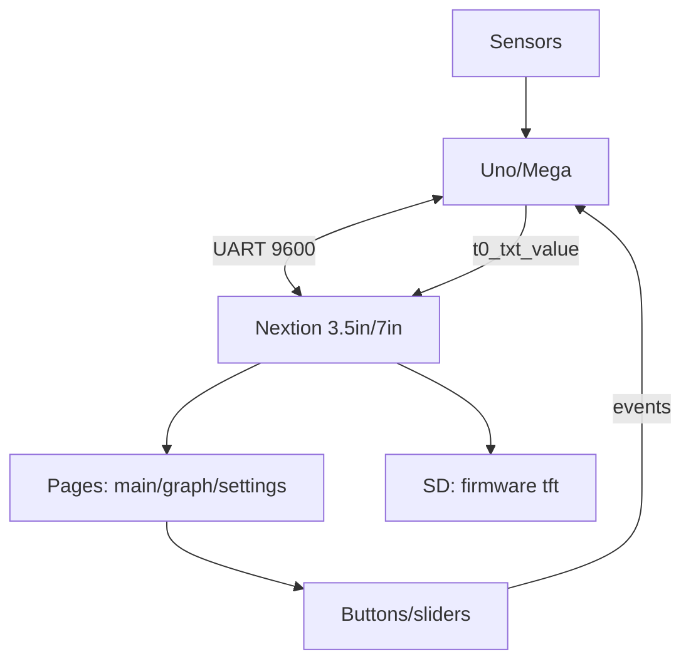

# Arduino Nextion HMI - Smart Display with Editor

![[assets/img/ard-nextion-hmi-scheme.png|600]]
*Fig. Smart display: interface lives in Nextion, Arduino sends data and catches presses - UART bridge.*

> [!tip] What this note is about
> Display-computer: draw interface with mouse in editor, Arduino only supplies data. Opposite of TFT where controller draws. Base: [[EN/11-Vivid/07-TFT-Touch-Deep.en|TFT with touch deep]], [[EN/04-Interfaces/01-UART.en|UART bus]].

## 1. Goal

Give interface to display:

- Nextion editor: pages, buttons, graphics, keyboards;
- Protocol: text commands to it, events back;
- Link with Arduino: data up, presses down;
- SD card on display: interface firmware.

## 2. Editor and pages

Pages are screens; components have IDs; commands set text and colors.

## 3. UART protocol

Arduino sends commands like `t0.txt="Hello"`; display sends touch events as `65 01 01 FF FF 01`.

## 4. Sketch fragment

```cpp
#include <SoftwareSerial.h>
SoftwareSerial nextSerial(10, 11);
void setup() { nextSerial.begin(9600); nextSerial.print("t0.txt=\"Hello\""); }
void loop() {}
```

## 5. Connection

UART at 9600; common ground; data to RX, from TX.

Power 3.5 inch from board rail is usually enough; 7 inch needs separate 5 V 2 A supply.
Keep UART wires short; cross TX to RX and RX to TX; share ground always.
SD slot on display takes interface firmware file; FAT32 card, file in root.

## 6. Editor: first project

Create page `page0` with title text `t0`, two buttons `b0` and `b1`, value field.
Each button press event sends a short code, e.g. `print "B0"` with three FF bytes.
Set baud in editor equal to port baud; upload compiled `.tft` via SD or UART.
Test pages in editor simulator before wiring to board.

## 7. Working code (Arduino)

Arduino sketch from section 4 extended with event parser and value push.
Read event bytes; on button code switch screens or toggle outputs.
Push sensor values with `t0.txt="23.5"` plus three 0xFF terminator bytes.
Throttle pushes to twice per second; display smooths the rest.

## 8. Working code (MicroPython)

Same protocol over UART object; commands as bytes with FF FF FF tail.
Parse incoming event frames in read loop; dispatch by button id.
Keep page ids mirrored with Arduino version for shared interface files.
Prefer 9600 baud on software ports; hardware UART allows higher rates.

## 9. Editor components

| Component | Use | Command |
| --- | --- | --- |
| Text t0 | Values | `t0.txt="23.5"` |
| Button b0 | Actions | Press event prints code |
| Slider h0 | Setpoints | Value event sends number |
| Page page0 | Screens | `page page1` to switch |
| Timer tm0 | Refresh | Periodic value request |

Terminate every command with three 0xFF bytes; no reply without them.

## 10. Mermaid: display link



## 6. Common issues

| # | Issue | Fix |
| --- | --- | --- |
| 1 | No response | Check baud and wiring |
| 2 | Wrong IDs | Match editor IDs |
| 3 | Silent after flash | Display baud must equal port baud |
| 4 | Garbage instead of text | Append three FF bytes to every command |
| 5 | SD flash fails | FAT32 card, firmware file in root |
| 6 | Buttons send nothing | Add print code in press event in editor |
| 7 | Backlight dies | Weak supply on 7 inch - separate 5V 2A unit |
| 8 | Slow response | Software serial at 115200 lags - use 9600 |

## 11. Nextion quick cheat sheet

| Task | Action |
| --- | --- |
| Set text | `t0.txt="Hi"` plus FF FF FF |
| Switch page | `page page1` plus terminator |
| Read press | Parse 65 ID page FF FF FF frame |
| Upload UI | SD FAT32 with.tft in root |
| Baud | Same number in editor and sketch |
| Slider | `h0.val=50` sets position, event returns number |
| Timer | `tm0.en=1` starts periodic refresh requests |

## 11.1 Baud and wiring rules

Keep Nextion at 9600 on software ports; hardware UART tolerates 115200.
Cross wires TX-RX, share ground, keep leads under thirty centimeters.
Power 7 inch screens from separate supply; board rail browns out on bright pages.
Confirm link with single `get t0.txt` command before loading full logic.
Log raw event bytes during first test; ID order in frame is page, component, event.

## 11.2 Page switch debounce

Guard page commands with 200 ms lockout; fast double taps duplicate events.
Echo current page id to monitor on every switch for test proof.
Default to main page on boot; unknown event ids return to main safely.
Store last page in variable; resend data values after each return.
Queue value pushes during switch; flush queue once new page acknowledges.

## Official sources

- [NX8048T070 Datasheet (Nextion)](https://nextion.tech/datasheets/nx8048t070/) - commands, components, power.
- [Language Reference (Arduino docs)](https://docs.arduino.cc/language-reference/) - SoftwareSerial, strings.
- [Ethernet Shield Rev2 (Arduino docs)](https://docs.arduino.cc/hardware/ethernet-shield-rev2/) - UART and SPI pin conflict example.

## See also

- [[Home.en]]
- [[EN/11-Vivid/07-TFT-Touch-Deep.en|TFT with touch deep]]
