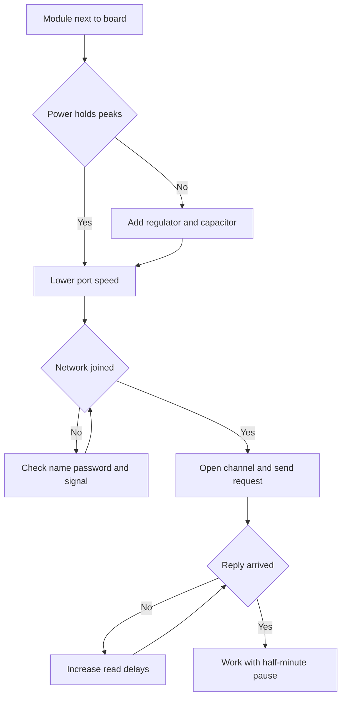

# ESP8266 WiFi Module - Serial AT Commands

![[assets/img/arduino-esp01-scheme.png|600]]
*Fig. ESP8266 module on board, UART link, 3.3 V power, WiFi antenna, AT commands.*

> [!tip] Purpose of this note
> Add WiFi to Arduino through ESP8266 module: connect UART, set baud, send AT commands, connect to network.

## 1. Purpose

ESP8266 is a WiFi chip with UART interface; AT commands control it.

Used for IoT, remote control, data upload.

## 2. Module characteristics

| Parameter | Value | Note |
| --- | --- | --- |
| Chip | ESP8266 | 2.4 GHz WiFi |
| Interface | UART | TX/RX |
| Power | 3.3 V | 5 V through level shifter if needed |
| Baud | 115200 default | Can change |

## 3. Connection

| ESP8266 | Board |
| --- | --- |
| VCC | 3.3 V |
| GND | GND |
| TX | RX (with divider if 5 V) |
| RX | TX (with divider if 5 V) |
| CH_PD/EN | 3.3 V via resistor |
| GPIO0 | Free or button for flash |

Use voltage divider on RX from board to module to protect 3.3 V input.
Feed from separate regulator with capacitor near pins; board 3V3 rail sags on peaks.
Pull enable high through resistor; floating enable gives random boots.

## 3.1 Power holds peaks

Transmit bursts draw hundreds of milliamps; thin rails dip and reboot the chip.
Place 470 uF capacitor at module pins plus ceramic 100 nF for spikes.
Short thick power wires; measure 3.2-3.4 V during `AT+CWJAP` join.
USB-powered boards alone often fail; add dedicated 3.3 V regulator with margin.
Watch monitor for `ets Jan` boot garbage: sign of brownout, not baud fault.

## 4. AT commands

| Command | Function |
| --- | --- |
| AT | Check |
| AT+CWMODE=1 | Station mode |
| AT+CWJAP="SSID","PASS" | Connect to AP |
| AT+CIFSR | Get IP |
| AT+CIPSTART | Open TCP channel |
| AT+CIPSEND | Send data length |
| AT+CIPCLOSE | Close channel |
| AT+RST | Reboot module |

Lower port speed with `AT+UART_DEF` before software-port work.
Test each command in monitor with Both NL and CR; missing line end stays silent.
Join network first, then open channel; reversed order always fails.

## 5. Sketch fragment

```cpp
#include <SoftwareSerial.h>
SoftwareSerial esp(10, 11);
void setup() { esp.begin(115200); esp.println("AT"); }
void loop() {}
```

Bridge sketch forwards monitor lines to module and prints replies back.
Read replies with time margin; tail bytes arrive late on slow ports.
Send one command per two seconds during tests; floods lock the parser.
Log full reply text before judging failure; `ERROR` often means order fault.

## 5.1 WiFi client sketch

Join AP, open TCP to server port 80, send GET path, print reply, close channel.
Pause thirty seconds between requests; servers cut frequent reconnects.
Check `+IPD` frames for payload; length prefix tells bytes to read.
On `busy` reply wait five seconds and resend; parallel commands collide.
Keep SSID and password in defines at top; no secrets in log prints.

## 6. When to take a separate chip instead of modem

Modem suits one sensor upload per minute; heavy logic stays on board.
Need TLS, JSON parse, or fast loop: move to ESP board as main controller.
Two software ports never listen together; modem plus GPS needs bigger board.
Prototype on modem, product on native ESP firmware for power and speed.

## Mermaid: modem startup



## 6. Common issues

| # | Issue | Fix |
| --- | --- | --- |
| 1 | No response | Check baud, power 3.3 V |
| 2 | No WiFi | Check SSID and password |
| 3 | Garbage | Match baud rate |
| 4 | Reboots on join | Separate regulator with margin and capacitor at pins |
| 5 | 5V into RX | Divider of two resistors between board and module RX |
| 6 | Floating enable | Pull enable to supply via resistor |
| 7 | High speed on software port | Lower speed and work low |
| 8 | Truncated replies | Read with time margin, print all to monitor |

## 7. ESP-01 quick cheat sheet

| Task | Action |
| --- | --- |
| Check link | `AT` expects `OK` |
| Join AP | `AT+CWJAP` with quoted pair |
| Get IP | `AT+CIFSR` after join |
| Send | `AT+CIPSTART`, `AT+CIPSEND`, close |
| Slow port | `AT+UART_DEF=9600` first |

## Official sources

- [SoftwareSerial reference on arduino.cc](https://www.arduino.cc/en/Reference/SoftwareSerial) - software port, speeds, receive limits and exchange example.
- [Serial reference on arduino.cc](https://www.arduino.cc/en/Reference/Serial) - hardware port, monitor, speeds and line reading.
- [ESP-AT command set on docs.espressif.com](https://docs.espressif.com/projects/esp-at/en/latest/esp32/AT_Command_Set/index.html) - link check, join, channel open and data send.

## See also

- [[Home.en]]
- [[EN/04-Interfaces/01-UART.en|UART bus]]
