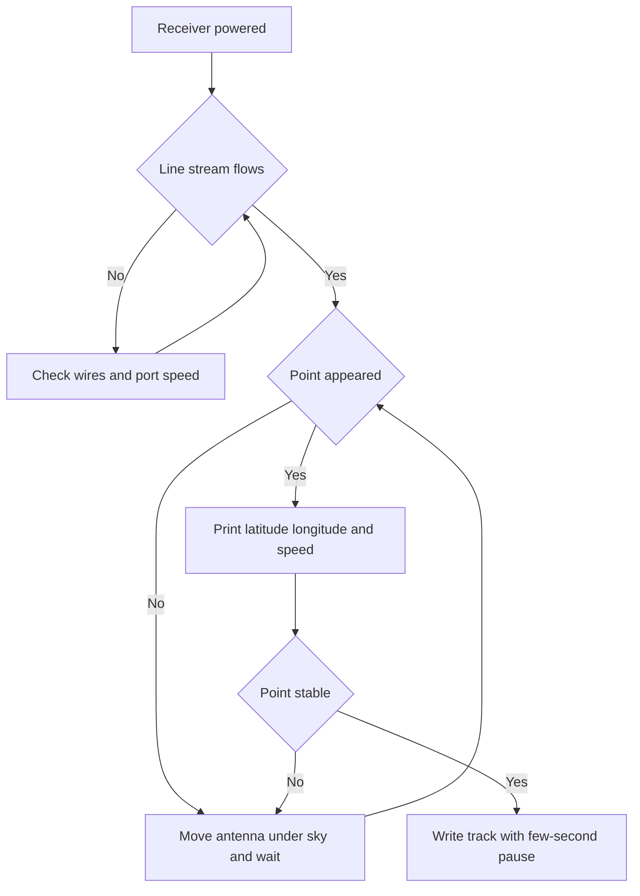

# GPS NEO-6M - Position from UART

![[assets/img/arduino-gps-scheme.png|600]]
*Fig. GPS module with antenna, UART to board, 3.3 or 5 V, NMEA sentences.*

> [!tip] Purpose of this note
> Get position from satellite: connect UART, read NMEA sentences, extract latitude and longitude.

## 1. Purpose

GPS module gives time, position, speed over UART; used for trackers, navigation.

## 2. Characteristics

| Parameter | Value | Note |
| --- | --- | --- |
| Chip | NEO-6M | 50 channels |
| Interface | UART | 9600 baud |
| Power | 3.3-5 V | Most modules accept 5 V |
| Antenna | External active | Place outdoors for fix |

## 3. Connection

| GPS | Board |
| --- | --- |
| VCC | 5 V or 3.3 V |
| GND | GND |
| TX | RX |
| RX | TX (optional for config) |

Cross TX to RX and RX to TX; common ground always.
Read VCC marking near comb; some carriers want 5 V, bare boards 3.3 V.
Keep antenna cable away from USB noise; route over clear area.

## 3.1 Sentences at 9600

`$GPGGA` carries fix flag, satellites, altitude; `$GPRMC` carries position and time.
`$GPGSV` lists visible satellites; use it to judge sky view indoors.
Set both sides to 9600 first; alien speed gives garbage, not empty stream.
Count sentences per ten seconds; zero means wiring fault, garbage means speed fault.
Parse only with valid flag `A`; `V` frames are stale repeats.

## 3.2 Antenna sees the sky

Patch faces up; metal roof, foil, or hand above kills fix entirely.
Balcony or yard gives first fix in 30-60 s warm, up to 12 min cold.
Fix LED blinks without fix and steadies with fix; watch it before code.
Keep antenna three meters from WiFi router; desense delays fix.
Log fix flag with each point; track without flag drifts hundreds of meters.

## 3.3 Cold and warm start

Cold start downloads almanac; needs open sky and minutes of patience.
Warm start reuses stored orbit; fix returns in seconds near last place.
Battery backup pin keeps clock alive; connect it for fast restarts.
Moving fast during first fix stretches time; stand still for first lock.
Record first fix time in log to prove start type on field tests.

## 4. NMEA sentences

$GPGGA gives fix, $GPRMC gives position and time.

Feed parser every loop iteration; long `delay()` drops characters.
Print raw stream to monitor first; parser second only after stream flows.
Convert `ddmm.mmmm` to decimal degrees before map upload.
Check freshness flag before logging; stale point poisons the track.

## 4.1 Parser library

TinyGPSPlus reads stream and exposes location, speed, time fields.
Call `encode()` per received byte; check `location.isValid()` before use.
`hdop` below 2 means good fix; above 5 means wander, wait longer.
Speed in knots convert to km/h; date arrives with `RMC` sentence.
Example prints latitude, longitude, satellites, and age of fix.

## 4.2 Second pulse

PPS pin ticks each second on fix; scope shows 100 ms pulse train.
Use it to discipline clock or timestamp radio packets precisely.
No ticks without fix; pin floats during search, do not gate logic on it.
Wire to interrupt pin for lowest jitter; poll loop adds milliseconds.

## 5. Sketch fragment

```cpp
#include <SoftwareSerial.h>
SoftwareSerial gps(10, 11);
void setup() { gps.begin(9600); Serial.begin(9600); }
void loop() { while (gps.available()) Serial.write(gps.read()); }
```

Tracker sketch adds parser, freshness check, and three-second log pause.
Print `lat,lon,speed,sats` CSV line; skip lines with invalid flag.
Throttle SD writes to every third second; card wears on per-second flush.

## Mermaid: from power to point



## 6. Common issues

| # | Issue | Fix |
| --- | --- | --- |
| 1 | No fix | Place antenna outside, wait 30-60 s |
| 2 | No data | Check baud 9600 |
| 3 | Test deep indoors | Roof blocks sky - antenna to balcony patch up |
| 4 | TX and RX swapped | Receiver TX to board RX and back |
| 5 | Alien port speed | Low speed both sides per marking |
| 6 | Long delays in loop | Feed parser without pauses, print on timer |
| 7 | Stale point logged | Check freshness flag before each write |
| 8 | 5V into 3V3 carrier | Read comb marking and measure before start |

## 7. GPS quick cheat sheet

| Task | Action |
| --- | --- |
| Stream | 9600 both sides, cross wires |
| Fix | Patch up, wait, watch LED |
| Parse | Encode per byte, valid flag first |
| Log | Fresh CSV every 3 s |
| PPS | Interrupt pin, only on fix |

## Official sources

- [TinyGPSPlus library on docs.arduino.cc](https://docs.arduino.cc/libraries/tinygpsplus/) - install, tracker example, place speed and time fields.
- [SoftwareSerial reference on arduino.cc](https://www.arduino.cc/en/Reference/SoftwareSerial) - software port, speeds, receive limits and exchange example.
- [Serial reference on arduino.cc](https://www.arduino.cc/en/Reference/Serial) - hardware port, monitor, float printing and line reading.

## See also

- [[Home.en]]
- [[EN/04-Interfaces/01-UART.en|UART bus]]
