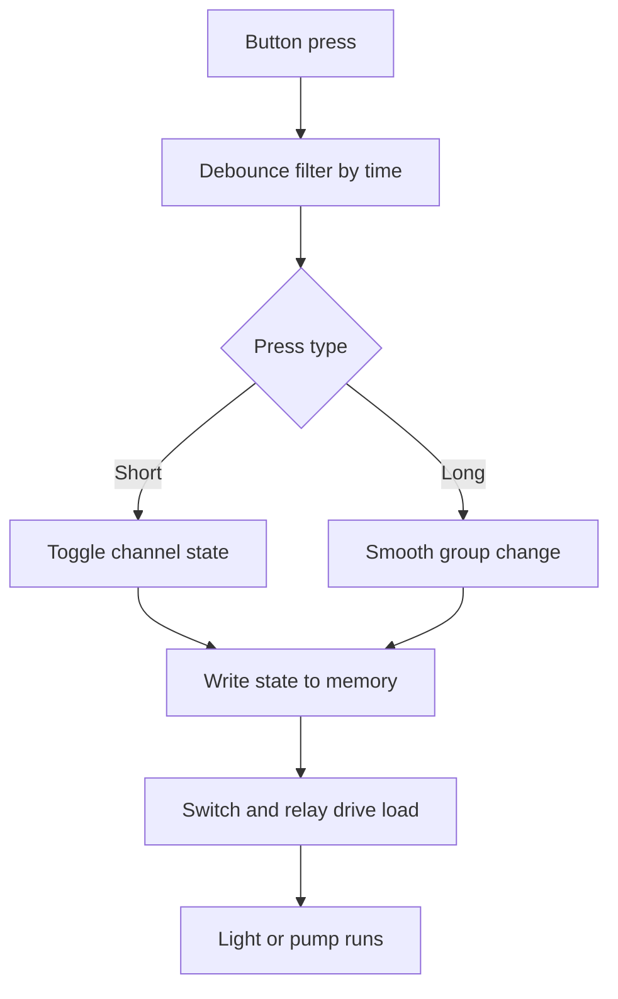

# Smart Home - Automation and Sensors

![[assets/img/arduino-smart-scheme.png|600]]
*Fig. Smart home: sensors, board, relays, network link, display.*

> [!tip] Purpose
> Build automation: temperature control, lighting, security with remote access.

## 1. Goal

Control devices from board; read environment; send alerts.

## 2. Components

| Component | Function | Interface |
| --- | --- | --- |
| DHT | Temperature | Digital |
| Relay | Load switch | Digital |
| WiFi | Remote | UART/ESP |
| PIR | Motion | Digital |
| LDR | Light | Analog |
| Button | Manual override | Digital with pull-up |

## 2.1 Relay through transistor

Pin never drives coil directly; coil current burns the output.
NPN or MOSFET switch with flyback diode across coil absorbs kickback.
Separate relay supply with common ground; board rail stays clean.
Pick relay module per load: 10 A resistive, derate inductive motors.
Test click without load first; chatter means weak coil supply.

## 2.2 Relay modules by load

Light bulbs suit mechanical relays; LED strips suit MOSFET outputs.
Mains loads need enclosed modules with screw terminals and fuse.
Snubber across contacts extends life on pumps and fans.
Label each channel with load name and fuse rating inside lid.

## 3. Sketch fragment

```cpp
void setup() {}
void loop() {}
```

Two-channel sketch: buttons poll on timer, states store to memory, relays follow.
Debounce window 30 ms of stable level; short press toggles, long press dims group.
Write memory only on state change; per-cycle writes wear cells early.
Init outputs to safe off before enabling drivers; loads must not jerk at boot.

## 3.1 Buttons without bounce

Poll every 5 ms; accept level stable for six consecutive reads.
One press gives one toggle; burst without filter gives many.
Single button serves many actions: short, double, long press map.
Manual buttons duplicate every automation channel for outage survival.

## 3.2 Memory keeps states

Store channel states after each change; restore on boot before outputs enable.
EEPROM has limited rewrites; RAM mirror with lazy write protects cells.
Keep version byte in first cell; format change migrates without garbage.
Log state changes to serial for commissioning proof.

## 4. Common issues

| # | Issue | Fix |
| --- | --- | --- |
| 1 | Relay not switching | Check power |
| 2 | No remote | Check WiFi settings |
| 3 | Coil from pin | Switch through transistor key |
| 4 | No diode on coil | Diode reverse across coil |
| 5 | One press many toggles | Time debounce window |
| 6 | Memory wears early | Write only on state change |
| 7 | Loads jerk at boot | Init outputs to safe state first |
| 8 | Dead house on crash | Every channel duplicated by button |

## 5. Sensor tables

| Sensor | Function | Interface |
| --- | --- | --- |
| DHT22 | Temperature, humidity | Digital |
| LDR | Light | Analog |
| PIR | Motion | Digital |

## 6. Automation logic

If temperature > 25 C, turn on fan; if light low, turn on LED.

Scenes combine sensors: evening plus motion gives hallway light for five minutes.
Hysteresis stops relay chatter: on at 25 C, off at 23 C.
Night mode caps brightness; day mode allows full power.
Log every automation trigger with sensor values for tuning.

## 6.1 Mermaid: from button to relay



## 7. Power

Use 5 V supply; relays take separate 5-12 V if needed.

Star ground from supply to board and relay bank.
Mains side fused per channel; low side shares one return.
Measure coil drop during all-on test; sag means weak supply.

## 7.1 Mains safety in short

Enclose mains terminals; no exposed screws outside box.
Fuse line side; neutral never switched alone.
Keep low and mains wires in separate ducts inside enclosure.
Test insulation with power off before first mains connection.

## 8. Security

Door sensor triggers alarm; send notification through WiFi.

Notify via MQTT topic plus local buzzer; network alone is not enough.
Arm modes: home, away, night; PIR zones map per mode.
Battery backup keeps sensors alive through outages.

## Official sources

- [Language reference on arduino.cc](https://www.arduino.cc/reference/en/) - digital outputs, input pull-ups and timing functions.
- [EEPROM guide on docs.arduino.cc](https://docs.arduino.cc/learn/built-in-libraries/eeprom/) - state write rules and rewrite limits.
- [PubSubClient message client](https://github.com/knolleary/pubsubclient) - relay commands over network above buttons.

## See also

- [[Home.en]]

## 5. Sensor tables

| Sensor | Function | Interface |
| --- | --- | --- |
| DHT22 | Temperature, humidity | Digital |
| LDR | Light | Analog |
| PIR | Motion | Digital |

## 6. Automation logic

If temperature > 25 C, turn on fan; if light low, turn on LED.

## 7. Power

Use 5 V supply; relays take separate 5-12 V if needed.

## 8. Security

Door sensor triggers alarm; send notification through WiFi.
