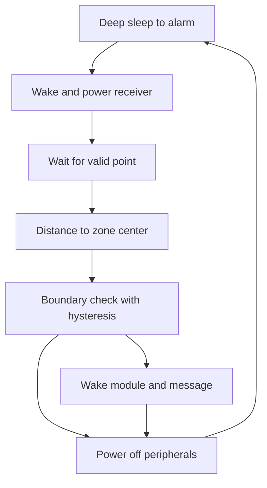

# Tracker - GPS and Data Logger

![[assets/img/arduino-tracker-scheme.png|600]]
*Fig. Tracker: GPS module, board, SD card, battery, display with position.*

> [!tip] Purpose
> Log position over time; show current speed and direction.

## 1. Goal

Get GPS fix; save to SD; show on display.

## 2. Components

| Component | Function | Note |
| --- | --- | --- |
| GPS NEO | Position | UART 9600, patch up |
| SD module | Storage | SPI, short bus |
| Display | LCD/OLED | Current and graph |
| Cellular SIM800 | Messages | 2 A peak supply |
| Battery Li-ion | Power | Charger module |
| RTC | Timestamps | Battery backup |

## 2.1 Tracker kit: what to buy

Board with two hardware ports preferred; one software port cannot hear two modules at once.
GPS receiver with active patch; cellular module with antenna and SIM holder.
SD module with level shifting; RTC DS3231 for marks independent of GPS.
DC-DC converter with 2 A peak for transmit bursts; thick short power wires.
Plastic enclosure with sky window; metal lid kills satellites entirely.

## 3. Sketch fragment

```cpp
#include <SoftwareSerial.h>
void setup() {}
void loop() {}
```

Full tracker sketch: point, zone, message in one loop with sleep between fixes.
Listen to GPS and cellular in turns; simultaneous software receive loses bytes.
Wait for validity flag before logging; raw points without flag lie by hundreds of meters.
Compute distance to zone center; outside radius with hysteresis triggers message.

## 3.1 Coordinate receiver: reading place

Parse `RMC` for latitude, longitude, speed, and time in one pass.
Feed parser without pauses; long delays drop characters and silence decode.
Hold last good point separate from fresh read; log only fresh with flag.
Stand still for first fix; moving start stretches lock to minutes.

## 3.2 Cellular channel: motion messages

Wake modem only on zone event; idle modem eats battery in hours.
Send compact text with time, lat, lon, speed; server parses same CSV.
Confirm send reply before sleeping; missing reply means retry once, then log locally.
Keep SIM PIN disabled; PIN prompt blocks unattended wake.

## 4. Common issues

| # | Issue | Fix |
| --- | --- | --- |
| 1 | No fix | Place antenna outside |
| 2 | No save | Check SD format |
| 3 | Board-fed modem reboots | Separate converter with 2 A peak |
| 4 | Raw point lies | Wait for validity flag before write |
| 5 | Two modules one soft port | Listen in turns or take dual-port board |
| 6 | Zone edge spam | Outer radius larger than inner |
| 7 | Thin wires sag | Short thick wires plus capacitor at module |
| 8 | Antenna under metal | Antenna up, only plastic above |

## 5. Logging format

CSV: time, lat, lon, speed, status.

Example: `12:00:00,48.45,35.02,12.5,VALID` imports directly to maps.
Log zone events in second file `EVENTS.CSV` with enter and exit marks.
Keep header single at top; repeated headers break chart imports.

## 5.1 Power: two-ampere peaks

Transmit burst sags thin rails; board and modem reboot together.
Capacitor 1000 uF at modem pins bridges millisecond peaks.
Measure rail during send; below 3.6 V means wires too thin.
Sleep modem between points; weeks of autonomy replace hours.

## 5.2 Sleep between points: weeks of autonomy

Deep sleep to clock alarm; wake receiver, fix, log, message, sleep.
Fix timeout caps at three minutes; longer search wastes battery.
Log sleep and wake times to prove duty cycle in field review.
Cut peripheral power with switch, not pin leakage, for true sleep.

## 6. Battery

Use Li-ion with charger module; low voltage alarm stops logging.

TP4056 charges single cell; protect against deep discharge with monitor.
Log battery voltage with each point; discharge curve predicts service date.
Cold halves capacity; insulate battery bay in winter tests.

## 6.1 Geofences: exit as event

Center plus radius defines zone; distance computed per fresh point.
Hysteresis pair avoids edge chatter: exit at 110 m, re-enter at 90 m.
Debounce three consecutive outsides before message; single jump is noise.
Store zones in memory; survive reboot without reconfiguration.

## 6.2 Tracker life-cycle mermaid



## 7. Display modes

Current, history graph, alarm.

Current shows speed big, coordinates small; graph plots last hour track.
Alarm screen flashes zone name on exit event with buzzer beep.
Throttle redraw to twice per second; GPS updates at 1 Hz anyway.

## 8. Antenna

Place GPS antenna outside; shield board from interference.

Patch up with clear sky view; balcony rail minimum for tests.
Cellular antenna vertical away from GPS patch to avoid desense.
Route antenna cables away from switching converter noise.

## 8.1 Enclosure and mounting

Antenna sees sky through plastic window; board stays dry below.
Vibration mount with foam; connectors lock with hot glue drops.
Label power switch and status LED outside for field checks.

## Official sources

- [Language reference on arduino.cc](https://www.arduino.cc/reference/en/) - serial ports, sleep, string and power work.
- [SoftwareSerial guide on docs.arduino.cc](https://docs.arduino.cc/learn/built-in-libraries/software-serial/) - simultaneous receive limits and speed choice.
- [SIM800 cellular module commands (SIMCom)](https://www.simcom.com/product/sim800c/) - sleep modes, messages and power demands.

## See also

- [[Home.en]]
- [[EN/12-Comm-Modules/04-GPS-NEO.en|GPS position]]
